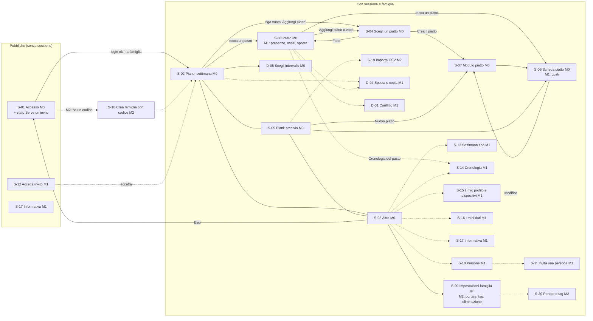

# Esperienza utente: Menu Design

> Documento di proprietà dell'ux-designer. Aggiornato il 2026-10-19 (CHG-020). **Stato: APPROVATO con il gate G3** (2026-10-19).
>
> Fonti: `docs/01-vision.md` (rev. 7), `docs/02-requirements.md` (v2 con CHG-001..020, approvato G2) e `docs/04-architecture.md` (v6) e gli ADR-0001, ADR-0008, ADR-0009, ADR-0010.
>
> **Metodo di accesso:** nell'MVP l'unico metodo è Google. Il login con email e password (US-029, FR-002) è nel backlog dopo M2 (CHG-020, Q-031). I contenuti già progettati restano nel documento, marcati `[rinviato]`, per quando verranno ripresi.
>
> Come leggere il documento:
> - ogni schermata ha un ID `S-NN`, la milestone (M0, M1, M2) e le user story (US) e i requisiti (FR) che realizza;
> - dove una schermata cresce nel tempo, le parti di una milestone successiva sono marcate `[M1]` o `[M2]`;
> - i testi dell'interfaccia sono dati come **chiave i18n + testo italiano** (ADR-0010). Il codice usa solo la chiave;
> - le domande per l'utente sono `Q-NNN`, numerate dopo Q-022 (ultima dei requisiti). Nessun requisito è stato inventato: ciò che il documento propone in più è dichiarato come tale.

## 0. Decisioni di design (DD)

Scelte trasversali che riducono passaggi e schermate. Il resto del documento le applica.

| ID | Decisione | Motivo |
|---|---|---|
| DD-01 | **Salvataggio immediato per ogni azione** sul pasto (aggiungi, togli, riordina, voce libera, stato speciale). Niente pulsante "Salva" nel pasto. Dopo l'azione compare un avviso con "Annulla". | NFR-012a (≤ 3 interazioni per assegnare un piatto) e KPI-2 (≤ 10 minuti). Un'azione = una scrittura con `If-Match` (ADR-0008). Le scritture sulla stessa unità vanno **in coda una alla volta** nel client, per non generare conflitti con se stessi. |
| DD-02 | Il **selettore dei piatti resta aperto** dopo ogni scelta e ha un contatore "Aggiunti: N" e un pulsante "Fatto". Le righe sono pulsanti a due stati (aggiunto / non aggiunto). | Un pasto ha spesso 2-3 piatti. Assegnare il primo costa 2 interazioni (apri il pasto, tocca il piatto), ogni altro piatto 1. |
| DD-03 | **Nessuna funzione solo con trascinamento** (WCAG 2.5.7). Il riordino usa "Sposta su / Sposta giù". | Accessibilità, touch. |
| DD-04 | I comandi che un ruolo **non potrà mai usare** sono **nascosti**. I comandi bloccati da uno **stato temporaneo** (offline, famiglia in sola lettura) restano visibili con `aria-disabled` e una spiegazione nel banner. | Meno rumore per il Membro. Chi è in uno stato temporaneo deve capire perché non può agire. Il server resta comunque l'unica autorità sui permessi (NFR-015). |
| DD-05 | **Pagine a tutto schermo su telefono, finestre di dialogo da 768 px.** Pasto, selettore, moduli sono rotte con URL, così il tasto "indietro" funziona. | Mobile-first, un solo insieme di componenti. |
| DD-06 | Navigazione con **barra in basso a 3 voci** (Piano, Piatti, Altro). Persone, impostazioni, cronologia, settimana tipo, dispositivi, i miei dati e informativa stanno sotto "Altro". | Poche schermate principali, raggiungibili col pollice. |
| DD-07 | Il **nome della famiglia** nella pagina di invito si mostra solo **dopo il login**, non prima. Prima si vede solo "Hai ricevuto un invito". | Un link intercettato non rivela il nome della famiglia (SR-004, SR-007). Da far verificare al security-engineer. |
| DD-08 | **Solo tema chiaro** nell'MVP. Nessun tema scuro. | Proporzione: un solo set di colori da verificare. Si può aggiungere dopo senza cambiare i componenti, perché si usano variabili CSS. |
| DD-09 | Le **descrizioni della cronologia si compongono nel client** da tipo di evento e valori (ID risolti in nomi alla lettura). Non esiste testo salvato nel database. | SR-047, ADR-0012: nessun nome nelle righe degli eventi. Serve una chiave i18n per ogni tipo di evento. |
| DD-10 | Libreria dei componenti: **React Aria Components** (già in `docs/04-architecture.md`) con stile proprio in CSS e variabili CSS. Nessun'altra libreria grafica. Font di sistema. | Accessibilità di base già risolta (tastiera, focus, ruoli ARIA), bundle contenuto (NFR-001), nessun font esterno (SR-031). |

## 1. Personas

Le persone derivano dagli utenti della visione (rev. 4). Non sono state aggiunte persone nuove. I nomi sono segnaposto per ricordare il ruolo.

### P1 · Chi pianifica (genitore che pianifica) · Pianificatore, spesso anche Amministratore

- **Chi è:** il genitore che oggi pianifica su carta. In M0 coincide con l'utente/Gestore, unica persona dell'app.
- **Obiettivi:** avere il piano della settimana pronto in pochi minuti (KPI-2 ≤ 10), variare i piatti, ritrovare la ricetta, sapere per quante persone cucinare.
- **Frustrazioni** (visione, "Problema"): sempre gli stessi piatti, idee "da provare" dimenticate, ricette sparse tra libri, siti e reel, presenze incerte.
- **Contesto d'uso:** telefono, spesso la sera sul divano o in cucina, una mano sola. Rete mobile non sempre ottima. Sessioni da 5-10 minuti.
- **Cosa gli serve dall'interfaccia:** pochi tocchi per pasto, la memoria dei piatti ("cucinato N giorni fa", "da provare") nel momento della scelta, correggere il passato senza fatica, partire dalla settimana precedente (M1).
- **Storie principali:** US-003..011 (M0), US-025/026/027 (M1), US-012/014/017 (M1, se Amministratore).

### P2 · Partner (altro adulto della famiglia) · Membro o Pianificatore

- **Chi è:** il secondo adulto. Può pianificare anche lui (ASM-001: 1-2 Pianificatori) oppure solo consultare.
- **Obiettivi:** sapere cosa si mangia, segnare "giovedì sera non ci sono" in pochi secondi, aggiungere l'idea vista in un reel, dire cosa gli piace, avvisare che vengono i nonni.
- **Frustrazioni:** chiedere in giro cosa c'è per cena, dover aprire schermate complicate per un'assenza.
- **Contesto:** telefono, apertura veloce di 20-30 secondi più volte a settimana. Spesso mentre fa altro.
- **Cosa gli serve:** la settimana subito all'apertura, l'assenza a 2 tocchi dal piano, i gusti con 3 scelte semplici.
- **Storie principali:** US-024, US-021, US-022, US-018, US-019, US-020, US-045.

### P3 · Adolescente (dai 14 anni) · qualunque ruolo, di norma Membro

- **Chi è:** figlio o figlia con account Google proprio (Q-012: può avere anche altri ruoli). I minori di 14 anni **non** sono utenti dell'app: hanno un profilo senza account gestito da un adulto.
- **Obiettivi:** vedere cosa c'è per cena, segnare quando non c'è, dire cosa non gli piace.
- **Frustrazioni:** moduli lunghi, testi legali incomprensibili, app da "genitori".
- **Contesto:** telefono, uso rapido e saltuario. Legge l'informativa privacy solo se è breve e chiara. Deve poter dichiarare l'età e capire cosa succede ai suoi dati (FR-068, SR-030).
- **Cosa gli serve:** linguaggio semplice e diretto, passaggi minimi all'accettazione dell'invito, controllo visibile delle proprie sessioni e del proprio nome.
- **Storie principali:** US-013, US-046 (all'ingresso), US-021, US-018, US-045, US-047.

### P4 · Gestore della piattaforma · **solo console**, nessuna schermata

- **Chi è:** il proprietario del prodotto (l'utente). Agisce con comandi da console (ADR-0011) e non legge i contenuti delle famiglie.
- **Impatto sulla UX:** nessuna interfaccia di amministrazione. L'app deve però dare alle persone **un modo chiaro di rivolgersi a lui**: il contatto privacy (esportazione dati in beta, recupero dell'Amministratore, richieste sui diritti) è mostrato nell'informativa e nelle schermate S-16 e S-10. La risposta del Gestore ricompare nell'app come file scaricabile (S-16) o come cambio di ruolo.
- **Storie:** US-002, US-036 (emissione), US-042, US-044, US-049: tutta la parte da console è fuori da questo documento.

### Persona rappresentata (non utente): profilo senza account

Un minore di 14 anni è una "persona della famiglia" con presenze e gusti, gestita da Amministratore o Pianificatore. Non vede nessuna schermata. L'interfaccia deve rendere chiaro **chi sta agendo per chi** (esempio: "Settimana tipo di Giulia", "Gusto di Giulia") ed evitare di confondere i gusti propri con quelli di un profilo.

## 2. User journey

Per ogni percorso: passi, interazioni (tocchi, digitazione esclusa) e storie coperte. Le interazioni contate servono come criterio di accettazione di NFR-012.

### J1 · Pianificare la settimana · P1 · **M0** · US-003, US-008, US-009, US-010, US-004

Obiettivo: 14 pasti (7 giorni x Pranzo e Cena) in ≤ 10 minuti, cioè circa 40 secondi per pasto.

| # | Passo | Schermata | Interazioni |
|---|---|---|---|
| 1 | Apre l'app: atterra sulla settimana corrente. Vai alla settimana successiva. | S-02 | 0 + 1 |
| 2 | Tocca "Aggiungi piatto" sul Pranzo di lunedì. | S-02 → S-03 → S-04 | 1 (la riga vuota del pasto apre direttamente il selettore) |
| 3 | Nel selettore tocca "Da provare" oppure scrive qualche lettera, poi tocca il piatto. Il pasto ha già il piatto. | S-04 | 1 (+ filtro 1) |
| 4 | Se il piatto ha più portate, sceglie come servirlo. | S-04 | 1 solo in questo caso |
| 5 | Vuole un secondo piatto: tocca un altro piatto, il selettore è ancora aperto. | S-04 | 1 |
| 6 | Tocca "Fatto" e torna alla settimana. | S-04 → S-02 | 1 |
| 7 | Ripete per gli altri pasti. | | 3 per pasto con un piatto |
| 8 | Per "avanzi di ieri": scrive il testo nel selettore e tocca "Aggiungi «…» come voce libera". | S-04 | 1 + digitazione |
| 9 | Per la cena fuori: tocca il pasto, sceglie "Ristorante". | S-03 | 2 |
| 10 | Un piatto nuovo che non c'è in archivio: scrive il nome nel selettore e tocca "Crea il piatto «…»". Si apre il modulo con il nome già inserito. | S-04 → S-07 | 1 + modulo |

Esito: assegnare un piatto già in archivio = **2 interazioni** dal piano (apri il selettore, tocca il piatto), **3** con la scelta della portata (NFR-012a ≤ 3). Tre tocchi per pasto x 14 = circa 42 tocchi, più la ricerca: compatibile con 10 minuti.

Errori e deviazioni: conflitto (J6), rete assente al salvataggio (stato "non salvato", vedi sezione 6), limite di 10 voci per pasto.

### J2 · Correggere un pasto passato · P1 · **M0** (contenuto) · US-011, US-010

1. Dalla settimana, torna a quella precedente con "‹" (1) oppure è già nella settimana corrente e il pasto è di ieri.
2. Tocca il pasto (1). Compare l'avviso "Stai correggendo un pasto passato".
3. Su un piatto tocca "⋯" → "Segna come non cucinato" (2), oppure "Togli" e aggiunge un altro piatto dal selettore.
4. L'etichetta del piatto diventa "Non cucinato" e "cucinato N giorni fa" torna al pasto precedente (AC-011.1, AC-010.5).
5. In M1 la correzione compare nella cronologia (S-14).

Nessun limite di tempo (AC-011.5). Il Membro (M1) vede il pasto in sola lettura, ma corregge la propria presenza e gli ospiti (J4).

### J3 · Aggiungere un piatto con la fonte della ricetta · P1 (e P2 come "da provare", M1) · **M0** · US-004, US-009, US-019

1. Piatti → "Nuovo piatto" (2), oppure dal selettore "Crea il piatto «…»" (nome già compilato).
2. Compila nome e almeno una portata. Stato predefinito "Da provare" (modificabile da Pianificatore e Amministratore).
3. "Aggiungi una fonte": tipo Link, incolla l'indirizzo. Può aggiungerne fino a 10.
4. "Salva". Torna alla scheda, o al selettore se arrivava da lì, con il piatto già aggiunto al pasto.

Variante "salva voce libera in archivio" (AC-009.2): nel pasto, sulla voce libera "Salva tra i piatti" → modulo con il testo come nome, portata obbligatoria, stato "Da provare" preselezionato → "Salva": la voce diventa il piatto.

### J4 · Segnare un'assenza e gli ospiti · P2, P3 · **M1** · US-021, US-022, US-023

1. Il Membro apre l'app e vede la settimana (J8).
2. Tocca la Cena di giovedì (1). Nella sezione "Chi c'è" la propria riga ha un interruttore.
3. Tocca l'interruttore "Tu: Presente" → diventa "Assente" (2). I coperti scendono di uno. Compare "Segnato: assente a cena" con "Annulla".
4. Se vengono i nonni: nella sezione "Ospiti" tocca "+" due volte (4) e scrive "nonni" nella nota.

Stesso percorso per correggere un pasto passato (AC-021.6, AC-022.5). Chi non era ancora nella famiglia a quella data non può segnarsi (AC-021.8): il comando non compare e si legge la spiegazione.

### J5 · Accettare un invito · P3 (e chiunque sia invitato) · **M1** · US-012, US-013, US-046

1. L'Amministratore (J10) crea il link e lo invia su WhatsApp. L'anteprima di WhatsApp non consuma l'invito (AC-013.7).
2. La persona apre il link (S-12, passo 1): "Hai ricevuto un invito". Tocca "Continua con Google".
3. Dopo il login (passo 2): vede il nome della famiglia e il ruolo (DD-07). Spunta "Ho almeno 14 anni" e "Ho letto l'informativa" (il testo breve è sulla stessa pagina, con link alla versione intera).
4. Tocca "Entra nella famiglia". Atterra sulla settimana.
5. Alternative: "Rifiuta l'invito" (con conferma). Se dichiara meno di 14 anni non può proseguire e legge cosa può fare l'adulto per lui (AC-013.2).

Tempo atteso: meno di un minuto, con due spunte e due tocchi.

### J6 · Gestire un conflitto · P1 · **M1** · US-027

1. Due Pianificatori hanno aperto la stessa cena. Anna aggiunge "Risotto". Marco, dopo, tocca "Insalata".
2. Il salvataggio di Marco riceve `412 conflict`. Compare la finestra "Qualcuno ha modificato questo pasto" (D-01) con "Ora nel pasto" e "La tua versione".
3. Marco sceglie "Ricarica" (azione principale, non perde il lavoro di Anna) oppure "Sovrascrivi" (la sua versione sostituisce quella di Anna, entrambe restano nella cronologia).
4. Modifiche ad altre unità (la presenza di qualcuno, gli ospiti) non danno mai conflitto con il contenuto.

### J7 · Impostare la settimana tipo · P2, P3, P1 per i profili · **M1** · US-020

Altro → Settimana tipo → per ogni tipo di pasto tocca i giorni in cui di solito è **assente**. Ogni tocco salva subito. Il testo introduttivo ricorda che vale da oggi in poi e che il passato non cambia (AC-020.7). Chi pianifica può cambiare la persona in alto ("Settimana tipo di: Giulia").

### J8 · Consultare il piano e la cronologia · P2, P3 · **M1** · US-024, US-028

1. Apre l'app: settimana corrente, sola lettura, con coperti e presenti (AC-024.1).
2. Tocca un piatto: vede fonti e gusti (AC-024.2).
3. Su un pasto con l'etichetta "Modificato da Anna, 18 ott 09:30" tocca "Cronologia" per vedere cosa è cambiato.
4. Altro → Cronologia per vedere le modifiche di tutti i giorni.

Stato vuoto della settimana: "Il piano non è ancora pronto" (AC-024.4).

### J9 · Partire dalla settimana scorsa · P1 · **M1** · US-026, NFR-012b

1. Piano, settimana precedente (1) → "⋯" → "Copia questa settimana" (2) → scegli la settimana di destinazione "Prossima settimana" (3) → "Copia" (4).
2. Se la destinazione ha pasti già pieni: scelta "Sostituisci / Aggiungi / Annulla" con il numero di pasti coinvolti.
3. Il riepilogo segnala i piatti archiviati non copiati (AC-026.3).
4. Modifica i 5 pasti da cambiare con J1. Obiettivo NFR-012b: 14 pasti, 5 cambiati, mediana ≤ 10 minuti.

### J10 · Invitare una persona e gestire le persone · Amministratore · **M1** · US-012, US-014..017

Altro → Persone → "Invita una persona" (S-11) → sceglie il ruolo (Membro o Pianificatore) → "Crea il link" → "Condividi" (foglio di condivisione del telefono) oppure "Copia il link". Compare tra gli inviti in sospeso con la scadenza. Per un bambino sotto i 14 anni: "Aggiungi un profilo senza account" con la dichiarazione di responsabilità genitoriale.

### J11 · Chiedere i propri dati o il recupero dell'Amministratore · tutti / Amministratore · **M1** · US-044, US-042

Altro → I miei dati: il testo spiega come scrivere al contatto privacy (risposta entro un mese). Quando il Gestore avvia l'esportazione compare l'elenco "File pronti" con il pulsante "Scarica" e la scadenza di 24 ore. Per il recupero dell'Amministratore la schermata S-10 e l'informativa indicano lo stesso contatto. Non esiste nessun comando nell'app (AC-042.5).

### Percorsi M2 (sintesi)

| ID | Percorso | Storie |
|---|---|---|
| J12 | Creare una famiglia con un codice: login Google → "Hai un codice?" → codice e nome famiglia → età e informativa → famiglia creata (S-18). | US-036 |
| J13 `[rinviato]` | **Rinviato a dopo M2 (CHG-020, Q-031): non fa parte dell'MVP.** Contenuto conservato per dopo: accedere con email e password dentro un invito (S-12 con scelta del metodo). | US-029 |
| J14 | Proposta "È stato cucinato per la prima volta. Segnarlo come collaudato?" (D-06). | US-030 |
| J15 | Avviso "Non piace a: Luca" nel selettore e nel pasto, con possibilità di assegnare comunque. | US-031 |
| J16 | Importare un CSV: carica, anteprima con errori per riga, conferma, riepilogo (S-19). | US-035 |
| J17 | Eliminare la famiglia: riautenticazione, digitare il nome, banner di sola lettura, annullamento entro 7 giorni (S-09, B-02). | US-038 |
| J18 | Consultare il piano offline: banner "dati aggiornati al…", comandi disabilitati (B-01). | US-041 |
| J19 | Nominare o revocare un Amministratore con riautenticazione (S-10). | US-043 |

## 3. Mappa di navigazione

Legenda: ogni nodo ha ID schermata e milestone. Le frecce tratteggiate sono percorsi M1 o M2.



Le tre voci della barra in basso (Piano, Piatti, Altro) sono sempre raggiungibili tranne dentro le schermate di scelta (S-04), di modulo (S-07) e dei flussi pubblici, dove la barra si nasconde per dare spazio al contenuto. La freccia "indietro" del telefono e del browser torna sempre alla schermata precedente (DD-05).

### Struttura degli indirizzi (per il tech-lead)

| Rotta | Schermata |
|---|---|
| `/accedi` | S-01 |
| `/invito#<segreto>` | S-12 (il segreto sta nel frammento, SR-043) |
| `/piano?da=AAAA-MM-GG&a=AAAA-MM-GG` | S-02 (senza parametri: settimana corrente) |
| `/piano/:data/:pastoId` | S-03 (`:pastoId` = identificativo del client ricavato da tipo e slot, ADR-0009; in M0/M1 coincide con il tipo di pasto, per esempio `cena`) |
| `/piano/:data/:pastoId/scegli` | S-04 |
| `/piatti`, `/piatti/nuovo`, `/piatti/:id`, `/piatti/:id/modifica` | S-05, S-07, S-06, S-07 |
| `/altro` | S-08 |
| `/altro/famiglia`, `/altro/persone`, `/altro/persone/invita`, `/altro/settimana-tipo`, `/altro/cronologia`, `/altro/profilo`, `/altro/i-miei-dati`, `/altro/informativa` | S-09, S-10, S-11, S-13, S-14, S-15, S-16, S-17 |

## 4. Schermate

Convenzioni dei wireframe: larghezza 360 px, margini laterali di 16 px, bersagli di tocco ≥ 44 x 44 px. `[ ]` = pulsante o campo, `( )` = scelta, `[<]` = indietro. I testi sono in italiano ma nel codice sono chiavi i18n (sezione 7). Le righe marcate `[M1]` o `[M2]` compaiono solo da quella milestone.

Matrice di visibilità per ruolo valida per tutto il documento: **A** = Amministratore, **P** = Pianificatore, **M** = Membro.

### S-01 · Accesso e "Serve un invito" · M0 · US-001 (FR-001, FR-004), AC-001.5, AC-001.6

- **Scopo:** autenticarsi con Google. Se l'account non appartiene a nessuna famiglia, spiegare cosa fare senza creare nulla (SR-049).
- **Permessi:** pubblica. Se esiste una sessione valida redirect a S-02.
- **Contenuto e azioni:** nome del prodotto, una frase di presentazione, pulsante "Continua con Google" (redirect lato server, nessuno script di terze parti), link "Informativa privacy" `[M1]`. `[M2]` Sotto il pulsante: "Hai un codice per creare una famiglia?" → S-18.
- **Wireframe:**

```
+--------------------------------------+
|                                      |
|           Menu Design                |
|                                      |
|  Il piano dei pasti della tua        |
|  famiglia, sempre in tasca.          |
|                                      |
|  [ G  Continua con Google         ]  |
|                                      |
|  Informativa privacy           [M1]  |
+--------------------------------------+

Stato "Serve un invito" (dopo il login):
+--------------------------------------+
|  Serve un invito                     |
|                                      |
|  Questo account Google non fa ancora |
|  parte di una famiglia. Chiedi a chi |
|  gestisce la tua famiglia di         |
|  mandarti un link di invito.         |
|                                      |
|  [ Usa un altro account Google    ]  |
+--------------------------------------+
```

- **Stati:**
  - caricamento: il pulsante diventa "Accesso in corso…" ed è disabilitato; al ritorno da Google schermata con indicatore di avanzamento;
  - errore: consenso annullato (`auth.cancelled`), accesso non riuscito (`auth.failed`), troppe richieste (`error.rateLimited` con i secondi di `Retry-After`);
  - sessione scaduta (AC-001.3): arriva qui con il messaggio `auth.sessionExpired`;
  - nessuna famiglia: stato "Serve un invito";
  - rimosso dalla famiglia: `auth.removed.title`;
  - nessun vuoto né permesso (schermata pubblica); offline: il pulsante mostra `error.network` se il redirect non parte.
- **Validazione:** nessun campo.
- **Note SL-01 (decisioni UX):**
  - Il pulsante "Continua con Google" in SL-01 è un `<button type="button">` senza effetto fino a SL-03a: accettato come segnaposto, senza nuovo microcopy e senza stato disabilitato (un pulsante spento sparisce dal contrasto e dalla scoperta). Non va rilasciato a utenti reali prima di SL-03a. Deve comunque avere nome accessibile, focus visibile e altezza di 44 px.
  - Pulsanti nativi `<button>` invece di RAC `Button`: accettato per i pulsanti semplici, purché abbiano altezza minima 44 px, focus visibile (contorno 3 px, contrasto 3:1), stato disabilitato/in attesa con testo e gli stessi stili `btn`. RAC resta obbligatorio per i componenti con comportamento (ToggleButton, menu, finestre, campi, selettori), dove la tastiera e i ruoli ARIA non si riscrivono a mano. Se un pulsante nativo ha bisogno di stato "in attesa" accessibile (`aria-disabled`, annuncio), passa a RAC.
  - Titolo di pagina (`<title>`): `app.documentTitle` con `auth.login.title` e `app.name`; il `<h1>` della schermata è `auth.login.title`.

### S-02 · Piano: settimana · M0 (M1: presenze, indicatore di modifica, copia) · US-008, US-003 (AC-003.3), US-024 (M1), US-023 (M1), US-028 (AC-028.2, M1), US-026 (M1) · FR-035, FR-036, FR-047, FR-053, FR-046, FR-060

- **Scopo:** vedere e comporre il piano. È la schermata di atterraggio.
- **Permessi:**
  - tutti i ruoli la vedono (M1);
  - A e P vedono "Aggiungi piatto", "Aggiungi un pasto", il menu del giorno e della settimana;
  - M vede solo la lettura (AC-024.1): nessuna riga "Aggiungi piatto", nessun menu di modifica.
- **Contenuto:**
  - barra superiore con titolo "Piano" e il pulsante account (iniziale del nome) che apre il menu con nome, ruolo e "Esci";
  - selettore di settimana: "‹", intervallo ("19 - 25 ottobre 2026"), "›", e "Oggi";
  - menu "⋯" della settimana: "Mostra un altro intervallo…" (D-05, M0), `[M1]` "Copia questa settimana…" (D-04);
  - un blocco per giorno, con intestazione ("Lunedì 19"), il badge "Oggi" sul giorno corrente e, per A e P, il menu "⋯" del giorno: "Aggiungi un pasto", `[M1]` "Copia questo giorno…";
  - per ogni pasto una riga: nome del pasto, riassunto dei contenuti (piatti, voci libere, etichetta del pasto speciale), `[M1]` coperti, `[M1]` "Assente" se sono assente, `[M1]` "Modificato da…" se un altro ha cambiato il pasto dopo la mia ultima visita (FR-046, Should; l'istante di ultima visita è salvato sul server per account, quindi vale su tutti i dispositivi);
  - riga vuota per A e P: "Aggiungi piatto" (apre direttamente S-04). Per M: "Ancora niente";
  - i pasti passati sono mostrati nello stesso modo, con sfondo attenuato e il badge "Passato" nell'intestazione del giorno (non solo colore).
- **Wireframe (M0 con parti M1 in evidenza):**

```
+--------------------------------------+
| Piano                            [M] |
+--------------------------------------+
| [<]  19 - 25 ottobre 2026  [>] [...] |
| [Oggi]                               |
+--------------------------------------+
| Lunedi 19                   [Passato]|
|--------------------------------------|
|  Pranzo                              |
|  Pasta e ceci, Insalata mista        |
|  4 coperti                      [M1] |
|--------------------------------------|
|  Cena                                |
|  [ + Aggiungi piatto ]               |
+--------------------------------------+
| Martedi 20                  [Oggi][..]|
|--------------------------------------|
|  Pranzo                              |
|  Ristorante                          |
|  Non si cucina                  [M1] |
|--------------------------------------|
|  Cena                                |
|  Risotto ai funghi, +1               |
|  4 coperti · Assente: tu        [M1] |
|  Modificato da Anna, 18 ott 09:30    |
+--------------------------------------+
| ... altri giorni ...                 |
+--------------------------------------+
|   Piano      Piatti       Altro      |
+--------------------------------------+
```

- **Comportamento:**
  - tocco su una riga di pasto apre S-03; tocco su "Aggiungi piatto" nella riga vuota apre S-04 per quel pasto (risparmia un passaggio);
  - "Oggi" riporta alla settimana contenente il `today` restituito dal server; il `today` si ricarica al ritorno in primo piano dell'app (ADR-0009);
  - l'intervallo scelto in D-05 rimane nella barra dell'indirizzo; la vista mostra più settimane in sequenza;
  - la barra di navigazione resta visibile durante lo scorrimento.
- **Stati:**
  - vuoto A/P, nessun pasto di default (AC-003.3): `plan.empty.noMeals.title`, con pulsanti "Aggiungi un pasto a un giorno" e "Scegli i pasti di ogni giorno" (S-09);
  - vuoto M o settimana senza piatti (AC-024.4): `plan.empty.notReady.title`. Per A e P non si mostra uno stato vuoto di pagina: ogni pasto ha già "Aggiungi piatto";
  - caricamento: tre blocchi giorno "scheletro" con `aria-busy="true"`; l'intestazione e la barra si vedono subito (NFR-001);
  - errore: `plan.error.load` con "Riprova";
  - successo: nessuna schermata; ogni azione ha il suo avviso (vedi 6);
  - nessun permesso: i comandi non ci sono (DD-04); un `403` imprevisto mostra `error.forbidden`;
  - `[M2]` offline e sola lettura: vedi B-01 e B-02.
- **Validazione:** nessun campo (la validazione dell'intervallo è in D-05).

### S-03 · Pasto · M0 (M1: chi c'è, ospiti, coperti, sposta, cronologia) · US-008, US-009, US-011 · M1: US-021, US-022, US-023, US-025, US-027 · FR-036..041, M1: FR-041, FR-042, FR-044, FR-051..053

- **Scopo:** vedere e modificare il contenuto di un solo pasto, passato, di oggi o futuro.
- **Permessi:**
  - contenuto: A e P modificano; M legge (anche pasti passati, AC-011.4);
  - `[M1]` presenze: ognuno cambia la **propria**; A e P cambiano quelle di tutti, profili compresi; M legge quelle degli altri;
  - `[M1]` ospiti: A, P e chi risulta presente a quel pasto (AC-022.3);
  - tutti gli utenti della famiglia possono aprire la cronologia del pasto `[M1]`.
- **Contenuto:**
  - intestazione: tipo di pasto e data ("Cena · martedì 20 ottobre"), indietro, menu "⋯" (`[M1]` "Sposta o scambia…", "Cronologia di questo pasto", e "Togli questo pasto da questo giorno" per A e P, se è un pasto di default);
  - avviso informativo `meal.past.banner` se il giorno è precedente a `today`;
  - sezione **Piatti e voci**: elenco numerato. Ogni riga: nome, portata nel pasto, "cucinato N giorni fa" (solo per piatti), etichette "Voce libera", "Archiviato" (AC-007.4), "Non cucinato" (solo pasti passati), pulsante "Togli" e menu "⋯" per riga (Sposta su, Sposta giù, Cambia portata, "Segna come non cucinato" solo se il pasto è passato, "Salva tra i piatti" per le voci libere, `[M1]` "Sposta in un altro pasto…");
  - pulsante "Aggiungi piatto o voce" (apre S-04);
  - sezione **Tipo di pasto**: gruppo di scelta "Normale / Fuori casa / Ristorante / Saltato" (AC-009.3);
  - `[M1]` sezione **Chi c'è**: elenco delle persone con interruttore Presente/Assente. La propria riga per prima, etichetta "Tu". Gli ex membri compaiono come "ex membro" e le persone eliminate come "persona eliminata", in sola lettura;
  - `[M1]` sezione **Ospiti**: contatore "- 0 +" e nota;
  - `[M1]` riepilogo **coperti**: "5 coperti", con elenco nominativo di presenti e assenti. Per i pasti speciali: "Non si cucina" e nessun numero di coperti (AC-023.3).
- **Wireframe (M0 + M1):**

```
+--------------------------------------+
| [<]  Cena · martedi 20 ottobre  [...]|
+--------------------------------------+
| (i) Stai correggendo un pasto        |
|     passato. Le modifiche cambiano   |
|     anche "cucinato N giorni fa".    |
|                                      |
| Piatti e voci                        |
|--------------------------------------|
| 1. Risotto ai funghi                 |
|    Primo · cucinato 12 giorni fa     |
|    [ Togli ]                   [...] |
|--------------------------------------|
| 2. Avanzi di ieri                    |
|    Voce libera                       |
|    [ Togli ]                   [...] |
|--------------------------------------|
| [ + Aggiungi piatto o voce ]         |
|                                      |
| Tipo di pasto                        |
|  (*) Normale     ( ) Fuori casa      |
|  ( ) Ristorante  ( ) Saltato         |
|                                      |
| ----------- da M1 -----------        |
| Chi c'è                    5 coperti |
|  Tu              [x] Presente        |
|  Anna            [x] Presente        |
|  Luca            [ ] Assente         |
|  Giulia (profilo)[x] Presente        |
|                                      |
| Ospiti                               |
|  [-]  2  [+]   Chi sono: [nonni   ]  |
|                                      |
| Cronologia di questo pasto           |
+--------------------------------------+
```

- **Menu "⋯" di una riga di piatto (M0):** Sposta su · Sposta giù · Cambia portata (solo se il piatto ne ha più di una) · Segna come non cucinato (solo pasto passato) · Salva tra i piatti (solo voce libera). "Togli" è sempre visibile perché è frequente.
- **Stati:**
  - vuoto: `meal.empty` ("Ancora niente in questo pasto") con il pulsante "Aggiungi piatto o voce". Per M: solo il testo;
  - caricamento: scheletro delle sezioni;
  - errore di caricamento: `error.generic` con "Riprova";
  - errore di salvataggio (rete assente, 5xx): l'azione si annulla visivamente, compare un avviso persistente con `error.save` e "Riprova". Nessun testo digitato va perso;
  - **conflitto `[M1]`**: D-01;
  - successo: avviso breve `meal.added.toast`, `meal.removed.toast`, ecc., con "Annulla" (DD-01);
  - nessun permesso: M vede le sezioni in sola lettura, senza pulsanti di modifica del contenuto. Un `403` imprevisto mostra `error.forbidden`;
  - pasto di un giorno prima dell'ingresso nella famiglia (AC-021.8): l'interruttore della propria presenza non compare e c'è il testo `presence.beforeJoin`;
  - limite di 10 voci (AC-008.9): "Aggiungi piatto o voce" resta visibile ma mostra `meal.limit` al tocco (stato temporaneo, DD-04);
  - `[M2]` sola lettura per eliminazione della famiglia e offline: B-02 e B-01.
- **Validazione:**
  - voce libera: 1-200 caratteri (AC-009.5);
  - ospiti: intero 0-50, nota ≤ 200 caratteri (AC-022.2);
  - portata nel pasto: solo tra quelle del piatto (AC-008.6), per questo la scelta propone solo quelle.

### S-04 · Scegli un piatto (selettore) · M0 (M2: avviso "non piace") · US-010, US-006 (AC-006.5), US-009 (voce libera), US-004 · FR-034, FR-037, FR-038, FR-040, M2: FR-048

- **Scopo:** il cuore del flusso di pianificazione: scegliere cosa cucinare ricordando cosa si è già fatto.
- **Permessi:** A e P. Gli altri non vedono mai questa schermata.
- **Contenuto:**
  - titolo: `picker.title` ("Scegli per Cena di martedì 20");
  - campo di ricerca per nome (parziale, senza maiuscole né accenti, ASM-047);
  - filtri: scelta "Tutti / Da provare" (FR-040) e menu "Portata";
  - elenco di piatti non archiviati. Ogni riga è un pulsante a due stati: nome, portate, stato (Da provare / Collaudato), **"cucinato N giorni fa" o "mai cucinato"**, indicatore "Aggiunto" se è già nel pasto;
  - quando c'è testo nella ricerca, in cima all'elenco due righe: "Aggiungi «testo» come voce libera" e "Crea il piatto «testo»";
  - barra fissa in basso: "Aggiunti: N" e "Fatto";
  - `[M2]` se a una persona presente a quel pasto il piatto non piace: riga di avviso "Non piace a: Luca" sotto il nome. Non impedisce di aggiungere (FR-048).
- **Wireframe:**

```
+--------------------------------------+
| [<]  Scegli per Cena di mar 20       |
+--------------------------------------+
| [ Cerca per nome...               ]  |
| (*) Tutti  ( ) Da provare  [Portata v]|
+--------------------------------------+
| + Aggiungi "pasta" come voce libera  |
| + Crea il piatto "pasta"             |
|--------------------------------------|
| Pasta e ceci                         |
|   Primo · Collaudato                 |
|   cucinato 12 giorni fa        [ + ] |
|--------------------------------------|
| Pasta al forno                       |
|   Piatto unico · Da provare          |
|   mai cucinato                 [ + ] |
|--------------------------------------|
| Pasta alla norma          [Aggiunto] |
|   Primo · Collaudato                 |
|   cucinato 40 giorni fa        [ v ] |
|--------------------------------------|
| Non cucinare per Luca (M2):          |
|   Non piace a: Luca                  |
+--------------------------------------+
| Aggiunti: 1               [ Fatto ]  |
+--------------------------------------+
```

- **Comportamento:**
  - tocco su una riga: aggiunge il piatto al pasto subito (DD-01, DD-02). Con una sola portata la usa. Con più portate compare sotto la riga "Come lo servi? (Primo) (Piatto unico)": la scelta aggiunge il piatto (terza interazione, NFR-012a). La portata predefinita proposta è la prima nell'ordine primo, secondo, contorno, piatto unico, altre;
  - secondo tocco su una riga già aggiunta: la toglie (stato `aria-pressed`);
  - "Aggiungi come voce libera" inserisce il testo nel pasto e svuota il campo;
  - "Crea il piatto «…»" apre S-07 con il nome compilato. Al salvataggio il piatto è aggiunto al pasto e si torna qui;
  - ordinamento in **M0: per nome**, senza scelta;
  - `[M2]` sopra l'elenco un menu "Ordina per": **Nome / Priorità / Non cucinato da più tempo** (i mai cucinati per primi; "Priorità" dal più alto punteggio al più basso, a parità per nome). La scelta è l'**ordine preferito dell'account**: si salva sul server a ogni cambio, vale su tutti i dispositivi ed è lo stesso di S-05. Valore iniziale: Nome. La riga mostra "Priorità N" accanto allo stato quando l'ordine è per priorità;
  - il filtro "Da provare" e la ricerca si combinano;
  - "Fatto" torna a S-03 (o a S-02 se si veniva dalla riga vuota del piano).
- **Stati:**
  - vuoto, archivio senza piatti: `picker.empty.noDishes.title` con "Crea il primo piatto" e il campo per la voce libera ancora utilizzabile;
  - vuoto, ricerca senza risultati (AC-006.5): `picker.empty.noResults` con le due righe "Crea il piatto" e "voce libera";
  - vuoto, filtro "Da provare" senza piatti: `picker.empty.noToTry`;
  - caricamento: righe scheletro; il campo di ricerca è già usabile;
  - errore: `picker.error` con "Riprova";
  - conflitto `[M1]`: come D-01, sul contenuto del pasto;
  - nessun permesso: la schermata non esiste per M; un accesso diretto mostra `error.forbidden`.
- **Validazione:** ricerca senza limiti utili (massimo 120 caratteri); per la voce libera valgono 1-200 caratteri (il pulsante è disabilitato oltre il limite e mostra `validation.string_too_long`).

### S-05 · Piatti: archivio · M0 (M2: filtri tag e tempo, ordinamento, importa) · US-004, US-006, US-007, US-019 (M1) · FR-020, FR-029, FR-030, FR-034, M2: FR-031

- **Scopo:** consultare, cercare e filtrare l'archivio dei piatti della famiglia.
- **Permessi:** tutti consultano (M1). "Nuovo piatto": A e P in M0; da M1 anche M (solo "Da provare", AC-019.1). Archiviati e import: solo A e P.
- **Contenuto:** titolo, pulsante "Nuovo piatto"; ricerca; filtri portata e stato; interruttore "Mostra archiviati" (solo A e P); elenco con per ogni piatto nome, portate, stato, "cucinato N giorni fa" / "mai cucinato", etichetta "Archiviato" se applicabile. `[M2]` filtri tag e tempo di preparazione, menu "Ordina per" (Nome / Priorità / Non cucinato da più tempo, FR-031): la scelta è l'ordine preferito dell'account, salvato sul server e condiviso con S-04; menu "Importa da CSV". In M0 l'elenco è per nome.
- **Wireframe:**

```
+--------------------------------------+
| Piatti                  [ + Nuovo ]  |
+--------------------------------------+
| [ Cerca per nome...               ]  |
| [Portata v] [Stato v]  [ ] Archiviati|
+--------------------------------------+
| Pasta e ceci                      >  |
|   Primo · Collaudato                 |
|   cucinato 12 giorni fa              |
|--------------------------------------|
| Shakshuka                         >  |
|   Piatto unico · Da provare          |
|   mai cucinato                       |
|--------------------------------------|
| Lasagne                [Archiviato]> |
|   Primo · Collaudato                 |
+--------------------------------------+
|   Piano      Piatti       Altro      |
+--------------------------------------+
```

- **Stati:**
  - vuoto: `dishes.empty.title` ("Il tuo archivio è vuoto") con il pulsante "Aggiungi il primo piatto" (AC-004.7);
  - nessun risultato: `dishes.noResults` con "Crea il piatto «testo»" (AC-006.5);
  - caricamento: righe scheletro; errore: `dishes.error.load` con "Riprova";
  - nessun permesso: il pulsante "Nuovo piatto" e le opzioni di archivio non compaiono per chi non le può usare (DD-04);
  - paginazione: caricamento incrementale a pagine da 50 elementi (massimo 100 per SR-060) con "Mostra altri". Nessuno scorrimento infinito automatico, per l'accessibilità.
- **Validazione:** nessun campo oltre ai filtri.

### S-06 · Scheda del piatto · M0 (M1: gusti) · US-004, US-005, US-007, US-018 (M1), US-019 (M1), AC-024.2 (M1) · FR-024, FR-025, FR-029, FR-034, M1: FR-027

- **Scopo:** vedere tutto di un piatto, aprire la ricetta, cambiare lo stato, archiviare o eliminare, `[M1]` dire cosa ne pensa ciascuno.
- **Permessi:**
  - tutti leggono;
  - A e P: Modifica, cambia stato, archivia, ripristina, elimina (solo mai pianificato);
  - M `[M1]`: Modifica e Elimina solo sui piatti che ha creato, ancora "Da provare" e mai pianificati (ASM-029). Non cambia lo stato;
  - gusti `[M1]`: ognuno imposta il proprio; A e P anche quelli dei profili.
- **Contenuto:** nome; portate; badge di stato; "cucinato N giorni fa (data)" o "mai cucinato"; tempo di preparazione; note; sezione "Dove trovi la ricetta" con le fonti (il link si apre in una nuova scheda con l'indicazione `source.open`, `rel="noopener noreferrer"`); `[M1]` sezione "Gusti" con la propria scelta a tre pulsanti (Mi piace / Neutro / Non mi piace) e l'elenco dei gusti degli altri con **icona e testo**, "Sconosciuto" dove non espresso (AC-018.5); azioni "Archivia" / "Ripristina" / "Elimina".
- **Wireframe:**

```
+--------------------------------------+
| [<]  Pasta e ceci        [ Modifica ]|
+--------------------------------------+
| Primo, Piatto unico                  |
| [Collaudato]  Riporta a "da provare" |
|                                      |
| Cucinato 12 giorni fa (7 ottobre)    |
| Tempo: 30-60 minuti                  |
|                                      |
| Note                                 |
| Con rosmarino. Meglio il giorno dopo.|
|                                      |
| Dove trovi la ricetta                |
|  Link  ricette.example.it  [Apri]    |
|  Libro "Il cucchiaio" p. 142         |
|                                      |
| Gusti                           [M1] |
|  Tu:  (Mi piace)(Neutro)(Non mi piace)|
|  Anna  - Piace                       |
|  Luca  - Non piace                   |
|  Giulia (profilo) - Sconosciuto  [..]|
|                                      |
| [ Archivia ]            [ Elimina ]  |
+--------------------------------------+
```

- **Comportamento:**
  - "Elimina" compare solo se il piatto non è mai stato pianificato. Altrimenti c'è solo "Archivia" (AC-007.2). Entrambe chiedono conferma (testi in sezione 7);
  - se nel frattempo il piatto è stato pianificato da altri, l'eliminazione è rifiutata e la finestra propone l'archiviazione (AC-007.6, `dish.deleteBlocked`);
  - il cambio di stato è immediato, con avviso e "Annulla" (registra l'evento per KPI-5). `[M2]` D-06 propone la promozione dopo la prima volta cucinata.
- **Stati:**
  - caricamento: scheletro; non trovato (piatto di un'altra famiglia o eliminato): `error.notFound` con "Torna ai piatti";
  - errore: `error.generic` con "Riprova";
  - conflitto `[M1]`: D-01 con `conflict.unit.dish` per la scheda e `conflict.unit.taste` per i gusti;
  - nessun permesso: i comandi non compaiono (DD-04);
  - piatto archiviato: banner "Archiviato. Non compare più tra le scelte" con "Ripristina" per A e P.
- **Validazione:** nessun campo (le modifiche sono in S-07).

### S-07 · Modulo del piatto (nuovo / modifica) · M0 (M2: tag, nomi simili) · US-004, US-009 (AC-009.2), US-019 (M1), M2: US-032, US-034 · FR-020, FR-021, FR-024

- **Scopo:** creare o modificare un piatto con portate, stato, note, tempo e fonti.
- **Permessi:** A e P creano e modificano; M `[M1]` crea solo "Da provare" (il campo Stato è bloccato e spiegato) e modifica solo i propri piatti nelle condizioni di ASM-029.
- **Campi:** nome; portate (scelta multipla, almeno una); stato; tempo di preparazione; note (con l'avviso sulla salute, SR-032); fonti (da 0 a 10, ciascuna con tipo, riferimento, nota); `[M2]` **punteggio di priorità** (menu a tendina o contatore "- 5 +" da 1 a 10, predefinito 5, con aiuto "Più è alto, prima compare quando ordini per priorità". Solo A e P: per M il campo non compare; la scheda S-06 mostra il valore in sola lettura); `[M2]` tag con aggiunta libera per A e P e solo tra i tag esistenti per M.
- **Wireframe:**

```
+--------------------------------------+
| [<]  Nuovo piatto                    |
+--------------------------------------+
| Nome del piatto (obbligatorio)       |
| [ Frittata di zucchine           ]   |
|                                      |
| Portate (almeno una, obbligatorio)   |
| [x] Primo  [x] Secondo  [ ] Contorno |
| [ ] Piatto unico [ ] Antipasto       |
| [ ] Dolce  [ ] Bevanda  [ ] Altro    |
|                                      |
| Stato                                |
| (*) Da provare   ( ) Collaudato      |
|                                      |
| Tempo di preparazione (facoltativo)  |
| [ Non indicato                   v]  |
|                                      |
| Note (facoltativo)                   |
| [                                 ]  |
| Non scrivere informazioni sulla      |
| salute di nessuno (per esempio       |
| allergie).                           |
|                                      |
| Dove trovi la ricetta                |
|  Fonte 1                             |
|  Tipo [ Link v]                      |
|  Indirizzo [ https://            ]   |
|  Nota [                          ]   |
|  [ Togli questa fonte ]              |
|  [ + Aggiungi una fonte ]            |
+--------------------------------------+
| [ Annulla ]            [ Salva ]     |
+--------------------------------------+
```

- **Comportamento:**
  - la barra con "Annulla" e "Salva" è fissa in basso (visibile con la tastiera aperta);
  - se arriva dal selettore (S-04) o da una voce libera, il nome è precompilato e, al salvataggio, il piatto è aggiunto al pasto;
  - uscire con modifiche non salvate chiede conferma (`form.discard.title`);
  - `[M2]` mentre si scrive il nome, sotto compare "Piatti simili: Pasta e ceci" con link; si può salvare comunque (AC-034.2).
- **Stati:** nuovo (campi vuoti, stato "Da provare" per default); modifica (campi compilati, `If-Match` sulla `version` del piatto, conflitto `[M1]` D-01); caricamento (scheletro del modulo); errore di salvataggio (messaggi per campo e riepilogo, sezione 5); successo (torna alla scheda con `dish.saved.toast`); non trovato (`error.notFound`); nessun permesso (`error.forbidden` con ritorno alla scheda).
- **Validazione:** vedi sezione 5.

### S-08 · Altro · M0 · navigazione, sessione visibile (FR-004)

- **Scopo:** elenco di accesso a tutto ciò che non è Piano o Piatti. Mostra con chi si è collegati.
- **Permessi:** tutti, con voci diverse per ruolo.
- **Contenuto:** in alto "Hai effettuato l'accesso come {nome} · {ruolo} · famiglia {nome famiglia}"; elenco di voci con icona e testo:

| Voce | Ruolo | Milestone |
|---|---|---|
| Impostazioni della famiglia (S-09) | A e P (P non cambia nome né fuso) | M0 |
| Persone (S-10) | tutti vedono, solo A e P gestiscono | M1 |
| Settimana tipo (S-13) | tutti | M1 |
| Cronologia (S-14) | tutti | M1 |
| Il mio profilo e i miei dispositivi (S-15) | tutti | M1 |
| I miei dati (S-16) | tutti | M1 |
| Informativa privacy (S-17) | tutti | M1 |
| Esci | tutti | M0 |

- **Wireframe:**

```
+--------------------------------------+
| Altro                                |
+--------------------------------------+
| Hai effettuato l'accesso come        |
| Marco · Amministratore               |
| Famiglia Rossi                       |
|--------------------------------------|
| Impostazioni della famiglia       >  |
| Persone                      [M1] >  |
| Settimana tipo               [M1] >  |
| Cronologia                   [M1] >  |
| Il mio profilo e dispositivi [M1] >  |
| I miei dati                  [M1] >  |
| Informativa privacy          [M1] >  |
|--------------------------------------|
| [ Esci ]                             |
+--------------------------------------+
|   Piano      Piatti       Altro      |
+--------------------------------------+
```

- **Stati:** nessun elenco da caricare oltre alla sessione; se `GET /session` fallisce: `error.generic` con "Riprova"; `[M2]` offline: tutte le voci di sola lettura restano, quelle di scrittura sono disabilitate.
- "Esci" è anche nel menu account della barra superiore (due tocchi da qualsiasi schermata). Dopo l'uscita si torna a S-01 con il messaggio `auth.loggedOut`.

### S-09 · Impostazioni della famiglia · M0 (M2: portate e tag, eliminazione) · US-003, M2: US-033, US-032, US-038 · FR-015, FR-060, M2: FR-016, FR-022, FR-023

- **Scopo:** nome della famiglia, pasti di ogni giorno, fuso orario. `[M2]` portate e tag, eliminazione della famiglia.
- **Permessi:**
  - pasti di default: A e P (AC-003.4);
  - nome e fuso: solo A (AC-003.5, AC-003.6). Per P i due campi sono mostrati in sola lettura, perché fanno parte della stessa schermata e servono a capire il contesto;
  - M: la voce non è raggiungibile.
- **Wireframe:**

```
+--------------------------------------+
| [<]  Impostazioni della famiglia     |
+--------------------------------------+
| Nome della famiglia                  |
| [ Famiglia Rossi                 ]   |
|                                      |
| Pasti di ogni giorno                 |
| Scegli quali pasti compaiono ogni    |
| giorno nel piano. Quelli già         |
| pianificati non spariscono.          |
| [ ] Colazione   [x] Pranzo           |
| [ ] Merenda     [x] Cena             |
| [ ] Altro pasto                      |
|                                      |
| Fuso orario                          |
| [ Europe/Rome                    v]  |
| Serve a decidere quando finisce un   |
| giorno. Cambiarlo non modifica i     |
| pasti gia registrati.                |
|                                      |
| Portate e tag                  [M2]> |
|                                      |
| Zona pericolosa                [M2]  |
| [ Elimina la famiglia ]              |
+--------------------------------------+
```

- **Comportamento:** ogni campo si salva con "Salva" (campi pochi, rari da cambiare; qui non vale DD-01). Togliere un pasto di default non cancella i pasti già pianificati (AC-003.2).
- **Stati:** caricamento: scheletro; errore: `error.generic` con "Riprova"; successo: `settings.saved.toast`; nessun pasto selezionato (AC-003.3): conferma con il testo `settings.noDefault.warn`; `[M2]` famiglia in sola lettura: B-02, tutti i campi in sola lettura; conflitto non previsto (nessuna unità di FR-044).
- **Eliminazione della famiglia `[M2]`:** pulsante danger. Passi: riautenticazione (D-03) → finestra con la data di cancellazione e il campo "Per confermare scrivi il nome della famiglia" (confronto senza distinzione tra maiuscole e minuscole, il pulsante "Elimina la famiglia" si abilita solo se coincide) → la famiglia diventa in sola lettura (B-02) con "Annulla l'eliminazione" per l'Amministratore.
- **Validazione:** vedi sezione 5.

### S-10 · Persone · M1 (M2: nomina Amministratore, collegamento profilo) · US-014, US-015, US-016, US-017, US-012 · FR-010, FR-011, FR-012, FR-013, M2: FR-066, FR-014

- **Scopo:** vedere chi fa parte della famiglia e gestirlo.
- **Permessi:**
  - tutti vedono l'elenco (nome, ruolo, tipo);
  - A: cambia ruoli (Membro, Pianificatore), rimuove persone, invita, vede gli inviti;
  - P: crea, modifica, elimina profili senza account;
  - tutti: "Esci dalla famiglia" (con il vincolo dell'ultimo Amministratore).
- **Wireframe:**

```
+--------------------------------------+
| [<]  Persone                         |
+--------------------------------------+
| [ + Invita una persona ]             |
| [ + Aggiungi un profilo senza account]|
|                                      |
| Marco (tu)                           |
|  Amministratore · Account            |
|--------------------------------------|
| Anna                          [...]  |
|  Pianificatore · Account             |
|--------------------------------------|
| Luca                          [...]  |
|  Membro · Account                    |
|--------------------------------------|
| Giulia                        [...]  |
|  Profilo senza account               |
|--------------------------------------|
| Inviti in sospeso                    |
|  Membro · scade il 25 ott · [Revoca] |
|  Pianificatore · Rifiutato           |
|--------------------------------------|
| [ Esci dalla famiglia ]              |
+--------------------------------------+
```

- **Email verificata (SR-073):** solo gli **Amministratori** vedono, sotto il nome di ogni persona entrata con un link di invito, l'**email verificata** dell'account ("m.rossi@esempio.it", `people.email`), utile a riconoscere chi è entrato. Pianificatori e Membri non vedono né l'email né la riga. I profili senza account non hanno email. L'email è testo normale (non un link), non si mostra nella cronologia né altrove, e non compare nella condivisione dello schermo di S-02.
- **Menu "⋯" per persona:** Cambia ruolo (A, solo account) · Rimuovi dalla famiglia (A, account) · Modifica nome (P e A, profili) · Elimina profilo (P e A) · `[M2]` Nomina Amministratore / Revoca il ruolo di Amministratore (A, con riautenticazione) · `[M2]` Invita a collegare l'account (A, profili).
- **Comportamento:**
  - cambio ruolo: finestra con le tre descrizioni dei ruoli (sezione 7) e conferma;
  - rimozione: finestra `people.remove.confirm` che spiega gusti, settimana tipo ed eccezioni future cancellati e presenze passate che restano come "ex membro" (AC-016.2);
  - eliminazione di un profilo: stesso testo con "persona eliminata" (AC-017.3);
  - "Esci dalla famiglia": se l'utente è l'unico Amministratore, la finestra è `people.lastAdmin.blocked` e non c'è il pulsante di conferma (AC-015.2, vedi Osservazione O-01);
  - il profilo senza account si crea con un modulo (nome, dichiarazione di responsabilità genitoriale, AC-017.1);
  - dopo che un utente è stato declassato mentre ha la pagina aperta, il `403` si traduce in `error.forbidden` e la pagina si ricarica con i comandi del nuovo ruolo (AC-014.3).
- **Stati:** vuoto: la famiglia ha sempre almeno la persona stessa, quindi nessun vuoto (gli inviti in sospeso hanno `invite.pending.empty`); caricamento: scheletro; errore: `error.generic`; nessun permesso: comandi nascosti; `[M2]` B-02 per la sola lettura.
- **Validazione:** profilo: vedi sezione 5.

### S-11 · Invita una persona · M1 · US-012 · FR-008, SR-044, SR-063

- **Scopo:** creare un link di invito e condividerlo.
- **Permessi:** solo A. Per gli altri la schermata non esiste.
- **Wireframe:**

```
+--------------------------------------+
| [<]  Invita una persona              |
+--------------------------------------+
| Che ruolo avrà?                      |
| (*) Membro                           |
|     Consulta il piano, segna le sue  |
|     presenze, dice cosa gli piace e |
|     propone piatti da provare.       |
| ( ) Pianificatore                    |
|     Fa anche tutto quello che serve  |
|     per gestire piatti e piano.      |
|                                      |
| [ Crea il link ]                     |
|--------------------------------------|
| Dopo la creazione:                   |
| Il link è pronto. Vale una sola      |
| volta, fino al 25 ottobre.           |
| Chiunque lo abbia può entrare:       |
| mandalo solo alla persona giusta.    |
| [ Condividi ]  [ Copia il link ]     |
+--------------------------------------+
```

- **Comportamento:** "Condividi" usa il foglio di condivisione del dispositivo se disponibile (`navigator.share`); altrimenti resta solo "Copia il link". Il link non compare in chiaro come testo evidenziato: è in un campo di sola lettura selezionabile. Il ruolo Amministratore **non esiste** tra le scelte (SR-044). Per un invito collegato a un profilo `[M2]`: scelta del profilo dal menu "⋯" di S-10.
- **Stati:** errore `invite.limit` (20 inviti in sospeso, AC-012.7) e `error.rateLimited`; successo: link visibile e avviso `invite.copied`; caricamento: pulsante in attesa; nessun permesso: `error.forbidden`.
- **Validazione:** il ruolo è obbligatorio (preselezionato Membro).

### S-12 · Accetta invito · M1 (scelta del metodo di accesso: rinviata a dopo M2) · US-013, US-046 (US-029 rinviata) · FR-009, FR-068, SR-013, SR-043, SR-056

- **Scopo:** far entrare una persona nella famiglia con dichiarazione dell'età e presa visione dell'informativa. Linguaggio adatto ai 14-17 anni.
- **Permessi:** pubblica. L'apertura del link (`GET`) non consuma l'invito: l'accettazione e il rifiuto sono azioni esplicite.
- **Passi:**
  1. **Invito.** "Hai ricevuto un invito. Ti hanno invitato a entrare in una famiglia su Menu Design." Pulsante "Continua con Google", l'unico metodo di accesso nell'MVP (AC-013.1, CHG-020). `[rinviato, dopo M2, US-029]` Sotto, un secondo pulsante "Continua con email e password" (non va realizzato né mostrato nell'MVP; la schermata funziona con un solo pulsante).
  2. **Dichiarazioni** (dopo il login, DD-07): "Entra in {famiglia}", ruolo, sintesi dell'informativa e delle condizioni di uso (testo breve, con "Leggi tutto" verso S-17), due caselle e due pulsanti.
- **Wireframe passo 2:**

```
+--------------------------------------+
| Entra in "Famiglia Rossi"            |
+--------------------------------------+
| Entrerai come Membro.                |
|                                      |
| Cosa fa Menu Design con i tuoi dati  |
| - Salva il tuo nome e la tua email   |
|   per farti accedere.                |
| - Salva quando ci sei o no ai pasti  |
|   e cosa ti piace mangiare.          |
| - Li vede solo la tua famiglia.      |
| [ Leggi tutta l'informativa ]        |
|                                      |
| [ ] Ho almeno 14 anni                |
| [ ] Ho letto l'informativa e le      |
|     condizioni d'uso                 |
|                                      |
| [ Entra nella famiglia ]             |
| [ Rifiuta l'invito ]                 |
+--------------------------------------+
```

  Il testo reale dell'informativa lo scrive l'utente (Q-017): qui sopra c'è solo la struttura e un esempio.
- **Stati:**
  - invito non valido, scaduto, usato, rifiutato, revocato o inventato: sempre lo stesso messaggio `accept.invalid` (AC-013.3), senza pulsanti oltre a "Vai alla pagina di accesso";
  - meno di 14 anni (AC-013.2): `accept.under14.title`/`.body`, nessun dato conservato, l'invito resta valido;
  - già in una famiglia (AC-013.4): `accept.alreadyInFamily`;
  - troppi tentativi: `error.rateLimited` (AC-013.5);
  - concorrenza (AC-013.9): se l'invito è appena stato usato da un'altra persona, `accept.invalid`;
  - successo: atterra su S-02 con `accept.welcome.toast` ("Benvenuto in {famiglia}", in forma neutra, vedi sezione 7);
  - caricamento: pulsanti in attesa; offline: `error.network`.
- **Validazione:** entrambe le caselle sono obbligatorie per abilitare "Entra nella famiglia" (AC-013.6). Se si tenta con una casella vuota, il messaggio compare vicino alla casella. Il pulsante resta attivo e il messaggio spiega, per non lasciare l'utente senza indicazioni.
- **Rifiuto:** "Rifiuta l'invito" chiede conferma (`accept.decline.confirm`) e consuma l'invito (AC-013.8).

### S-13 · Settimana tipo · M1 · US-020 · FR-049, FR-050, FR-063

- **Scopo:** indicare in quali pasti di solito non ci si è. Ogni tocco salva subito.
- **Permessi:** ognuno la propria; A e P anche per le altre persone, profili compresi (selettore in alto). M non vede il selettore.
- **Wireframe:**

```
+--------------------------------------+
| [<]  Settimana tipo                  |
+--------------------------------------+
| Settimana tipo di: [ Tu            v]|
| Segna i pasti a cui di solito non ci |
| sei. Vale da oggi in poi: i giorni   |
| passati non cambiano.                |
|                                      |
| Pranzo                               |
| [L] [M] [M] [G] [V] [S] [D]          |
|  -   -   -   -   -   v   v           |
| Cena                                 |
| [L] [M] [M] [G] [V] [S] [D]          |
|  v   v   v   v   v   v   v           |
| Colazione ...    Merenda ...         |
|                                      |
| v = presente    - = assente          |
+--------------------------------------+
```

- **Comportamento:**
  - per ogni tipo di pasto (non "Altro pasto", ASM-032) sette pulsanti a due stati (giorni della settimana), ciascuno con **icona e testo**: segno di spunta e "Presente", trattino/croce e "Assente". Nome accessibile "Pranzo, lunedì: presente";
  - tutti i tipi sono mostrati, anche quelli non di default (AC-020.3), con quelli di default per primi;
  - senza una settimana tipo compilata tutti i pulsanti sono "Presente" (AC-020.2);
  - ogni tocco salva (unità: settimana tipo della persona, conflitto con D-01 e `conflict.unit.typicalWeek`);
  - una nota sotto: "Le eccezioni che hai già segnato su singoli pasti restano valide" (AC-020.5).
- **Stati:** caricamento: scheletro; errore: `error.generic`; successo: avviso `typicalWeek.saved.toast`; `[M2]` sola lettura e offline: pulsanti `aria-disabled`.
- **Validazione:** nessuna (solo due stati).

### S-14 · Cronologia · M1 · US-028 · FR-045, FR-046, SR-022, SR-047

- **Scopo:** vedere chi ha cambiato cosa e quando.
- **Permessi:** tutti gli account della famiglia, sola lettura. Nessun comando di modifica o cancellazione esiste (AC-028.4).
- **Contenuto:** elenco raggruppato per giorno del **pasto** (non per giorno di modifica), con filtro per data ("Vai al giorno…") e, quando si arriva da un pasto, già filtrato su quel pasto. Ogni voce: descrizione ("Cena: aggiunto Risotto ai funghi"), autore con **ruolo di allora** ("Anna · Pianificatore"), data e ora nel fuso della famiglia. Per autori eliminati o usciti: "utente eliminato" / "ex membro" (DD-09).
- **Wireframe:**

```
+--------------------------------------+
| [<]  Cronologia                      |
+--------------------------------------+
| Pasto: [ Cena di mar 20 ott      x ]  |
|        (mostra tutto)                |
|--------------------------------------|
| Martedi 20 ottobre                   |
|  Cena: aggiunto Risotto ai funghi    |
|  Anna · Pianificatore · 18 ott 09:30 |
|--------------------------------------|
|  Cena: Luca segnato assente          |
|  Luca · Membro · 18 ott 08:12        |
|--------------------------------------|
| Domenica 18 ottobre                  |
|  Pranzo: Lasagne segnate non cucinate|
|  Marco · Amministratore · 19 ott 7:55|
|--------------------------------------|
| [ Mostra altri ]                     |
+--------------------------------------+
```

- **Stati:** vuoto `history.empty`; caricamento: righe scheletro; errore `error.generic` con "Riprova"; paginazione con "Mostra altri" (massimo 100 per pagina). Gli eventi registrati in M0 compaiono come gli altri (AC-028.5).

### S-15 · Il mio profilo e i miei dispositivi · M1 (M2: elimina account) · US-045, US-047 · FR-067, FR-069, M2: FR-017

- **Scopo:** cambiare il proprio nome, vedere dove si è collegati e uscire dagli altri dispositivi.
- **Permessi:** ognuno per sé.
- **Wireframe:**

```
+--------------------------------------+
| [<]  Il mio profilo                  |
+--------------------------------------+
| Il tuo nome                          |
| [ Marco                          ]   |
| Lo vede tutta la famiglia.           |
| [ Salva ]                            |
|--------------------------------------|
| I miei dispositivi                   |
|  Questo dispositivo                  |
|   Chrome su Android · ora            |
|  iPhone · Safari                     |
|   Ultimo uso: 12 ottobre   [Esci]    |
|  [ Esci da tutti gli altri ]         |
|--------------------------------------|
| Elimina il mio account         [M2]  |
+--------------------------------------+
```

- **Comportamento:** per le sessioni si mostrano tipo di dispositivo, browser e data approssimativa dell'ultimo uso, mai l'indirizzo IP (AC-047.1). "Esci da tutti gli altri" chiede conferma. `[M2]` "Elimina il mio account": riautenticazione (D-03), poi finestra con conseguenze (dati personali cancellati, modifiche e presenze passate restano come "utente eliminato"), blocco per l'ultimo Amministratore con il testo `people.lastAdmin.blocked`.
- **Stati:** caricamento; errore; successo (`profile.name.saved.toast`, `sessions.revoked.toast`); nessun permesso: non applicabile.
- **Validazione:** nome 1-60 caratteri (AC-045.3).

### S-16 · I miei dati · M1 · US-044 · FR-065, SR-016, SR-067

- **Scopo:** spiegare come chiedere una copia dei propri dati e permettere di scaricarla quando è pronta. Nessuna richiesta parte dall'app (la avvia il Gestore dalla console).
- **Permessi:** tutti per i propri dati. Solo A vede anche "Dati della famiglia".
- **Wireframe:**

```
+--------------------------------------+
| [<]  I miei dati                     |
+--------------------------------------+
| Per ricevere una copia dei tuoi dati |
| scrivi a privacy@esempio.it.         |
| Rispondiamo entro un mese. Quando il |
| file è pronto lo trovi qui per 24 ore|
|                                      |
| File pronti                          |
|  I tuoi dati                         |
|  Scade il 20 ottobre alle 18:30      |
|  [ Scarica ]                         |
|                                      |
| Dati della famiglia (solo           |
| Amministratori)                      |
|  Nessun file pronto                  |
+--------------------------------------+
```

- **Stati:** vuoto `export.empty` ("Nessun file pronto"); caricamento; errore; file scaduto: scompare dall'elenco; scaricamento non riuscito o file non più valido: `error.notFound`. L'indirizzo del contatto privacy è un parametro di configurazione, non un testo fisso (dipendenza: l'utente decide il contatto, SR-053).

### S-17 · Informativa privacy e condizioni d'uso · M1 · US-046 · FR-068, SR-030, SR-056

- **Scopo:** leggere l'informativa breve in italiano semplice, comprensibile anche a 14-17 anni. Visibile anche prima del login (link da S-01 e S-12).
- **Contenuto:** testo scritto dall'utente (Q-017) in un file per lingua e versione (ADR-0010), titolo, "Versione {n} · {data}", sintesi delle condizioni d'uso, contatto privacy. Il testo è reso senza HTML libero.
- **Riaccettazione (AC-046.3):** dopo un cambio sostanziale di versione, al login successivo compare questa stessa schermata come passo obbligatorio con le novità e "Ho letto, continua". Chiudere senza confermare lascia fuori dai dati (AC-046.4): mostra un messaggio "Per continuare devi leggere l'informativa" e "Esci".
- **Stati:** caricamento (testo statico, immediato); errore di caricamento del file: `error.generic`.

### S-18 · Crea una famiglia con un codice · M2 · US-036 · FR-006, FR-068, SR-043, SR-063

- **Scopo:** per un utente autenticato e senza famiglia: inserire il codice e il nome della famiglia, dichiarare l'età, leggere l'informativa.
- **Campi:** codice (testo, senza distinzione tra maiuscole e minuscole), nome della famiglia, due caselle (≥14 anni, informativa), come in S-12.
- **Stati:** codice usato, scaduto, revocato o inventato: messaggio unico `code.invalid` (AC-036.3); troppi tentativi `error.rateLimited` (AC-036.6); già in una famiglia: `accept.alreadyInFamily` (AC-036.7); successo: S-02 vuota con `plan.empty.noMeals`/pasti di default da scegliere.
- **Validazione:** codice obbligatorio; nome della famiglia 1-60 (confermato).

### S-19 · Importa piatti da CSV · M2 (Could) · US-035 · FR-033, SR-025, NFR-003

- **Scopo:** caricare un file CSV, vedere l'anteprima, confermare.
- **Permessi:** A e P.
- **Passi:** (1) scelta del file con le istruzioni del formato (colonne di ASM-040) e link a un file di esempio; (2) anteprima: conteggi "valide / con errori / duplicate", elenco degli errori con numero di riga e motivo, scelta "Importa comunque i duplicati" (predefinito: salta); (3) conferma; (4) riepilogo (importate, saltate, escluse per quota, AC-035.7).
- **Stati:** file non valido (oltre 1 MB, oltre 1.000 righe, non UTF-8, intestazione mancante): rifiuto con motivo (AC-035.3); caricamento: indicatore con "Sto controllando il file…"; errore; `error.rateLimited`; nessun permesso: voce nascosta.
- **Validazione:** vedi sezione 5.

### S-20 · Portate e tag · M2 · US-033, US-032 · FR-022, FR-023

- **Scopo:** gestire le portate personalizzate (Should) e i tag della famiglia.
- **Permessi:** A e P. Un Membro `[M1+]` assegna soltanto tag esistenti da S-07 e non vede questa schermata.
- **Contenuto:** due elenchi con "Aggiungi", "Rinomina", "Elimina". Le portate di base compaiono senza azioni (AC-033.4). Una portata in uso mostra "Usata da N piatti" e l'eliminazione è rifiutata con il numero (AC-033.3). Eliminare un tag lo toglie dai piatti e la finestra lo dice.
- **Stati:** vuoto, caricamento, errore come negli altri elenchi. Validazione: sezione 5.

### D-01 · Finestra di conflitto · M1 · US-027 · FR-044, ADR-0008

- **Quando compare:** il server risponde `412` con `code=conflict` su una scrittura di contenuto del pasto, presenza, ospiti, scheda del piatto, settimana tipo o gusto.
- **Tipo:** finestra modale `alertdialog`. Il focus parte sul titolo. Non si chiude con Esc né con un tocco fuori: ci sono due scelte esplicite (sovrascrivere deve essere sempre una scelta consapevole).
- **Contenuto:** titolo, frase con **chi** ha modificato e **quando** ("Anna ha modificato il pasto alle 18:30", dal `modifiedBy` e `modifiedAt` del `412`), il testo "La tua modifica non è stata salvata", e due blocchi affiancati o sovrapposti su telefono: "Ora nel pasto" e "La tua versione" (elenchi brevi dei contenuti). Pulsanti: **"Ricarica"** (primario, scarta la modifica) e **"Sovrascrivi"** (secondario, con il testo che spiega: "Salva la tua versione al posto di quella di Anna. Entrambe le modifiche restano nella cronologia").
- **Wireframe:**

```
+--------------------------------------+
|  Qualcuno ha modificato questo pasto |
|                                      |
|  Anna ha modificato il pasto alle    |
|  18:30. La tua modifica non è stata  |
|  salvata.                            |
|                                      |
|  Ora nel pasto                       |
|   - Risotto ai funghi                |
|  La tua versione                     |
|   - Insalata mista                   |
|                                      |
|  [ Ricarica ]                        |
|   Scarta la tua modifica e mostra    |
|   la versione di Anna.               |
|  [ Sovrascrivi ]                     |
|   Salva la tua versione al posto di  |
|   quella di Anna. Entrambe le        |
|   modifiche restano nella cronologia.|
+--------------------------------------+
```

- **Variante per più unità** (sposta, scambia, copia): titolo `conflict.multi.title` ("Alcuni pasti sono cambiati nel frattempo"), elenco dei pasti in conflitto, pulsanti "Ricarica" e "Riprova sovrascrivendo". Ogni pasto dell'elenco mostra il testo del suo `params.units[].reason`:
  - `version_changed` → `conflict.multi.reason.version_changed`; per questo pasto valgono "Ricarica" e "Riprova sovrascrivendo";
  - `choice_required` → `conflict.multi.reason.choice_required`, con le scelte `conflict.multi.choice.replace` / `conflict.multi.choice.merge` e "Annulla". Non è un conflitto di modifica (nessuno ha cambiato nulla): la finestra non mostra "Riprova sovrascrivendo" per questo pasto. Il focus va alla prima scelta; le scelte sono pulsanti di testo, non solo colore.
- **Gusti e presenze:** testi brevi con `conflict.unit.taste` e `conflict.unit.presence`. In questi casi il "Sovrascrivi" ripete la scelta dell'utente.
- **Dopo "Ricarica":** la pagina mostra lo stato del server, il focus torna all'elemento che ha originato l'azione e un avviso annuncia `conflict.reloaded.toast`.
- **Stati:** durante la nuova richiesta i pulsanti sono in attesa; se la nuova richiesta fallisce con un altro `412`, la finestra si ripresenta con i dati aggiornati.

### D-02 · Conferme

Tutte le conferme usano lo stesso componente `ConfirmDialog` (`alertdialog`): titolo con la domanda e il nome dell'oggetto, una frase con la conseguenza (cosa si perde e cosa resta), pulsante di conferma con il **verbo dell'azione** ("Archivia", "Elimina", "Rimuovi", "Revoca"), pulsante "Annulla" con il focus iniziale per le azioni irreversibili. Elenco delle conferme richieste: eliminare un piatto mai pianificato, archiviare un piatto, rimuovere una persona, eliminare un profilo, uscire dalla famiglia, cambiare un ruolo, revocare un invito, rifiutare un invito, "Esci da tutti gli altri dispositivi", sostituire pasti con una copia o uno spostamento, `[M2]` eliminare account o famiglia.

Azioni **annullabili senza conferma** (con "Annulla" per almeno 10 secondi che resta finché ha il focus, WCAG 2.2.1): aggiungere o togliere un piatto o una voce, riordinare, segnare "non cucinato", cambiare il tipo di pasto, cambiare lo stato di un piatto, segnare presenze o ospiti. L'"Annulla" è una comodità: la stessa correzione si può fare a mano.

### D-03 · Riautenticazione · M2 · SR-039

Finestra `reauth.title` ("Conferma che sei tu") con una riga di spiegazione e il pulsante "Accedi di nuovo con Google" (`prompt=login`, `max_age`). Compare quando il server risponde `reauth_required` per: eliminazione della famiglia o dell'account, esportazione della famiglia, nomina o revoca di un Amministratore. Al ritorno l'azione richiesta riprende dal punto in cui era (nessun dato digitato va perso, WCAG 3.3.7).

**Account diverso:** la riautenticazione vale solo se si accede con lo **stesso account Google** della sessione. Se si sceglie un altro account, l'operazione non parte e al ritorno compare in D-03 un errore `role="alert"`: `error.reauth_wrong_account` (codice `reauth_wrong_account`, 403) "Hai usato un account Google diverso da quello con cui sei collegato. Accedi con {expectedEmailMasked}." (l'email mascherata dal server, per esempio "m***@gmail.com", per non rivelarla per intero). Il pulsante "Accedi di nuovo con Google" resta disponibile e il focus va sul messaggio. L'errore non rivela l'esistenza di altri account.

### D-04 · Sposta, scambia, copia · M1 · US-025, US-026 · FR-042, FR-043, ADR-0008

- **Sposta o scambia** (da S-03 o dal menu di un piatto): si sceglie la destinazione con un selettore di data e tipo di pasto (elenco dei giorni della vista), l'azione ("Sposta", "Scambia") e, se la destinazione non è vuota, "Sostituisci / Unisci / Annulla" con il testo "La Cena di mercoledì ha già 2 piatti" (AC-025.4). Presenze e ospiti restano legati al giorno (ASM-053), e la finestra lo ricorda in una riga.
- **Copia giorno o settimana** (dal menu "⋯"): si sceglie il giorno o la settimana di destinazione (predefinito: il giorno o la settimana successivi), poi se serve "Sostituisci / Aggiungi / Annulla" con il numero di pasti coinvolti (AC-026.2). Riepilogo finale con i piatti archiviati non copiati (AC-026.3). Non si copiano presenze né ospiti (la finestra lo dice).
- **Conflitti:** la mappa `expectedVersions` produce il `412` con l'elenco dei pasti in conflitto: D-01 in variante multi-unità.
- **Stati:** caricamento durante la copia (può toccare molti pasti), errore con "Riprova", successo con avviso `copy.done.toast`.

### D-05 · Scegli intervallo · M0 · US-008 (AC-008.5), FR-035

Finestra con due campi data ("Dal", "Al") e due scorciatoie "Questa settimana" e "Prossime 2 settimane". Validazione: la data finale non precede quella iniziale; al massimo 62 giorni (errore del client e, se arriva dal server, `range_too_large` con `maxDays`: chiave `error.range_too_large`). Il pulsante "Mostra" porta a S-02 con l'intervallo scelto.

### D-06 · Proposta di promozione · M2 · US-030 · FR-026

Carta in cima a S-02 e a S-05 per A e P: "«Shakshuka» è stato cucinato per la prima volta. Vuoi segnarlo come collaudato?" con "Sì, collaudato" e "Non ora". "Non ora" nasconde la proposta per quel piatto fino alla volta successiva in cui sarà cucinato (AC-030.3). Il Membro non la vede (AC-030.4).

### D-07 · Aggiungi un pasto a un giorno · M0/M1 (un "Altro pasto"), M2 (più "Altro pasto" con nome) · US-008 (AC-008.3) · FR-036

- Si apre dal menu "⋯" del giorno in S-02 ("Aggiungi un pasto"). Elenca i tipi non presenti nel giorno (compresi i pasti di default tolti da quel giorno).
- **M0 e M1:** "Altro pasto" compare nell'elenco solo se non c'è già nel giorno. Nome fisso.
- **M2:** "Altro pasto" è sempre disponibile, anche se ce n'è già uno. Scelto "Altro pasto", compare il campo "Nome del pasto" (1-40 caratteri, FR-072/AC-052.4, predefinito "Altro pasto", modificabile ogni volta). Al massimo **5 "Altro pasto" attivi** per giorno (ASM-068): con 5 attivi la voce resta visibile ma `aria-disabled`, con il testo `error.quota_exceeded.other_meals_per_day`. Se il server risponde comunque `409 quota_exceeded` con `quota=other_meals_per_day` (per esempio per una richiesta concorrente), lo stesso messaggio compare come errore. Togliere un "Altro pasto" libera un posto. Esempio: "Aperitivo", "Dopocena". Il nome è contenuto dell'utente e non si traduce (ASM-025). In S-02 e S-03 i pasti "altro" si mostrano con il loro nome. Si può rinominare dal menu "⋯" di S-03.
- Presenze: tutte le persone risultano presenti per default (FR-050), modificabili come per gli altri pasti.
- **Riaggiungere un pasto tolto:** aggiungere di nuovo un pasto tolto da quel giorno (un pasto di default o un "Altro pasto") **riattiva lo stesso pasto, vuoto**: i contenuti di prima non tornano. L'elenco mostra anche i pasti tolti come voci aggiungibili. Un "Altro pasto" riattivato riprende il nome predefinito, modificabile.
- Indirizzo del pasto: `/piano/:data/:pastoId`, dove `pastoId` è un identificativo solo del client ricavato da tipo e slot (ADR-0009): `cena` per i tipi standard e per il primo "Altro pasto" (`altro`), `altro-2`..`altro-4` per gli altri. Il server non conosce `pastoId`; uno non valido mostra `error.notFound`. In M0/M1 si usa solo il formato semplice. Vedi O-05.
- Validazione: nome 1-40 (`validation.required`, `validation.string_too_long` {max: 40}). Stati: errore con "Riprova"; conflitto sull'unità "contenuto del pasto" come in D-01.

### B-03 · Avviso alla famiglia: Amministratore ripristinato dal supporto · M1 · US-042 · FR-064

- **Quando:** il Gestore promuove un account ad Amministratore con il comando di recupero. Il server crea un avviso di famiglia (`family_notice`, conservato 30 giorni) visibile a **tutte** le persone con un account, in ogni ruolo.
- **Dove:** banner informativo in cima a S-02 (Piano), sotto la barra superiore, e voce in cima alla cronologia (S-14) come "{name} promosso ad Amministratore dal Gestore". Non compare nelle altre schermate, per non occupare spazio.
- **Origine dei dati:** gli avvisi arrivano in `notices[]` della risposta di `GET /api/v1/session` (tipo `admin_recovered`, persona interessata, data); la chiusura chiama `POST /api/v1/notices/{id}/dismiss`. Il client sceglie la chiave i18n dal tipo (`admin_recovered` → `notice.adminRecovered`).
- **Testo:** `notice.adminRecovered` "{name} è diventato Amministratore tramite il supporto." con la data ("il 20 ottobre"). Una riga di spiegazione: `notice.adminRecovered.help` "Il supporto può nominare un Amministratore dopo una richiesta verificata di una persona della famiglia. Se non te lo aspettavi, scrivi a {email}." (il contatto privacy è un parametro).
- **Chiusura:** pulsante "Ho capito" (`notice.dismiss`) per ogni account. La chiusura vale per quell'account e si ricorda sul server (come l'ultima visita), quindi su tutti i dispositivi. Senza chiusura l'avviso sparisce da solo dopo 30 giorni. Più avvisi si impilano, il più recente in alto, al massimo 3 visibili con "Mostra altri". Non è un'azione irreversibile, quindi nessuna conferma.
- **Accessibilità:** `role="status"` (non interrompe), pulsante di chiusura con nome "Chiudi l'avviso: {name} è diventato Amministratore". Il banner non è solo colore: icona informativa e testo.
- **Stati:** l'avviso non ha caricamento proprio (arriva con la sessione). Se il nome della persona è stato cancellato nel frattempo: "una persona" (`notice.person.deleted`).

### B-01 · Banner offline · M2 · US-041 · FR-054

Banner informativo fisso sotto la barra superiore: "Sei offline. Stai vedendo i dati aggiornati al {data e ora}." Tutti i comandi di scrittura restano visibili e `aria-disabled` con descrizione "Non disponibile offline". Al ritorno online il banner scompare con l'annuncio `online.restored` e i dati si aggiornano (AC-041.4).

**Dati offline scaduti (cache di oltre 7 giorni):** i dati salvati sul dispositivo valgono 7 giorni dall'ultimo aggiornamento. Passato il termine, offline l'app **non mostra più il piano**: al suo posto uno stato pieno `offline.expired.title` "I dati salvati sono troppo vecchi" con `offline.expired.body` "Per sicurezza i dati offline si cancellano dopo 7 giorni. Collegati a Internet per rivedere il piano." e il pulsante "Riprova" (ripete il controllo della rete). La cache scaduta viene svuotata. Il banner normale `offline.banner` si usa solo entro i 7 giorni; a partire da 5 giorni compare un'aggiunta `offline.banner.old` "Questi dati hanno più di {days} giorni." (informativa, nessun blocco). Annunciato con `role="status"`. Dopo logout, cambio account o rimozione dalla famiglia, nessun dato resta visibile (AC-041.3).

In M0 e M1 non esiste la modalità offline: se la rete manca si vedono gli stati di errore con "Riprova" (`error.network`).

### B-02 · Banner di sola lettura per eliminazione della famiglia · M2 · US-038 · FR-016

Banner di avviso **persistente**, in cima a ogni schermata, che non si può chiudere: "Questa famiglia sarà eliminata il {data}. Fino ad allora puoi solo consultare i dati." Per l'Amministratore: pulsante "Annulla l'eliminazione" (con riautenticazione). Tutti i comandi di scrittura sono `aria-disabled` con la descrizione `readonly.action.disabled`. Restano attivi: consultare, uscire dalla famiglia, eliminare il proprio account, chiedere i propri dati, cambiare il proprio nome, vedere e revocare le proprie sessioni. Un `family_pending_deletion` dal server (per esempio se lo stato è cambiato mentre l'app era aperta) mostra `error.familyPendingDeletion` e ricarica il banner.

### Riepilogo storie → schermate

| US | Schermate | Mil. | US | Schermate | Mil. |
|---|---|---|---|---|---|
| US-001 | S-01 | M0 | US-025 | S-03, D-04 | M1 |
| US-002 | (console) | M0 | US-026 | S-02, D-04 | M1 |
| US-003 | S-09, S-02 | M0 | US-027 | D-01 | M1 |
| US-004 | S-05, S-06, S-07 | M0 | US-028 | S-14, S-02 | M1 |
| US-005 | S-06 | M0 | US-029 | S-12 | M2 |
| US-006 | S-05, S-04 | M0 | US-030 | D-06 | M2 |
| US-007 | S-06 | M0 | US-031 | S-04, S-03 | M2 |
| US-008 | S-02, S-03, S-04, D-05 | M0 | US-032 | S-05, S-07, S-20 | M2 |
| US-009 | S-03, S-04, S-07 | M0 | US-033 | S-20 | M2 |
| US-010 | S-04 | M0 | US-034 | S-07 | M2 |
| US-011 | S-03 | M0/M1 | US-035 | S-19 | M2 |
| US-012 | S-10, S-11 | M1 | US-036 | S-18 | M2 |
| US-013 | S-12 | M1 | US-037 | S-10, S-11, S-12 | M2 |
| US-014 | S-10 | M1 | US-038 | S-09, B-02, D-03 | M2 |
| US-015 | S-10, S-15 | M1 | US-039 | S-15, D-03 | M2 |
| US-016 | S-10 | M1 | US-040 | (apertura al pubblico, fuori MVP; riusa S-16) | Apertura |
| US-017 | S-10 | M1 | US-041 | B-01 | M2 |
| US-018 | S-06 | M1 | US-042 | (console; contatto in S-10 e S-17) | M1 |
| US-019 | S-05, S-07 | M1 | US-043 | S-10, D-03 | M2 |
| US-020 | S-13 | M1 | US-044 | S-16 | M1 |
| US-021 | S-03 | M1 | US-045 | S-15 | M1 |
| US-022 | S-03 | M1 | US-046 | S-12, S-17 | M1 |
| US-023 | S-02, S-03 | M1 | US-047 | S-15 | M1 |
| US-024 | S-02, S-06 | M1 | US-048 | S-03 (presenze congelate, nessuna schermata propria) | M1 |
| | | | US-049 | (nessuna interfaccia) | M0 |

Il numero di schermate è volutamente basso: 20 (di cui 6 solo M2 o dialoghi) con pochi componenti ripetuti (elenco con riga, scheda con sezioni, modulo con barra fissa, finestra di conferma).

## 5. Stati: schemi comuni, checklist NFR-013 e validazione dei moduli

### 5.1 Schemi comuni degli stati

| Stato | Componente | Regole |
|---|---|---|
| Caricamento | `Skeleton` per elenchi e schede; indicatore nel pulsante per le azioni | `aria-busy="true"` sulla regione. L'intestazione e la barra restano visibili. Nessuno schermo bianco. Se dura oltre 10 secondi compare `common.loading.slow` ("Ci sta mettendo più del solito…"). |
| Vuoto | `EmptyState`: titolo breve, una frase, **una sola azione consigliata** | Spiega cosa succede e cosa fare dopo. Mai solo "Nessun dato". |
| Errore di caricamento | `ErrorState`: titolo, una frase, pulsante "Riprova" | Il testo dipende dal `code` dell'errore. Non mostra mai `title` o `detail` del server (ADR-0010). Il pulsante "Riprova" ripete la richiesta e riporta il focus sul titolo. |
| Errore di salvataggio | Avviso `role="alert"` persistente + "Riprova" | L'azione si annulla visivamente. I dati digitati restano. |
| Successo | Avviso breve `role="status"` | Solo per azioni senza altro segnale visivo. Con "Annulla" quando possibile. |
| Conflitto | D-01 | Vedi sopra. |
| Nessun permesso | I comandi non si mostrano (DD-04). Se il server risponde `403`: `error.forbidden` e ricarica della sessione | Mai una schermata che finge che l'azione sia riuscita. |
| Non trovato (`404`) | `ErrorState` `error.notFound` con ritorno alla schermata madre | Vale anche per accesso a risorse di altre famiglie. Nessun dettaglio. |
| Sessione scaduta (`401`) | Redirect a S-01 con `auth.sessionExpired`, ritorno alla pagina di partenza dopo il login | `[M2]` svuota la cache offline. |
| Troppe richieste (`429`) | `error.rateLimited` con i secondi di `Retry-After`; il pulsante si riabilita dopo | |
| Offline `[M2]` | B-01 | |
| Sola lettura `[M2]` | B-02 | |

### 5.2 Checklist NFR-013

| Vista | Vuoto | Caricamento | Errore | Altri stati specifici |
|---|---|---|---|---|
| S-02 Settimana | `plan.empty.noMeals.title` / `plan.empty.notReady.title` | scheletro giorni | `plan.error.load` | M2: B-01, B-02 |
| S-03 Pasto | `meal.empty` | scheletro | `error.generic` | conflitto D-01, `presence.beforeJoin` |
| S-04 Selettore | `picker.empty.noDishes.title`, `picker.empty.noResults`, `picker.empty.noToTry` | righe scheletro | `picker.error` | |
| S-05 Archivio | `dishes.empty.title`, `dishes.noResults` | righe scheletro | `dishes.error.load` | |
| S-06 Scheda piatto | n/a | scheletro | `error.generic`, `error.notFound` | archiviato, conflitto |
| S-07 Modulo piatto | n/a | scheletro (in modifica) | messaggi per campo + `error.save` | conflitto, uscita con modifiche |
| S-09 Impostazioni | n/a | scheletro | `error.generic` | nessun pasto di default |
| S-10 Persone | `invite.pending.empty` | scheletro | `error.generic` | ultimo Amministratore |
| S-13 Settimana tipo | n/a | scheletro | `error.generic` | conflitto |
| S-14 Cronologia | `history.empty` | scheletro | `error.generic` | |
| S-15 Profilo e dispositivi | n/a | scheletro | `error.generic` | |
| S-16 I miei dati | `export.empty` | scheletro | `error.generic` | file scaduto |
| S-12 Accetta invito | n/a | pulsanti in attesa | `accept.invalid`, `error.network` | meno di 14 anni, già in una famiglia |
| S-20 Portate e tag `[M2]` | `courses.empty`, `tags.empty` | scheletro | `error.generic` | in uso |

Ogni riga deve avere un test end-to-end per lo stato vuoto (NFR-013).

### 5.3 Regole generali di validazione

- **Quando:** al **salvataggio** per tutti i campi; alla **perdita del focus** (blur) per i campi già compilati almeno una volta; dopo il primo errore, il campo si rivalida **a ogni modifica** e l'errore sparisce appena il valore è valido. Mai mentre si sta scrivendo la prima volta.
- **Dove:** il messaggio sta **sotto il campo**, con icona e testo (non solo bordo rosso), collegato con `aria-describedby`, il campo ha `aria-invalid="true"`. Nei moduli con più di 3 campi, al salvataggio compare anche un **riepilogo degli errori** in cima (`role="alert"`) con link ai campi, e il focus passa al riepilogo (WCAG 3.3.1, 3.3.3).
- **Etichette:** sempre visibili sopra il campo. I campi facoltativi hanno "(facoltativo)" nel testo, i campi obbligatori "(obbligatorio)". L'asterisco da solo non basta.
- **Errori del server:** il frontend mappa `errors[].field` sul campo e `errors[].code` su una chiave `validation.*`. I limiti numerici vengono dai `params` (nessun numero scritto nel testo).
- **Contatori:** i campi con limite alto (note: 2.000) mostrano il contatore ("1.850 / 2.000") solo oltre il 90% del limite, con annuncio educato per i lettori di schermo.
- **Autocompilazione:** `autocomplete` appropriato dove ha senso (nome: `name`), per WCAG 1.3.5. Nessun blocco di incolla.
- **Mai perdere il testo:** in caso di errore, il contenuto digitato resta.

### 5.4 Regole per modulo

| Modulo | Campo | Regola | Chiave del messaggio | Quando |
|---|---|---|---|---|
| Piatto (S-07) | Nome | obbligatorio, 1-120 caratteri | `validation.required`, `validation.string_too_long` {max: 120} | blur e salvataggio |
| | Portate | almeno una | `validation.course_required` | salvataggio |
| | Stato | per M: solo "Da provare" (campo bloccato) | `dish.status.memberLocked` | sempre |
| | Tempo | facoltativo, tre fasce | | |
| | Note | ≤ 2.000 caratteri | `validation.string_too_long` {max: 2000} | digitando oltre 90% e al salvataggio |
| | Fonti | al massimo 10 | `validation.limit_reached` {max: 10} (il pulsante "Aggiungi una fonte" si disabilita, con testo) | |
| | Fonte, tipo Link | `http://` o `https://`, ≤ 500 caratteri | `validation.url_invalid` | blur e salvataggio |
| | Fonte, Libro/Rivista | titolo obbligatorio, ≤ 500; pagina facoltativa | `validation.required` | salvataggio |
| | Fonte, Altro | testo obbligatorio, ≤ 500 | `validation.required` | salvataggio |
| | Fonte, nota | ≤ 500 | `validation.string_too_long` | |
| | Tag `[M2]` | 1-30 caratteri, al massimo 20 per piatto | `validation.string_too_long`, `validation.limit_reached` | alla aggiunta |
| Voce libera (S-04) | Testo | 1-200 caratteri | `validation.required`, `validation.string_too_long` | pulsante disabilitato se vuoto; messaggio oltre il limite |
| Ospiti (S-03) | Numero | intero 0-50 | `validation.guests_range` | cambio del valore (il "+" si ferma a 50) |
| | Nota | ≤ 200 | `validation.string_too_long` | blur |
| Intervallo (D-05) | Dal / Al | date valide; "Al" non prima di "Dal"; ≤ 62 giorni | `validation.date_invalid`, `validation.range_order`, `validation.date_invalid`, `validation.range_order` (client); `range_too_large` {maxDays: 62} → `error.range_too_large` | salvataggio |
| Pasti di default (S-09) | Elenco | nessuno ammesso, con conferma | `settings.noDefault.warn` | salvataggio |
| Nome famiglia (S-09) | Nome | obbligatorio, 1-60 (confermato) | `validation.required`, `validation.string_too_long` | blur e salvataggio |
| Fuso (S-09) | Nome IANA | scelta da un elenco (nessun testo libero) | n/a | n/a |
| Profilo senza account (S-10) | Nome | 1-60 caratteri | `validation.required`, `validation.string_too_long` {max: 60} | blur e salvataggio |
| | Dichiarazione di responsabilità | obbligatoria | `profile.declaration.required` | salvataggio |
| Mio nome (S-15) | Nome | 1-60 caratteri | come sopra | blur e salvataggio |
| Invito (S-11) | Ruolo | obbligatorio (preselezionato) | | |
| Accettazione (S-12) | "Ho almeno 14 anni" | obbligatoria | `accept.age.required` | salvataggio |
| | Informativa | obbligatoria | `accept.privacy.required` | salvataggio |
| Eliminazione famiglia `[M2]` | Nome della famiglia | deve coincidere (senza distinzione tra maiuscole e minuscole) | `deleteFamily.nameMismatch` | alla digitazione, il pulsante si abilita quando coincide |
| Codice di creazione `[M2]` | Codice | obbligatorio | `code.invalid` (generico) | salvataggio |
| Priorità `[M2]` | Punteggio | intero 1-10, predefinito 5 | `validation.priority_range` | cambio del valore |
| Altro pasto `[M2]` | Nome | 1-40, predefinito "Altro pasto" | `validation.required`, `validation.string_too_long` {max: 40} | blur e salvataggio |
| Altro pasto `[M2]` | Numero per giorno | al massimo 5 attivi | `409 quota_exceeded` {quota: `other_meals_per_day`, limit: 5} → `error.quota_exceeded.other_meals_per_day` | voce disabilitata con 5 attivi; errore del server come rete di sicurezza |
| Portata personalizzata `[M2]` | Nome | 1-40 (ASM-063), diversa da tutte le portate esistenti senza distinzione tra maiuscole e minuscole | `validation.duplicate_course` | salvataggio |
| Import CSV `[M2]` | File | ≤ 1 MB, UTF-8, ≤ 1.000 righe, intestazione attesa | `csv.error.size`, `csv.error.rows`, `csv.error.encoding`, `csv.error.header` | alla selezione |

## 6. Interazione, stato di salvataggio e comportamenti trasversali

- **Salvataggio e rete:** ogni scrittura è ottimistica (TanStack Query). Se fallisce per rete o 5xx, l'interfaccia torna allo stato precedente, compare l'avviso persistente `error.save` con "Riprova" e il tentativo si può ripetere. Le scritture sulla stessa unità vanno in coda (DD-01).
- **Aggiornamento del `today`:** al ritorno in primo piano dell'app il client richiede il `today` al server. Se il giorno è cambiato, il badge "Oggi" e la distinzione passato/futuro si aggiornano e, con una settimana aperta, un avviso discreto `plan.dayChanged.toast` ("È cambiato il giorno: il piano è stato aggiornato").
- **Data e ora:** formattate con `Intl` nel fuso della famiglia (ADR-0009), mai quello del dispositivo. Le date nei testi sono in forma estesa ("martedì 20 ottobre"), le ore nel formato 24 ore.
- **Perdita di sessione:** un `401` durante una modifica porta a S-01 e, dopo il login, riporta alla stessa schermata. Le modifiche non salvate di un modulo restano in memoria per la durata della pagina e si riproducono dopo la riautenticazione (WCAG 3.3.7), ma non si scrivono mai in `localStorage` (SR-037).
- **Sicurezza percepita:** il nome e il ruolo di chi è collegato sono sempre raggiungibili (menu account, S-08). "Esci" sta a due tocchi da qualsiasi schermata. Le azioni sensibili (rimuovere, eliminare, cambiare ruolo, invitare) chiedono conferma e spiegano la conseguenza. Il link di invito ha un avviso su chi lo può usare. `[M2]` Le operazioni critiche chiedono la riautenticazione e la dicono prima.
- **Indicatore "Modificato da" (FR-046, Should):** sul pasto compare solo se la modifica è di **un'altra persona** ed è successiva all'ultima visita dell'account. L'istante di ultima visita è **salvato sul server per account** (decisione dell'utente): l'indicatore è coerente tra dispositivi. Si aggiorna quando si apre il pasto. È un nuovo dato personale: va in `docs/05-data.md`, in SR-014 e nell'informativa.
- **Ordine preferito e punteggio di priorità `[M2]`:** il punteggio (1-10, predefinito 5, a livello di famiglia) si modifica nel modulo del piatto (S-07) solo da Pianificatore e Amministratore, e si legge nella scheda (S-06). L'ordine preferito di elenco (Nome / Priorità / Non cucinato da più tempo) si sceglie dal menu "Ordina per" di S-05 e S-04 e si salva sul server per account. Non serve una voce in "Il mio profilo" (nessuna duplicazione di impostazioni).

## 7. Microcopy e tono

### 7.1 Lingua e tono

- **Lingua:** italiano (`it-IT`) in MVP. Tutte le stringhe sono nel catalogo `web/src/locales/it/messages.po` con ID semantici (ADR-0010). Nessuna stringa nel codice, nemmeno `aria-label` o `title`.
- **Tono:** caldo, diretto, pratico. Si dà del **tu**. Frasi brevi, parole di casa ("piatto", "cena", "famiglia"), niente gergo tecnico ("richiesta", "sessione", "API"). Rispettoso per i 14-17 anni: niente tono da genitore, niente paternalismo, niente punti esclamativi, niente emoji.
- **Forma neutra:** per non assumere il genere di chi legge si evitano aggettivi e participi flessi sulla persona ("Benvenuto/a", "invitato/a"). Si preferiscono giri impersonali: "Hai ricevuto un invito", "Sei dentro", "Accesso eseguito".
- **Verbi sui pulsanti:** il verbo dice cosa succede ("Archivia", "Elimina", "Crea il link"). Mai "OK", "Sì", "Invia" da soli.
- **Errori:** dicono **cosa è successo** e **come rimediare**, in una o due frasi, senza colpa e senza dettagli interni (nessun codice HTTP, nessun nome di tabella). Esempio: "Non siamo riusciti a salvare. Controlla la connessione e riprova."
- **Date:** "martedì 20 ottobre", "oggi", "ieri". Ore "18:30". Intervalli "19 - 25 ottobre".
- **Plurali e genere:** con ICU `plural` e `select` nelle chiavi, per esempio `{n, plural, one {# giorno} other {# giorni}}`.

### 7.2 Terminologia (coerente con il glossario dei requisiti)

| Usare | Non usare | Note |
|---|---|---|
| famiglia | gruppo, nucleo | |
| persona della famiglia, "persone" | utenti | "utente" solo dove serve all'account |
| Membro, Pianificatore, Amministratore | Utente base, Admin, Editor | "Membro" **solo** come ruolo. Per tutti si dice "persone". |
| profilo senza account | bambino, figlio minore | nome esteso nei punti che spiegano il concetto; "profilo" nei punti brevi |
| piatto, portata (primo, secondo, contorno, piatto unico, antipasto, dolce, bevanda, altro) | ricetta (per il piatto), categoria | "ricetta" solo per la fonte ("Dove trovi la ricetta") |
| pasto (Colazione, Pranzo, Merenda, Cena, Altro pasto) | slot, momento | |
| voce libera | nota, testo | |
| pasto speciale: Fuori casa, Ristorante, Saltato | | |
| da provare, collaudato | nuovo, provato, preferito | |
| archiviato / archivia / ripristina | nascosto, cancellato | "elimina" solo quando è definitivo |
| cucinato N giorni fa, mai cucinato | ultima volta | |
| coperti, ospiti | persone a tavola | |
| settimana tipo | schema, abitudine | |
| cronologia | log, storico delle modifiche | |
| Gestore | amministratore di sistema, supporto | il Gestore compare quasi solo nella cronologia ("promosso ad Amministratore dal Gestore") |
| informativa privacy | privacy policy | |

### 7.3 Testi principali (chiave i18n e testo italiano)

Le chiavi sono quelle da usare nel catalogo. I testi tra graffe sono parametri ICU.

**Comuni**

| Chiave | Italiano |
|---|---|
| `common.save` | Salva |
| `common.cancel` | Annulla |
| `common.close` | Chiudi |
| `common.back` | Indietro |
| `common.retry` | Riprova |
| `common.confirm` | Conferma |
| `common.edit` | Modifica |
| `common.delete` | Elimina |
| `common.add` | Aggiungi |
| `common.remove` | Togli |
| `common.done` | Fatto |
| `common.today` | Oggi |
| `common.undo` | Annulla |
| `common.optional` | (facoltativo) |
| `common.required` | (obbligatorio) |
| `common.loading` | Caricamento… |
| `common.loading.slow` | Ci sta mettendo più del solito… |
| `common.showMore` | Mostra altri |
| `nav.plan` | Piano |
| `nav.dishes` | Piatti |
| `nav.more` | Altro |
| `nav.skipToContent` | Vai al contenuto |
| `role.admin` | Amministratore |
| `role.planner` | Pianificatore |
| `role.member` | Membro |
| `role.admin.desc` | Gestisce la famiglia, le persone e tutto il piano. |
| `role.planner.desc` | Gestisce piatti e piano dei pasti, e le presenze di tutti. |
| `role.member.desc` | Consulta il piano, segna le sue presenze, dice cosa gli piace e propone piatti da provare. |
| `account.menu` | Account di {name} |
| `account.signedInAs` | Hai effettuato l'accesso come {name} |
| `account.logout` | Esci |
| `auth.loggedOut` | Hai effettuato l'uscita. |

**Accesso (S-01)**

| Chiave | Italiano |
|---|---|
| `auth.login.title` | Accedi a Menu Design |
| `auth.login.subtitle` | Il piano dei pasti della tua famiglia, sempre in tasca. |
| `auth.login.google` | Continua con Google |
| `auth.login.inProgress` | Accesso in corso… |
| `auth.cancelled` | Accesso annullato. Puoi riprovare quando vuoi. |
| `auth.failed` | Non siamo riusciti a completare l'accesso. Riprova. |
| `auth.sessionExpired` | La sessione è scaduta. Accedi di nuovo per continuare. |
| `auth.noFamily.title` | Serve un invito |
| `auth.noFamily.body` | Questo account Google non fa ancora parte di una famiglia. Chiedi a chi gestisce la tua famiglia di mandarti un link di invito. |
| `auth.noFamily.bodyWithCode` (M2) | Questo account Google non fa ancora parte di una famiglia. Chiedi un link di invito a chi gestisce la tua famiglia, oppure usa il codice che hai ricevuto per crearne una nuova. |
| `auth.noFamily.switch` | Usa un altro account Google |
| `auth.removed.title` | Non fai più parte di questa famiglia |
| `auth.removed.body` | Se pensi sia un errore, chiedi a un Amministratore di invitarti di nuovo. |

**Guscio dell'applicazione e pagina non trovata (decisione UX, SL-01)**

| Chiave | Italiano |
|---|---|
| `app.name` | Menu Design |
| `app.documentTitle` | {title} · {app} |
| `error.notFound.title` | Pagina non trovata |
| `error.notFound.back` | Vai alla pagina di accesso |
| `conflict.title.generic` | Qualcuno ha modificato questi dati |

Note: `app.documentTitle` compone il titolo della scheda del browser (WCAG 2.4.2: prima la pagina, poi il prodotto). `error.notFound.back` è valido finché non esiste una sessione (SL-01); con la sessione (SL-02) il ritorno è a S-02 e si usa `nav.plan`, quindi la chiave si sostituisce senza nuovo testo. `conflict.title.generic` è il titolo di ripiego per un `conflict` che arriva dove la schermata non ha un titolo specifico; le schermate M1 con conflitto (D-01) usano la chiave specifica.

**Piano e pasto (S-02, S-03)**

| Chiave | Italiano |
|---|---|
| `plan.title` | Piano |
| `plan.range` | {start} - {end} |
| `plan.nav.prev` | Settimana precedente |
| `plan.nav.next` | Settimana successiva |
| `plan.menu.otherRange` | Mostra un altro intervallo… |
| `plan.menu.copyWeek` (M1) | Copia questa settimana… |
| `plan.day.menu` | Azioni per {day} |
| `plan.day.addMeal` | Aggiungi un pasto |
| `plan.day.copy` (M1) | Copia questo giorno… |
| `plan.day.past` | Passato |
| `plan.day.today` | Oggi |
| `plan.meal.add` | Aggiungi piatto |
| `plan.meal.nothing` | Ancora niente |
| `plan.meal.aria` | {meal} di {date}: {summary}. Apri il pasto |
| `plan.meal.covers` (M1) | {n, plural, one {1 coperto} other {# coperti}} |
| `plan.meal.coversNone` (M1) | Non si cucina |
| `plan.meal.youAbsent` (M1) | Assente: tu |
| `plan.modifiedBy` (M1) | Modificato da {name}, {when} |
| `plan.empty.noMeals.title` | Nessun pasto da pianificare |
| `plan.empty.noMeals.body` | Scegli quali pasti compaiono ogni giorno, oppure aggiungine uno a un giorno. |
| `plan.empty.noMeals.cta1` | Scegli i pasti di ogni giorno |
| `plan.empty.noMeals.cta2` | Aggiungi un pasto a un giorno |
| `plan.empty.notReady.title` | Il piano non è ancora pronto |
| `plan.empty.notReady.body` | Chi pianifica non ha ancora inserito i pasti di questa settimana. |
| `plan.error.load` | Non riusciamo a caricare il piano. Controlla la connessione e riprova. |
| `plan.dayChanged.toast` | È cambiato il giorno: il piano è stato aggiornato. |
| `plan.range.title` | Scegli un intervallo |
| `plan.range.from` | Dal |
| `plan.range.to` | Al |
| `plan.range.show` | Mostra |
| `plan.range.thisWeek` | Questa settimana |
| `plan.range.nextTwo` | Prossime 2 settimane |
| `meal.type.breakfast` | Colazione |
| `meal.type.lunch` | Pranzo |
| `meal.type.snack` | Merenda |
| `meal.type.dinner` | Cena |
| `meal.type.other` | Altro pasto |
| `meal.other.name` (M2) | Nome del pasto |
| `meal.other.rename` (M2) | Rinomina il pasto |
| `meal.add.title` | Aggiungi un pasto |
| `sort.label` (M2) | Ordina per |
| `sort.name` (M2) | Nome |
| `sort.priority` (M2) | Priorità |
| `sort.longestNotCooked` (M2) | Non cucinato da più tempo |
| `dish.priority.label` (M2) | Priorità |
| `dish.priority.hint` (M2) | Da 1 a 10. Più è alta, prima compare quando ordini per priorità. |
| `dish.priority.value` (M2) | Priorità {n} |
| `validation.priority_range` (M2) | Scegli un numero da 1 a 10. |
| `error.quota_exceeded.other_meals_per_day` (M2) | Puoi avere al massimo {limit} «Altro pasto» al giorno. Togline uno per aggiungerne un altro. |
| `meal.special.normal` | Normale |
| `meal.special.out` | Fuori casa |
| `meal.special.restaurant` | Ristorante |
| `meal.special.skipped` | Saltato |
| `meal.section.items` | Piatti e voci |
| `meal.section.type` | Tipo di pasto |
| `meal.empty` | Ancora niente in questo pasto |
| `meal.add` | Aggiungi piatto o voce |
| `meal.past.banner` | Stai correggendo un pasto passato. Le modifiche cambiano anche «cucinato N giorni fa». |
| `meal.freeText.label` | Voce libera |
| `meal.item.archived` | Archiviato |
| `meal.item.notCooked` | Non cucinato |
| `meal.item.moveUp` | Sposta su |
| `meal.item.moveDown` | Sposta giù |
| `meal.item.changeCourse` | Cambia portata |
| `meal.item.markNotCooked` | Segna come non cucinato |
| `meal.item.markCooked` | Segna come cucinato |
| `meal.item.saveToArchive` | Salva tra i piatti |
| `meal.item.remove` | Togli {name} dal pasto |
| `meal.added.toast` | Aggiunto {name} |
| `meal.removed.toast` | Tolto {name} |
| `meal.typeChanged.toast` | Pasto segnato come {type} |
| `meal.limit` | Un pasto può avere al massimo {max} voci. |
| `meal.removeFromDay` | Togli questo pasto da questo giorno |
| `meal.history.link` (M1) | Cronologia di questo pasto |
| `meal.move.link` (M1) | Sposta o scambia… |
| `error.save` | Non siamo riusciti a salvare. Controlla la connessione e riprova. |

**Selettore (S-04)**

| Chiave | Italiano |
|---|---|
| `picker.title` | Scegli per {meal} di {date} |
| `picker.search.label` | Cerca un piatto |
| `picker.search.placeholder` | Cerca per nome |
| `picker.filter.all` | Tutti |
| `picker.filter.toTry` | Da provare |
| `picker.filter.course` | Portata |
| `picker.lastCooked` | {n, plural, one {cucinato 1 giorno fa} other {cucinato # giorni fa}} |
| `picker.neverCooked` | mai cucinato |
| `picker.added` | Aggiunto |
| `picker.count` | Aggiunti: {n} |
| `picker.addFreeText` | Aggiungi «{text}» come voce libera |
| `picker.create` | Crea il piatto «{text}» |
| `picker.courseChoice` | Come lo servi? |
| `picker.empty.noDishes.title` | Non hai ancora piatti |
| `picker.empty.noDishes.body` | Crea il primo piatto, oppure scrivi una voce libera. |
| `picker.empty.noResults` | Nessun piatto trovato |
| `picker.empty.noToTry` | Nessun piatto da provare. Aggiungine uno nuovo dall'archivio. |
| `picker.error` | Non riusciamo a caricare i piatti. Riprova. |
| `picker.dislike` (M2) | Non piace a: {names} |

**Piatti (S-05, S-06, S-07)**

| Chiave | Italiano |
|---|---|
| `dishes.title` | Piatti |
| `dishes.new` | Nuovo piatto |
| `dishes.search` | Cerca per nome |
| `dishes.filter.status` | Stato |
| `dishes.filter.archived` | Mostra archiviati |
| `dishes.empty.title` | Il tuo archivio è vuoto |
| `dishes.empty.body` | Aggiungi i piatti che cucinate e quelli che vorreste provare. |
| `dishes.empty.cta` | Aggiungi il primo piatto |
| `dishes.noResults` | Nessun piatto trovato |
| `dishes.error.load` | Non riusciamo a caricare i piatti. Riprova. |
| `dish.course.first` | Primo |
| `dish.course.second` | Secondo |
| `dish.course.side` | Contorno |
| `dish.course.single` | Piatto unico |
| `dish.course.starter` | Antipasto |
| `dish.course.dessert` | Dolce |
| `dish.course.drink` | Bevanda |
| `dish.course.other` | Altro |
| `dish.status.toTry` | Da provare |
| `dish.status.tested` | Collaudato |
| `dish.status.archived` | Archiviato |
| `dish.status.markTested` | Segna come collaudato |
| `dish.status.markToTry` | Riporta a «da provare» |
| `dish.status.changed.toast` | {name} è ora {status} |
| `dish.status.memberLocked` | Come Membro puoi proporre solo piatti da provare. |
| `dish.time.label` | Tempo di preparazione |
| `dish.time.under30` | Meno di 30 minuti |
| `dish.time.30to60` | 30-60 minuti |
| `dish.time.over60` | Più di 60 minuti |
| `dish.time.none` | Non indicato |
| `dish.field.name` | Nome del piatto |
| `dish.field.courses` | Portate |
| `dish.field.courses.hint` | Scegli almeno una portata. |
| `dish.field.status` | Stato |
| `dish.field.notes` | Note |
| `dish.field.notes.hint` | Non scrivere informazioni sulla salute di nessuno (per esempio allergie). |
| `dish.lastCooked` | Cucinato {n, plural, one {1 giorno fa} other {# giorni fa}} ({date}) |
| `dish.neverCooked` | Mai cucinato |
| `dish.sources.title` | Dove trovi la ricetta |
| `dish.source.type.link` | Link |
| `dish.source.type.book` | Libro |
| `dish.source.type.magazine` | Rivista |
| `dish.source.type.other` | Altro |
| `dish.source.url` | Indirizzo (https://…) |
| `dish.source.bookTitle` | Titolo |
| `dish.source.page` | Pagina |
| `dish.source.text` | Descrizione |
| `dish.source.note` | Nota |
| `dish.source.add` | Aggiungi una fonte |
| `dish.source.remove` | Togli questa fonte |
| `dish.source.open` | Apri la ricetta (si apre in una nuova scheda) |
| `dish.source.limit` | Hai raggiunto il massimo di {max} fonti. |
| `dish.saved.toast` | Piatto salvato |
| `dish.archive` | Archivia |
| `dish.archive.confirm.title` | Archiviare «{name}»? |
| `dish.archive.confirm.body` | Non comparirà più tra le scelte, ma resterà visibile nei piani passati. Potrai ripristinarlo quando vuoi. |
| `dish.restore` | Ripristina |
| `dish.delete.confirm.title` | Eliminare «{name}»? |
| `dish.delete.confirm.body` | Non è mai stato pianificato, quindi verrà eliminato per sempre. |
| `dish.deleteBlocked` | Nel frattempo questo piatto è stato aggiunto a un pasto, quindi non si può eliminare. Puoi archiviarlo. |
| `dish.archivedBanner` | Questo piatto è archiviato e non compare più tra le scelte. |
| `form.discard.title` | Uscire senza salvare? |
| `form.discard.body` | Le modifiche che hai fatto andranno perse. |
| `form.discard.confirm` | Esci senza salvare |
| `form.errorSummary` | Controlla questi campi prima di salvare |

**Gusti, presenze, ospiti, settimana tipo (M1)**

| Chiave | Italiano |
|---|---|
| `taste.title` | Gusti |
| `taste.like` | Mi piace |
| `taste.neutral` | Mi è indifferente |
| `taste.dislike` | Non mi piace |
| `taste.of.like` | Piace |
| `taste.of.neutral` | Neutro |
| `taste.of.dislike` | Non piace |
| `taste.of.unknown` | Sconosciuto |
| `taste.you` | Tu |
| `taste.clear` | Rimuovi la mia scelta |
| `taste.forProfile` | Gusto di {name} |
| `presence.title` | Chi c'è |
| `presence.me` | Tu |
| `presence.present` | Presente |
| `presence.absent` | Assente |
| `presence.setAbsent.toast` | Segnato: assente a {meal} |
| `presence.setPresent.toast` | Segnato: presente a {meal} |
| `presence.exMember` | ex membro |
| `presence.deletedPerson` | persona eliminata |
| `presence.readonly.others` | Solo chi pianifica può cambiare le presenze degli altri. |
| `presence.beforeJoin` | Non facevi ancora parte della famiglia in questo giorno. |
| `presence.profile` | profilo senza account |
| `guests.title` | Ospiti |
| `guests.count` | Numero di ospiti |
| `guests.note` | Chi sono (facoltativo) |
| `guests.note.hint` | Non scrivere informazioni sulla salute di nessuno. |
| `guests.summary` | {n, plural, one {1 ospite} other {# ospiti}}{note, select, other {}} |
| `guests.increase` | Aggiungi un ospite |
| `guests.decrease` | Togli un ospite |
| `covers.total` | {n, plural, one {1 coperto} other {# coperti}} |
| `typicalWeek.title` | Settimana tipo |
| `typicalWeek.for` | Settimana tipo di |
| `typicalWeek.intro` | Segna i pasti a cui di solito non ci sei. Vale da oggi in poi: i giorni passati non cambiano. |
| `typicalWeek.exceptions` | Le eccezioni che hai già segnato su singoli pasti restano valide. |
| `typicalWeek.cell.aria` | {meal}, {day}: {state, select, present {presente} other {assente}} |
| `typicalWeek.saved.toast` | Settimana tipo salvata |

**Persone, inviti, accettazione (M1)**

| Chiave | Italiano |
|---|---|
| `people.title` | Persone |
| `people.invite` | Invita una persona |
| `people.addProfile` | Aggiungi un profilo senza account |
| `people.type.account` | Account |
| `people.type.profile` | Profilo senza account |
| `people.you` | (tu) |
| `people.changeRole` | Cambia ruolo |
| `people.changeRole.confirm` | {name} diventerà {role}. Vale dalla prossima azione. |
| `people.remove` | Rimuovi dalla famiglia |
| `people.remove.confirm.title` | Rimuovere {name} dalla famiglia? |
| `people.remove.confirm.body` | Verranno cancellati i suoi gusti, la sua settimana tipo e le sue assenze future. Le presenze passate restano, senza il nome. I piatti che ha creato restano alla famiglia. |
| `people.profile.delete.confirm.body` | Verranno cancellati i gusti, la settimana tipo e le assenze future di {name}. Nel passato resterà come «persona eliminata». |
| `people.leave` | Esci dalla famiglia |
| `people.leave.confirm.title` | Uscire dalla famiglia? |
| `people.leave.confirm.body` | Non vedrai più il piano. I tuoi gusti, la tua settimana tipo e le tue assenze future saranno cancellati. Le presenze passate restano, senza il tuo nome. |
| `people.lastAdmin.blocked` (M1) | Una famiglia deve avere sempre un Amministratore, e al momento sei l'unico. Per ora non puoi uscire. |
| `people.lastAdmin.blocked` (M2) | Una famiglia deve avere sempre un Amministratore, e al momento sei l'unico. Nomina un altro Amministratore, oppure elimina la famiglia. |
| `profile.form.title` | Nuovo profilo senza account |
| `profile.name` | Nome |
| `profile.declaration` | Dichiaro di esercitare la responsabilità genitoriale su questa persona, o di avere il consenso di chi la esercita. |
| `profile.declaration.required` | Per creare il profilo serve questa dichiarazione. |
| `invite.title` | Invita una persona |
| `invite.role` | Che ruolo avrà? |
| `invite.create` | Crea il link |
| `invite.ready` | Il link è pronto. Vale una sola volta, fino al {date}. |
| `invite.warn` | Chiunque abbia questo link può entrare nella famiglia: mandalo solo alla persona giusta. |
| `invite.share` | Condividi |
| `invite.copy` | Copia il link |
| `invite.copied` | Link copiato |
| `invite.pending.title` | Inviti in sospeso |
| `invite.pending.empty` | Nessun invito in sospeso. |
| `invite.status.pending` | In attesa, scade il {date} |
| `invite.status.expired` | Scaduto |
| `invite.status.accepted` | Accettato |
| `invite.status.declined` | Rifiutato |
| `invite.status.revoked` | Revocato |
| `invite.revoke` | Revoca |
| `invite.revoke.confirm` | Revocare l'invito? Il link smetterà di funzionare. |
| `invite.limit` | Hai già {max} inviti in sospeso. Revocane uno per crearne un altro. |
| `accept.title` | Hai ricevuto un invito |
| `accept.intro` | Ti hanno invitato a entrare in una famiglia su Menu Design. |
| `accept.login` | Continua con Google |
| `accept.step2.title` | Entra in «{family}» |
| `accept.role` | Entrerai come {role}. |
| `accept.dataSummary` | Cosa fa Menu Design con i tuoi dati |
| `accept.readAll` | Leggi tutta l'informativa |
| `accept.age.label` | Ho almeno 14 anni |
| `accept.age.required` | Per entrare devi avere almeno 14 anni. |
| `accept.privacy.label` | Ho letto l'informativa e le condizioni d'uso |
| `accept.privacy.required` | Per entrare devi confermare di aver letto l'informativa. |
| `accept.confirm` | Entra nella famiglia |
| `accept.decline` | Rifiuta l'invito |
| `accept.decline.confirm` | Rifiutare l'invito? Non potrai più usarlo. |
| `accept.invalid` | Questo invito non è valido o è scaduto. Chiedi di mandartene uno nuovo. |
| `accept.under14.title` | Per entrare servono almeno 14 anni |
| `accept.under14.body` | Se hai meno di 14 anni non puoi avere un account. Un adulto della tua famiglia può aggiungerti come profilo senza account, così le tue presenze e i tuoi gusti contano comunque. L'invito resta valido. |
| `accept.alreadyInFamily` | Fai già parte di una famiglia. In questa versione ogni account può far parte di una sola famiglia, quindi non puoi entrare con questo invito. L'invito non è stato usato. |
| `accept.alreadyInFamily.cta` | Vai alla tua famiglia |

Nota su `already_in_family` (ADR-0010, AC-013.4, THR-034): la persona atterra nella propria famiglia (S-02) con `accept.alreadyInFamily` come avviso persistente e il pulsante `accept.alreadyInFamily.cta`. Il testo **non nomina mai la famiglia dell'invito** e non rivela chi l'ha creato; l'invito resta non consumato e valido per chi lo riceverà.

| `accept.welcome.toast` | Sei dentro: ecco il piano di {family}. |

**Cronologia, dispositivi, dati, informativa (M1)**

| Chiave | Italiano |
|---|---|
| `history.title` | Cronologia |
| `history.empty` | Ancora nessuna modifica. |
| `history.filter.meal` | Pasto |
| `history.filter.clear` | Mostra tutto |
| `history.actor` | {name} · {role} |
| `history.actor.deletedAccount` | utente eliminato |
| `history.actor.exMember` | ex membro |
| `history.actor.deletedProfile` | persona eliminata |
| `history.actor.operator` | il Gestore |
| `history.event.meal.itemAdded` | {meal}: aggiunto {item} |
| `history.event.meal.itemRemoved` | {meal}: tolto {item} |
| `history.event.meal.itemReplaced` | {meal}: {from} sostituito con {to} |
| `history.event.meal.notCooked` | {meal}: {item} segnato non cucinato |
| `history.event.meal.special` | {meal}: segnato come {type} |
| `history.event.presence.absent` | {meal}: {person} segnato assente |
| `history.event.presence.present` | {meal}: {person} segnato presente |
| `history.event.guests` | {meal}: ospiti {n} |
| `history.event.dish.status` | {dish}: da {from} a {to} |
| `history.event.typicalWeek` | Settimana tipo di {person} modificata |
| `history.event.role.promotedByOperator` | {person} promosso ad Amministratore dal Gestore |
| `sessions.title` | I miei dispositivi |
| `sessions.current` | Questo dispositivo |
| `sessions.lastUsed` | Ultimo uso: {date} |
| `sessions.revoke` | Esci da questo dispositivo |
| `sessions.revokeAll` | Esci da tutti gli altri dispositivi |
| `sessions.revokeAll.confirm` | Verrai disconnesso da tutti gli altri dispositivi. Questo resta collegato. |
| `sessions.revoked.toast` | Disconnesso dagli altri dispositivi |
| `profile.name.label` | Il tuo nome |
| `profile.name.hint` | Lo vede tutta la famiglia. |
| `profile.name.saved.toast` | Nome aggiornato |
| `export.title` | I miei dati |
| `export.howTo` | Per ricevere una copia dei tuoi dati scrivi a {email}. Rispondiamo entro un mese. Quando il file è pronto lo trovi qui per 24 ore. |
| `export.ready.title` | File pronti |
| `export.empty` | Nessun file pronto. |
| `export.expires` | Scade il {date} alle {time} |
| `export.download` | Scarica |
| `export.familyData` | Dati della famiglia (solo Amministratori) |
| `privacy.title` | Informativa privacy e condizioni d'uso |
| `privacy.version` | Versione {version}, {date} |
| `privacy.contact` | Per qualsiasi domanda sui tuoi dati scrivi a {email}. |
| `privacy.review.title` | L'informativa è cambiata |
| `privacy.review.body` | Prima di continuare, leggi le novità e conferma. |
| `privacy.review.confirm` | Ho letto, continua |
| `privacy.review.required` | Per continuare devi leggere l'informativa. |
| `settings.title` | Impostazioni della famiglia |
| `settings.familyName` | Nome della famiglia |
| `settings.defaultMeals` | Pasti di ogni giorno |
| `settings.defaultMeals.hint` | Scegli quali pasti compaiono ogni giorno nel piano. Quelli già pianificati non spariscono. |
| `settings.noDefault.warn` | Nessun pasto selezionato: il piano resterà vuoto finché non aggiungi pasti ai singoli giorni. |
| `settings.timezone` | Fuso orario |
| `settings.timezone.hint` | Serve a decidere quando finisce un giorno. Cambiarlo non modifica i pasti già registrati. |
| `settings.saved.toast` | Impostazioni salvate |
| `settings.readOnlyForPlanner` | Solo un Amministratore può cambiarlo. |

**Conflitto e spostamenti (M1)**

| Chiave | Italiano |
|---|---|
| `conflict.title.meal` | Qualcuno ha modificato questo pasto |
| `conflict.title.dish` | Qualcuno ha modificato questo piatto |
| `conflict.title.typicalWeek` | Qualcuno ha modificato questa settimana tipo |
| `conflict.title.presence` | Qualcuno ha cambiato questa presenza |
| `conflict.title.guests` | Qualcuno ha cambiato gli ospiti |
| `conflict.title.taste` | Questo gusto è cambiato |
| `conflict.body` | {name} ha modificato {unit} alle {time}. La tua modifica non è stata salvata. |
| `conflict.unit.meal` | il pasto |
| `conflict.unit.dish` | il piatto |
| `conflict.unit.typicalWeek` | la settimana tipo |
| `conflict.unit.presence` | la presenza |
| `conflict.unit.guests` | gli ospiti |
| `conflict.unit.taste` | il gusto |
| `conflict.current` | Ora nel pasto |
| `conflict.mine` | La tua versione |
| `conflict.reload` | Ricarica |
| `conflict.reload.hint` | Scarta la tua modifica e mostra la versione di {name}. |
| `conflict.overwrite` | Sovrascrivi |
| `conflict.overwrite.hint` | Salva la tua versione al posto di quella di {name}. Entrambe le modifiche restano nella cronologia. |
| `conflict.reloaded.toast` | Ho aggiornato con la versione di {name}. |
| `conflict.multi.title` | Alcuni pasti sono cambiati nel frattempo |
| `conflict.multi.retry` | Riprova sovrascrivendo |
| `conflict.multi.reason.version_changed` | {name} ha cambiato questo pasto alle {time}. |
| `conflict.multi.reason.choice_required` | Questo pasto non è vuoto. Scegli se sostituire quello che c'è o unire i due. |
| `conflict.multi.choice.replace` | Sostituisci |
| `conflict.multi.choice.merge` | Unisci |
| `move.title` | Sposta o scambia |
| `move.destination` | Destinazione |
| `move.occupied` | La destinazione ha già {n, plural, one {1 voce} other {# voci}}. |
| `move.replace` | Sostituisci |
| `move.merge` | Unisci |
| `move.swap` | Scambia |
| `move.note` | Presenze e ospiti restano legati al giorno. |
| `copy.title` | Copia |
| `copy.destination` | Copia in |
| `copy.replace` | Sostituisci |
| `copy.add` | Aggiungi |
| `copy.note` | Si copiano piatti, voci libere e pasti speciali. Presenze e ospiti non si copiano. |
| `copy.replace.confirm` | Verranno sostituiti {n, plural, one {1 pasto già compilato} other {# pasti già compilati}}. |
| `copy.done.toast` | Copiati {n, plural, one {1 pasto} other {# pasti}} |
| `copy.summary.archived` | {n, plural, one {1 piatto archiviato non è stato copiato: {names}} other {# piatti archiviati non sono stati copiati: {names}}} |

**Errori generali**

| Chiave | Italiano | Codice server |
|---|---|---|
| `error.generic` | Qualcosa non ha funzionato. Riprova tra poco. | sconosciuto, 5xx |
| `error.network` | Non riesco a collegarmi. Controlla la connessione e riprova. | rete assente |
| `error.notFound` | Non troviamo quello che cerchi. Potrebbe essere stato eliminato. | `not_found` |
| `error.forbidden` | Non hai il permesso di fare questa operazione. | `forbidden` |
| `error.reauth` | Per sicurezza, accedi di nuovo per continuare. | `reauth_required` |
| `error.rateLimited` | Troppi tentativi. Riprova tra {seconds, plural, one {# secondo} other {# secondi}}. | `rate_limited` |
| `error.sessionExpired` | La sessione è scaduta. Accedi di nuovo per continuare. | `401` |
| `error.familyPendingDeletion` | La famiglia è in sola lettura: verrà eliminata il {date}. | `family_pending_deletion` |
| `error.inviteInvalid` | Questo invito non è valido o è scaduto. Chiedi di mandartene uno nuovo. | `invite_invalid` |

**Errori di validazione**

| Chiave | Italiano |
|---|---|
| `validation.required` | Compila questo campo. |
| `validation.string_too_long` | Massimo {max} caratteri. |
| `validation.course_required` | Scegli almeno una portata. |
| `validation.url_invalid` | Inserisci un indirizzo che inizi con http:// o https://. |
| `validation.limit_reached` | Hai raggiunto il limite di {max}. |
| `validation.guests_range` | Inserisci un numero da 0 a 50. |
| `validation.date_invalid` | Inserisci una data valida. |
| `validation.range_order` | La data finale deve essere dopo quella iniziale. |
| `error.range_too_large` | Scegli al massimo {maxDays} giorni. |
| `validation.duplicate_course` (M2) | Esiste già una portata con questo nome. |
| `validation.invalid_value` | Questo valore non è valido. Controllalo e riprova. Se il problema resta, ricarica la pagina. |
| `validation.unknown_field` | Qualcosa non è andato come previsto. Ricarica la pagina e riprova. |
| `error.course_in_use` | {usageCount, plural, one {Questa portata è usata da 1 piatto, quindi non si può eliminare. Cambia prima la portata di quel piatto.} other {Questa portata è usata da # piatti, quindi non si può eliminare. Cambia prima la portata di quei piatti.}} |
| `error.dish_not_planned` | Questo piatto non è mai stato pianificato, quindi non si può archiviare. Se non ti serve più, eliminalo. |
| `validation.dish_archived` | Questo piatto è archiviato e non si può aggiungere. Scegline un altro o ripristinalo dalla scheda. |

Nota: `invalid_value` e `unknown_field` sono errori che l'interfaccia normale non dovrebbe produrre (un valore fuori elenco, un campo non previsto, un `If-Match` malformato). Il primo si mostra vicino al campo se `errors[].field` lo indica, altrimenti in un avviso `role="alert"` in cima al modulo; il secondo è sempre un avviso in cima al modulo, senza nome del campo né dettagli interni. `dish_archived` si mostra nel selettore di piatti (S-04) con il piatto ancora visibile e l'elenco aggiornato; il ripristino è consentito solo a chi può modificare il piatto, agli altri si omette la seconda frase (variante `validation.dish_archived.noRestore`: "Questo piatto è archiviato e non si può aggiungere. Scegline un altro.").

**M2**

| Chiave | Italiano |
|---|---|
| `offline.banner` | Sei offline. Stai vedendo i dati aggiornati al {datetime}. |
| `offline.action.disabled` | Non disponibile offline. |
| `offline.banner.old` | Questi dati hanno più di {days} giorni. |
| `offline.expired.title` | I dati salvati sono troppo vecchi |
| `offline.expired.body` | Per sicurezza i dati offline si cancellano dopo 7 giorni. Collegati a Internet per rivedere il piano. |
| `error.reauth_wrong_account` | Hai usato un account Google diverso da quello con cui sei collegato. Accedi con {expectedEmailMasked}. |
| `notice.adminRecovered` (M1) | {name} è diventato Amministratore tramite il supporto. |
| `notice.adminRecovered.help` (M1) | Il supporto può nominare un Amministratore dopo una richiesta verificata di una persona della famiglia. Se non te lo aspettavi, scrivi a {email}. |
| `notice.dismiss` (M1) | Ho capito |
| `notice.dismiss.aria` (M1) | Chiudi l'avviso: {name} è diventato Amministratore |
| `notice.more` (M1) | Mostra altri avvisi |
| `notice.person.deleted` (M1) | una persona |
| `people.email` (M1) | Email verificata: {email} |
| `online.restored` | Sei di nuovo online. |
| `readonly.banner.title` | Famiglia in eliminazione |
| `readonly.banner.body` | Questa famiglia sarà eliminata il {date}. Fino ad allora puoi solo consultare i dati. |
| `readonly.cancel` | Annulla l'eliminazione |
| `readonly.action.disabled` | Non disponibile: la famiglia è in sola lettura. |
| `reauth.title` | Conferma che sei tu |
| `reauth.body` | Per questa operazione serve un accesso recente. |
| `reauth.cta` | Accedi di nuovo con Google |
| `deleteFamily.title` | Eliminare la famiglia? |
| `deleteFamily.body` | Per 7 giorni la famiglia resterà in sola lettura e potrai annullare. Il {date} tutti i dati saranno cancellati per sempre. |
| `deleteFamily.confirmLabel` | Per confermare scrivi il nome della famiglia |
| `deleteFamily.nameMismatch` | Il nome non corrisponde. |
| `deleteFamily.cta` | Elimina la famiglia |
| `deleteAccount.title` | Eliminare il tuo account? |
| `deleteAccount.body` | I tuoi dati personali saranno cancellati. Le tue modifiche e presenze passate resteranno come «utente eliminato». |
| `promote.title` | «{name}» è stato cucinato per la prima volta. Vuoi segnarlo come collaudato? |
| `promote.yes` | Sì, collaudato |
| `promote.later` | Non ora |
| `similar.title` | Piatti simili: {names} |
| `code.title` | Crea la tua famiglia |
| `code.field` | Codice ricevuto |
| `code.familyName` | Nome della famiglia |
| `code.invalid` | Questo codice non è valido o è scaduto. |
| `code.cta` | Crea la famiglia |
| `courses.title` | Portate personalizzate |
| `courses.empty` | Non hai ancora portate personalizzate. |
| `courses.inUse` | Usata da {n, plural, one {1 piatto} other {# piatti}} |
| `tags.title` | Tag |
| `tags.empty` | Non hai ancora tag. |
| `csv.title` | Importa piatti da CSV |
| `csv.preview` | {valid} valide, {errors} con errori, {dups} duplicate |
| `csv.error.size` | Il file è troppo grande (massimo 1 MB). |
| `csv.error.rows` | Il file ha troppe righe (massimo 1.000). |
| `csv.error.encoding` | Il file deve essere in formato UTF-8. |
| `csv.error.header` | La riga di intestazione non è quella attesa. |
| `csv.done` | Importati {n, plural, one {1 piatto} other {# piatti}}. |

### 7.4 Dipendenze di contenuto

- **Informativa privacy breve** e sintesi delle condizioni d'uso (Q-017, SR-030, precondizione di M1): le scrive l'utente. La UX fornisce il punto in cui vanno (S-12, S-17). Va verificata la leggibilità con un lettore di 14-15 anni.
- **Contatto privacy** (indirizzo email): decisione dell'utente (SR-053). Compare in S-16, S-17 e nelle note di S-10. È un parametro, non un testo fisso nel catalogo.
- **Testo di avviso salute** (SR-032, Q-015): usato in note del piatto e nota degli ospiti.

## 8. Accessibilità (WCAG 2.2 AA, NFR-008)

### 8.1 Criteri e come li soddisfa il design

| Criterio | Requisito | Come lo applica Menu Design |
|---|---|---|
| 1.1.1 Contenuti non testuali | Alternativa testuale | Ogni icona ha testo visibile accanto oppure `aria-label`. Le icone puramente decorative sono `aria-hidden`. Nessuna immagine con informazioni nell'MVP. |
| 1.3.1 Info e relazioni | Struttura semantica | Punti di riferimento `header`, `nav`, `main`. Un `h1` per schermata e un `h2` per ogni giorno del piano. Gli elenchi sono `ul`. Le sezioni dei moduli sono `fieldset` con `legend`. Le righe del piano sono pulsanti con nome accessibile completo (`plan.meal.aria`). |
| 1.3.2 Sequenza significativa | Ordine di lettura | L'ordine del DOM coincide con l'ordine visivo. |
| 1.3.5 Scopo degli input | `autocomplete` | Sul campo nome. |
| 1.4.1 Uso del colore | Non solo colore | Ogni stato ha **testo o icona** oltre al colore: Da provare / Collaudato / Archiviato, Presente / Assente, Piace / Neutro / Non piace, Passato / Oggi, errore e avviso, passato attenuato (c'è anche il badge "Passato"). |
| 1.4.3 Contrasto minimo | Testo ≥ 4,5:1 (grande ≥ 3:1) | Vedi tabella dei colori al paragrafo 9.2. |
| 1.4.4 Ridimensionamento del testo | Fino al 200% | Dimensioni in `rem`. Nessuna altezza fissa che tagli il testo. |
| 1.4.10 Riflusso | Nessuno scorrimento orizzontale a 320 px, anche a 400% di zoom | Si progetta a 360 px (NFR-009) e si verifica anche a 320 px. Le liste vanno a capo. Nessuna tabella larga: la settimana tipo è una griglia di 7 pulsanti che si adatta. |
| 1.4.11 Contrasto non testuale | Componenti e stati ≥ 3:1 | Bordi di campi e pulsanti a due stati #6B7280 (4,83:1 su bianco). Icone informative ≥ 3:1. |
| 1.4.12 Spaziatura del testo | Nessuna perdita di contenuto | Contenitori senza altezze fisse. |
| 1.4.13 Contenuto al passaggio del mouse o al focus | Descrizioni persistenti | Nessun suggerimento solo al passaggio (`title`). Le spiegazioni sono testo visibile o descrizioni associate. |
| 2.1.1 Tastiera | Tutto con la tastiera | Componenti React Aria. Nessuna funzione solo con il trascinamento (DD-03). |
| 2.1.2 Nessuna trappola | | Le finestre modali tengono il focus all'interno, ma si chiudono con Esc dove previsto. D-01 e le conferme irreversibili si chiudono solo con i loro pulsanti. |
| 2.2.1 Tempo regolabile | | L'avviso con "Annulla" resta almeno 10 secondi, e finché ha il focus o il puntatore sopra. Nessuna azione dipende da un tempo. |
| 2.4.1 Salto di blocchi | | Collegamento "Vai al contenuto" come primo elemento. |
| 2.4.2 Titolo della pagina | | `document.title` descrittivo per ogni rotta ("Piano, 19-25 ottobre · Menu Design"). |
| 2.4.3 Ordine del focus | | Ordine logico. Dopo il cambio di rotta il focus va sul `h1`. Alla chiusura di una finestra torna al pulsante che l'ha aperta. |
| 2.4.6 Intestazioni ed etichette | | Etichette descrittive e visibili. |
| 2.4.7 Focus visibile | | Anello di 3 px #1D4ED8 con scostamento di 2 px bianco su ogni elemento interattivo. Mai `outline: none` senza sostituto. |
| 2.4.11 Focus non oscurato (nuovo in 2.2) | Il focus non è coperto | La barra in basso e le barre fisse (Fatto, Salva) sono alte al massimo 64 px. Lo scorrimento porta l'elemento a fuoco sopra le barre (`scroll-padding-bottom` ≥ 72 px). |
| 2.5.1 Gesti del puntatore | | Nessun gesto complesso. |
| 2.5.3 Etichetta nel nome | | Il nome accessibile contiene il testo visibile ("Aggiungi piatto"). |
| 2.5.7 Movimenti di trascinamento (nuovo) | Alternativa al trascinamento | Riordino con "Sposta su/giù". Nessun trascinamento in nessuna schermata. |
| 2.5.8 Dimensione del bersaglio (nuovo) | ≥ 24 x 24 px | Il design usa **44 x 44 px** come minimo per i comandi e 8 px di distanza. Le righe dei pasti sono alte almeno 56 px. |
| 3.1.1 Lingua della pagina | | `<html lang="it">`, aggiornato quando arriveranno altre lingue. I contenuti degli utenti non hanno `lang` proprio. |
| 3.2.1/3.2.2 Focus e input | | Nessun cambio di contesto automatico al focus o all'input. |
| 3.2.3/3.2.4 Navigazione coerente | | Barra in basso e menu account sempre nello stesso posto. Gli stessi comandi hanno gli stessi nomi in tutte le schermate. |
| 3.2.6 Aiuto coerente (nuovo) | | Il contatto privacy sta sempre nello stesso punto (Altro → Informativa, e nelle schermate che lo citano). |
| 3.3.1/3.3.3 Errori | Identificare e suggerire | Messaggi per campo e riepilogo (paragrafo 5.3), con il modo di correggere. |
| 3.3.2 Etichette | | Etichette visibili sopra ogni campo, istruzioni prima del campo. |
| 3.3.4 Prevenzione errori | Azioni importanti reversibili o confermate | Conferme per le azioni irreversibili (D-02). Annulla per le altre. |
| 3.3.7 Inserimento ridondante (nuovo) | Non richiedere due volte | Il nome del piatto digitato nel selettore passa al modulo. Dopo la riautenticazione l'azione riprende senza ridigitare. |
| 3.3.8 Autenticazione accessibile (nuovo) | Nessun test cognitivo | Il login è con Google (nessun CAPTCHA, nessuna trascrizione). Nota sul login con password `[rinviato, dopo M2]`: **non si applica all'MVP**; quando verrà ripreso dovrà consentire incolla e gestori di password (`autocomplete="current-password"` e `new-password`). |
| 4.1.2 Nome, ruolo, valore | | Pulsanti a due stati con `aria-pressed`, interruttori con `role="switch"`, finestre con `role="dialog"`/`alertdialog` e titolo associato. |
| 4.1.3 Messaggi di stato | | Avvisi di successo con `role="status"` (educato). Errori con `role="alert"`. Il contatore "Aggiunti: N" e i coperti sono regioni `aria-live="polite"`. Lo scheletro di caricamento ha `aria-busy`. |

### 8.2 Regole specifiche delle schermate chiave

- **Settimana (S-02):** l'intestazione di ogni giorno è un `h2` con data completa e "oggi" o "passato" come testo. Ogni riga di pasto è un solo elemento interattivo, con nome accessibile "Cena di martedì 20 ottobre: Risotto ai funghi e Insalata mista. 4 coperti. Apri il pasto". Non ci sono pulsanti annidati nella riga: le azioni del giorno stanno nel menu "⋯" dell'intestazione.
- **Selettore (S-04):** ogni riga è un pulsante con `aria-pressed`; il nome accessibile contiene nome, portata, stato e "cucinato N giorni fa". Dopo ogni aggiunta, il contatore annuncia "Aggiunto Risotto, 2 piatti nel pasto" e il focus **resta** sulla riga (WCAG 3.2.2). "Come lo servi?" è un gruppo di scelta che riceve il focus appena compare.
- **Presenze (S-03, S-13):** gli interruttori hanno nome "Anna: presente" e cambiano a "Anna: assente". Lo stato è anche testo visibile, non solo posizione o colore.
- **Conflitto (D-01):** `alertdialog` con titolo e descrizione collegati. Il focus iniziale sul titolo, quindi sul primo pulsante con Tab. Le due liste hanno un'intestazione ciascuna.
- **Moduli:** l'ordine di tabulazione segue l'ordine visivo. L'errore sposta il focus sul riepilogo.
- **Movimento:** transizioni brevi (≤ 150 ms) disattivate con `prefers-reduced-motion`. Nessuna animazione a scorrimento automatico.
- **Zoom:** non si disabilita lo zoom del browser (`viewport` senza `user-scalable=no`).

### 8.3 Verifica (NFR-008)

1. Zero violazioni "serious" o "critical" con axe (`@axe-core/playwright`) su tutte le pagine, a 360 px e a 1024 px, e negli stati principali (vuoto, errore, finestra aperta).
2. Prove manuali con la sola tastiera e con VoiceOver (iOS) e TalkBack (Android) dei flussi richiesti:
   - US-008 (pianificare la settimana);
   - US-021 (segnare un'assenza);
   - US-024 (consultare il piano).
3. Prova a 320 px e a 400% di zoom senza scorrimento orizzontale.
4. Controllo dei contrasti dei token di colore a ogni modifica (test automatico sui token).
5. Prova del flusso J5 (accetta invito) e S-17 con un lettore di 14-15 anni per la leggibilità del testo.

## 9. Design system minimo

Raccomandazione: **React Aria Components** per il comportamento e l'accessibilità (già nell'architettura, DD-10) e **CSS proprio con variabili CSS** per l'aspetto. Nessuna libreria grafica aggiuntiva, nessun font esterno, nessuna libreria di icone predefinita: le icone sono SVG inline in un modulo unico. Se il tech-lead preferisce un set pronto (per esempio Lucide), vanno applicate le verifiche del protocollo sui pacchetti.

### 9.1 Principi

1. **Pochi componenti, tanti usi.** Gli stessi componenti per tutte le schermate.
2. **Il contenuto prima.** Poca decorazione, tipografia chiara.
3. **Un'azione primaria per schermata**, in basso o in evidenza.
4. **Stati sempre visibili** con testo e icona, mai solo colore.

### 9.2 Colori e contrasto

Il tema è chiaro (DD-08). Ogni coppia di testo e sfondo rispetta ≥ 4,5:1 (testo normale) e ogni bordo o icona informativa ≥ 3:1.

> **Come sono stati verificati i contrasti:** i rapporti di bianco/colore #15803D, #1D4ED8, #B91C1C, #1F2937, #4B5563, #6B7280, #92400E, #14532D sono stati **calcolati a mano** con la formula WCAG 2.2 (luminanza relativa sRGB). Gli altri rapporti (marcati con ~) sono stime con le stesse formule e vanno **riverificati con uno strumento** (per esempio il controllo dei token in CI o il contrast checker di WebAIM) prima di fissare i token. Nessuno strumento automatico è stato eseguito in questa fase.

| Token | Valore | Uso | Contrasto |
|---|---|---|---|
| `--color-bg` | #FFFFFF | sfondo pagina | n/a |
| `--color-surface` | #F9FAFB | carte, pasti passati attenuati #F3F4F6 | n/a |
| `--color-text` | #1F2937 | testo principale | 14,8:1 su #FFFFFF |
| `--color-text-muted` | #4B5563 | testo secondario | 7,6:1 su #FFFFFF; ~7,2:1 su #F9FAFB |
| `--color-border` | #6B7280 | bordi di campi, pulsanti a due stati, icone informative | 4,8:1 su #FFFFFF (≥ 3:1 richiesto) |
| `--color-divider` | #D1D5DB | linee decorative tra righe (non informative) | non richiesto |
| `--color-primary` | #15803D | pulsante primario, selezione | testo bianco su #15803D: 5,0:1 |
| `--color-primary-hover` | #166534 | stato premuto | ~7,1:1 con testo bianco |
| `--color-primary-subtle` | #F0FDF4 con testo #14532D | selezione, badge "Collaudato" | ~8,8:1 |
| `--color-danger` | #B91C1C | azioni distruttive, errori | testo/icone su bianco 6,5:1; bianco su #B91C1C 6,5:1 |
| `--color-danger-subtle` | #FEF2F2 con testo #7F1D1D | fondo dei messaggi di errore | ~9:1 |
| `--color-warning-subtle` | #FFFBEB con testo #92400E | avvisi (sola lettura, nessun pasto, "non piace") | ~6,9:1 (#92400E su bianco 7,1:1) |
| `--color-info` | #1D4ED8 | link, anello di focus, "Da provare" | 6,7:1 su bianco |
| `--color-info-subtle` | #EFF6FF con testo #1E3A8A | fondo dei banner informativi, badge "Da provare" | ~9:1 |
| `--color-focus` | #1D4ED8, 3 px, scostamento 2 px bianco | anello di focus | 6,7:1 su bianco |

Regole: il colore non è mai l'unico segnale (paragrafo 8.1, criterio 1.4.1). Il testo su sfondi colorati usa solo le coppie della tabella.

### 9.3 Tipografia

- **Carattere:** stack di sistema `system-ui, -apple-system, "Segoe UI", Roboto, sans-serif`. Nessun font scaricato (SR-031, NFR-001).
- **Scala (in `rem`, base 16 px):**

| Token | Dimensione | Peso | Uso |
|---|---|---|---|
| `title-l` | 1,5 rem / 1,3 | 700 | titolo di schermata (`h1`) |
| `title-m` | 1,25 rem / 1,3 | 600 | intestazione del giorno, titoli di sezione (`h2`) |
| `body` | 1 rem / 1,5 | 400 | testo, righe di elenco |
| `body-strong` | 1 rem / 1,5 | 600 | nome del piatto, nome del pasto |
| `small` | 0,875 rem / 1,45 | 400 | "cucinato N giorni fa", note, aiuti |
| `label` | 0,9375 rem / 1,4 | 600 | etichette dei campi |

Niente testo sotto 14 px (0,875 rem). Righe di lunghezza massima 70 caratteri su schermi larghi.

### 9.4 Spaziatura, forme

- **Scala di 4 px:** 4, 8, 12, 16, 24, 32, 48. Margine laterale della pagina 16 px (24 px da 600 px).
- **Bersagli di tocco:** minimo 44 x 44 px, distanza minima di 8 px tra bersagli adiacenti. Righe di elenco cliccabili alte almeno 56 px.
- **Raggio:** 8 px (carte, campi), 999 px (badge).
- **Ombre:** solo per barre fisse e finestre, leggere. Nessun altro effetto.
- **Icone:** 24 px, tratto 2 px, sempre con testo vicino o `aria-label`.

### 9.5 Componenti riusabili

| Componente | Descrizione | Basato su | Usato in |
|---|---|---|---|
| `AppShell` | Barra superiore (titolo, menu account), contenuto, barra in basso (<768 px) o barra laterale (≥768 px), collegamento "Vai al contenuto", banner di stato (B-01, B-02) | proprio | tutte le schermate in sessione |
| `Button` | Varianti: primario, secondario, pericolo, testuale. Altezza 44 px. Stato "in attesa" con indicatore e testo | RAC `Button` | ovunque |
| `IconButton` | 44 x 44 px, con `aria-label` | RAC `Button` | indietro, "⋯", Togli |
| `TextField`, `TextArea`, `SearchField` | Etichetta sopra, aiuto, errore con icona, contatore | RAC `TextField` | moduli, ricerca |
| `Select` | Menu a tendina accessibile | RAC `Select` | portata, tempo, fuso, persona |
| `CheckboxGroup`, `RadioGroup` | Scelta multipla / singola con testo accanto | RAC | portate, tipo di pasto, ruolo |
| `ToggleButton` | Pulsante a due stati con icona e testo | RAC `ToggleButton` | selettore, settimana tipo, filtri |
| `Switch` | Interruttore con testo di stato | RAC `Switch` | presenza |
| `Stepper` | "-", numero, "+" | proprio | ospiti |
| `Badge` | Etichetta con icona e testo: Da provare, Collaudato, Archiviato, Passato, Oggi, Voce libera, Non cucinato, Speciale | proprio | piano, piatti |
| `ListRow` | Riga di elenco con titolo, sottotitolo, azione, freccia | proprio | piano, piatti, persone, cronologia, Altro |
| `DayBlock`, `MealRow` | Giorno con intestazione e righe dei pasti | proprio | S-02 |
| `Card` | Contenitore con sezioni | proprio | scheda, proposte |
| `Dialog`, `ConfirmDialog` | Modale con titolo, descrizione, focus gestito. Variante `alertdialog` | RAC `Modal`, `Dialog` | D-01, D-02, D-03, D-04, D-05 |
| `Toast` | Avviso breve con "Annulla" opzionale, `role="status"` | RAC `ToastRegion` | conferme |
| `Banner` | Messaggio fisso: info, avviso, errore | proprio | B-01, B-02, banner passato |
| `EmptyState`, `ErrorState`, `Skeleton` | Stati comuni (paragrafo 5.1) | proprio | tutte |
| `FormErrorSummary` | Riepilogo degli errori con link ai campi | proprio | moduli lunghi |
| `ConflictDialog` | `Dialog` specializzato per D-01 | proprio | S-03, S-06, S-07, S-13 |
| `Avatar` | Iniziale del nome (decorativa) con testo | proprio | menu account |

### 9.6 Convenzioni di interazione

- Un tocco sul corpo di una riga apre il dettaglio. Le azioni secondarie stanno in pulsanti separati (mai annidati nella riga cliccabile).
- Il pulsante primario sta in basso nelle schermate di modulo e nelle barre fisse; il pericolo è sempre un pulsante separato e a distanza dal primario.
- Le conferme usano il verbo dell'azione. Il pulsante di conferma di un'azione irreversibile non ha il focus iniziale.

## 10. Comportamento responsive

Approccio **mobile-first**: la base è 360 px (NFR-009), verificata fino a 320 px (WCAG 1.4.10). Il layout si arricchisce con la larghezza, senza cambiare il modello di interazione.

| Larghezza | Navigazione | Piano (S-02) | Pasto, selettore, moduli | Note |
|---|---|---|---|---|
| < 600 px (telefono) | Barra in basso con 3 voci (56 px) | Un giorno sotto l'altro | Pagine a tutto schermo (DD-05) | Barre fisse in basso per "Fatto" e "Salva". Margine 16 px. |
| 600-767 px | Barra in basso | Un giorno sotto l'altro, contenuto centrato, larghezza massima 640 px | Pagine a tutto schermo, larghezza massima 640 px | Margine 24 px. |
| 768-1023 px (tablet) | Barra laterale a sinistra (icone e testo) | Giorni in due colonne | Finestre di dialogo centrate (larghezza 560 px) per pasto, selettore e moduli | La barra in basso scompare. |
| ≥ 1024 px (desktop) | Barra laterale | Sette colonne (griglia dei giorni), pasti come righe all'interno di ciascuna colonna | Pasto e selettore come pannello laterale destro (larghezza 420 px) che lascia vedere il piano | Larghezza massima 1280 px. |

Regole comuni:
- il contenuto non scorre mai in orizzontale (NFR-009). Testi lunghi vanno a capo; i nomi di piatti lunghi si troncano su due righe con il testo completo accessibile;
- la tastiera su telefono non deve nascondere il campo attivo né i pulsanti di conferma (`scroll-padding`, barre fisse sopra la tastiera con `visualViewport`);
- orientamento libero, nessun blocco in verticale;
- i comandi sono raggiungibili con una mano: azioni frequenti nella metà inferiore dello schermo (barra, "Fatto", "Salva");
- la PWA installata in `standalone` non mostra la barra del browser: il pulsante "Indietro" è sempre presente nell'intestazione delle schermate interne, perché non c'è il tasto del browser (su iOS non c'è il gesto di ritorno in tutti i casi);
- le aree sicure (`env(safe-area-inset-*)`) sono rispettate dalla barra in basso;
- le prestazioni (NFR-001): scheletro immediato, code splitting per rotta, nessun font esterno. L'app shell non dipende dai dati.

### Mappa dei codici d'errore (ADR-0010, fonte unica) sulle chiavi di catalogo

Nome del codice del server = suffisso della chiave `error.<code>`. I parametri sono quelli dell'ADR-0010.

| `code` (params) | Chiave | Dove si usa |
|---|---|---|
| `range_too_large` (`maxDays`) | `error.range_too_large` | D-05, S-02 |
| `quota_exceeded` (`quota`, `limit`) | `error.quota_exceeded.<quota>`: `other_meals_per_day` (qui sopra); `pending_invites` e `daily_invites` → `invite.limit`; `dishes`, `people`, `courses`, `tags` → `validation.limit_reached` con `limit` | D-07, S-11, S-05, S-10, S-20 |
| `reauth_wrong_account` (`expectedEmailMasked`) | `error.reauth_wrong_account` | D-03 |
| `reauth_required` | `error.reauth` | D-03 |
| `family_pending_deletion` (`deletionDate`) | `error.familyPendingDeletion` | B-02 |
| `invite_invalid`, `code_invalid` | `accept.invalid`, `code.invalid` | S-12, S-18 |
| `age_declaration_blocked` | `accept.under14.*` (la mappa unica punta a `.body`; la schermata mostra sempre titolo e corpo insieme) | S-12, S-18 |
| `already_in_family` | `accept.alreadyInFamily` | S-12, S-18 |
| `last_admin` | `people.lastAdmin.blocked` (una sola chiave: il testo M1 o M2 dipende dalla milestone del catalogo, nessuna chiave dedicata) | S-10, S-15 |
| `dish_already_planned` | `dish.deleteBlocked` | S-06 |
| `course_not_allowed` | `picker.courseChoice` (la scelta propone solo le portate valide; errore generico se arriva) | S-04 |
| `person_before_join` (`joinedOn`) | `presence.beforeJoin` | S-03 |
| `conflict` (senza contesto di schermata) | `conflict.title.generic`; dove la schermata è nota, la chiave specifica (`conflict.title.meal`, `.dish`, ...) | tutte |
| `conflict`, `not_found`, `forbidden`, `rate_limited` (`retryAfterSeconds`), `unauthenticated`, `internal`, `csrf_failed`, `precondition_required`, `payload_too_large` | `conflict.*`, `error.notFound`, `error.forbidden`, `error.rateLimited` (parametro `seconds` = `retryAfterSeconds`), `error.sessionExpired`, `error.generic` (gli ultimi tre per tutti i casi tecnici) | tutte |

I parametri dei testi seguono i nomi dell'ADR-0010 (per esempio `retryAfterSeconds`, `deletionDate`). Nei testi di sezione 7.3 dove compare `{seconds}` o `{date}` si intende il parametro corrispondente del server.

## 11. Osservazioni sui requisiti (non bloccanti)

| ID | Osservazione | Proposta |
|---|---|---|
| O-01 | **AC-015.2** dice che il sistema, all'ultimo Amministratore che tenta di uscire, "spiega come nominare un altro Amministratore o eliminare la famiglia". Ma la nomina (FR-066) e l'eliminazione (FR-016) sono **M2**: in M1 non c'è nulla da indicare (solo il recupero tramite Gestore, FR-064). | In M1 il messaggio si limita a spiegare il vincolo (`people.lastAdmin.blocked` M1). Dall'M2 aggiunge le due vie. L'analista può confermare. |
| O-02 | **Chiusa** (decisione utente 2026-10-18): nome della famiglia di 1-60 caratteri; nome di portata personalizzata (ASM-063) e di "Altro pasto" (FR-072, ASM-068) di 1-40 caratteri. | Applicata nei moduli. |
| O-03 | **Chiusa** (decisione utente): l'istante di ultima visita per FR-046 si conserva **sul server, per account**, e vale su tutti i dispositivi. È un nuovo dato personale: va in `docs/05-data.md`, SR-014 e nell'informativa (S-17). | Vedi S-02 e paragrafo 6. Il requisito formale è del product-analyst. |
| O-04 | **Chiusa** (decisione utente): in M2 ogni "Altro pasto" ha un nome libero scelto ogni volta (default "Altro pasto"). | Vedi S-03 e D-07. |
| O-05 | **Superata** (decisione utente): in M2 una famiglia può aggiungere **più** "Altro pasto" nello stesso giorno. Il vincolo (data, tipo) dell'ADR-0009 non basta più: servono un identificativo per pasto "altro" e un'indirizzo che non usi solo il tipo. In M0 e M1 la UI offre al massimo un "Altro pasto" per giorno. | Per architect e data-architect (ADR-0009, ADR-0008). Impatto UX: rotta `/piano/:data/:pastoId` in M2. |

## 12. Domande per l'utente

| ID | Domanda | Opzioni | Raccomandazione |
|---|---|---|---|
| **Q-023** (chiusa, vedi 02-requirements) | Il selettore dei piatti in **M0** deve ordinare per "non cucinato da più tempo"? Oggi FR-031 (ordinamento dell'archivio) è M2, ma il selettore di M0 mostra già "cucinato N giorni fa". | **A.** In M0 il selettore ordina solo per nome. **B.** In M0 il selettore ordina per "non cucinato da più tempo" (mai cucinati per primi), come ordine predefinito. L'archivio S-05 resta per nome fino a M2. **C.** Anticipare tutto FR-031 a M0. | **B.** Costa quasi nulla (il dato c'è già) e rafforza il valore principale ("aiuto alla varietà durante la scelta") nel flusso che deve stare in 10 minuti. Il filtro "Da provare" resta com'è. Non cambia altri requisiti. |
| **Q-024** (chiusa, vedi 02-requirements) | "Altro pasto" può avere un **nome personalizzato** (per esempio "Aperitivo")? ASM-025 nomina "nomi dei pasti personalizzati" ma nessun FR li definisce. | **A.** No: etichetta fissa "Altro pasto" (default). **B.** Sì: un nome facoltativo per ogni "Altro pasto" aggiunto a un giorno (campo di testo ≤ 60). | **A** nell'MVP. Meno campi, meno schermate. Si rivaluta dopo l'uso reale. |
| **Q-025** (chiusa, vedi 02-requirements) | Dove si conserva l'**ultima visita** necessaria a "Modificato da… dopo la tua ultima visita" (FR-046, Should)? | **A.** Nel dispositivo (memoria locale del browser, per account), senza nuovi dati personali sul server. L'indicatore ricomincia da zero cambiando dispositivo o svuotando i dati. **B.** Sul server, un istante per account (nuovo dato personale: va in `docs/05-data.md`, SR-014 e informativa). **C.** Rinviare FR-046. | **A.** Rispetta la minimizzazione (FR-062 si limita a un sì/no a settimana) e non cambia l'informativa. Va scritto che non si usa `localStorage` per il token, ma per questo solo istante (nessun dato sensibile). |
| **Q-026** (chiusa, vedi 02-requirements) | Nel selettore si può aggiungere un'indicazione **"già nel piano: gio 22"** quando il piatto è già pianificato nella stessa settimana o nei 7 giorni attorno al pasto? Non è in nessun FR. Serve a KPI-4 (meno del 20% di ripetizioni entro 7 giorni), che il selettore oggi non aiuta a evitare. | **A.** No, solo "cucinato N giorni fa" (come i requisiti). **B.** Sì, come nuova riga di testo opzionale nel selettore (priorità Should/Could, M0 o M1). | **B**, in M1, solo se Q-023 e l'uso reale mostrano ripetizioni. Va aggiunto come FR dall'analista. Fino ad allora il design non la include. |

**Esito (decisioni dell'utente, 2026-10-18).** Le domande Q-023..Q-026 di questo documento sono **chiuse (vedi 02-requirements)**: gli ID definitivi li assegna il product-analyst, perché anche il data-architect ha usato Q-023..Q-026 per altre domande. Gli esiti, già applicati al documento:

| Domanda (ID provvisorio) | Esito |
|---|---|
| Ordinamento del selettore in M0 (Q-023) | In M0 il selettore ordina **per nome**. In M2: punteggio di priorità e ordine preferito per account (S-04, S-05, S-07, S-15). |
| Nome di "Altro pasto" (Q-024) | In M2 più "Altro pasto" nello stesso giorno, ciascuno con nome libero (default "Altro pasto"). In M0/M1 uno solo, nome fisso. |
| Ultima visita per FR-046 (Q-025) | Istante **sul server, per account**. |
| "già nel piano: gio 22" (Q-026) | **Non ora.** Non incluso. |

Le decisioni DD-01..DD-10 sono accettate. Resta da far verificare DD-07 al security-engineer.
