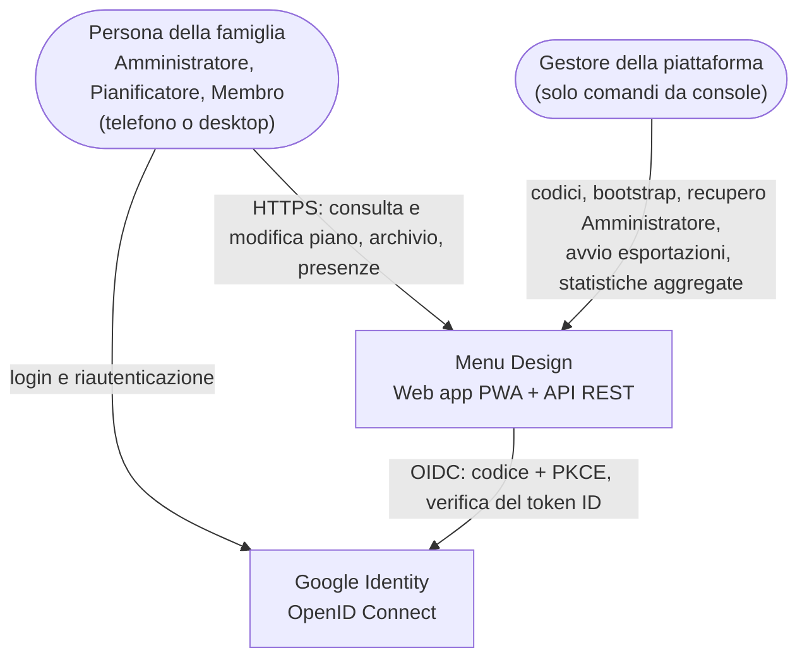
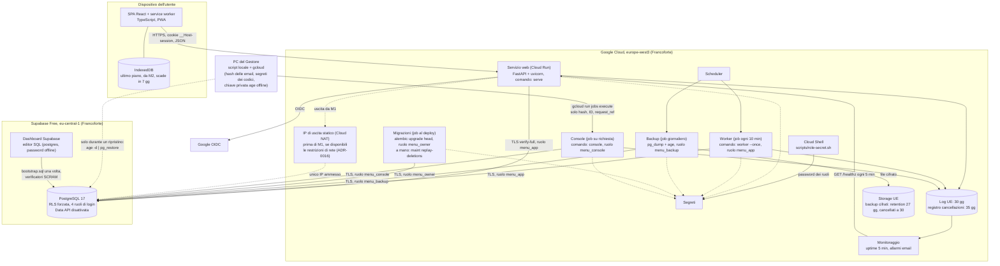
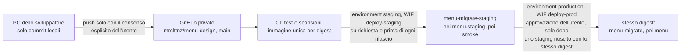
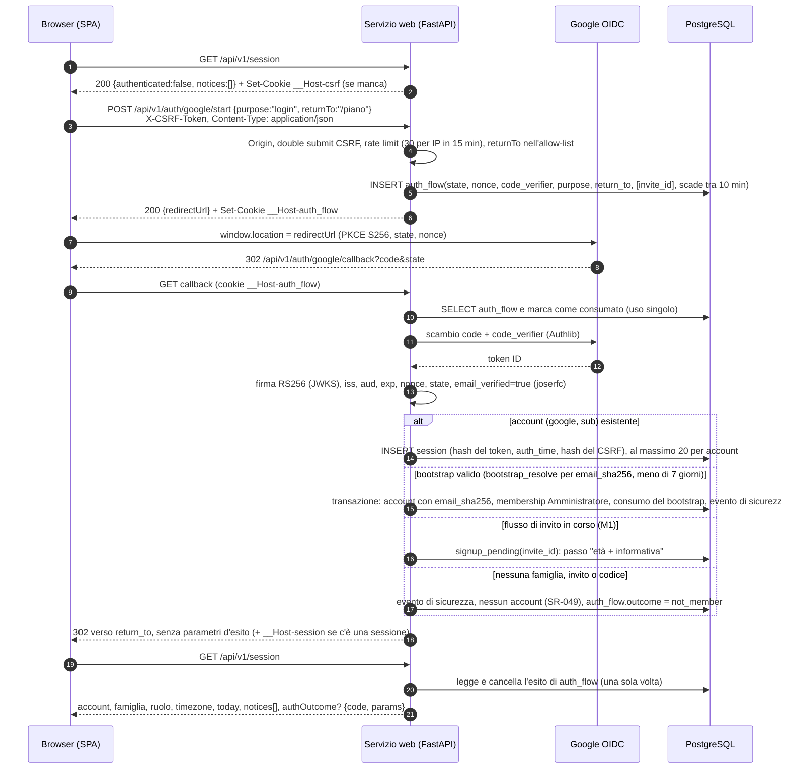
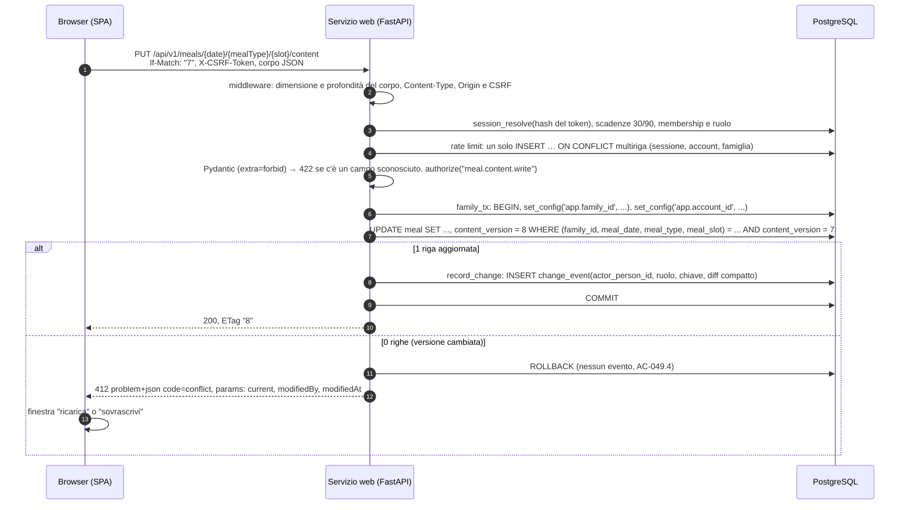
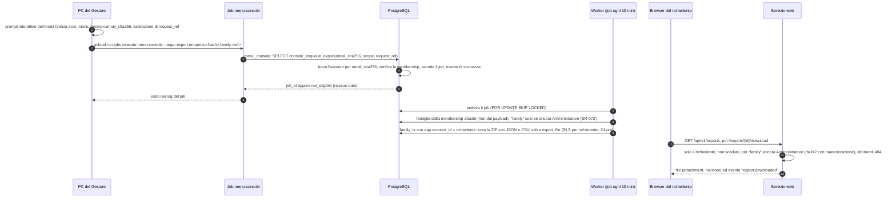
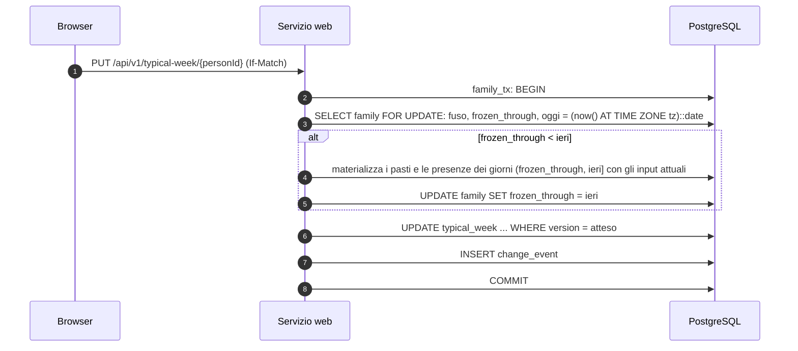

# Architettura: Menu Design

> Documento di proprietà dell'architect. Versione 6, 2026-10-19 (aggiornamento G4 su una base approvata al G3). **Stato: pronta per il gate G3**, confermato dopo il secondo giro della revisione critica (nessun blocco).
>
> **Fonti:**
> - `docs/01-vision.md` (rev. 4);
> - `docs/02-requirements.md` (v2, approvato G2);
> - `docs/03-ux.md`, `docs/05-data.md`, `docs/06-threat-model.md`;
> - `references/security-standard.md` di Bottega;
> - decisioni dell'utente del 2026-10-18 e del 2026-10-19.
>
> **Principio guida dell'utente** (2026-10-19): "non stiamo parlando di un sistema che gestisce cose critiche, facciamoci meno paranoie". Si sceglie il design più semplice che rispetti gli obblighi reali (GDPR, minori, isolamento tra famiglie).
>
> **Storia delle versioni:**
> - **v1:** prima stesura;
> - **v2:** backend Python, Supabase, backup giornalieri, rischio sull'endpoint accettato;
> - **v3:** proposte del data-architect, eventi compatti, più "Altro pasto" al giorno, `ErrorCode`;
> - **v4:** azioni A-01 … A-19 del threat model;
> - **v5:** obiezioni della revisione critica OBJ-01 … OBJ-08 e OBJ-10, con le decisioni dell'utente del 2026-10-19:
>   - recupero dell'Amministratore ancora più semplice;
>   - email solo come hash negli argomenti della console;
>   - `postgres` offline e password dei ruoli generate in Cloud Shell;
>   - login avviato con una `POST` JSON ed esito del callback lato server;
>   - riuso della riga di un pasto tolto;
>   - `ErrorCode` con una sola fonte;
>   - quattro ruoli di login senza `menu_maint`;
>   - meno automazioni (niente riconciliazione, rilevazione ridotta, Lighthouse di notte);
> - **v6 (2026-10-19, G4):** ambiente di staging e repository GitHub privato (ADR-0005 rev. 5), contratto di `/healthz` (Q-T2), `If-Match` malformato (Q-T1, ADR-0008), login con email e password rinviato al backlog dopo M2 (CHG-020: niente provider email, Pwned Passwords e argon2-cffi nell'MVP; testo originale marcato *[rinviato]*), codice `dish_not_planned` in ADR-0010.
>
> Versioni e stato di manutenzione di librerie e servizi sono stati verificati il 2026-10-18 su PyPI, sul registro npm e sui siti dei fornitori.

## Stato degli ADR

| ADR | Titolo | Stato |
|---|---|---|
| ADR-0001 | Monolite modulare, SPA PWA + API REST/OpenAPI | ACCEPTED |
| ADR-0002 | Python (FastAPI) + React/TypeScript | ACCEPTED |
| ADR-0003 | PostgreSQL, filtro centralizzato + RLS, quattro ruoli | ACCEPTED |
| ADR-0004 | Authlib + joserfc + sessioni opache lato server | ACCEPTED |
| ADR-0005 | Google Cloud Run europe-west3 e osservabilità | ACCEPTED |
| ADR-0006 | Limiti di frequenza in PostgreSQL | ACCEPTED |
| ADR-0007 | Passato congelato | ACCEPTED |
| ADR-0008 | Concorrenza ottimistica | ACCEPTED |
| ADR-0009 | Fuso orario, "oggi" e identità del pasto con `meal_slot` | ACCEPTED |
| ADR-0010 | i18n con Lingui, enumerazione `ErrorCode` (fonte unica) | ACCEPTED |
| ADR-0011 | Console del Gestore come job Cloud Run | ACCEPTED |
| ADR-0012 | Eventi di modifica compatti, autore come persona | ACCEPTED |
| ADR-0013 | Elaborazioni in background | ACCEPTED |
| ADR-0014 | Supabase Free a Francoforte | ACCEPTED |
| ADR-0015 | Backup giornalieri e ripristino | ACCEPTED |
| ADR-0016 | Endpoint del database esposto | RISK ACCEPTANCE |

Gli ADR accettati il 2026-10-19 (0001, 0006 … 0013) sono stati confermati dopo il secondo giro della revisione critica (nessun blocco).

## Sintesi

- **Stile:** monolite modulare. Una sola immagine container Python con tre comandi:
  - `serve`: API REST JSON `/api/v1` con OpenAPI 3.1, più i file statici della SPA, sulla stessa origine;
  - `worker --once`: elaborazioni in background, avviate ogni 10 minuti da Cloud Scheduler;
  - `console`: comandi del Gestore, eseguiti come job Cloud Run avviato dal PC con `gcloud`.
- **Frontend:** SPA React/TypeScript installabile come PWA, offline in sola lettura da M2. Client tipizzato generato da `openapi.json`.
- **Dati:**
  - PostgreSQL 17 su Supabase Free (Francoforte), usato come PostgreSQL standard;
  - isolamento con filtro centralizzato, RLS forzata e FK composite;
  - quattro ruoli di login: `menu_owner`, `menu_app`, `menu_console`, `menu_backup`.
- **Identità:** Google OIDC con Authlib e joserfc, sessioni opache lato server con cookie `__Host-`. Login con email e password (Argon2id) rinviato al backlog dopo M2 (CHG-020).
- **Esecuzione:** Google Cloud Run in europe-west3, con Cloud Scheduler, Secret Manager, Cloud Logging, Cloud Monitoring e Cloud Storage.
- **Pochi pezzi in movimento:**
  - niente Redis: limiti di frequenza e coda di lavoro stanno in PostgreSQL;
  - niente CDN, niente SDK di terze parti nel browser;
  - niente identity provider gestito.

## Driver architetturali

| Driver | Fonte | Implicazione |
|---|---|---|
| Isolamento rigoroso per famiglia, con dati di minori e di presenza in casa | SR-008, SR-041, SR-042, SR-055 | Filtro centralizzato (`family_tx`), RLS forzata, FK composite, UUID casuali, test "altra famiglia" obbligatori (ADR-0003). |
| Futura API riutilizzabile da app native, con OpenAPI versionata | NFR-015 | Tutta la UI passa da `/api/v1`. OpenAPI generata da FastAPI e committata, client generato (ADR-0001, ADR-0002). |
| Hosting gratuito con dati nell'UE, portabile | NFR-014, NFR-016, SR-027, SR-062 | Container standard, PostgreSQL standard, configurazione da variabili d'ambiente, nessun SDK del provider nel codice (ADR-0005, ADR-0014). |
| Sviluppatore singolo part-time, sistema non critico | visione, principio guida dell'utente | Monolite, un solo database, nessun broker, poche dipendenze, poche automazioni operative (ADR-0001, ADR-0006, ADR-0013, ADR-0015). |
| Sessioni lunghe ma sicure, legate al `sub` Google | SR-001, SR-005, SR-033, SR-037, SR-039 | Sessioni server-side con hash del token, scadenze di 30 e 90 giorni, riautenticazione con lo stesso `sub` (ADR-0004). |
| Gestore senza accesso ai contenuti | SR-012, SR-040, SR-066, SR-067 | Console con ruolo limitato a funzioni `SECURITY DEFINER`, email solo come hash (ADR-0011). |
| Passato congelato, fuso per famiglia, concorrenza per unità | FR-044, FR-060, FR-063 | Date locali, "oggi" dal database, congelamento prima di ogni cambio degli input, versione per unità con `If-Match` (ADR-0007, ADR-0008, ADR-0009). |
| Eventi di modifica da M0 | FR-061, SR-047 | Registrazione nella stessa transazione, eventi compatti, tabella di sola aggiunta, inventario in pytest (ADR-0012). |
| Limiti di frequenza condivisi e persistenti | SR-059 | Contatori in PostgreSQL, un solo upsert per richiesta (ADR-0006). |
| i18n da M0 con controllo in CI | NFR-011 | Lingui nel frontend. Il server restituisce solo codici, definiti in un'unica fonte (ADR-0010). |
| Backup cifrati, ripristino provato, cancellazioni riapplicate | NFR-006, SR-028, SR-048 | Backup giornaliero cifrato con `age`, registro delle cancellazioni anche fuori dal database (ADR-0015). |
| LCP ≤ 2,0 s su rete 4G lenta | NFR-001 | Budget del bundle a ogni PR, Lighthouse di notte e prima del rilascio (ADR-0001). |

Vincoli: budget iniziale nullo, dati nell'UE, Gestore che opera solo da console, utente esperto di Python, TypeScript e PostgreSQL.

## Contesto (C4 livello 1)

Nell'MVP (M0-M2) l'unico sistema esterno è Google e l'app non invia email (CHG-020).

*[rinviato, CHG-020: backlog dopo M2]* Il diagramma v5 aveva altri due sistemi esterni, solo da M2:
- "Provider email UE (da scegliere)", per verifica email, recupero password e avvisi. Servirà dal primo flusso email: FR-002/FR-003 ripresi, oppure SR-050 all'apertura al pubblico;
- "Pwned Passwords" a k-anonimato, che riceve il prefisso di 5 caratteri dell'hash SHA-1. Servirà solo con il login con password.

Gli ospiti e i profili senza account non sono attori. Nessuno script di terze parti nel browser (SR-031).

## Container (C4 livello 2)

Corrispondenze dei riquadri generici:
- scheduler → Cloud Scheduler;
- segreti → Secret Manager;
- log → Cloud Logging;
- monitoraggio → Cloud Monitoring;
- storage → Cloud Storage.

Note:
- Il deploy avviene da GitHub Actions con Workload Identity Federation limitata a questo repository e a `main`, con un environment `production` protetto. Il repository non contiene dati personali. Gli ambienti sono descritti sotto.
- L'endpoint del database è raggiungibile da Internet (rischio accettato in ADR-0016). Prima di M1 si attivano IP statico e restrizioni di rete, se disponibili sul piano Free.
- Nessun provider email nell'MVP (CHG-020). ~~In M2 si aggiunge un provider email UE~~: l'ADR si scrive prima del primo flusso email (login con password ripreso, oppure SR-050 all'apertura al pubblico).

### Ambienti e deploy (ADR-0005 rev. 5)

| | Sviluppo | Staging | Produzione |
|---|---|---|---|
| Esecuzione | PC, Docker | Cloud Run `menu-staging`, europe-west3, scala a zero, `max-instances=1` | Cloud Run `menu`, europe-west3 |
| Database | PostgreSQL 17 in Docker | Secondo progetto Supabase Free, Francoforte. Va in pausa dopo 7 giorni senza uso | Supabase Free, Francoforte |
| Dati | Solo sintetici | **Solo sintetici** (seed, dataset `load`) | Reali. **Mai seed né dataset sintetici** |
| Job | – | `menu-migrate-staging`, `menu-console-staging`, `menu-seed-staging`, `menu-worker-staging` (a mano). Nessun backup né Scheduler | `menu-migrate`, `menu-console`, `menu-worker` (ogni 10 min), `menu-backup` (giornaliero) |
| Segreti e identità | `.env` locale con valori finti | Segreti e account di servizio `*-staging` e un client OAuth dedicato | Segreti e account di servizio di produzione e un client OAuth dedicato |
| Uso | Sviluppo e test | Smoke, Lighthouse e carico ufficiali, ZAP, esercitazioni sugli allarmi, V-3 | Famiglie |
| Costo | 0 | circa 0 € | 0-1 €/mese (5 € con l'IP statico) |

- Nessuna identità di staging legge segreti o raggiunge il database di produzione. Il comando `seed` parte solo con `APP_ENV` in allow-list (`dev` o `staging`); qualsiasi altro valore lo blocca.
- Il client OAuth di staging ammette solo il redirect URI di `menu-staging`.
- Supabase Free consente 2 progetti attivi. Per la prova trimestrale di ripristino si mette in pausa staging, da verificare con V-8 (ADR-0005, ADR-0015).
- Finché l'utente non autorizza i push, non c'è alcun deploy.
- Staging non si aggiorna a ogni push: parte con `workflow_dispatch` e prima di ogni rilascio, per il budget dei minuti di Actions (piano §6.3, I-P13). La produzione richiede sempre uno staging riuscito con lo stesso digest.

## Componenti e responsabilità

### Backend (Python, pacchetto `menu` con moduli dai confini espliciti)

Un modulo non legge le tabelle di un altro: ne chiama i servizi.

| Componente | Responsabilità | Interfacce | Tecnologia |
|---|---|---|---|
| `platform.http` | App FastAPI. Middleware propri e testati: header di sicurezza (CSP con Trusted Types, HSTS, `nosniff`, `Referrer-Policy`, `frame-ancestors`), limite del corpo (64 KB, 1 MB per l'import), profondità JSON ≤ 10, `Content-Type: application/json` sulle scritture, `If-Match` solo nella forma `^"(0|[1-9][0-9]{0,17})"$` (altrimenti `422 invalid_value`, assente `428`, ADR-0008, THR-107), ID di correlazione, `Cache-Control: no-store` sulle risposte autenticate. Errori RFC 9457. File statici della SPA. `/healthz` (contratto sotto). IP del client dall'ultima voce di `X-Forwarded-For`. | HTTP | FastAPI 0.146, uvicorn 0.54 |
| `platform.config` | Configurazione dalle variabili d'ambiente, validata all'avvio. L'avvio fallisce se manca un valore o se un URL del database non ha `sslmode=verify-full`. `APP_ENV` (`dev`, `test`, `staging`, `production`) è obbligatoria: il comando `seed` parte solo con `dev` o `staging` (allow-list). | `Settings` | pydantic-settings 2.16 |
| `platform.routing` | `AuthzRoute`: ogni rotta dichiara `authz` (ruoli, ambito, ripensamento, riautenticazione, `tracks`). Senza dichiarazione l'app non parte. `x-authz` in OpenAPI. | Decoratore e classe di rotta | FastAPI |
| `identity` | OIDC Google (avvio con `POST`, callback, esito salvato sul server), sessioni (con `app.session_resolve`, massimo 20 per account), CSRF (per sessione e double submit anonimo), bootstrap per `email_sha256`, SR-049, riautenticazione con lo stesso `sub`. `account.email_sha256`. *[rinviato, CHG-020: backlog dopo M2]* ~~Da M2~~: password, verifica email, recupero. | `/api/v1/auth/*`, `/api/v1/session` (con `notices[]` e `authOutcome`) | Authlib 1.9, joserfc 1.7, httpx 0.28 (ADR-0004). argon2-cffi solo se la password viene ripresa |
| `access` | Matrice ruoli × operazioni centralizzata, regole "Propri" e "Se presente", periodo di ripensamento, `403` o `404`, eventi per gli accessi negati. | `authorize(ctx, operation, resource)` | Python |
| `tenancy` | `family_tx(ctx)` con `set_config(…, true)` e repository filtrati. `system_tx()` per le tabelle non di famiglia. Unico punto che crea sessioni SQLAlchemy. | Context manager | SQLAlchemy 2.1, psycopg 3.3 |
| `family` | Famiglia, fuso, pasti di default, eliminazione con ripensamento, persone, ruoli, invariante "almeno un Amministratore", profili con dichiarazione di responsabilità genitoriale, inviti (email di chi entra visibile agli Amministratori, SR-073), codici, età, informativa. **Avvisi alla famiglia** (`family_notice`): lettura in `GET /session`, chiusura per account. | `/api/v1/family*`, `/invites*`, `/people*`, `POST /api/v1/notices/{id}/dismiss` | Python |
| `catalog` | Piatti, portate, tag, fonti, gusti, ricerca senza accenti, nomi simili, import CSV (M2). Da M2 la priorità del piatto (1-10) e l'ordinamento preferito per account. | `/api/v1/dishes*`, `/courses*`, `/tags*`, `/me/preferences` | Python, `unaccent`, `pg_trgm` |
| `planning` | Pasti identificati da (data, tipo, `meal_slot`), con fino a 5 "Altro pasto" attivi con nome. Togliere e rimettere un pasto riusa la riga. Contenuto, sposta, scambia, copia, "ultima volta cucinato", concorrenza ottimistica. Ultima visita al piano per account (FR-046). | `/api/v1/plan*`, `/meals/{date}/{mealType}/{slot}*`, `POST /api/v1/me/plan-seen` | Python |
| `attendance` | Settimana tipo, eccezioni, ospiti, coperti, `ensure_frozen`. | `/api/v1/attendance*`, `/typical-week*` | Python |
| `history` | `record_change` nella stessa transazione, codec compatto e versionato, diff invertibili, cronologia decodificata con la mappa `refs` (DD-09). Visite settimanali. | `/api/v1/history*` | Python, Pydantic (ADR-0012) |
| `privacy` | Esportazioni (JSON e CSV con formule neutralizzate, ZIP, perimetro di SR-072), registro delle cancellazioni, eliminazioni, conservazione. | `/api/v1/exports*`, job | Python (libreria standard) |
| `audit` | Registro di sicurezza (`menu_app` solo `INSERT`, lettura dalla console), eventi strutturati per gli allarmi. | `security_log(event)` | structlog 26.1 |
| `ratelimit` | Contatori PostgreSQL, un upsert multiriga per richiesta, `429` con `Retry-After`. | Dipendenze FastAPI, middleware | Python + SQL (ADR-0006) |
| `jobs` | Coda `job` con `SKIP LOCKED` e compiti periodici, eseguiti dal worker con `menu_app`. Pulizie semplici in SQL normale, funzioni `maint_*` solo dove attraversano famiglie o tabelle di sola aggiunta. | `enqueue()`, CLI | Python (ADR-0013) |
| `console` | Comandi del Gestore nel job `menu-console`. Email solo come `email_sha256`. Recupero con `console_recover_admin`. | Job `python -m menu console`, script locale con `gcloud` | `argparse` (ADR-0011) |
| Migrazioni e manutenzione | Schema, policy RLS, funzioni, sempre con `upgrade` e `downgrade`. `maint replay-deletions` con la stessa identità. | `alembic`, CLI | Alembic 1.20 |

**Contratto di `GET /healthz` (Q-T2, 2026-10-19).**
- Fuori da `/api/v1`. È comunque in OpenAPI con `operationId: platform.health.read` e `x-authz: {scope: public}`, nell'elenco chiuso delle rotte pubbliche.
- Esegue `SELECT 1` con `menu_app`, senza contesto di famiglia, con timeout brevi: circa 2 s per ottenere la connessione e `statement_timeout` di circa 1 s. Restano sotto il timeout dell'uptime check.
- Risposte:
  - `200 {"status":"ok"}`;
  - `503 {"status":"unavailable"}` se il database non risponde entro il timeout.
- Il corpo non contiene altro: niente versione, errori del database o tempi. È fuori dalla tabella `ErrorCode` (ADR-0010). Header `Cache-Control: no-store`. Nessun cookie, nessuna sessione.

### Frontend (TypeScript)

| Componente | Responsabilità | Interfacce | Tecnologia |
|---|---|---|---|
| Shell e routing | Rotte con code splitting (`/piano/:data/:pastoId`, ADR-0009). All'avvio chiama sempre `GET /api/v1/session` (sessione, `__Host-csrf`, avvisi, esito dell'ultimo login). Informativa da rivedere. Layout da 360 px. | URL | React 19, React Router 8 (SPA) |
| Client API | Client generato da `openapi.json`. Header CSRF e `If-Match`. Gestione degli stati HTTP e mappatura dei `code` sui messaggi del catalogo (ADR-0010). | HTTP | `openapi-typescript` 7.13, `openapi-fetch` 0.17, TanStack Query 5 |
| Viste di funzionalità | Piano, scelta del piatto, archivio, presenze, persone, cronologia, sessioni, inviti, informativa, banner degli avvisi. Stati vuoto, caricamento ed errore (NFR-013). | Componenti | React Aria Components 1.22 |
| Conflitti | Finestra "modificato da X alle HH:MM", con "ricarica" o "sovrascrivi". | Componente | React |
| i18n | Cataloghi per lingua. `Intl` nel fuso della famiglia. | `t`, `<Trans>` | Lingui 6.10 |
| Offline (M2) | App shell precaricata, nessun runtime caching delle API. Ultimo piano in IndexedDB legato all'account, con scadenza a 7 giorni. | Service worker | `vite-plugin-pwa` 2.0 |

## Stack tecnologico

| Livello | Scelta | Versione (verificata il 2026-10-18) | ADR |
|---|---|---|---|
| Linguaggio e runtime del backend | Python (CPython) | 3.14.x | ADR-0002 |
| Framework HTTP e server | FastAPI, uvicorn | 0.146.0, 0.54.0 | ADR-0002 |
| Modelli e configurazione | Pydantic, pydantic-settings | 2.14.1, 2.16.0 | ADR-0002 |
| Accesso ai dati e migrazioni | SQLAlchemy (sincrono), Alembic, psycopg 3 | 2.1.5, 1.20.0, 3.3.6 (LGPL-3.0) | ADR-0002, ADR-0003 |
| Database | PostgreSQL su Supabase Free (eu-central-1), con `unaccent` e `pg_trgm` | 17 | ADR-0003, ADR-0014 |
| OIDC | Authlib, joserfc, httpx | 1.9.1, 1.7.5, 0.28.1 | ADR-0004 |
| *[rinviato, CHG-020]* Hash delle password ~~(M2)~~ | argon2-cffi (Argon2id), **fuori dall'MVP** | 25.1.0 (da ricontrollare alla ripresa) | ADR-0004 |
| Log | structlog (JSON) | 26.1.0 | — |
| Strumenti del backend | uv, ruff, mypy, pytest, Hypothesis, bandit, pip-audit | 0.13.1, 0.17.1, 2.4.0, 9.1.1, 6.170.1, 1.9.4, 2.10.1 | ADR-0002 |
| UI | React, React Router, TanStack Query, React Aria Components | 19.3.x, 8.4.x, 5.104.x, 1.22.x | ADR-0001 |
| Build e PWA | Vite, `vite-plugin-pwa`, TypeScript | 8.3.x, 2.0.x, 7.0.x | ADR-0001 |
| Client API | `openapi-typescript`, `openapi-fetch` | 7.13.x, 0.17.x | ADR-0001, ADR-0002 |
| i18n | `@lingui/core`, `@lingui/react`, `eslint-plugin-lingui` | 6.10.x, 6.10.x, 0.16.x | ADR-0010 |
| Test del frontend (proposta per il tester) | Vitest, Playwright, `@axe-core/playwright` | 5.0.x, 1.64.x, 4.14.x | decide il tester |
| Esecuzione | Cloud Run (servizio e job), Cloud Scheduler, Secret Manager, Cloud Logging e Monitoring, Cloud Storage | servizi gestiti, europe-west3 | ADR-0005 |
| Backup | `pg_dump` 17, `age` | age 1.3.2 | ADR-0015 |

## Integrazioni

| Integrazione | Direzione | Protocollo | Dati scambiati | Milestone |
|---|---|---|---|---|
| Google Identity | Uscita (redirect del browser più chiamata server) | OIDC Authorization Code + PKCE, scope `openid email profile` | `sub`, `email`, `email_verified`, `name` (solo come proposta iniziale), `auth_time` | M0 |
| Provider email UE | Uscita | API HTTPS o SMTP con TLS | Indirizzo, modelli fissi | *[rinviato, CHG-020]* ~~M2~~ Primo flusso email: backlog dopo M2 o apertura al pubblico (ADR da scrivere) |
| Pwned Passwords | Uscita | HTTPS, API range | I primi 5 caratteri dello SHA-1 | *[rinviato, CHG-020]* ~~M2~~ Solo con il login con password (backlog dopo M2) |
| Monitor di uptime | Entrata | `GET /healthz` | Nessun dato personale | M0 |

## Flussi principali

### 1. Login Google (M0), con bootstrap o invito (M1), ed esito del callback (OBJ-04)

- La riautenticazione (SR-039, M2) usa lo stesso flusso con `purpose:"reauth"`, `prompt=login` e `max_age`.
- Con un `sub` diverso dall'account della sessione, `session.auth_time` non cambia e la successiva `GET /session` restituisce `authOutcome: {code: "reauth_wrong_account", params: {expectedEmailMasked}}`.
- L'email mascherata non compare mai in un URL.

### 2. Modifica del contenuto di un pasto, con concorrenza ottimistica ed evento di modifica

### 3. Esportazione durante la beta, avviata dal Gestore (FR-065, SR-067)

### 4. Modifica della settimana tipo con congelamento del passato (FR-063)

## Confini di fiducia

| ID | Confine | Da → A | Controlli |
|---|---|---|---|
| TB-1 | Internet ↔ servizio web | Browser, bot, attaccanti → piattaforma | TLS 1.2+ e HSTS, cookie `__Host-`, CSRF (per sessione e double submit anonimo), solo JSON sulle scritture, validazione Pydantic con `extra=forbid`, rate limit, `authorize` su ogni rotta, header di sicurezza, limiti sul corpo. |
| TB-2 | Famiglia ↔ famiglia (logico, nello stesso database) | Account della famiglia A → dati della famiglia B | Famiglia ricavata dalla sessione, `family_tx`, RLS forzata, FK composite, UUID casuali, `404` più evento di sicurezza. |
| TB-3 | Applicazione ↔ database | Piattaforma → Supabase, attraverso Internet | TLS `verify-full` imposto all'avvio, "Enforce SSL", quattro ruoli con privilegi minimi e `CONNECTION LIMIT`, nessun `BYPASSRLS`, controllo delle finestre orarie dei ruoli privilegiati. **Endpoint raggiungibile da Internet: rischio accettato in ADR-0016.** Prima di M1: IP statico più restrizioni di rete, se disponibili. |
| TB-4 | Gestore ↔ piattaforma | PC del Gestore, Cloud Shell, dashboard Supabase → piattaforma e database | Vedi sotto. |
| TB-5 | Servizio ↔ Google OIDC | Piattaforma ↔ accounts.google.com | Validazione completa del token, `state` e `nonce` monouso, PKCE, stesso `sub` per la riautenticazione. |
| TB-6 | Dispositivo dell'utente | Dati nel browser e nella PWA | Token mai leggibile da JS, cache offline legata all'account, scadenza a 7 giorni, svuotamento secondo SR-026 e SR-046, `no-store` sulle API, esiti del login mai negli URL. |
| TB-7 | CI/CD ↔ cloud | GitHub Actions → registry e piattaforma | WIF limitata al repository e a `main`, environment `production` protetto, permessi minimi, azioni fissate a SHA, scansioni bloccanti (SR-076). Le migrazioni girano nel cloud. |
| TB-8 | Backup | Job di backup → storage | Cifratura `age` prima del caricamento, chiave privata solo offline, bucket privato UE con retention policy di 27 giorni e cancellazione a 30 (ADR-0015). |
| TB-9 | *[rinviato, CHG-020]* Provider email ~~(M2)~~, dal primo flusso email | Servizio → provider | Modelli fissi, tetto giornaliero, SPF, DKIM e DMARC. |
| TB-10 | Staging (ADR-0005 rev. 5) | Pipeline e identità di staging ↔ risorse di produzione | Identità WIF, account di servizio e segreti `*-staging` distinti. Nessun accesso ai segreti o al database di produzione. Solo dati sintetici, seed solo con `APP_ENV` `dev` o `staging`. Client OAuth separato. Il deploy in produzione passa dall'environment protetto. |

**Dettaglio di TB-4 (Gestore ↔ piattaforma):**
- **Comandi operativi (`gcloud` → job `menu-console`):**
  - IAM limitata all'esecuzione di quel job e alla lettura dei suoi log;
  - MFA resistente al phishing;
  - argomenti con soli hash, ID e `request_ref`, mai email in chiaro;
  - nessuna credenziale del database sul PC;
  - output senza contenuti;
  - audit log del cloud (ADR-0011).
- **Password dei ruoli:** generate in Cloud Shell direttamente nel Secret Manager. Nel database arrivano solo i verificatori SCRAM (ADR-0015).
- **Dashboard di Supabase:** `postgres` con password solo offline. `db/bootstrap.sql` eseguito una volta dall'editor SQL.
- **Ripristino (prova o reale):** il PC si collega al database di destinazione **solo durante il ripristino**:
  - con l'URL di `menu_owner` letto in memoria dal Secret Manager;
  - con l'IP aggiunto temporaneamente all'allow-list, se le restrizioni sono attive;
  - decifrando con la chiave `age`, che resta sul PC.

## Strategie trasversali

- **Configurazione e segreti:**
  - variabili d'ambiente validate all'avvio (fail closed);
  - segreti dal Secret Manager, ognuno accessibile al solo servizio o job che lo usa:
    - URL del database per ruolo;
    - client secret OIDC;
    - pepper HMAC dei limiti di frequenza;
    - chiave pubblica `age`;
  - `postgres` solo offline;
  - nel repository solo `.env.example`;
  - rotazione in `docs/09-release.md`;
  - sviluppo con PostgreSQL 17 in Docker e dati sintetici (SR-029);
  - staging con segreti `*-staging` separati e dati solo sintetici; in produzione mai seed (ADR-0005 rev. 5).
- **Log e osservabilità:**
  - structlog in JSON con `severity` e redazione (SR-021);
  - log nell'UE al massimo 30 giorni (SR-051);
  - registro di sicurezza nel database (12 mesi), replicato come evento strutturato per gli allarmi;
  - uptime ogni 5 minuti su `/healthz`;
  - allarmi entro 15 minuti su 5xx, eccezioni, soglie di SR-058 e ruoli privilegiati fuori finestra;
  - nessun SDK di error tracking di terze parti.
- **Errori:**
  - RFC 9457 `problem+json` con `code`, `params` ed `errors[]`;
  - **l'elenco autorevole dei codici, con stati HTTP e parametri, è solo in ADR-0010** (fonte unica, OBJ-06);
  - `title` e `detail` tecnici, mai mostrati;
  - mai stack trace;
  - fail closed nei controlli di sicurezza.
- **Autenticazione e autorizzazione:**
  - ADR-0004 e ADR-0003;
  - membership riletta a ogni richiesta;
  - `AuthzRoute` impedisce rotte senza dichiarazione;
  - inventario in pytest con i marker `cross_family` e `tracks` (SR-009, SR-042, ADR-0012).
- **Avvisi alla famiglia:**
  - `GET /api/v1/session` restituisce `notices[]` (avvisi attivi non chiusi dall'account);
  - `POST /api/v1/notices/{id}/dismiss` li chiude per l'account, sul server (ADR-0011);
  - primo uso: "{nome} è diventato Amministratore tramite il supporto".
- **Caching:**
  - nessuna cache applicativa sul server;
  - risposte autenticate `no-store`;
  - asset con hash `immutable`;
  - `index.html` e `sw.js` `no-cache`;
  - lato client TanStack Query in memoria e, da M2, l'ultimo piano in IndexedDB (7 giorni).
- **Internazionalizzazione (ADR-0010):** testi solo nei cataloghi Lingui. Il server restituisce codici e parametri. Email con cataloghi gettext lato server, dal primo flusso email (~~M2~~, rinviato con CHG-020).
- **Tempo (ADR-0009):**
  - istanti in `timestamptz` UTC;
  - giorni dei pasti in `date` locale;
  - "oggi" calcolato dal database;
  - la finestra giornaliera del limite per famiglia è nel fuso della famiglia (ADR-0006).
- **Identificativi:** UUID v4 casuali.
- **API:**
  - `/api/v1`;
  - `openapi.json` committato e confrontato in CI;
  - paginazione al massimo a 100 elementi;
  - intervallo del piano al massimo 62 giorni;
  - `response_model` espliciti.
- **Transazioni:** una per richiesta che tocca dati di famiglia. Invarianti e quote con `SELECT … FOR UPDATE` sulla famiglia, oppure con `UPDATE` condizionati.

## Mappa requisiti → soluzioni

### Requisiti non funzionali

| ID | Come è soddisfatto |
|---|---|
| NFR-001 | SPA con code splitting, bundle iniziale ≤ 150 KB gzip verificato **a ogni PR**, nessun font o script esterno, API e database nella stessa città. Lighthouse (mediana di 5) su 500 piatti e 8 persone **di notte e prima di ogni rilascio**. Rischio R-03. |
| NFR-002 | Monolite senza salti interni, piattaforma e database a Francoforte, indici `(family_id, …)`, una transazione per richiesta, un solo upsert per i limiti. Test di carico (strumento a scelta del tester). |
| NFR-003 | Import CSV: anteprima in una richiesta (≤ 1.000 righe, validazione per riga), conferma con inserimento in blocco in una transazione. |
| NFR-004 | Un'istanza (massimo 2) e un database per 50 famiglie. Quote di ASM-034. Spazio sotto controllo: eventi compatti, allarme al 70%, misura nella prima slice (R-01). |
| NFR-005 | Uptime ogni 5 minuti su `/healthz` (con `SELECT 1`). I controlli tengono calda l'istanza e attivo il database. |
| NFR-006 | Backup giornaliero cifrato con `menu_backup` senza `BYPASSRLS`, retention di 27 giorni e cancellazione a 30, ripristino trimestrale con fusione e riapplicazione delle cancellazioni (ADR-0015). |
| NFR-007 | Uptime check e allarmi su errori ed eccezioni entro 15 minuti (ADR-0005). |
| NFR-008 | React Aria Components, axe in Playwright, verifiche manuali. |
| NFR-009 | `browserslist` sulle ultime 2 versioni come target di Vite. Layout da 360 px. |
| NFR-010 | `vite-plugin-pwa`, ultimo piano in IndexedDB (ADR-0001). |
| NFR-011 | Lingui con ID espliciti, `no-unlocalized-strings` e `compile --strict` bloccanti in CI. Il server restituisce solo codici. Test di copertura degli `ErrorCode` (ADR-0010). |
| NFR-012 | Interazioni definite dalla UX. Aggiornamenti ottimistici e latenza bassa. |
| NFR-013 | Componenti condivisi per gli stati vuoto, caricamento ed errore con "riprova". |
| NFR-014 | Nessun SDK di provider nel codice. I file del ripristino si leggono da un volume montato (ADR-0005, ADR-0015). |
| NFR-015 | Tutta la UI passa da `/api/v1`. OpenAPI con `x-authz`. Autorizzazione solo sul server. |
| NFR-016 | Piattaforma, storage, log e database in regioni UE. La decifratura dei backup avviene sul PC del Gestore, nell'UE (ADR-0015). |
| NFR-017 | Spazio del database (CHG-006): eventi di modifica compatti da M0 (ADR-0012), dimensioni reali misurate nella prima slice, allarme al 70% della quota di Supabase tramite `maint_db_size` e metrica nei log (ADR-0014, ADR-0013), piano a pagamento solo se serve. Rischio R-01. |

### Requisiti di sicurezza e privacy

| ID | Come è soddisfatto |
|---|---|
| SR-001 | Authlib: Authorization Code + PKCE S256, scope minimi. Validazione con joserfc (ADR-0004). |
| SR-002 | *[rinviato, CHG-020: backlog dopo M2]* ~~M2~~: argon2-cffi Argon2id, 12-128 caratteri, k-anonimato. |
| SR-003 | Modulo `ratelimit` con i valori di SR-059 e SR-070, `429` e `Retry-After` (ADR-0006). |
| SR-004 | Messaggi e codici generici unici. Hash fittizio per le email inesistenti (*rinviato con FR-002, CHG-020*). Risposta unica per inviti e codici non validi. |
| SR-005 | Cookie `__Host-session`. Nuova sessione al login, cancellazione al logout, al cambio password e all'eliminazione. Membership riletta a ogni richiesta. Massimo 20 sessioni per account. |
| SR-006 | *[rinviato, CHG-020]* ~~M2~~: account `unverified` senza accesso ai dati. Token monouso salvati come hash. |
| SR-007 | Segreti di 256 bit da `secrets`, salvati come hash SHA-256, consumo atomico, risposta generica. |
| SR-008 | Famiglia dalla sessione, `family_tx`, RLS, `404` più evento di sicurezza (ADR-0003). |
| SR-009 | Matrice in `access`, `authz` obbligatoria, test negativi, inventario `cross_family`. |
| SR-010 | Pydantic con `extra='forbid'` e modelli di scrittura per ruolo. |
| SR-011 | `SELECT … FOR UPDATE` sulla famiglia e conteggio degli Amministratori nella stessa transazione. |
| SR-012 | Nessuna API per il Gestore. `menu_console` senza privilegi sulle tabelle di famiglia (ADR-0011). |
| SR-013 | Solo flag e data della dichiarazione di età. Il blocco lascia valido l'invito. |
| SR-014 | Schema minimo (`docs/05-data.md` §10). Dati per account aggiunti con decisioni dell'utente: ultima visita al piano, ordinamento preferito (M2), `email_sha256`. Email visibile agli Amministratori (SR-073). Aggiornamento di SR-014 e dell'informativa a cura del product-analyst. |
| SR-015 | `docs/05-data.md`. |
| SR-016 | `export_file` con RLS per richiedente, 24 ore, neutralizzazione delle formule, perimetro e cancellazione alla perdita del ruolo (SR-072, ADR-0013). |
| SR-017 | Eliminazione con pseudonimizzazione, backup ruotati a 30 giorni, registro delle cancellazioni (ADR-0012, ADR-0015). |
| SR-018 | Cancellazione definitiva dal worker con `maint_purge_due_families` (M2), registro delle cancellazioni (ADR-0013, ADR-0015). |
| SR-019 | Compiti periodici del worker (`menu_app`): inviti e codici a 30 giorni, registro a 12 mesi, IP a 90 giorni (ADR-0013). Log a 30 giorni. |
| SR-020 | Modulo `audit` con il catalogo degli eventi, compresi tutti gli esiti dei comandi della console. |
| SR-021 | Redazione in structlog, nessun segreto né contenuto nei log, nessuna email negli argomenti della console. |
| SR-022 | Cronologia in sola lettura, privilegi di sola aggiunta (ADR-0012). |
| SR-023 | TLS 1.2+, HSTS, CSP con `object-src 'none'`, `base-uri 'none'`, `form-action 'self'`, `frame-ancestors 'none'` e Trusted Types. CSRF per sessione e anonimo, solo JSON sulle scritture. Nessun CORS. |
| SR-024 | Validazione Pydantic con i limiti di ASM-034. URL solo `http` e `https`. Escape di React, `dangerouslySetInnerHTML` vietato. |
| SR-025 | M2: import ≤ 1 MB, UTF-8, ≤ 1.000 righe, validazione per riga, nessuna formula. |
| SR-026 | Cache offline legata all'account, scadenza a 7 giorni, svuotamento nei casi elencati. Nessun runtime caching delle API nel service worker (ADR-0001). |
| SR-027 | Fornitori e regioni in ADR-0005 e ADR-0014. DPA da accettare. |
| SR-028 | Cifratura a riposo del provider, più `age` sui dump (ADR-0015). |
| SR-029 | Seed sintetici. Ripristino di prova in un progetto UE temporaneo. |
| SR-030 | Informativa come file di contenuto per lingua e versione (ADR-0010). |
| SR-031 | Nessuno script di terze parti. Login con redirect. |
| SR-032 | Testo di avviso nell'interfaccia (UX). |
| SR-033 | Validazione completa del token. Chiave (provider, `sub`). Bootstrap per `email_sha256` con scadenza di 7 giorni (ADR-0004). |
| SR-034 | *[rinviato, CHG-020]* ~~M2~~: nessuna unione automatica, risposta indistinguibile. |
| SR-035 | *[rinviato, CHG-020]* ~~M2~~: registrazione solo dentro i flussi di invito e codice, pulizia a 7 giorni. |
| SR-036 | *[rinviato, CHG-020]* ~~M2~~: k-anonimato, hash fittizio, ritardo progressivo (ADR-0006), email di notifica. |
| SR-037 | Token di 256 bit, hash SHA-256, cookie `__Host-`, scadenze di 30 e 90 giorni, RLS su `session` con `session_resolve`. |
| SR-038 | Tabella `session` con dispositivo approssimato. Revoca singola o "tutte tranne questa". |
| SR-039 | Riautenticazione valida solo con lo stesso (provider, `sub`) e `auth_time` fresco. Altrimenti `authOutcome` `reauth_wrong_account` (ADR-0004). |
| SR-040 | `menu_console` con sole funzioni dedicate. Console come job cloud, nessuna credenziale sul PC. MFA resistente al phishing. `postgres` offline (ADR-0011, ADR-0015). |
| SR-041 | Verifica nella stessa transazione più FK composite (ADR-0003). |
| SR-042 | `family_tx`, RLS, UUID v4, `x-authz`, inventario in pytest. |
| SR-043 | Il `GET` della pagina invito non modifica nulla. Segreto nel frammento, risolto con `POST`. Attraverso il login viaggia solo `invite_id`. `return_to` in allow-list. Consumo atomico (ADR-0004). |
| SR-044 | Lo schema dell'invito accetta solo `member` o `planner`. |
| SR-045 | M2: trasferimento solo con la conferma di un Amministratore. |
| SR-046 | `no-store`, `no-cache` su `sw.js`, svuotamento della cache su `401`, `404` membership e cambio di account. |
| SR-047 | Autore come persona, soli ID nei diff, nomi risolti in lettura, tombstone (ADR-0012). |
| SR-048 | Registro delle cancellazioni nel database e fuori (35 giorni). Dopo un ripristino il runbook li fonde e `maint replay-deletions` li riapplica, con l'identità del job di migrazione (ADR-0015). |
| SR-049 | `auth_flow` temporaneo (esito letto una volta, TTL breve), nessun account senza bootstrap, invito o codice. |
| SR-050 | Apertura al pubblico: compito periodico del worker, richiede un provider email (ADR da scrivere prima dell'apertura, CHG-020). |
| SR-051 | Log nell'UE al massimo 30 giorni, redazione, IP troncati a 90 giorni. |
| SR-052 | Fornitori in ADR-0005 e ADR-0014. DPA prima di M1. |
| SR-053 | `sessions revoke-all` (ADR-0011). Procedura in `docs/09-release.md`. |
| SR-054 | `PATCH` del nome visualizzato. Il login Google non lo sovrascrive. |
| SR-055 | Nessuna presenza nei log. Statistiche solo aggregate. |
| SR-056 | Versione dell'informativa in configurazione, presa visione registrata. |
| SR-057 | `menu_app` con solo `INSERT` sul registro di sicurezza, trigger contro `UPDATE`, lettura dalla console, pulizia con `maint_security_log_retention` (ADR-0003). |
| SR-058 | Metriche basate sui log e allarmi (ADR-0005). |
| SR-059 | Contatori PostgreSQL condivisi e persistenti, upsert multiriga, IP dall'ultima voce di `X-Forwarded-For` verificata in staging (ADR-0006). |
| SR-060 | Limiti di corpo e profondità, paginazione, limite di 62 giorni, quote con lock. |
| SR-061 | Dal primo flusso email (~~M2~~, CHG-020): modelli fissi, tetto giornaliero, SPF, DKIM e DMARC. |
| SR-062 | Budget con avvisi, `max-instances` = 2, timeout dei job, degrado documentato. |
| SR-063 | Quote con lock sulla famiglia. Limite globale dei codici nella funzione della console. |
| SR-064 | Profilo rifiutato senza la dichiarazione. |
| SR-065 | Threat model del security-engineer, compreso il rischio di ADR-0016. |
| SR-066 | `console_recover_admin(email_sha256, request_ref)`: famiglia ricavata dall'unica persona attiva dell'account, promozione, invalidazione delle sessioni, evento in cronologia, avviso a tutta la famiglia, evento di sicurezza per ogni esito (`promoted`, `not_eligible`, `already_admin`, `invalid_request_ref`) (ADR-0011). |
| SR-067 | `console_enqueue_export(email_sha256, scope, request_ref)`. Il worker ricava la famiglia dalla membership attuale. Download solo del richiedente (flusso 3). |

### Requisiti proposti dal threat model (SR-068 … SR-076)
Le proposte sono di `docs/06-threat-model.md` §9, da integrare in `docs/02-requirements.md` dal product-analyst. La tabella riporta l'esito delle decisioni dell'utente.

| ID | Esito | Come è soddisfatto |
|---|---|---|
| SR-068 | Accettata | Stesso (provider, `sub`) e `auth_time` fresco, `reauth_wrong_account` con l'email della sessione mascherata, consegnato con `authOutcome` (ADR-0004, ADR-0010). |
| SR-069 | **Respinta** | Sostituita da `console_recover_admin`: semplice, senza soglie, con avviso a tutta la famiglia (ADR-0011, R-11). |
| SR-070 | Accettata | 60 scritture al minuto per account, 5.000 scritture tracciate al giorno per famiglia (fuso della famiglia), massimo 20 sessioni per account. |
| SR-071 | Accettata solo per la scadenza | Dati offline oltre 7 giorni non mostrati e cancellati. Contenuto invariato. |
| SR-072 | Accettata | Download `family` solo se ancora Amministratore (da M2 con riautenticazione), cancellazione alla perdita del ruolo, perimetro dei contenuti. |
| SR-073 | Accettata | Email verificata di chi entra con un invito visibile ai soli Amministratori. |
| SR-074 | Accettata | MFA resistente al phishing, console come job cloud, `postgres` offline, password dei ruoli generate in Cloud Shell, disco cifrato. |
| SR-075 | Accettata, semplificata | Hardening di Supabase da M0, controllo delle finestre orarie dei tre ruoli privilegiati, restrizioni di rete e IP statico prima di M1 se disponibili (ADR-0016). |
| SR-076 | Accettata | Cooldown di 7 giorni, script npm bloccati, immagini per digest, scansioni bloccanti, WIF limitata. |

## Rischi architetturali

| ID | Rischio | Probabilità | Impatto | Mitigazione |
|---|---|---|---|---|
| R-01 | Cambiano i piani gratuiti. Si esaurisce lo spazio di 500 MB (stima piena di circa 270 MB nell'anno 1, `docs/05-data.md` §14). | Media | Medio | Eventi compatti, misura nella prima slice, allarme al 70%, verifica di come Supabase misura il limite, passaggio a Supabase Pro previsto. |
| R-02 | Endpoint del database raggiungibile da Internet. RLS e FK non proteggono dal furto della credenziale di `menu_app` o di `menu_backup`. | Media | Alto | Rischio accettato in ADR-0016 con 10 controlli. Prima di M1: restrizioni di rete e IP statico se disponibili, altrimenti rischio residuo nella DPIA. |
| R-03 | LCP ≤ 2,0 s difficile per una SPA su rete 4G lenta. | Media | Medio | Budget del bundle a ogni PR, Lighthouse di notte e prima del rilascio, prerender dell'app shell se serve. |
| R-04 | Errori nelle policy RLS. | Bassa | Alto | Test di RLS automatici, filtro applicativo comunque presente, controllo in CI delle tabelle e delle funzioni privilegiate. |
| R-05 | Concentrazione su Google (login, hosting, log, backup). | Bassa | Alto | MFA e codici di recupero, copia mensile offline dei backup, database su un altro fornitore, uscite documentate (ADR-0005). |
| R-06 | Avvio a freddo di Python (2-4 s) o pausa del database. | Media | Basso | Controlli ogni 5 minuti, immagine snella. |
| R-07 | Correttezza del passato congelato con fusi e cambi d'ora. | Bassa | Medio | Date locali, "oggi" dal database, test di proprietà e sui cambi d'ora. |
| R-08 | Sviluppatore singolo con due toolchain. | Alta | Medio | Contratto unico (`openapi.json`) controllato in CI, poche dipendenze, poche automazioni operative. |
| R-09 | Codice proprio per sessioni, CSRF, limiti di frequenza e coda di lavoro. | Media | Medio | Moduli piccoli, test negativi e di concorrenza, revisione del security-engineer. |
| R-10 | `httpx` stabile fermo alla 0.28.1. *[rinviato, CHG-020]* `argon2-cffi` senza rilasci da giugno 2025, fuori dall'MVP. | Bassa | Basso | Perimetro piccolo, scansione delle CVE in CI, sostituti disponibili. |
| R-11 | Recupero dell'Amministratore: chi controlla l'email di un membro può ottenere il ruolo tramite il Gestore. | Bassa | Medio | Verifica del mittente da parte del Gestore, `request_ref` vincolato, avviso a tutta la famiglia, cronologia, evento di sicurezza con allarme per ogni esito, sessioni invalidate. Rischio accettato dall'utente (sistema non critico, SR-069 respinta). |
| R-12 | Staging su Supabase Free: pausa dopo 7 giorni e limite di 2 progetti attivi in conflitto con il progetto temporaneo della prova di ripristino. | Alta | Basso | Passo "riattiva" nel runbook, staging ricreabile da zero (bootstrap e seed), pausa di staging durante la prova (V-8). |

## Decisioni da prendere

Nessuna. Restano azioni dell'utente prima di M1:
- account di fatturazione Google Cloud con budget;
- accettazione dei DPA di Google Cloud e di Supabase;
- dopo la verifica V-1: attivazione dell'IP statico (circa 5 €/mese) se le restrizioni di rete sono disponibili, oppure riconferma del rischio residuo nella DPIA (ADR-0016).

## Aggiornamenti richiesti ad altri documenti

| Destinatario | Cosa |
|---|---|
| product-analyst (`docs/02-requirements.md`) | Integrare SR-068 e SR-070 … SR-076 con gli esiti sopra, e registrare SR-069 come respinta. Riscrivere FR-064, SR-066 e ASM-057 per `console_recover_admin` (ADR-0011). Nuovi FR per più "Altro pasto" (fino a 5 attivi, ASM-068), priorità del piatto (M2) e ordinamento preferito (M2). FR-046 con l'ultima visita sul server. Aggiornare SR-014 (dati dell'account, compresi `email_sha256` ed email visibile agli Amministratori), ASM-025 e l'informativa. |
| data-architect (`docs/05-data.md`) | Quattro ruoli (niente `menu_maint`) e matrice di `menu_app` con le pulizie in SQL normale. Elenco ridotto delle funzioni `SECURITY DEFINER` (ADR-0003). RLS su `session` con `session_resolve`, nessuna RLS su `account`. `account.email_sha256`, `family_bootstrap.email_sha256` al posto dell'email. `console_recover_admin` e `console_enqueue_export` con `p_email_sha256`. `auth_flow` con `purpose`, `invite_id`, `return_to`, esito (`outcome_code`, `outcome_params`, consumo). `family_notice` con la chiusura per account. Riuso della riga del pasto rimesso e limite di 5 "Altro pasto" **attivi** (ADR-0009). Colonna `meal_slot` ovunque. `maint_role_activity` solo sulle finestre orarie, come SQL normale su `pg_stat_activity` e non `SECURITY DEFINER` (fatto in 05-data v5 §3.4). Niente riconciliazione. |
| devops (`docs/09-release.md`) | Job `menu-console` e `menu-migrate` (anche per `maint replay-deletions`) con IAM minima. Script `scripts/role-secret.sh` (Cloud Shell, verificatori SCRAM). `postgres` offline. `db/bootstrap.sql` dall'editor SQL. Runbook di backup, prova trimestrale e ripristino reale (ADR-0015). Verifiche V-1 … V-5 e V-7, conservazione delle esecuzioni dei job e degli audit log (OBJ-02), `X-Forwarded-For` in staging. WIF limitata ed environment `production` protetto. Checklist di SR-074, SR-075 e SR-076. Configurazione dell'IP statico pronta per M1. Verifiche Supabase di ADR-0014. |
| ux-designer (`docs/03-ux.md`) | Banner degli avvisi (`notices[]`, chiusura per account). Esiti del login da `authOutcome` (codici in ADR-0010), compreso `reauth_wrong_account` con l'email mascherata. Email accanto al nome per gli Amministratori. Scadenza dei dati offline. Formato di `pastoId`. Chiavi `history.*`. Rimettere un pasto tolto e 5 "Altro pasto" attivi. |
| devops (`docs/09-release.md`), rev. 6 | Ambiente di staging (ADR-0005 rev. 5): environment GitHub `staging` e `production`, identità WIF `deploy-staging` e `deploy-prod` legate al `subject` dell'environment, risorse `*-staging`, segreti separati, client OAuth di staging, runbook "riattiva Supabase staging", V-8, pausa di staging durante la prova di ripristino. Nessun deploy prima del primo push autorizzato. |
| tester (`docs/08-test-strategy.md`), rev. 6 | Q-T1 chiusa: il test `If-Match` malformato attende `422 validation` con `invalid_value`, `*` compreso (ADR-0008). Togliere "fino a decisione". Prove su staging: prima il passo "riattiva Supabase". Il dataset `load` solo in staging. |
| tech-lead (`docs/07-plan.md`), rev. 6 | Q-T2: `/healthz` con `operationId: platform.health.read`, `x-authz: {scope: public}`, `503 {"status":"unavailable"}`. In §4.1 la regola di `If-Match` malformato. Le precondizioni P-n sullo staging: secondo progetto Supabase, client OAuth, primo push autorizzato. Il comando `seed` con l'allow-list `APP_ENV` `dev` o `staging`. Regex di `If-Match` a 18 cifre (THR-107). `dish_not_planned` ora è in ADR-0010 (togliere "da aggiungere" in 11.3). CHG-020: niente argon2-cffi, Pwned Passwords, provider email né ritardo progressivo nelle slice di M0-M2. |
| security-engineer (`docs/06-threat-model.md`), rev. 6 | Staging come nuovo ambiente: confine di fiducia, identità di deploy separate, dati solo sintetici, Supabase di staging senza restrizioni di rete (accettabile con dati sintetici). CHG-020: TB-9 (provider email) e Pwned Passwords escono dall'MVP, e le minacce sul login con password vanno marcate come rinviate. |
| data-architect (`docs/05-data.md`), rev. 6 | Seed sintetici solo per dev e staging. Nessun dataset sintetico nelle migrazioni. CHG-020: niente `rate_block`, colonne o tabelle per password, verifica e recupero nell'MVP (marcarle come rinviate). Il `CHECK` su `dish.archived_at` produce `dish_not_planned` (ADR-0010). |
| ux-designer (`docs/03-ux.md`), rev. 6 | Verificare che `error.dish_not_planned` coincida con la riga di ADR-0010. CHG-020: le schermate password ed email restano rinviate. |
| security-engineer (`docs/06-threat-model.md`) | Aggiornare §7 e §12 per ADR-0016 rev. 3, il recupero semplificato (R-11), i quattro ruoli, l'esito del login lato server e il percorso di ripristino. |
