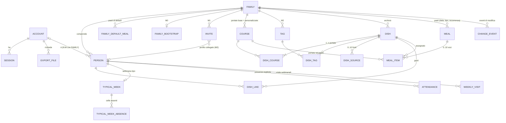

# Modello dei dati: Menu Design

> Documento di proprietà del data-architect. Versione 9, 2026-10-23. **Stato: APPROVATO al gate G3** (2026-10-19, versione 4). La versione 5 contiene le correzioni per il gate G4, da approvare con il piano. La versione 6 contiene le correzioni emerse dalla prima esecuzione reale del DDL (SL-02). La versione 7 contiene quelle di SL-03a (migrazione `0005`). La versione 8 quelle di SL-03b (migrazione `0006`).
>
> **Novità della versione 9** (2026-10-23, SL-04: migrazione `0007` eseguita su PostgreSQL 17, con `upgrade`, `downgrade -1` e `base ↔ head`):
> - **`dish`, `dish_course`, `dish_source`** come nella sezione 4.2, senza le colonne di M2. `dish.name` ha `ck_dish_name` (non vuoto, non solo spazi), `dish_source.reference` un `CHECK` di non vuoto.
> - **FK diretta `family_id → family ON DELETE CASCADE` anche sulle parti** (`dish_course`, `dish_source`): necessaria perché PostgreSQL esegue le cascate RI in ampiezza e il controllo `NO ACTION` di `dish_course → course` scatterebbe prima della cascata dal piatto (sezione 4, "Regola `ON DELETE`"). Vale anche per le tabelle future come `meal_item`.
> - `dish_source` senza `UQ (family_id, id)`: nessuna FK la referenzia (come `family_bootstrap`).
> - **Eccezione voluta alla regola "`text` + `CHECK`" della v6:** `dish.name`, `dish.notes` e i campi di `dish_source` restano `varchar(n)` come nella sezione 4.2 e nei test di SL-04. Un valore troppo lungo dà 22001 (`string_data_right_truncation`); l'app valida i limiti prima dell'`INSERT` (SR-024).
> - Indice `ix_dish_family_name`: lo spareggio per `id` del cursore usa un ordinamento incrementale (sezione 5); tolta la menzione della ricerca per prefisso, che Q4 non usa.
>
> **Novità della versione 8** (2026-10-23, SL-03b: migrazione `0006` eseguita su PostgreSQL 17, con `upgrade`, `downgrade -1` e `base ↔ head`):
> - **`rate_counter`** come nella sezione 4.1 (`pk_rate_counter`, `ck_rate_counter_key`, `ck_rate_counter_count`), più l'indice **`ix_rate_counter_window_start`** per la pulizia oraria (sezione 5). La versione 7 lo elencava tra gli indici volutamente assenti: il numero di righe non è di poche centinaia, perché ogni sessione attiva apre una finestra al minuto e le chiavi per IP crescono con chi attacca. `rate_block` non si crea (CHG-020).
>
> **Novità della versione 7** (2026-10-23, SL-03a: migrazione `0005` eseguita su PostgreSQL 17, con `upgrade`, `downgrade -1` e `base ↔ head`):
> - **`auth_flow` conserva l'esito del callback** (ADR-0004 rev. 3, colmata la lacuna della v6): colonne `consumed_at`, `outcome_code`, `outcome_params`. Il callback reclama la riga una sola volta, il successo la cancella, un esito negativo resta leggibile **una volta** per al massimo 5 minuti dal consumo (sezione 4.1). `purpose` ammette per ora solo `login` e `reauth`: `invite` arriva con `invite_id` (ordine 14 del piano).
> - **Scadenze delle sessioni in ore** (720 e 2160) anche nelle policy e in `session_resolve`, con i confini inclusi (esattamente 30 o 90 giorni = ancora valida). Le policy di pulizia si chiamano `p_session_expired_select` e `p_session_expired_delete` e valgono solo senza contesto di account (`app.current_account_id() IS NULL`, SEC-SL03a-001; sezione 6.1).
> - `bootstrap_resolve`: scadenza **inclusa** (`expires_at >= app.now_utc()`), più righe possibili per lo stesso hash, ordinate per creazione (sezione 6.2).
> - `account.email` resta `varchar(254)`: è un dato di Google che l'app valida prima dell'`INSERT`, quindi l'eccezione alla regola "`text` + `CHECK`" della v6 è voluta (un valore troppo lungo dà 22001). Vincoli aggiunti: formato minimo dell'email, `auth_subject` non vuoto, `session.ip_prefix` già troncato (famiglia, maschera e bit di host azzerati), `auth_flow.code_verifier` nell'alfabeto di RFC 7636.
> - Nome dell'indice secondo la convenzione: `ix_session_account_id`.
>
> **Novità della versione 6** (2026-10-22, SL-02: migrazioni `0002`-`0004` eseguite su PostgreSQL 17, con `upgrade`, `downgrade -1` e `base ↔ head` per ogni revisione):
> - **Testi con lunghezza massima come `text` + `CHECK`**, non `varchar(n)`: `family.name`, `person.display_name`, `course.name` (e d'ora in poi i nomi e le note delle tabelle future). Con `varchar(n)` un valore troppo lungo dà `string_data_right_truncation` (22001) *prima* del `CHECK`, quindi senza il nome del vincolo; con `text` l'errore è sempre `check_violation` (23514) con il nome del vincolo, che l'app traduce in modo uniforme. I `CHECK` sono scritti come `char_length(x) BETWEEN 1 AND n AND btrim(x) <> ''` (il solo `char_length(btrim(x)) BETWEEN 1 AND n` ammetteva valori lunghi con spazi). `security_event.event_type` e `target_type` restano `varchar` (non sono testi dell'utente).
> - **Scadenze in ore, non in giorni** (sezione 11.1): `timestamptz + interval '7 days'` dipende dal `TimeZone` della sessione nei giorni del cambio dell'ora legale (7 giorni "di calendario" a Roma possono essere 167 o 169 ore). I `CHECK` di uguaglianza sulle scadenze (`family_bootstrap`, `family.deletion_due_at`, `invite`, `creation_code`, `family_notice`) e le scadenze scritte dalle funzioni usano `interval '168 hours'` (7 giorni), `'720 hours'` (30 giorni), `'24 hours'`. Le soglie con disuguaglianza (policy di `session`) possono restare in giorni: lo scarto massimo è un'ora.
> - `family_bootstrap`: l'hash c'è **se e solo se** il bootstrap non è riscattato (`ck_family_bootstrap_hash_until_redeemed`), `redeemed_at` e `redeemed_person_id` sono valorizzati insieme. Niente `UQ (family_id, id)`: `UQ (family_id)` basta e nessuna FK punta al bootstrap.
> - `security_event`: il trigger d'immutabilità ammette sulla colonna `ip` solo il troncamento a /24 o /48 o l'azzeramento (sezione 4.1). `console_security_events` restituisce una tabella esplicita con l'IP troncato, non `setof security_event` (sezione 3.3).
> - Funzioni della console di M0: nomi degli eventi, errori sollevati con `invalid_parameter_value` (22023) e `p_limit` tra 1 e 1000 (sezione 3.3).
> - Sequenza delle migrazioni allineata al piano (§12). Verificato con test: `ON DELETE NO ACTION` con cascata dalla famiglia (sezione 4).
>
> **Novità della versione 5** (2026-10-19, gate G4):
> - **CHG-020:** il login con email e password esce da M2. `password_credential`, `account_token`, `rate_block`, `account.status` e l'unicità parziale su `lower(email)` sono **rinviati** (sezione 4.3, che conserva il disegno). `auth_provider` ammette solo `google`.
> - **Orologio `app.now_utc()`** (D-T1): sostituisce `now()` in funzioni, default, policy, viste e nell'SQL dell'applicazione. Elenco chiuso delle eccezioni ed elenco delle funzioni `LANGUAGE sql` per il tester (sezione 11.1).
> - **Pasti tolti dai default (I-P1):** il cambio dei pasti di default rende espliciti (`added`) i pasti futuri con contenuto o ospiti, così restano visibili (AC-003.2, sezione 7.2).
> - **Nomi delle funzioni di manutenzione** con il prefisso `maint_` di ADR-0003 (I-P5). Le differenze di insieme sono segnalate all'architect (sezione 3.3).
> - Correzioni di testo: citazione di ADR-0012 al posto di un inesistente "ADR-0017" (I-P2), password dei ruoli in §12 come in §3.1 (I-P6), percorso del pasto sempre con lo slot (I-P7), stato del documento e rimando a §6.3 (I-P8).
> - Seed solo in sviluppo e staging, nessun dato sintetico nelle migrazioni (ADR-0005 rev. 5). Il `CHECK` su `dish.archived_at` corrisponde a `dish_not_planned` (ADR-0010).
>
> **Novità della versione 2**, dopo le decisioni dell'utente del 2026-10-18:
> - `change_event` compatto da M0 (solo gli elementi cambiati, chiavi JSON brevi), con stima dello spazio aggiornata;
> - `dish.ever_planned` come flag permanente;
> - nomi riservati delle portate base per lingua nella configurazione del server;
> - istante dell'ultima visita sul server, uno per account (FR-046);
> - priorità del piatto 1-10 e ordinamento preferito per account (M2);
> - **più "Altro pasto" nello stesso giorno, ognuno con un nome libero**: il modello lo supporta da M0 con la colonna `meal.meal_slot`;
> - ASM-063 … ASM-066 confermate;
> - deviazioni dagli ADR accettate (oggi incorporate in ADR-0003).
>
> **Novità della versione 3** (2026-10-19): azioni sui dati del threat model (`docs/06-threat-model.md` §10.2), con le decisioni dell'utente del 2026-10-18.
> - **Recupero dell'Amministratore semplice**, non in due fasi, con un avviso in app alla famiglia (`family_notice`) e un evento di sicurezza. Nessuna tabella `admin_recovery_request` e nessuna attesa di 72 ore. La versione 4 lo semplifica ancora.
> - Invito trasportato attraverso il login Google con il solo `invite_id` (`auth_flow`, `signup_pending`), allineato ad A-02 dell'architetto.
> - `CONNECTION LIMIT` per ruolo, revoca di `CREATE` sugli schemi, inventario delle funzioni `SECURITY DEFINER` e dei loro grant.
> - Limiti di SR-070.
> - Esportazioni secondo SR-072.
> - Email verificata visibile agli Amministratori (SR-073).
> - Cache offline solo lato client.
>
> **Novità della versione 4** (2026-10-19): risposte alle obiezioni del critic al gate G3 e indicazioni del threat model v2 §15.3, con le decisioni dell'utente ("facciamoci meno paranoie": il design più semplice che rispetta gli obblighi reali su GDPR e minori).
> - **Recupero:** `console_recover_admin(p_email_sha256, p_request_ref)`.
>   - La famiglia si ricava dall'account. Niente soglia di inattività e niente limite per famiglia.
>   - Esiti `promoted`, `not_eligible`, `already_admin`, `invalid_request_ref`, e un evento di sicurezza per **ogni** esito.
>   - `request_ref` ha un formato rigido.
>   - ASM-071 è rimossa.
> - **Email nella console solo come hash** SHA-256 (`bytea`, 32 byte) calcolato da `menu.common.email_sha256` (ADR-0011). `family_bootstrap.email_sha256` sostituisce `email_norm`, e c'è una nuova colonna `account.email_sha256`.
> - **Esecuzione dei passi privilegiati:**
>   - `postgres` resta inutilizzato dopo il bootstrap;
>   - `bootstrap.sql` si esegue dall'editor SQL di Supabase;
>   - le password nascono in Cloud Shell e vanno nel Secret Manager;
>   - `replay-deletions` usa l'identità della migrazione.
> - **Pasti:**
>   - `meal_slot` ovunque (ADR-0009);
>   - riaggiungere un pasto rimosso ne riusa la riga;
>   - al massimo 5 "Altro pasto" attivi al giorno.
> - **Ruoli e funzioni:**
>   - **niente `menu_maint`**: quattro ruoli di login, e il worker usa `menu_app`;
>   - `SECURITY DEFINER` ridotte a un inventario chiuso;
>   - RLS su `session` con il risolutore `session_resolve`, non su `account`.
> - **Altro:**
>   - attività dei ruoli privilegiati come soli controlli sulle finestre orarie;
>   - contatori conservati ≤ 2 giorni;
>   - finestra giornaliera per famiglia nel fuso della famiglia (ADR-0006).
>
> Fonti: `docs/02-requirements.md` (v2, approvato G2, con CHG-001 … CHG-020), `docs/01-vision.md` (rev. 7), `docs/04-architecture.md` (v6), ADR-0001 … ADR-0016, `docs/07-plan.md` §11.2, `docs/08-test-strategy.md` (v2), `security-standard.md` di Bottega (§3, §7, §8).
>
> **Stato di verifica:** **eseguiti e verificati su PostgreSQL 17** (SL-02, migrazioni `0002`-`0004`): `family`, `family_default_meal`, `person`, `family_bootstrap`, `course`, i loro trigger e policy, `app.family_today()`, `security_event` e le funzioni `console_bootstrap_family`, `console_security_events`, `console_audit_note`. **SL-03a, migrazione `0005`:** `account`, la FK `person.account_id`, `session` con le sue policy, `auth_flow`, `session_resolve`, `bootstrap_resolve`. Il resto del DDL e delle funzioni **non è ancora stato eseguito**: lo verifica la slice che lo crea, e le correzioni tornano qui. Le stime di spazio sono analitiche e vanno misurate (vedi "Stima dello spazio").
>
> Convenzioni:
> - schema applicativo `app`, estensioni nello schema `extensions` (convenzione Supabase);
> - nomi di tabelle e colonne in inglese al singolare, `snake_case`;
> - valori enumerati come `text` con vincolo `CHECK` nominato (non tipi `ENUM`, perché un `ENUM` non permette di togliere un valore in un `downgrade`);
> - "Mx" indica la milestone in cui la tabella o la colonna nasce. Le colonne di milestone successive arrivano con una migrazione additiva (espansione).
> - Le nuove ipotesi di questo documento partono da **ASM-063**. ASM-068 … ASM-070 sono definitive in `02-requirements.md`. ASM-067 di quel documento riguarda un altro punto: il Membro non imposta la priorità. Le domande della versione 1 sono Q-027 … Q-030 in `02-requirements.md`, tutte chiuse.

## 1. Principi del modello

1. **Due ambiti di dati.**
   - **Tabelle di famiglia:** hanno `family_id uuid NOT NULL`, la RLS abilitata e forzata, FK composite `(family_id, …)` e indici con `family_id` in testa (ADR-0003).
   - **Tabelle non di famiglia:** identità, sessioni, flussi temporanei, limiti di frequenza, coda di lavoro, registri. Si usano solo con `system_tx()` nei moduli `identity`, `ratelimit`, `jobs`, `audit` e `privacy` (elenco chiuso nella sezione 6.3).
2. **Le persone si referenziano tramite la riga `person` della famiglia, mai tramite l'account.** Autore delle modifiche, chi crea un piatto, chi dichiara la responsabilità genitoriale: tutto punta a `person`. Quando un account esce o viene eliminato, la sua riga `person` diventa un tombstone senza nome e senza legame all'account. Così la pseudonimizzazione (SR-047) è automatica e non richiede di riscrivere eventi o righe storiche.
3. **Il passato è materializzato** (ADR-0007): i giorni fino a `family.frozen_through` si leggono dalle righe. I giorni successivi si calcolano con un'unica funzione SQL, che è anche quella usata dal congelamento. Così il risultato del calcolo coincide per costruzione con quello che il congelamento scrive.
4. **Una versione per ogni unità di FR-044** (ADR-0008). Una versione `0` significa "unità mai scritta". Le righe non si cancellano quando un'unità torna al valore di default: il valore diventa `NULL`, così non si presenta il problema ABA delle versioni.
5. **Vincoli nel database:** FK composite, `CHECK` sui limiti di ASM-034 dove sono esprimibili per riga, unicità su posizioni (massimo 10 voci per pasto, massimo 10 fonti per piatto), invariante "almeno un Amministratore" con un trigger differito (difesa aggiuntiva al lock applicativo).
6. **Tipi corretti:**
   - istanti in `timestamptz`, scritti con l'orologio del database `app.now_utc()` (sezione 11.1), mai con un istante inviato dal client;
   - giorni dei pasti in `date` locale nel fuso della famiglia (ADR-0009);
   - identificativi esposti in `uuid` v4 (`gen_random_uuid()`);
   - hash in `bytea` di 32 byte;
   - IP in `inet`.
   - Non ci sono importi monetari.
7. **Minimizzazione:**
   - per l'età si conserva solo la data della dichiarazione "almeno 14 anni";
   - per la navigazione solo la visita settimanale;
   - nessuna data di nascita, foto o cognome;
   - nessun IP nelle tabelle di famiglia.

## 2. Modello concettuale



Tabelle senza relazioni di dominio, non mostrate nel diagramma: `auth_flow`, `signup_pending`, `creation_code` (M2), `security_event`, `deletion_log`, `job`, `periodic_task_run`, `rate_counter`.

Rinviate con CHG-020 e quindi assenti dal diagramma: `password_credential` e `account_token` (relazioni `ACCOUNT ||--o| PASSWORD_CREDENTIAL` e `ACCOUNT ||--o{ ACCOUNT_TOKEN`), `rate_block` (sezione 4.3).

**Cardinalità chiave:**
- **Account e famiglia (N:M, ASM-002).** La relazione passa da `person`: un account ha una riga `person` attiva per ogni famiglia a cui appartiene. Nell'MVP un indice unico parziale limita l'account a **una sola** riga attiva (ASM-050). Toglierlo basta per passare a N:M nell'interfaccia.
- **Profilo senza account.** È una riga `person` con `kind='profile'`, nome visualizzato e dichiarazione di responsabilità genitoriale.
- **Pasto.** È identificato da (famiglia, data locale, tipo di pasto, `meal_slot`), come in ADR-0009.
  - Per Colazione, Pranzo, Merenda e Cena, `meal_slot` vale sempre 0: un solo pasto per tipo al giorno.
  - Per "Altro pasto" ci possono essere **più occorrenze nello stesso giorno** (`meal_slot` da 0 a 4, al massimo 5 attivi, ASM-068), ognuna con un nome libero. Senza nome, il client mostra l'etichetta localizzata "Altro pasto".
  - Il pasto di default "Altro pasto" corrisponde sempre a `meal_slot` 0.
  - La riga `meal` esiste solo se il pasto ha contenuto, ospiti, un nome o una deviazione dai default, oppure se il giorno è congelato.

## 3. Ruoli del database e privilegi

### 3.1 Ruoli

**Quattro ruoli di login**:
- ognuno ha una password casuale di almeno 32 caratteri, diversa per ruolo;
- le password si generano in Cloud Shell e si scrivono direttamente nel Secret Manager, senza passare dal PC del Gestore né da file (ADR-0016);
- Cloud Shell calcola anche il verificatore `SCRAM-SHA-256$…` di ogni password, ed è solo il verificatore che si incolla nell'editor SQL (ADR-0015);
- i ruoli **non** li crea Alembic.

Lo script `db/bootstrap.sql` si esegue **una sola volta dall'editor SQL di Supabase**, come `postgres`. Crea:
- i ruoli **senza password** (`CREATE ROLE … LOGIN`). Subito dopo, nell'editor, si esegue `ALTER ROLE … PASSWORD 'SCRAM-SHA-256$…'` con il verificatore calcolato in Cloud Shell. Né la password in chiaro né il verificatore finiscono nel file;
- i `CONNECTION LIMIT`;
- le estensioni;
- lo schema `app`;
- le revoche.

Dopo il bootstrap `postgres` resta **inutilizzato**: password casuale gestita, nessun uso a runtime né in CI. La migrazione `0001` verifica che ruoli ed estensioni esistano e fallisce se mancano.

| Ruolo | Uso | Attributi | Privilegi |
|---|---|---|---|
| `menu_owner` | Migrazioni Alembic (job `menu-migrate`) e `replay-deletions` dopo un ripristino (stessa identità del job di migrazione) | `LOGIN NOSUPERUSER NOCREATEROLE NOBYPASSRLS` | Proprietario dello schema `app`, di tutti gli oggetti e delle funzioni `SECURITY DEFINER`. Policy esplicita `p_owner USING (true)` su ogni tabella con RLS, necessaria con `FORCE` per le migrazioni di dati e per le funzioni di cui è proprietario. Mai usato dal servizio web, dal worker o dalla console. |
| `menu_app` | Servizio web **e worker** (anche per i compiti trasversali) | `LOGIN NOBYPASSRLS` | `USAGE` su `app`. DML per tabella secondo la matrice in 3.2. `EXECUTE` sulle funzioni elencate in 3.2 e 3.3. Nessun DDL. |
| `menu_console` | Console del Gestore (job `menu-console`, ADR-0011) | `LOGIN NOBYPASSRLS` | `USAGE` su `app`, `EXECUTE` sulle sole funzioni `console_*`, `SELECT` sulla sola vista `console_stats_global`. Nessun privilegio su tabelle (SR-012, SR-040). |
| `menu_backup` | Job di backup (ADR-0015) | `LOGIN NOBYPASSRLS` | `USAGE` su `app`, `SELECT` su tutte le tabelle e sequenze, policy `p_backup FOR SELECT … USING (true)` su ogni tabella con RLS. |

**Niente `menu_maint`** (decisione dell'utente, 2026-10-19).
- Il worker usa `menu_app`.
- I compiti periodici sulle tabelle non di famiglia sono SQL normale dentro `system_tx()`.
- Quelli sulle tabelle di famiglia girano per famiglia con `family_tx()`, nel passaggio notturno per famiglia (sezione 3.4).
- Restano `SECURITY DEFINER` solo le poche funzioni trasversali della sezione 3.3.

**`menu_backup` senza `BYPASSRLS`** (ADR-0003):
- `pg_dump --enable-row-security` con la policy `p_backup`. La soluzione è portabile su qualunque PostgreSQL.
- La CI verifica che ogni tabella con RLS abbia `p_owner` e `p_backup`.
- Il ripristino trimestrale verifica che il dump sia completo.

**Impostazioni per ruolo.** Il pooler in modalità transazione le rispetta, perché la connessione al backend è fatta con il ruolo.

| Ruolo | Impostazioni | `CONNECTION LIMIT` | Motivo del limite |
|---|---|---|---|
| `menu_app` | `statement_timeout = '5s'`, `lock_timeout = '3s'`, `idle_in_transaction_session_timeout = '15s'`. Il worker alza `statement_timeout` a 60 s per transazione con `set_config` (passaggio notturno, eliminazione delle famiglie). | 20 | Connessioni del pooler verso il database. La dimensione del pool di Supavisor va configurata a un valore ≤ 20, e la dimensione reale la fissa il devops. |
| `menu_console` | `statement_timeout = '30s'` | 2 | Un solo operatore |
| `menu_backup` | `statement_timeout = 0` | 2 | Un job al giorno, più un ripristino di prova |
| `menu_owner` | `lock_timeout = '5s'` (impostato in `env.py`) | 3 | Job di migrazione |

Nessun ruolo dipende dal `search_path`: il codice qualifica tutto con lo schema (`MetaData(schema="app")`). Anche le funzioni delle estensioni si qualificano: `extensions.unaccent(…)`, `extensions.similarity(…)`.

**Supabase e schemi:**
- `REVOKE ALL ON SCHEMA app FROM PUBLIC, anon, authenticated`;
- `REVOKE CREATE ON SCHEMA public FROM PUBLIC` e `REVOKE CREATE ON SCHEMA app FROM PUBLIC`;
- nessun privilegio predefinito per `anon` e `authenticated` sugli oggetti di `menu_owner`;
- `ALTER DEFAULT PRIVILEGES FOR ROLE menu_owner REVOKE EXECUTE ON FUNCTIONS FROM PUBLIC`.

**Email nella console e nel servizio (ADR-0011).** La console non riceve né salva email in chiaro.
- L'hash si calcola **solo in Python**, con la funzione `menu.common.email_sha256`, usata sia dallo script della console sia dal servizio. Restituisce lo SHA-256 dell'email normalizzata come `bytea` di 32 byte. La normalizzazione è definita una volta sola in quella funzione (ADR-0011), che ha i suoi test.
- Il servizio scrive `account.email_sha256` a ogni creazione dell'account e a ogni cambio dell'email (login Google).
- Le funzioni SQL confrontano solo valori `bytea`: **nessuna normalizzazione e nessun hash in SQL**.
- È una pseudonimizzazione, non un'anonimizzazione, perché un'email si può indovinare per dizionario: l'hash resta un dato personale (sezione 10). Ma l'email in chiaro non compare negli argomenti del job, nei log né nelle tabelle della console.

**Correlazione.** Le funzioni non hanno un parametro di correlazione. Il chiamante esegue `set_config('app.correlation_id', :id, true)` nella stessa transazione, e le funzioni la leggono con `current_setting('app.correlation_id', true)` quando scrivono `security_event`.

### 3.2 Matrice dei privilegi di `menu_app`

| Tabella | SELECT | INSERT | UPDATE | DELETE | Note |
|---|---|---|---|---|---|
| Tabelle di famiglia (sezione 4.2), escluse le righe seguenti | sì | sì | sì | sì | Sempre sotto RLS per famiglia |
| `change_event` | sì | sì | no | no | Sola aggiunta (ADR-0012, SR-022) |
| `family_notice` | sì | no | no | no | L'avviso lo scrive solo `console_recover_admin`. La pulizia la fa `maint_purge_family_notices`. |
| `family_notice_dismissal` | sì | sì | no | no | "Ho capito" per account, idempotente |
| `security_event` | no | sì | no | no | Sola aggiunta (SR-057, ADR-0003). Conservazione con `maint_security_log_retention`. |
| `deletion_log` | no | sì | no | no | Pulizia con `maint_purge_deletion_log` |
| `account`, `auth_flow`, `signup_pending` | sì | sì | sì | sì | `system_tx`, modulo `identity` e pulizie del worker. `account` **senza** RLS. `password_credential` e `account_token` avranno gli stessi privilegi se FR-002 viene ripreso (sezione 4.3). |
| `session` | sì | sì | sì | sì | **RLS per account** (sezione 6.1). La risoluzione del cookie passa da `session_resolve`. |
| `creation_code` (M2) | sì | no | sì (`status`, `status_changed_at`) | sì | Consumo atomico. L'emissione avviene solo dalla console. La pulizia la fa il worker. |
| `export_file` | sì | sì | no | sì | RLS per account richiedente, più la policy delle righe scadute per la pulizia |
| `job`, `periodic_task_run` | sì | sì | sì | sì | Prelievo con `SKIP LOCKED`. Pulizia dei job terminati. |
| `rate_counter` | sì | sì | sì | sì | Pulizia del worker. `rate_block` è rinviata (CHG-020, sezione 4.3). |

Funzioni `SECURITY INVOKER` eseguibili da `menu_app`:
- `app.now_utc()`, `app.current_family_id()`, `app.current_account_id()`, `app.search_norm(text)`, `app.family_today()`;
- `app.effective_meals(date, date)`, `app.effective_attendance(date, date)`, `app.ensure_frozen()`.

### 3.3 Funzioni `SECURITY DEFINER`

Regole comuni:
- proprietario `menu_owner`;
- `SET search_path = app, pg_temp`;
- `REVOKE EXECUTE … FROM PUBLIC` e `GRANT EXECUTE` al solo ruolo previsto;
- nessun SQL dinamico;
- parametri solo identificativi, hash o valori enumerati;
- nessuna funzione restituisce nomi, email o contenuti di famiglia;
- ogni funzione `console_*` scrive in `security_event` un evento `console.<comando>` con `actor_kind='platform_operator'` ed esito;
- un test pytest per funzione, compresi i casi d'errore;
- create e rimosse da Alembic con `op.execute` (sia `upgrade` sia `downgrade`).

**Inventario chiuso** (test in CI). Il test legge `pg_proc` (`prosecdef`, `proowner`, `proconfig`, `proacl`) nello schema `app` e fallisce se l'insieme delle funzioni `SECURITY DEFINER` non coincide con questa tabella, se una funzione:
- non ha `search_path=app, pg_temp`;
- non è di proprietà di `menu_owner`;
- ha `EXECUTE` per un ruolo diverso da quello elencato, oppure per `PUBLIC`.

Lo stesso test verifica che le funzioni `SECURITY INVOKER` della sezione 3.2 e le funzioni trigger non siano eseguibili da `PUBLIC`.

| # | Funzione | `EXECUTE` | Mx | Scopo |
|---|---|---|---|---|
| 1 | `session_resolve(p_token_hash bytea)` | `menu_app` | M0 | Risolve il cookie di sessione prima di conoscere l'account (sezione 6.2) |
| 2 | `invite_resolve(p_token_hash bytea)` | `menu_app` | M1 | Risolve un invito prima dell'appartenenza |
| 3 | `bootstrap_resolve(p_email_sha256 bytea)` | `menu_app` | M0 | Risolve il bootstrap al primo login |
| 4 | `purge_family_exports(p_account_id uuid)` | `menu_app` | M1 | Cancella i file `family` di un account nella famiglia del contesto (SR-072). La RLS per richiedente impedirebbe a un Amministratore di farlo. |
| 5 | `maint_families_needing_freeze()` | `menu_app` | M0 | Solo gli ID delle famiglie con `frozen_through < oggi locale − 1`, che sono anche quelle del passaggio notturno |
| 6 | `maint_purge_due_families()` | `menu_app` | M2 | Eliminazione definitiva delle famiglie scadute (SR-018) |
| 7 | `maint_purge_family_notices()` | `menu_app` | M1 | Avvisi scaduti di tutte le famiglie |
| 8 | `maint_security_log_retention()` | `menu_app` | M0 | Troncamento degli IP a 90 giorni e cancellazione a 12 mesi |
| 9 | `maint_purge_deletion_log()` | `menu_app` | M1 | Righe del registro più vecchie di 35 giorni |
| 10 | `maint_db_size()` | `menu_app` | M0 | Dimensione del database e prime 10 relazioni (allarme al 70%) |
| 11 | `maint_apply_deletion(p_entity_type, p_entity_id, p_family_id)` | nessuno (solo `menu_owner`) | M1 | Riapplica una cancellazione dopo un ripristino |
| 12 | `console_bootstrap_family` | `menu_console` | M0 | |
| 13 | `console_security_events` | `menu_console` | M0 | |
| 14 | `console_audit_note` | `menu_console` | M0 | |
| 15 | `console_recover_admin` | `menu_console` | M1 | |
| 16 | `console_enqueue_export` | `menu_console` | M1 | |
| 17 | `console_export_status` | `menu_console` | M1 | |
| 18 | `console_revoke_all_sessions` | `menu_console` | M1 | |
| 19-21 | `console_issue_code`, `console_list_codes`, `console_revoke_code` | `menu_console` | M2 | |

Sono 18 funzioni fino a M1 e 21 con M2. Il conteggio è più alto della stima di circa 15 perché comprende `session_resolve`, `purge_family_exports` (SR-072) e le tre funzioni dei codici di M2. Le funzioni per l'inattività dell'apertura al pubblico (SR-050) si aggiungeranno allora.

**Nomi (I-P5).** Le funzioni del worker e del ripristino hanno il prefisso `maint_` di ADR-0003, così il gruppo si riconosce nell'inventario. `purge_family_exports` non ha il prefisso: non è manutenzione, la chiama l'app dentro un cambio di ruolo o un'uscita (sezioni 7.3 e 11). Tutte le funzioni `SECURITY DEFINER` sono `LANGUAGE plpgsql`: con `SET search_path` non sarebbero comunque inlinabili, e così compaiono sempre in `pg_stat_user_functions`.

**Differenze con la tabella di ADR-0003 (rev. 5), da allineare nell'ADR.** L'insieme di questa sezione segue la regola dello stesso ADR, "`SECURITY DEFINER` solo dove è inevitabile":
- `maint_purge_sessions`, `maint_purge_exports`: **non esistono**. Le pulizie sono SQL normale grazie alle policy `p_session_expired_select`/`p_session_expired_delete` e `p_export_expired` (sezione 6.1);
- `maint_purge_invites_codes`: **non esiste**. Inviti e bootstrap si puliscono nel passaggio notturno per famiglia con `family_tx`, i codici di M2 in `system_tx` (sezione 3.4);
- `maint_role_activity`: **non è privilegiata**. È SQL normale su `pg_stat_activity`, dove `usename` e `backend_start` sono visibili a ogni ruolo (sezione 3.4);
- mancano nell'ADR: `maint_purge_family_notices` (`menu_app` non ha `DELETE` su `family_notice`), `maint_db_size` e `purge_family_exports`.

**Console (`menu_console`), ADR-0011:**

| Funzione | Mx | Firma (ritorno) | Comportamento |
|---|---|---|---|
| `console_bootstrap_family` | M0 | `(p_family_name text, p_email_sha256 bytea) → uuid` | Valida la lunghezza del nome (1-60, non solo spazi) e la lunghezza dell'hash (`octet_length = 32`). Crea `family` (fuso `Europe/Rome`, `frozen_through` = oggi locale − 1), i pasti di default (Pranzo e Cena, ASM-063), le 8 portate base e `family_bootstrap` con `email_sha256` e scadenza a 168 ore. Nessuna `person`: l'Amministratore nasce al riscatto (SL-03a). Nessun vincolo di unicità sull'hash: due bootstrap per la stessa email sono due famiglie. Evento `console.family_bootstrap` con `family_id` e `target_type='family'`. Restituisce l'ID della famiglia. |
| `console_issue_code` | M2 | `(p_code_hash bytea) → uuid` | Prende `pg_advisory_xact_lock`. Rifiuta se esistono già 20 codici `active` non scaduti (SR-063). Il segreto lo genera la CLI: al database arriva solo l'hash. |
| `console_list_codes` | M2 | `() → setof (id, status, created_at, expires_at, status_changed_at)` | Nessun dato di famiglia (AC-036.4). |
| `console_revoke_code` | M2 | `(p_code_id uuid) → boolean` | `active` → `revoked`. |
| `console_recover_admin` | M1 | `(p_email_sha256 bytea, p_request_ref text) → text` (solo esito) | Vedi sotto. |
| `console_enqueue_export` | M1 | `(p_email_sha256 bytea, p_scope text, p_request_ref text) → (outcome text, job_id uuid)` | Vedi sotto. |
| `console_export_status` | M1 | `(p_job_id uuid) → (status, created_at, finished_at, last_error_code)` | |
| `console_security_events` | M0 | `(p_since timestamptz, p_limit integer) → TABLE (id, occurred_at, event_type, outcome, actor_kind, actor_account_id, actor_role, family_id, target_type, target_id, ip, correlation_id, details)` | Restituisce solo identificativi e codici, ordinati per (`occurred_at`, `id`), dal più vecchio, da `p_since` incluso. **L'IP è sempre troncato** a /24 (IPv4) o /48 (IPv6) (ADR-0011, SR-051), anche nei primi 90 giorni. `p_since` obbligatorio, `p_limit` tra 1 e 1000. Evento `console.security_log` (dettagli `since`, `limit`), scritto **dopo** la lettura: non compare nel proprio output. Tabella esplicita e non `setof security_event`: il tipo di ritorno non cambia se il registro riceve nuove colonne. |
| `console_revoke_all_sessions` | M1 | `(p_reason_ref text) → bigint` | `DELETE FROM session`. Restituisce il numero di sessioni revocate (SR-053). |
| `console_audit_note` | M0 | `(p_ref text) → void` | Registra un accesso diretto al database (ASM-045): evento `console.audit_note` con `details = {"request_ref": …}`. Un `request_ref` non valido **solleva** l'errore (nessun evento), a differenza delle funzioni di M1 che restituiscono l'esito `invalid_request_ref`. |

**Errori e eventi delle funzioni di M0** (verificati in SL-02):
- un argomento non valido solleva `invalid_parameter_value` (SQLSTATE 22023). Il messaggio nomina il parametro ma non ne ripete mai il valore (niente email, hash o nomi nei log del job). La transazione fallisce e non lascia righe, nemmeno l'evento;
- ogni chiamata riuscita scrive **esattamente un** evento `console.<comando>` con `actor_kind='platform_operator'`, `outcome='success'` e `correlation_id` letto da `app.correlation_id` (`NULL` se il job non lo imposta);
- nessun evento contiene l'email o il suo hash (I-01).

**Formato di `request_ref`** (A-08), comune a recupero ed esportazione: `^[A-Z]{2,5}-[0-9]{8}-[0-9]{1,3}$` (ADR-0011), per esempio `REC-20261103-1`. È un codice di pratica, senza dati personali. Lo controlla la funzione, che con un formato non valido restituisce `invalid_request_ref` senza fare nulla.

**`console_recover_admin(p_email_sha256, p_request_ref)`** (FR-064, SR-066). Recupero semplice, decisione dell'utente del 2026-10-19: nessun argomento famiglia, nessuna soglia di inattività, nessun controllo di "Amministratore utilizzabile", nessun limite per famiglia. La verifica della richiesta resta procedurale (ASM-057, runbook).
1. Se `p_request_ref` non rispetta il formato: `invalid_request_ref`.
2. Cerca gli account con `account.email_sha256 = p_email_sha256`, una colonna scritta dal servizio (sezione 4.1). Sono circa 250 righe, quindi basta una scansione, senza indice. Nessuna normalizzazione in SQL.
3. Ricava la famiglia dall'**unica persona attiva** dell'account (indice `ux_person_account_single_family`, ASM-050).
4. Se l'account non esiste, non è unico (raro: un indirizzo riassegnato a un altro account Google, vedi `account.email_sha256`) o non ha una persona attiva: `not_eligible`, senza modifiche. L'esito è lo stesso per tutti i casi, quindi non rivela nulla.
5. Se la persona è già Amministratore: `already_admin`.
6. Altrimenti, nella stessa transazione, con il lock sulla riga `family`:
   - `role='admin'`;
   - cancellazione delle sessioni dell'account (SR-066);
   - `family_notice` con `kind='admin_recovered'` e `subject_person_id` (ADR-0011);
   - `change_event` con `actor_kind='platform_operator'`, `unit_type='membership'`, `op='role_change'`;
   - l'evento di sicurezza del punto 8.

   Esito `promoted`.
7. Restituisce solo l'esito: `promoted`, `not_eligible`, `already_admin` o `invalid_request_ref`.
8. **Ogni esito scrive un evento di sicurezza** `console.admin_recover` (I-01, ADR-0011), con `outcome` (`success` per `promoted`, `failure` per gli altri) e `details = {"result": <esito>, "request_ref": <solo se valido>}`. Per `promoted` e `already_admin` l'evento contiene anche gli ID della persona e della famiglia. L'evento **non** contiene mai l'email né il suo hash.

Anche `console_enqueue_export` scrive un evento per ogni esito, con le stesse regole.

**`console_enqueue_export(p_email_sha256, p_scope, p_request_ref)`** (FR-065, SR-067, A-08):
1. Controlla `request_ref` come sopra.
2. Risolve l'account dall'hash dell'email: deve essere unico. È il controllo che l'email del richiedente coincida con l'account.
3. Per `scope='family'` serve una persona attiva. Il ruolo di Amministratore lo ricontrolla il worker all'esecuzione (AC-044.4, A-17).
4. Inserisce il `job` (payload: `account_id`, `scope`) con `dedupe_key = 'export:' || account_id || ':' || p_request_ref`.
5. Restituisce `(queued, job_id)`, `(not_eligible, NULL)` o `(invalid_request_ref, NULL)`.

**Vista `console_stats_global`** (M1, proprietario `menu_owner`):
- una sola riga di conteggi globali: famiglie attive, account, piatti, pasti con contenuto negli ultimi 30 giorni;
- **nessuna** colonna per famiglia e **nessuna** lettura di `attendance`, `typical_week*`, `dish_like` o ospiti (SR-055);
- ha `security_barrier`;
- i conteggi sotto 5 si mostrano come `<5`.

### 3.4 Compiti periodici del worker (con `menu_app`, ADR-0013)

| Compito | Mx | Come | Frequenza |
|---|---|---|---|
| Passaggio notturno per famiglia | M1 (M0: solo pulizia) | `maint_families_needing_freeze()` restituisce gli ID. Per ognuno, in `family_tx`:<br>- `ensure_frozen()`;<br>- cancellazione di `invite` e `family_bootstrap` scaduti, usati, rifiutati o revocati da oltre 30 giorni (SR-019).<br>Ogni famiglia compare una volta al giorno, dopo la mezzanotte locale. | Ogni esecuzione |
| Flussi temporanei | M0 | `system_tx`: `DELETE FROM auth_flow WHERE expires_at < app.now_utc()`, poi `signup_pending` scaduti o più vecchi di 24 ore (SR-049) | Ogni ora |
| Sessioni scadute | M0 | `system_tx`: `DELETE FROM session WHERE last_used_at < app.now_utc() - interval '720 hours' OR created_at < app.now_utc() - interval '2160 hours'`. Le righe scadute sono visibili e cancellabili solo senza contesto di account grazie alle policy `p_session_expired_select` e `p_session_expired_delete` (sezione 6.1). | Ogni giorno |
| Limiti di frequenza | M0 | `system_tx`: finestre di `rate_counter` più vecchie di 2 giorni (comprese quelle giornaliere di SR-070). I `rate_block` scaduti solo se la tabella torna con FR-002 (sezione 4.3). | Ogni ora |
| Esportazioni scadute | M1 | `system_tx`: `DELETE FROM export_file WHERE expires_at <= app.now_utc()`, tramite la policy `p_export_expired` | Ogni esecuzione |
| Job terminati | M1 | `system_tx`: job `done`, `failed` o `cancelled` terminati da oltre 30 giorni | Ogni giorno |
| Codici di creazione | M2 | `system_tx`: usati, revocati o scaduti da oltre 30 giorni | Ogni giorno |
| Account non verificati | *Rinviato (CHG-020)* | `system_tx`: `unverified` creati da oltre 7 giorni (SR-035). Solo se FR-002 viene ripreso. | Ogni giorno |
| Avvisi scaduti | M1 | `maint_purge_family_notices()` | Ogni giorno |
| Registro di sicurezza | M0 | `maint_security_log_retention()` | Ogni giorno |
| Registro delle cancellazioni | M1 | `maint_purge_deletion_log()` | Ogni giorno |
| Spazio | M0 | `maint_db_size()`, metrica nei log | Ogni giorno |
| Eliminazione definitiva delle famiglie | M2 | `maint_purge_due_families()` | Ogni ora |
| Attività dei ruoli privilegiati | M1 | SQL normale su `pg_stat_activity` (colonne `usename` e `backend_start`, visibili a ogni ruolo). Segnala nei log, per l'allarme di SR-075, una connessione di `menu_backup` fuori dalla finestra 02:45-04:30 Europe/Rome, e **ogni** connessione di `menu_owner` o `menu_console`, che sono rare e si confrontano con deploy e uso della console. Sono solo controlli sulle finestre orarie: nessun registro e nessuna riconciliazione giornaliera del registro delle cancellazioni. | Ogni esecuzione |

**Riapplicazione delle cancellazioni.** `maint_apply_deletion` è eseguibile solo da `menu_owner` e si usa nel job `replay-deletions`, con la stessa identità del job di migrazione, dopo un ripristino. Per `account` esegue la procedura della sezione 9.2, per `family` cancella la famiglia, per `person` applica la pseudonimizzazione dell'uscita. È idempotente: un'entità che non esiste più non produce nulla.

## 4. Schema fisico

Notazione: **PK** chiave primaria, **UQ** unico, **FK** chiave esterna, **CK** check. Ogni tabella di famiglia con colonna `id` ha anche `UQ (family_id, id)`, bersaglio delle FK composite. Le colonne `*_by` che puntano a una persona sono FK composite `(family_id, <col>) → person(family_id, id)`, salvo dove indicato.

**Regola `ON DELETE`:**
- `CASCADE` dalla famiglia verso tutte le sue tabelle (eliminazione definitiva) e dal "contenitore" verso le sue parti (piatto → fonti, portate e tag; pasto → voci);
- `NO ACTION` sui riferimenti storici (persona, piatto e portata usati in un pasto). Il controllo avviene a fine istruzione, quindi la cascata dalla famiglia, che cancella genitori e figli nella stessa istruzione, è ammessa. La cancellazione isolata di un oggetto ancora referenziato invece è rifiutata. **Verificato in SL-02** (`tests/db/test_family_schema.py`): con `family.deletion_requested_by` e `family_bootstrap.redeemed_person_id` che puntano a una persona, `DELETE FROM family` (anche da `menu_app` nel contesto) cancella tutto, mentre `DELETE FROM person` isolato dà `foreign_key_violation`.
- `RESTRICT` dove il database deve imporre una procedura, per esempio non si cancella un account con una `person` attiva.
- **FK diretta verso la famiglia anche per le "parti"** (verificato in SL-04 su PostgreSQL 17): ogni tabella di famiglia ha `family_id → family ON DELETE CASCADE`, anche quando ha già la FK composite verso il suo contenitore (per esempio `dish_course`, `dish_source`, e in futuro `meal_item`). PostgreSQL esegue i trigger RI delle cascate in ampiezza, nell'ordine in cui li accoda: senza la FK diretta, `DELETE FROM family` cancella al livello 1 portate e piatti, poi al livello 2 il controllo `NO ACTION` di `dish_course → course` scatta **prima** della cascata piatto → `dish_course`, accodata dopo, e la cancellazione della famiglia fallisce con `foreign_key_violation`. Con la FK diretta le righe delle parti spariscono al livello 1, prima di ogni controllo. Il caso di `person` in SL-02 funzionava perché i riferimenti (`family_bootstrap`, `family`) erano già al livello 1.

### 4.1 Tabelle non di famiglia

#### account (M0)
| Campo | Tipo | Null | Default | Vincoli | Note |
|---|---|---|---|---|---|
| id | uuid | no | `gen_random_uuid()` | PK | Esposto all'API |
| auth_provider | text | no | `'google'` | CK in (`google`) | Nell'MVP l'unico metodo è Google (CHG-020). La colonna resta perché fa parte della chiave dell'identità (SR-033) e perché `password` si aggiunge allargando il `CHECK`, senza toccare la chiave (sezione 4.3). |
| auth_subject | varchar(255) | no | | UQ (`auth_provider`, `auth_subject`). CK `auth_subject <> ''` | `sub` di Google: chiave dell'identità (SR-033). `NOT NULL` finché esiste solo Google (sezione 4.3 per il ritorno di FR-002). |
| email | varchar(254) | no | | `ck_account_email`: `char_length(email) BETWEEN 3 AND 254 AND email ~ '^[^@[:space:][:cntrl:]]+@[^@[:space:][:cntrl:]]+$'` | Email verificata di Google, aggiornata a ogni login. **Non** unica: l'identità è il `sub`, non l'email (SR-033). L'unicità parziale su `lower(email)` è rinviata con FR-002 (sezione 4.3). Resta `varchar(254)` e non `text` + `CHECK` (v6): non è un testo dell'utente, e l'app la valida prima dell'`INSERT`. Un valore oltre 254 caratteri dà quindi `string_data_right_truncation` (22001), non `check_violation`. |
| email_sha256 | bytea | sì | | CK `octet_length(email_sha256) = 32`. **Non** unico. | Scritto dal servizio con `menu.common.email_sha256` alla creazione e a ogni cambio dell'email. Serve solo alle funzioni della console (recupero, esportazione), che lo confrontano con l'hash ricevuto. Nessun indice: circa 250 righe. Non è unico perché l'email non è unica: Google può riassegnare un indirizzo a un nuovo account (nuovo `sub`, per esempio un account Workspace ricreato), e il vecchio account resta finché non viene eliminato. Le funzioni della console trattano il caso come `not_eligible`. Se FR-002 viene ripreso, si aggiunge il caso di un account Google e uno con password con lo stesso indirizzo (SR-034). |
| email_verified_at | timestamptz | sì | | | Istante del login con `email_verified=true` |
| display_name | text | no | | CK `char_length(display_name) BETWEEN 1 AND 60 AND btrim(display_name) <> ''` | Proposto da Google alla creazione, poi solo modificabile dall'utente (SR-054) |
| age_declared_at | timestamptz | sì | | | Dichiarazione "ho almeno 14 anni" (SR-013). Nessuna data di nascita. È nulla solo per l'account di bootstrap fino alla prima presa visione (ASM-064). |
| privacy_version | varchar(20) | sì | | `ck_account_privacy_pair`: `(privacy_version IS NULL) = (privacy_ack_at IS NULL)`. CK non vuota. | Versione dell'informativa presa in visione (SR-056) |
| privacy_ack_at | timestamptz | sì | | | |
| last_active_on | date | sì | | | Giorno (UTC) dell'ultimo uso, aggiornato al massimo una volta al giorno. Serve solo per SR-050. |
| last_visit_at | timestamptz | sì | | | **M1, FR-046.** Istante dell'ultima apertura del piano, uno per account (decisione dell'utente, 2026-10-18). L'apertura del piano restituisce il valore **precedente**, che il client usa per l'indicatore "modificato da altri dopo la tua ultima visita", e poi lo aggiorna a `app.now_utc()`, al massimo una volta al minuto. Non si conservano altri dettagli di navigazione. |
| dish_sort_preference | text | sì | | CK in (`name`, `priority`, `least_recently_cooked`) | **M2.** Ordinamento preferito dell'archivio per account. `NULL` = ordinamento per nome. |
| created_at | timestamptz | no | `app.now_utc()` | | |

Colonne dell'apertura al pubblico (SR-050), aggiunte con una migrazione additiva: `inactivity_warned_at timestamptz NULL`.

`last_visit_at` è per account, non per famiglia: è coerente con l'interfaccia a una sola famiglia (ASM-050). Se l'interfaccia passerà a più famiglie, il dato si sposterà su `person` con una migrazione di espansione.

#### session (M0)
| Campo | Tipo | Null | Default | Vincoli | Note |
|---|---|---|---|---|---|
| id | uuid | no | `gen_random_uuid()` | PK | Handle pubblico per elenco e revoca (SR-038). **Non** è il token. |
| account_id | uuid | no | | FK → `account(id)` ON DELETE CASCADE | |
| token_hash | bytea | no | | UQ. CK `octet_length = 32` | SHA-256 del token di 256 bit (SR-037) |
| csrf_token_hash | bytea | no | | CK `octet_length = 32` | SHA-256 del token CSRF della sessione, che non è casuale ma derivato: `HMAC-SHA256(token di sessione, "menu-design/csrf/v1")` in base64url. `GET /session` lo ricalcola dal cookie; la verifica confronta l'hash dell'header con questa colonna (ADR-0004 rev. 5) |
| created_at | timestamptz | no | `app.now_utc()` | | Scadenza assoluta a 90 giorni |
| last_used_at | timestamptz | no | `app.now_utc()` | | Aggiornato al massimo una volta all'ora. Scadenza mobile a 30 giorni. Nessun CK rispetto a `created_at`. |
| auth_time | timestamptz | no | | | Riautenticazione (SR-039) |
| device_label | varchar(80) | sì | | CK non vuota | Per esempio "Chrome · Android", ricavato dallo user agent. Lo user agent completo non si conserva. |
| ip_prefix | inet | sì | | `ck_session_ip_prefix`: IPv4 con `masklen = 24` oppure IPv6 con `masklen = 48`, e `ip_prefix = network(ip_prefix)` (bit di host azzerati) | IP già troncato alla creazione (SR-051): `203.0.113.0/24` sì, `203.0.113.77/24` no. Non si mostra (AC-047.1). |

Indice `ix_session_account_id (account_id)` (sezione 5). FK, `UNIQUE` e `CHECK` hanno i nomi della convenzione (sezione 12), per esempio `uq_session_token_hash`, `fk_session_account_id_account`.

Validità di una sessione, uguale in `session_resolve` e nelle policy di pulizia: `last_used_at >= app.now_utc() - interval '720 hours' AND created_at >= app.now_utc() - interval '2160 hours'`. I confini sono inclusi: una sessione usata esattamente 30 giorni fa, o creata esattamente 90 giorni fa, è ancora valida (AC-001.3, provato al secondo).

#### auth_flow (M0)
Stato del flusso OIDC (ADR-0004), referenziato dal cookie `__Host-auth_flow`.

| Campo | Tipo | Null | Default | Vincoli | Note |
|---|---|---|---|---|---|
| handle_hash | bytea | no | | PK. CK `octet_length = 32` | SHA-256 del valore del cookie |
| purpose | text | no | | CK in (`login`, `reauth`); `invite` si aggiunge con `invite_id` (ordine 14 del piano, M1) | `invite` da M1 (threat model A-02, THR-033) |
| session_id | uuid | sì | | FK → `session(id)` ON DELETE CASCADE. CK `(purpose='reauth') = (session_id IS NOT NULL)` | Nessun indice: poche decine di righe, la cascata dalla sessione costa una scansione minima |
| invite_id (M1) | uuid | sì | | FK → `invite(id)` ON DELETE CASCADE. CK `(purpose='invite') = (invite_id IS NOT NULL)` | **Solo l'ID dell'invito**, mai il segreto. La SPA invia il segreto con un `POST` anonimo prima del login, e il server lo risolve con `invite_resolve`. Il browser non conserva il segreto. Al callback il server rilegge l'invito, che deve essere ancora `pending` e valido. |
| return_to | varchar(200) | sì | | CK `return_to ~ '^/[A-Za-z0-9/_.?=&-]*$' AND return_to !~ '^//'` | Percorso relativo di ritorno, salvato all'avvio (A-03). Lo si confronta anche con una allow-list in codice. Un valore non ammesso o oltre i 200 caratteri non si salva: si torna a `/piano`. |
| state_hash | bytea | no | | CK `octet_length = 32` | Si confronta l'hash dello `state` ricevuto |
| nonce_hash | bytea | no | | CK `octet_length = 32` | Si confronta l'hash del `nonce` del token ID |
| code_verifier | varchar(128) | no | | CK lunghezza 43-128 e alfabeto `^[A-Za-z0-9._~-]+$` (RFC 7636) | Va inviato a Google in chiaro, quindi si conserva in chiaro per al massimo 15 minuti (10 prima del callback, 5 dopo il consumo). Monouso: la riga si consuma al callback. |
| created_at | timestamptz | no | `app.now_utc()` | | |
| expires_at | timestamptz | no | | `ck_auth_flow_expires_at`: `expires_at > created_at AND expires_at <= CASE WHEN consumed_at IS NULL THEN created_at + interval '10 minutes' ELSE consumed_at + interval '5 minutes' END` | 10 minuti per completare il login; dal consumo, 5 minuti per leggere l'esito (ADR-0004 rev. 3) |
| consumed_at | timestamptz | sì | | CK `consumed_at >= created_at` | Istante del callback che ha reclamato il flusso. Non nullo = flusso già usato: `state`, `nonce` e `code_verifier` non valgono più. |
| outcome_code | text | sì | | CK in (`not_member`, `auth_cancelled`, `auth_failed`, `reauth_wrong_account`). CK `outcome_code IS NULL OR consumed_at IS NOT NULL` | Esito negativo del callback, letto una volta da `GET /api/v1/session` come `authOutcome.code`. `invite_invalid` si aggiunge con `purpose='invite'` (M1). Un accesso riuscito non ha esito: la riga si cancella. |
| outcome_params | jsonb | sì | | CK `outcome_params IS NULL OR (outcome_code IS NOT NULL AND jsonb_typeof(outcome_params) = 'object' AND pg_column_size(outcome_params) <= 512)` | `authOutcome.params`, per esempio `{"expectedEmailMasked": "a***@example.test"}` per `reauth_wrong_account` (ADR-0004 rev. 2). Mai email in chiaro, `sub`, token o nomi di altre famiglie. |

**Ciclo di vita** (ADR-0004 rev. 3). Ogni passo è un'unica istruzione atomica, in `system_tx`:
1. **Avvio:** `INSERT` con `expires_at = app.now_utc() + interval '10 minutes'`.
2. **Callback, reclamo monouso** prima dello scambio del codice: `UPDATE auth_flow SET consumed_at = app.now_utc(), expires_at = app.now_utc() + interval '5 minutes' WHERE handle_hash = :h AND consumed_at IS NULL AND expires_at > app.now_utc() RETURNING …`. Zero righe vuol dire flusso assente, scaduto o già usato: `302` senza sessione. Due callback concorrenti con lo stesso cookie: uno solo ottiene la riga (THR-002).
3. **Esito:**
   - con un **successo**, `DELETE` della riga nella transazione che crea la sessione, e cookie cancellato;
   - con un **esito negativo**, `UPDATE … SET outcome_code = …, outcome_params = …` sulla riga reclamata, e il cookie resta.
4. **Lettura una sola volta:** `DELETE FROM auth_flow WHERE handle_hash = :h AND outcome_code IS NOT NULL AND expires_at > app.now_utc() RETURNING outcome_code, outcome_params`. Poi il cookie si cancella. Una seconda lettura non trova nulla. Senza il cookie dello stesso browser l'esito non si legge.
5. **Pulizia:** le righe scadute, usate o no, le cancella il worker ogni ora (sezione 3.4).

Hash e `code_verifier` restano `NOT NULL` anche dopo il consumo: è `consumed_at` a renderli inutilizzabili, e la riga vive al massimo 5 minuti in più.

#### signup_pending (M1)
Stato temporaneo di chi ha completato il login Google ma non ha ancora un account (SR-049): passo "dichiarazione di età + informativa" prima dell'accettazione di un invito (M1) o dell'uso di un codice (M2). Cookie `__Host-signup`. In M0 non serve, perché il bootstrap crea l'account subito.

| Campo | Tipo | Null | Default | Vincoli | Note |
|---|---|---|---|---|---|
| handle_hash | bytea | no | | PK. CK `octet_length = 32` | |
| auth_provider | text | no | `'google'` | CK in (`google`) | |
| auth_subject | varchar(255) | no | | | `sub` |
| email | varchar(254) | no | | | Email verificata |
| suggested_name | varchar(60) | sì | | | Claim `name`, solo come proposta (SR-054) |
| csrf_token_hash | bytea | no | | | La `POST` di accettazione è protetta da CSRF (SR-043) |
| invite_id | uuid | sì | | FK → `invite(id)` ON DELETE CASCADE | Copiato da `auth_flow.invite_id` al callback (A-02). È nullo nel flusso del codice di creazione (M2), dove il codice si inserisce dopo il login. All'accettazione l'invito si riverifica e si consuma in modo atomico (sezione 6.2). |
| created_at | timestamptz | no | `app.now_utc()` | | |
| expires_at | timestamptz | no | | CK `expires_at <= created_at + interval '24 hours'` | L'app usa 30 minuti. La pulizia oraria garantisce comunque meno di 24 ore (SR-049). |

#### creation_code (M2)
| Campo | Tipo | Null | Default | Vincoli | Note |
|---|---|---|---|---|---|
| id | uuid | no | `gen_random_uuid()` | PK | |
| code_hash | bytea | no | | UQ. CK `octet_length = 32` | SHA-256 del segreto di 256 bit (SR-007) |
| status | text | no | `'active'` | CK in (`active`, `used`, `revoked`) | "Scaduto" si ricava da `expires_at` |
| created_at | timestamptz | no | `app.now_utc()` | | |
| expires_at | timestamptz | no | | CK `expires_at = created_at + interval '720 hours'` | ASM-038 (30 giorni) |
| status_changed_at | timestamptz | sì | | CK `(status='active') = (status_changed_at IS NULL)` | |

Non c'è un riferimento alla famiglia creata: la console non deve collegare i codici ai contenuti, e l'evento di sicurezza `code.used` contiene già gli ID.

#### security_event (M0)
| Campo | Tipo | Null | Default | Vincoli | Note |
|---|---|---|---|---|---|
| id | bigint | no | `GENERATED ALWAYS AS IDENTITY` | PK | Mai esposto alle famiglie, quindi la sequenzialità non conta |
| occurred_at | timestamptz | no | `app.now_utc()` | | UTC del server (SR-057) |
| event_type | varchar(64) | no | | CK `~ '^[a-z][a-z0-9_]*(\.[a-z0-9_]+)+$'` | Catalogo in codice (SR-020, SR-057) |
| outcome | text | no | | CK in (`success`, `failure`, `denied`) | |
| actor_kind | text | no | | CK in (`account`, `anonymous`, `platform_operator`, `system`) | |
| actor_account_id | uuid | sì | | Nessuna FK: sopravvive all'account per 12 mesi | Solo l'ID (SR-047) |
| actor_role | text | sì | | CK in (`admin`, `planner`, `member`) | |
| family_id | uuid | sì | | Nessuna FK: sopravvive alla famiglia per 12 mesi | |
| target_type | varchar(32) | sì | | | Per esempio `invite`, `session`, `meal` |
| target_id | uuid | sì | | | |
| ip | inet | sì | | | Completo per 90 giorni, poi troncato (SR-051) |
| correlation_id | uuid | sì | | | |
| details | jsonb | sì | | CK `pg_column_size(details) <= 1024` | Solo codici e ID (per esempio `role_before` e `role_after`). Mai segreti né contenuti (SR-021). |

Immutabilità (verificata in SL-02):
- `menu_app` ha solo `INSERT`: niente `SELECT` (quindi nemmeno `INSERT … RETURNING`), `UPDATE`, `DELETE`, `TRUNCATE`. `menu_console` nessun privilegio (legge con `console_security_events`). `menu_backup` `SELECT`. L'identità `GENERATED ALWAYS` non richiede privilegi sulla sequenza e impedisce all'app di scegliere l'`id`.
- Il trigger `tg_security_event_immutable` (`BEFORE UPDATE`, vale anche per `menu_owner`) rifiuta ogni modifica di una colonna diversa da `ip`. Su `ip` ammette solo `NULL` oppure l'indirizzo troncato a /24 (IPv4) o /48 (IPv6) dello stesso valore (per esempio `203.0.113.77` → `203.0.113.0` o `203.0.113.0/24`): è il troncamento a 90 giorni di `maint_security_log_retention()`, che deve scrivere esattamente quel valore. Errore: `insufficient_privilege` (42501).
- Le cancellazioni le fa solo `maint_security_log_retention()` (proprietario `menu_owner`). Il trigger non copre `TRUNCATE`, che nessun ruolo dell'app possiede.

#### deletion_log (M1)
Copia nel database del registro delle cancellazioni (SR-048). Quella autorevole dopo un ripristino è l'archivio esterno di 35 giorni (ADR-0015), perché la copia nel database torna allo stato del backup.

| Campo | Tipo | Null | Default | Vincoli | Note |
|---|---|---|---|---|---|
| id | bigint | no | identity | PK | |
| executed_at | timestamptz | no | `app.now_utc()` | | |
| entity_type | text | no | | CK in (`account`, `family`, `person`) | `person` copre uscita, rimozione ed eliminazione di un profilo |
| entity_id | uuid | no | | | |
| family_id | uuid | sì | | CK `entity_type <> 'person' OR family_id IS NOT NULL` | |
| reason | text | no | | CK in (`account_deleted`, `family_deleted`, `left`, `removed`, `profile_deleted`, `inactivity`) | |

#### export_file (M1), con RLS per account
| Campo | Tipo | Null | Default | Vincoli | Note |
|---|---|---|---|---|---|
| id | uuid | no | `gen_random_uuid()` | PK | |
| job_id | uuid | no | | Nessuna FK (il job si pulisce dopo 30 giorni) | |
| requester_account_id | uuid | no | | FK → `account(id)` ON DELETE CASCADE | Unico che può scaricare (SR-016, SR-067) |
| scope | text | no | | CK in (`self`, `family`) | Perimetro di SR-072 (sezione 9.3) |
| family_id | uuid | sì | | FK → `family(id)` ON DELETE CASCADE. CK `scope <> 'family' OR family_id IS NOT NULL` | |
| created_at | timestamptz | no | `app.now_utc()` | | |
| expires_at | timestamptz | no | | CK `expires_at = created_at + interval '24 hours'` | |
| size_bytes | integer | no | | CK `size_bytes BETWEEN 1 AND 20971520` | Massimo 20 MB |
| sha256 | bytea | no | | | Integrità del download |
| content | bytea | no | | `ALTER COLUMN content SET STORAGE EXTERNAL` | ZIP già compresso: inutile comprimerlo di nuovo con TOAST |

RLS: policy `p_requester FOR ALL TO menu_app USING (requester_account_id = app.current_account_id()) WITH CHECK (…)`. Il worker imposta `app.account_id` al richiedente prima dell'`INSERT`.

**Ciclo di vita (SR-072):**
- **Download di un file `family`:** nella stessa transazione si verifica che il richiedente sia ancora persona attiva con `role='admin'` di `family_id`, altrimenti `404`. Da M2 serve anche la riautenticazione (SR-039).
- **Cancellazione anticipata:** quando il richiedente perde il ruolo di Amministratore, esce o viene rimosso dalla famiglia, i suoi file `family` di quella famiglia si cancellano nella stessa transazione con `app.purge_family_exports(account_id)`. È uno dei passi del cambio di ruolo (sezione 11) e della sezione 7.3.
- I file `self` restano fino alla scadenza delle 24 ore: contengono solo i dati del richiedente.

#### job (M1) e periodic_task_run (M0)
| Tabella | Campo | Tipo | Null | Default | Vincoli / note |
|---|---|---|---|---|---|
| job | id | uuid | no | `gen_random_uuid()` | PK |
| job | kind | varchar(50) | no | | CK in (`export`) per ora. L'elenco si estende con le migrazioni. |
| job | payload | jsonb | no | | Solo ID ed enumerati. CK `pg_column_size(payload) <= 2048`. |
| job | status | text | no | `'queued'` | CK in (`queued`, `running`, `done`, `failed`, `cancelled`) |
| job | run_after | timestamptz | no | `app.now_utc()` | |
| job | attempts | smallint | no | 0 | CK `attempts BETWEEN 0 AND max_attempts` |
| job | max_attempts | smallint | no | 5 | |
| job | locked_until | timestamptz | sì | | Lease del worker |
| job | last_error_code | varchar(64) | sì | | Codice, mai contenuti |
| job | dedupe_key | varchar(200) | sì | | UQ. Accodamento idempotente, per esempio `export:<account>:<request_ref>`. |
| job | created_at, finished_at | timestamptz | no / sì | `app.now_utc()` / | |
| periodic_task_run | task_name | varchar(64) | no | | PK |
| periodic_task_run | last_started_at, last_finished_at | timestamptz | sì | | |
| periodic_task_run | last_status | text | sì | | CK in (`ok`, `error`) |
| periodic_task_run | last_error_code | varchar(64) | sì | | |

#### rate_counter (M0), ADR-0006
| Tabella | Campo | Tipo | Null | Default | Vincoli / note |
|---|---|---|---|---|---|
| rate_counter | key | bytea | no | | PK (`key`, `window_start`). HMAC-SHA-256 di regola e identificativo, quindi nessun IP o email in chiaro. CK `octet_length = 32`. |
| rate_counter | window_start | timestamptz | no | | |
| rate_counter | count | integer | no | 1 | CK `count >= 1` |

`rate_block` (ritardo progressivo) è **rinviata con CHG-020**: serve solo al login con password (ADR-0006 rev. 5). Il disegno è nella sezione 4.3.

Tabella normale, non `UNLOGGED`: SR-059 chiede che i contatori sopravvivano ai riavvii, e il volume è minimo. Nessuna RLS e nessuna `family_id` (sezione 6.3). Indice `ix_rate_counter_window_start` per la pulizia oraria (sezione 5). Migrazione `0006`.

### 4.2 Tabelle di famiglia (RLS)

#### family (M0)
La RLS filtra su `id` invece che su `family_id`.

| Campo | Tipo | Null | Default | Vincoli | Note |
|---|---|---|---|---|---|
| id | uuid | no | `gen_random_uuid()` | PK | |
| name | text | no | | CK `char_length(name) BETWEEN 1 AND 60 AND btrim(name) <> ''` | Lunghezza secondo ASM-063 |
| timezone | text | no | `'Europe/Rome'` | Trigger `tg_family_timezone_valid` (`BEFORE INSERT OR UPDATE OF timezone`): deve esistere in `pg_timezone_names`, altrimenti `check_violation` | ADR-0009 |
| frozen_through | date | no | | | Ultimo giorno locale congelato (ADR-0007). Alla creazione vale oggi locale − 1. |
| status | text | no | `'active'` | CK in (`active`, `pending_deletion`) | FR-016 (M2) |
| deletion_requested_at | timestamptz | sì | | `ck_family_deletion_coherent`: con `status='active'` tutti e tre nulli, con `status='pending_deletion'` tutti e tre valorizzati | |
| deletion_due_at | timestamptz | sì | | CK `deletion_due_at = deletion_requested_at + interval '168 hours'` | ASM-022 (7 giorni) |
| deletion_requested_by | uuid | sì | | FK (`id`, `deletion_requested_by`) → `person(family_id, id)` | Riferimento circolare ammesso, perché è annullabile |
| created_at | timestamptz | no | `app.now_utc()` | | |

Colonna dell'apertura al pubblico: `inactivity_warned_at timestamptz NULL` (SR-050).

#### family_default_meal (M0)
| Campo | Tipo | Null | Default | Vincoli | Note |
|---|---|---|---|---|---|
| family_id | uuid | no | | PK (`family_id`, `meal_type`). FK → `family` ON DELETE CASCADE | |
| meal_type | text | no | | CK in (`breakfast`, `lunch`, `snack`, `dinner`, `other`) | Zero righe ammesse (ASM-049). Ogni modifica chiama prima `ensure_frozen`. |

#### family_bootstrap (M0)
| Campo | Tipo | Null | Default | Vincoli | Note |
|---|---|---|---|---|---|
| id | uuid | no | `gen_random_uuid()` | PK | |
| family_id | uuid | no | | UQ. FK → `family` ON DELETE CASCADE | Un solo bootstrap per famiglia. `UQ (family_id)` rende superfluo `UQ (family_id, id)`: nessuna FK punta al bootstrap. |
| email_sha256 | bytea | sì | | CK `octet_length(email_sha256) = 32`. `ck_family_bootstrap_hash_until_redeemed`: `(redeemed_at IS NULL) = (email_sha256 IS NOT NULL)` | Hash dell'email calcolato da `menu.common.email_sha256` (sezione 3.1). L'email in chiaro non si salva. C'è finché il bootstrap non è riscattato e si cancella al riscatto (minimizzazione). |
| created_at | timestamptz | no | `app.now_utc()` | | |
| expires_at | timestamptz | no | | CK `= created_at + interval '168 hours'` | SR-033 (7 giorni) |
| redeemed_at | timestamptz | sì | | `ck_family_bootstrap_redeemed_coherent`: `(redeemed_at IS NULL) = (redeemed_person_id IS NULL)` | |
| redeemed_person_id | uuid | sì | | FK (`family_id`, `redeemed_person_id`) → `person` NO ACTION | |

Ricerca prima dell'appartenenza: `app.bootstrap_resolve(email)` (sezione 6.2).

#### person (M0, profili e tombstone da M1)
| Campo | Tipo | Null | Default | Vincoli | Note |
|---|---|---|---|---|---|
| id | uuid | no | `gen_random_uuid()` | PK. UQ (`family_id`, `id`) | |
| family_id | uuid | no | | FK → `family` ON DELETE CASCADE | |
| kind | text | no | | CK in (`account`, `profile`) | Resta anche nel tombstone, per distinguere "ex membro" da "persona eliminata" |
| status | text | no | `'active'` | CK in (`active`, `former`) | `former` = tombstone |
| account_id | uuid | sì | | `fk_person_account_id_account` → `account(id)` ON DELETE **RESTRICT** (migrazione `0005`, SL-03a; in `0002` la colonna esiste senza FK). Il controllo della FK usa `ux_person_account_single_family`. | Un account non si cancella finché ha una persona attiva: si passa dalla procedura della sezione 9.2 |
| role | text | sì | | CK in (`admin`, `planner`, `member`) | |
| display_name | text | sì | | CK `char_length BETWEEN 1 AND 60 AND btrim <> ''` | **Solo per i profili.** Per gli account il nome sta in `account`. |
| guardian_declared_at | timestamptz | sì | | | Dichiarazione di responsabilità genitoriale (SR-064) |
| guardian_declared_by | uuid | sì | | FK (`family_id`, `guardian_declared_by`) → `person` | Autore come persona della famiglia |
| joined_on | date | no | | | Data locale di ingresso o di creazione del profilo (ASM-058) |
| former_reason | text | sì | | CK in (`left`, `removed`, `profile_deleted`, `account_deleted`, `link_merged`) | |
| created_at | timestamptz | no | `app.now_utc()` | | |

Vincoli di stato (CK):
- `ck_person_active_account`: `status<>'active' OR kind<>'account' OR (account_id IS NOT NULL AND role IS NOT NULL AND display_name IS NULL)`;
- `ck_person_active_profile`: `status<>'active' OR kind<>'profile' OR (account_id IS NULL AND role IS NULL AND display_name IS NOT NULL AND guardian_declared_at IS NOT NULL AND guardian_declared_by IS NOT NULL)`. Il profilo non esiste senza la dichiarazione (SR-064);
- `ck_person_former`: `status<>'former' OR (account_id IS NULL AND role IS NULL AND display_name IS NULL AND former_reason IS NOT NULL)`. Il tombstone non ha nome né legame (SR-047).

Indice unico parziale `ux_person_account_single_family ON (account_id) WHERE account_id IS NOT NULL`:
- impone ASM-050 in modo atomico, anche con due accettazioni concorrenti;
- per la gestione di più famiglie si sostituisce con `UNIQUE (family_id, account_id) WHERE account_id IS NOT NULL`.

**Invariante "almeno un Amministratore" (FR-011, SR-011):**
- **Meccanismo primario:** l'app esegue `SELECT … FROM family WHERE id = :f FOR UPDATE` prima di ogni cambio di ruolo, uscita, rimozione o eliminazione dell'account, poi conta gli Amministratori.
- **Difesa aggiuntiva:** `CONSTRAINT TRIGGER tg_person_admin_invariant AFTER UPDATE OR DELETE ON person DEFERRABLE INITIALLY DEFERRED`. Al commit verifica che la famiglia, se esiste ancora e ha almeno una persona collegata a un account (`account_id IS NOT NULL`), abbia almeno una persona `active` con `role='admin'`; altrimenti `check_violation` con vincolo `tg_person_admin_invariant`. Una famiglia appena creata dalla console, senza persone, e una famiglia di soli tombstone non violano l'invariante; la cascata dalla famiglia nemmeno. Funzione `SECURITY INVOKER`: con `menu_app` vede la famiglia del contesto, cioè quella della persona modificata. Verificato in SL-02: il passaggio di consegne (promuovere poi degradare nella stessa transazione) va a buon fine, degradare l'unico Amministratore fallisce al commit.

#### invite (M1, collegamento ai profili M2)
| Campo | Tipo | Null | Default | Vincoli | Note |
|---|---|---|---|---|---|
| id | uuid | no | `gen_random_uuid()` | PK. UQ (`family_id`, `id`) | |
| family_id | uuid | no | | FK → `family` ON DELETE CASCADE | |
| token_hash | bytea | no | | UQ (globale). CK `octet_length = 32` | SHA-256 del segreto di 256 bit (SR-007) |
| role | text | no | | CK in (`member`, `planner`) | **Mai `admin`** (SR-044) |
| linked_person_id | uuid | sì | | FK (`family_id`, `linked_person_id`) → `person` | Profilo da collegare (M2) |
| created_by | uuid | no | | FK → `person` | |
| created_at | timestamptz | no | `app.now_utc()` | | |
| expires_at | timestamptz | no | | CK `= created_at + interval '168 hours'` | 7 giorni |
| status | text | no | `'pending'` | CK in (`pending`, `accepted`, `declined`, `revoked`) | "Scaduto" si ricava da `expires_at` |
| status_changed_at | timestamptz | sì | | CK `(status='pending') = (status_changed_at IS NULL)` | |
| accepted_person_id | uuid | sì | | FK → `person`. CK `(status='accepted') = (accepted_person_id IS NOT NULL)` | SR-044: gli Amministratori vedono chi è entrato |
| link_status | text | sì | | CK in (`pending_confirmation`, `confirmed`, `rejected`). CK `link_status IS NULL OR linked_person_id IS NOT NULL` | SR-045 (M2) |

Indice unico parziale `ux_invite_one_pending_per_profile ON (family_id, linked_person_id) WHERE status='pending' AND linked_person_id IS NOT NULL`: l'app revoca l'invito precedente nella stessa transazione (SR-063, AC-037.2).

#### family_notice (M1)
Avvisi in app per la famiglia scritti dal sistema, oggi solo per il recupero dell'Amministratore tramite il supporto (decisione dell'utente, 2026-10-18). Lo vedono tutte le persone con account della famiglia.

| Campo | Tipo | Null | Default | Vincoli | Note |
|---|---|---|---|---|---|
| id | uuid | no | `gen_random_uuid()` | PK. UQ (`family_id`, `id`) | |
| family_id | uuid | no | | FK → `family` ON DELETE CASCADE | |
| kind | text | no | | CK in (`admin_recovered`) (ADR-0011) | Testo nel catalogo del client: "{nome} è diventato Amministratore tramite il supporto" (ADR-0010) |
| subject_person_id | uuid | no | | FK (`family_id`, `subject_person_id`) → `person` NO ACTION | Il nome si risolve in lettura. Dopo un'uscita, "ex membro" (SR-047). |
| created_at | timestamptz | no | `app.now_utc()` | | |
| expires_at | timestamptz | no | | CK `expires_at = created_at + interval '720 hours'` | Dopo 30 giorni l'avviso sparisce. Resta l'evento nella cronologia (`change_event`, FR-064). |

Indice: `ix_family_notice_family (family_id, created_at)` per gli avvisi attivi mostrati a ogni apertura del piano. `menu_app` ha solo `SELECT`: l'avviso lo scrive `console_recover_admin`.

**Solo l'ID della persona (SR-047):**
- l'avviso salva soltanto `subject_person_id` e il codice `kind`;
- non contiene nomi, email né testo composto;
- il messaggio lo compone il client dal catalogo i18n, con il nome risolto in lettura tramite `person`. Dopo un'uscita o un'eliminazione appare "ex membro" o "utente eliminato".

#### family_notice_dismissal (M1)
"Ho capito" sugli avvisi (UX B-03), conservato sul server così vale su tutti i dispositivi dell'account.

| Campo | Tipo | Null | Default | Vincoli | Note |
|---|---|---|---|---|---|
| family_id | uuid | no | | PK (`family_id`, `notice_id`, `person_id`) | |
| notice_id | uuid | no | | FK (`family_id`, `notice_id`) → `family_notice(family_id, id)` ON DELETE **CASCADE** | Sparisce insieme all'avviso, dopo 30 giorni |
| person_id | uuid | no | | FK (`family_id`, `person_id`) → `person` NO ACTION | La persona dell'account in quella famiglia: una riga per account e per famiglia. È coerente con la pseudonimizzazione (SR-047). |
| dismissed_at | timestamptz | no | `app.now_utc()` | | |

- **Scrittura:** `INSERT … ON CONFLICT DO NOTHING`, quindi idempotente. Non è un'unità di FR-044 e non genera eventi di modifica.
- **Lettura:** gli avvisi attivi della famiglia senza una riga di chiusura per la persona dell'account (anti-join sulla PK). Nessun indice in più.
- RLS di famiglia standard, con `p_owner` e `p_backup`.
- **Privilegi di `menu_app`:** `SELECT` e `INSERT`. Nessun `UPDATE`, e nessun `DELETE` (le righe si cancellano solo per cascata).
- **Conservazione:** come l'avviso, 30 giorni, per cascata da `maint_purge_family_notices()`.
- **Uscita della persona:** le sue righe restano, legate al tombstone, fino alla scadenza dell'avviso.

#### course (M0, portate personalizzate M2)
| Campo | Tipo | Null | Default | Vincoli | Note |
|---|---|---|---|---|---|
| id | uuid | no | `gen_random_uuid()` | PK. UQ (`family_id`, `id`) | |
| family_id | uuid | no | | FK → `family` ON DELETE CASCADE | |
| base_code | text | sì | | CK in (`starter`, `first`, `second`, `side`, `one_dish`, `dessert`, `drink`, `other`). UQ (`family_id`, `base_code`) | Le 8 portate base si creano con la famiglia (FR-021). L'etichetta la traduce il client (ADR-0010). |
| name | text | sì | | CK `(base_code IS NULL) <> (name IS NULL)`. CK `char_length(name) BETWEEN 1 AND 40 AND btrim(name) <> ''` | Solo personalizzate. Lunghezza secondo ASM-063. |
| name_key | text | sì | `GENERATED ALWAYS AS (lower(btrim(name))) STORED` | UQ (`family_id`, `name_key`) | AC-033.2: nessun duplicato tra portate personalizzate, senza distinzione tra maiuscole e minuscole. Il confronto con le portate base usa i **nomi riservati per lingua nella configurazione del server** (decisione dell'utente, 2026-10-18): un file versionato `backend/config/reserved_course_names.<lingua>.json`, che per `it` contiene "antipasto", "primo", "secondo" e le altre. Il servizio confronta `name_key` con i nomi riservati di tutte le lingue configurate. È un dato di validazione, non un testo dell'interfaccia: ADR-0010 resta valido. |
| created_at | timestamptz | no | `app.now_utc()` | | |

Una portata in uso non si elimina: `dish_course` e `meal_item` la referenziano con `NO ACTION` (AC-033.3). Il numero di utilizzi da mostrare si conta con l'indice `ix_dish_course_course`. Le portate base non hanno operazioni di modifica nell'API (AC-033.4).

#### tag (M2)
| Campo | Tipo | Null | Default | Vincoli | Note |
|---|---|---|---|---|---|
| id | uuid | no | `gen_random_uuid()` | PK. UQ (`family_id`, `id`) | |
| family_id | uuid | no | | FK → `family` ON DELETE CASCADE | Quota di 200 per famiglia con lock sulla famiglia |
| name | text | no | | CK `char_length(name) BETWEEN 1 AND 30 AND btrim(name) <> ''` | |
| name_key | text | no | `GENERATED ALWAYS AS (lower(btrim(name))) STORED` | UQ (`family_id`, `name_key`) | |
| created_at | timestamptz | no | `app.now_utc()` | | |

#### dish (M0)
| Campo | Tipo | Null | Default | Vincoli | Note |
|---|---|---|---|---|---|
| id | uuid | no | `gen_random_uuid()` | PK. UQ (`family_id`, `id`) | |
| family_id | uuid | no | | FK → `family` ON DELETE CASCADE | Quota di 2.000 per famiglia (SR-060) |
| name | varchar(120) | no | | `ck_dish_name`: `char_length(name) BETWEEN 1 AND 120 AND btrim(name) <> ''` | Nomi duplicati ammessi (FR-032). Oltre 120 caratteri: `string_data_right_truncation` (22001), come le altre colonne `varchar(n)` di questa tabella. |
| name_search | text | no | `GENERATED ALWAYS AS (app.search_norm(name)) STORED` | | Minuscole senza accenti (FR-030, ASM-047) |
| status | text | no | `'to_try'` | CK in (`to_try`, `tested`) | |
| notes | varchar(2000) | sì | | | Avviso sui dati sanitari nell'interfaccia (SR-032) |
| prep_time | text | sì | | CK in (`under_30`, `30_60`, `over_60`) | |
| archived_at | timestamptz | sì | | CK `ck_dish_archived_requires_planned`: `archived_at IS NULL OR ever_planned` | Si archivia solo un piatto pianificato (FR-029). Il servizio controlla prima `ever_planned` e risponde `409 dish_not_planned` (ADR-0010, AC-007.7). Una violazione del `CHECK` che arrivi comunque al database si traduce nello stesso codice. |
| ever_planned | boolean | no | false | Trigger `tg_dish_ever_planned_monotonic`: rifiuta `true → false` | Diventa vero alla prima assegnazione a un pasto, anche se poi viene tolto, e non torna mai falso (lettura letterale di FR-029, decisione dell'utente del 2026-10-18) |
| priority | smallint | no | 5 | CK `priority BETWEEN 1 AND 10` | **M2.** Priorità del piatto a livello di famiglia. Fa parte della scheda del piatto (unità (d)). Si aggiunge con una migrazione di espansione (`ADD COLUMN … DEFAULT 5 NOT NULL`, istantanea in PostgreSQL 17). |
| promotion_dismissed_on | date | sì | | | M2, FR-026: ultima data di cottura quando la proposta è stata ignorata |
| created_by | uuid | no | | FK → `person` | Regole del Membro (ASM-029) |
| created_at | timestamptz | no | `app.now_utc()` | | |
| version | integer | no | 1 | CK `version >= 1` | **Unità (d)** di FR-044. Cresce anche per modifiche a fonti, portate e tag. |
| modified_by | uuid | sì | | FK → `person` | |
| modified_at | timestamptz | no | `app.now_utc()` | | |

La cancellazione definitiva di un piatto è ammessa solo se `ever_planned = false`. In più, la FK `NO ACTION` da `meal_item` la rifiuta nel database anche in caso di corsa (AC-007.6).

#### dish_course, dish_tag, dish_source (M0, tag M2)
| Tabella | Campo | Tipo | Null | Vincoli / note |
|---|---|---|---|---|
| dish_course | family_id, dish_id, course_id | uuid | no | PK (`family_id`, `dish_id`, `course_id`). FK `family_id` → `family` ON DELETE CASCADE (necessaria, vedi "Regola `ON DELETE`"). FK (`family_id`, `dish_id`) → `dish` ON DELETE CASCADE. FK (`family_id`, `course_id`) → `course` NO ACTION. "Almeno una portata" lo garantisce l'app nella transazione che incrementa `dish.version`. |
| dish_tag | family_id, dish_id, tag_id | uuid | no | PK (`family_id`, `dish_id`, `tag_id`). FK → `dish` CASCADE. FK → `tag` **CASCADE**: eliminare un tag lo toglie dai piatti (FR-023). Massimo 20 per piatto, controllato dall'app. |
| dish_source | id | uuid | no | PK. Niente `UQ (family_id, id)`: nessuna FK punta alle fonti (come `family_bootstrap`). |
| dish_source | family_id, dish_id | uuid | no | FK `family_id` → `family` ON DELETE CASCADE. FK (`family_id`, `dish_id`) → `dish` ON DELETE CASCADE. |
| dish_source | position | smallint | no | CK `BETWEEN 0 AND 9`. UQ (`family_id`, `dish_id`, `position`) `DEFERRABLE INITIALLY IMMEDIATE`: **al massimo 10 fonti** nel database (FR-024). |
| dish_source | kind | text | no | CK in (`link`, `book`, `magazine`, `other`). |
| dish_source | reference | varchar(500) | no | CK `btrim(reference) <> ''`. URL per `link` (`ck_dish_source_link_http`: `kind<>'link' OR reference ~* '^https?://'`). Titolo per libro e rivista. Testo per altro (SR-024). |
| dish_source | page | varchar(20) | sì | CK `page IS NULL OR kind IN ('book','magazine')`. |
| dish_source | note | varchar(500) | sì | |

#### dish_like (M1), unità "gusto"
| Campo | Tipo | Null | Default | Vincoli | Note |
|---|---|---|---|---|---|
| family_id, dish_id, person_id | uuid | no | | PK (`family_id`, `dish_id`, `person_id`). FK → `dish` CASCADE. FK → `person` NO ACTION | |
| value | text | sì | | CK in (`like`, `neutral`, `dislike`) | `NULL` = "sconosciuto" dopo una rimozione (AC-018.2). La riga resta per conservare la versione. |
| version | integer | no | 1 | CK ≥ 1 | Riga assente = versione 0 |
| modified_by | uuid | no | | FK → `person` | |
| modified_at | timestamptz | no | `app.now_utc()` | | |

#### meal (M0), unità (a) e (c)
| Campo | Tipo | Null | Default | Vincoli | Note |
|---|---|---|---|---|---|
| family_id | uuid | no | | PK (`family_id`, `meal_date`, `meal_type`, `meal_slot`). FK → `family` CASCADE | |
| meal_date | date | no | | | Data locale (ADR-0009) |
| meal_type | text | no | | CK in (`breakfast`, `lunch`, `snack`, `dinner`, `other`) | |
| meal_slot | smallint | no | 0 | CK `(meal_type <> 'other' AND meal_slot = 0) OR (meal_type = 'other' AND meal_slot BETWEEN 0 AND 4)` | Occorrenza nel giorno. Più "Altro pasto" nello stesso giorno, al massimo 5 attivi (ASM-068), garantiti dal `CHECK` perché le righe rimosse si riusano. **Supportato dal modello da M0**, interfaccia in M2. |
| name | text | sì | | CK `name IS NULL OR (meal_type = 'other' AND char_length(name) BETWEEN 1 AND 40 AND btrim(name) <> '')` | Nome libero di un "Altro pasto". `NULL` = etichetta localizzata "Altro pasto" nel client (ADR-0010). Contenuto della famiglia. Fa parte dell'unità (a). |
| presence | text | no | `'inherit'` | CK in (`inherit`, `added`, `removed`). CK `meal_slot = 0 OR presence <> 'inherit'` | Presenza del pasto nel giorno (FR-036). Le occorrenze con `meal_slot > 0` esistono solo se aggiunte esplicitamente. Nei giorni congelati vale solo `added` o `removed`. |
| special_kind | text | sì | | CK in (`away`, `restaurant`, `skipped`) | FR-039 |
| content_version | integer | no | 0 | CK ≥ 0 | **Unità (a)**, una per occorrenza. 0 = contenuto mai scritto. Copre voci, stato speciale, nome e `presence`. |
| content_modified_by | uuid | sì | | FK → `person` | FR-046, messaggio di conflitto |
| content_modified_at | timestamptz | sì | | | |
| guests_count | smallint | no | 0 | CK `BETWEEN 0 AND 50` | FR-052 |
| guests_note | varchar(200) | sì | | | Dato riservato (SR-055) |
| guests_version | integer | no | 0 | CK ≥ 0 | **Unità (c)**, separata dal contenuto, una per occorrenza |
| guests_modified_by | uuid | sì | | FK → `person` | |
| guests_modified_at | timestamptz | sì | | | |

**Rimozione e nuova aggiunta, per ogni tipo e ogni `meal_slot`** (decisione dell'utente, 2026-10-19):
- **Rimozione:** `presence='removed'` e `content_version + 1`. Il contenuto resta nella riga, ma non conta perché il pasto non c'è.
- **Nuova aggiunta di un pasto rimosso:** si **riusa la stessa riga**, senza crearne una nuova. In una transazione:
  - `presence='added'`;
  - contenuto svuotato: `DELETE` delle voci, `special_kind` e `name` a `NULL`;
  - ospiti azzerati: `guests_count = 0`, `guests_note = NULL`;
  - `content_version + 1` e `guests_version + 1`;
  - se il giorno **non è congelato** (`meal_date > frozen_through`), `DELETE` delle presenze esplicite di quella (data, tipo, `meal_slot`). Le presenze dei giorni congelati restano, perché il passato non cambia (ADR-0007).

  Le versioni crescono, quindi un client con una versione letta prima della rimozione riceve `412` e non scrive su un pasto "nuovo".
- **Aggiunta di un pasto con una riga `inherit` nascosta** (slot 0 di un tipo che non è più di default, sezione 7.2): `presence='added'` e `content_version + 1`, **senza** svuotare contenuto e ospiti, perché non sono mai stati rimossi.
- **Aggiunta di un "Altro pasto" (M2):**
  - il server sceglie **il primo `meal_slot` con una riga `removed` da riusare, altrimenti il primo libero** (senza riga) tra 0 e 4, come in ADR-0009;
  - per una riga nuova usa `INSERT … ON CONFLICT DO NOTHING`, per il riuso un `UPDATE … WHERE presence='removed'`;
  - se due persone aggiungono nello stesso istante, una delle due non trova la riga libera e il server riprova una volta;
  - con 5 occorrenze attive la richiesta è rifiutata con l'indicazione del limite. Il `CHECK` su `meal_slot` (0-4) garantisce **al massimo 5 attivi** nel database.

**API (ADR-0009):** il pasto si indirizza sempre come `/api/v1/meals/{date}/{mealType}/{slot}`, con lo slot sempre presente nel percorso (`0` per i tipi standard e per il primo "Altro pasto"). Non esiste un percorso senza slot. In M0 e M1 l'interfaccia usa solo lo slot `0`.

#### meal_item (M0)
| Campo | Tipo | Null | Default | Vincoli | Note |
|---|---|---|---|---|---|
| id | uuid | no | `gen_random_uuid()` | PK. UQ (`family_id`, `id`) | Serve per spostare un singolo piatto (FR-042) |
| family_id, meal_date, meal_type, meal_slot | | no | | FK (`family_id`, `meal_date`, `meal_type`, `meal_slot`) → `meal` ON DELETE CASCADE | |
| position | smallint | no | | CK `BETWEEN 0 AND 9`. UQ (`family_id`, `meal_date`, `meal_type`, `meal_slot`, `position`) `DEFERRABLE INITIALLY IMMEDIATE` | **Al massimo 10 voci per pasto** nel database (ASM-034, AC-008.9). Riordino con `SET CONSTRAINTS … DEFERRED`. |
| kind | text | no | | CK in (`dish`, `free_text`) | |
| dish_id | uuid | sì | | FK (`family_id`, `dish_id`) → `dish` **NO ACTION** | |
| course_id | uuid | sì | | FK (`family_id`, `course_id`) → `course` NO ACTION | Portata scelta nel pasto. L'app verifica che sia tra le portate del piatto (AC-008.6). Volutamente non è una FK verso `dish_course`, così togliere una portata a un piatto non altera i pasti passati. |
| free_text | varchar(200) | sì | | CK lunghezza 1-200 | FR-038 |
| not_cooked | boolean | no | false | | ASM-003, AC-011.1 |

CK di forma:
- `(kind='dish' AND dish_id IS NOT NULL AND course_id IS NOT NULL AND free_text IS NULL) OR (kind='free_text' AND free_text IS NOT NULL AND dish_id IS NULL AND course_id IS NULL AND NOT not_cooked)`.

#### typical_week e typical_week_absence (M1), unità (e)
| Tabella | Campo | Tipo | Null | Vincoli / note |
|---|---|---|---|---|
| typical_week | family_id, person_id | uuid | no | PK. FK (`family_id`, `person_id`) → `person` NO ACTION. Riga assente = settimana tipo non compilata, quindi la persona è sempre presente (FR-049). |
| typical_week | version | integer | no | Default 1. CK ≥ 1. |
| typical_week | modified_by | uuid | no | FK → `person`. |
| typical_week | modified_at | timestamptz | no | Default `app.now_utc()`. |
| typical_week_absence | family_id, person_id | uuid | no | FK → `typical_week` ON DELETE CASCADE. |
| typical_week_absence | iso_dow | smallint | no | CK `BETWEEN 1 AND 7`. Lunedì = 1. |
| typical_week_absence | meal_type | text | no | CK in (`breakfast`, `lunch`, `snack`, `dinner`). **Niente `other`** (ASM-032). PK (`family_id`, `person_id`, `iso_dow`, `meal_type`). |

Si salvano solo le celle **assenti**, perché il default è "presente". La scrittura sostituisce l'insieme delle assenze nella stessa transazione che incrementa `version`, dopo `ensure_frozen`.

#### attendance (M1), unità (b)
| Campo | Tipo | Null | Default | Vincoli | Note |
|---|---|---|---|---|---|
| family_id, meal_date, meal_type, meal_slot, person_id | | no | | PK (`family_id`, `meal_date`, `meal_type`, `meal_slot`, `person_id`). FK (`family_id`, `person_id`) → `person` NO ACTION | Nessuna FK verso `meal`: un'eccezione futura può riguardare un pasto di default senza riga `meal`. `meal_slot` > 0 solo per `other`, con lo stesso CK di `meal`. Ogni occorrenza di "Altro pasto" ha presenze proprie, e tutti sono presenti per default (FR-050). |
| present | boolean | sì | | CK `present IS NOT NULL OR source='exception'` | `NULL` = eccezione rimossa: torna a valere la regola (AC-021.2) |
| source | text | no | | CK in (`exception`, `frozen`, `correction`) | ADR-0007 |
| version | integer | no | 0 | CK ≥ 0 | 0 per le righe `frozen`, perché l'unità non è mai stata scritta da una persona. Ogni scrittura +1. |
| modified_by | uuid | sì | | FK → `person`. CK `source<>'frozen' OR version>0 OR modified_by IS NULL` | |
| modified_at | timestamptz | sì | | | |

La validità rispetto all'ingresso (`meal_date >= joined_on`, AC-021.8) la controlla l'app nella stessa transazione.

#### change_event (M0), sola aggiunta
| Campo | Tipo | Null | Default | Vincoli | Note |
|---|---|---|---|---|---|
| id | uuid | no | `gen_random_uuid()` | PK | Non sequenziale (SR-042) |
| family_id | uuid | no | | FK → `family` ON DELETE CASCADE | |
| occurred_at | timestamptz | no | `app.now_utc()` | | UTC. Tutti gli eventi di una transazione condividono l'istante. |
| actor_kind | text | no | | CK in (`person`, `platform_operator`, `system`) | `platform_operator` per FR-064 |
| actor_person_id | uuid | sì | | CK `(actor_kind='person') = (actor_person_id IS NOT NULL)`. Nessuna FK (riga di sola aggiunta). Il riferimento si risolve verso `person`, compresi i tombstone. | Autore come persona, non come account: decisione dell'utente del 2026-10-18, incorporata in ADR-0012 (rev. 3, "Autore come persona"). Con la persona, "ex membro" e "utente eliminato" si risolvono senza dati dell'account (SR-047, AC-016.2) |
| actor_role | text | sì | | CK in (`admin`, `planner`, `member`) | Ruolo in quel momento (FR-061) |
| unit_type | text | no | | CK in (`meal_content`, `meal_guests`, `attendance`, `typical_week`, `dish`, `membership`) | |
| op | text | no | | CK in (`set`, `clear`, `move`, `swap`, `copy`, `status_change`, `archive`, `restore`, `role_change`) | |
| meal_date | date | sì | | | Chiave delle unità del pasto e della presenza |
| meal_type | text | sì | | | |
| meal_slot | smallint | sì | | | Occorrenza del pasto. È 0 per tutti i tipi tranne `other`. |
| subject_person_id | uuid | sì | | | Presenza, settimana tipo, ruolo |
| dish_id | uuid | sì | | | Unità piatto. Nessuna FK: un piatto mai pianificato può essere cancellato e appare come "piatto eliminato". |
| before | jsonb | sì | | | **Formato compatto (da M0):** solo gli elementi cambiati, chiavi brevi, soli ID per persone, piatti e portate (SR-047) |
| after | jsonb | sì | | CK `pg_column_size(before) + pg_column_size(after) <= 4096` | |
| correlation_id | uuid | sì | | | |

**Formato compatto di `before` e `after`** (decisione dell'utente, 2026-10-18). È un contratto versionato con la chiave `"v":1` in `after`, e lo valida un modello Pydantic per `unit_type`.
- Le chiavi sono brevi e documentate in un'unica tabella nel codice (`history/event_format.py`).
- Compaiono **solo gli elementi e i campi cambiati**:
  - un elemento aggiunto compare solo in `after`;
  - un elemento tolto compare solo in `before`;
  - un elemento modificato compare in entrambi, con i soli campi cambiati più l'`id`.

| `unit_type` | Chiavi |
|---|---|
| `meal_content` | `i`: voci, ognuna `{"id", "p": posizione, "d": dish_id, "c": course_id, "t": voce libera, "n": non cucinato}`. `s`: stato speciale. `pr`: presenza del pasto. `nm`: nome dell'"Altro pasto". |
| `meal_guests` | `g`: numero. `gn`: nota. |
| `attendance` | `p`: `true`, `false` o `null`. |
| `typical_week` | `a`: celle assenti aggiunte (in `after`) o tolte (in `before`), come `[iso_dow, "codice del tipo di pasto"]`. |
| `dish` | `st`: stato. `ar`: archiviato (booleano). |
| `membership` | `r`: ruolo. |

Esempio: aggiunta di un secondo piatto a una Cena:
- `before = null`;
- `after = {"v":1,"i":[{"id":"…","p":1,"d":"…","c":"…"}]}`.

**Ricostruzioni:**
- per KPI-1 lo stato di un pasto a una certa ora si ottiene partendo dallo stato attuale e applicando all'indietro i `before` degli eventi successivi, oppure riapplicando in avanti gli `after` dal primo evento;
- un test di proprietà verifica che la ricostruzione coincida con lo stato salvato.

CK sulla chiave per tipo di unità:
- `meal_*` richiede `meal_date`, `meal_type` e `meal_slot`;
- `attendance` richiede in più `subject_person_id`;
- `typical_week` e `membership` richiedono `subject_person_id`;
- `dish` richiede `dish_id`.

Immutabilità:
- `menu_app` ha solo `SELECT` e `INSERT`;
- il trigger `tg_change_event_immutable BEFORE UPDATE` solleva sempre un'eccezione;
- le cancellazioni avvengono solo per cascata con l'eliminazione definitiva della famiglia.

#### weekly_visit (M1), FR-062
| Campo | Tipo | Null | Default | Vincoli | Note |
|---|---|---|---|---|---|
| family_id, person_id | uuid | no | | PK (`family_id`, `person_id`, `week_start`). FK → `person` NO ACTION | Riferimento alla persona, così è pseudonimizzato come il resto del piano |
| week_start | date | no | | CK `extract(isodow FROM week_start) = 1` | Lunedì locale |
| role | text | no | | CK in (`admin`, `planner`, `member`) | Ruolo in quel momento, necessario a KPI-7 |

Scrittura con `INSERT … ON CONFLICT DO NOTHING` (idempotente). Nessun orario e nessuna pagina vista (ASM-060).

### 4.3 Parti rinviate con CHG-020 (email e password)

Il login con email e password (FR-002, FR-003, US-029) è nel backlog dopo M2 (CHG-020, Q-031). Nessuna di queste strutture entra nelle migrazioni di M0-M2. Il disegno resta qui come riferimento per una futura migrazione **additiva** (espansione), compatibile con il codice precedente, se FR-002 viene ripreso.

**Modifiche ad `account`:**

| Elemento | Oggi (MVP) | Con FR-002 | Motivo |
|---|---|---|---|
| `auth_provider` | CK in (`google`) | CK in (`google`, `password`). Si sostituisce il `CHECK` nominato. | Secondo metodo di accesso |
| `auth_subject` | `NOT NULL` | `DROP NOT NULL` e CK `(auth_provider='google') = (auth_subject IS NOT NULL)` | Un account con password non ha un `sub` |
| `email` | Nessuna unicità | UQ parziale `lower(email)` WHERE `auth_provider='password'`, che serve anche da indice per il login con password | Registrazione unica per indirizzo. Nessuna unione automatica con l'account Google che ha la stessa email (SR-034). |
| `email_verified_at` | Login Google con `email_verified=true` | Per password: istante della verifica (SR-006) | |
| `status` | **Colonna assente** | `status text NOT NULL DEFAULT 'active'`, CK in (`active`, `unverified`). `unverified` solo per password. | Nessun accesso ai dati prima della verifica (SR-006). Senza FR-002 la colonna avrebbe un solo valore, quindi non si crea. |
| `email_sha256` | Non unico (indirizzo riassegnato da Google) | Non unico anche per un account Google e uno con password con lo stesso indirizzo | Le funzioni della console rispondono `not_eligible` se l'hash è ambiguo |

**password_credential**
| Campo | Tipo | Null | Default | Vincoli | Note |
|---|---|---|---|---|---|
| account_id | uuid | no | | PK. FK → `account(id)` ON DELETE CASCADE | La credenziale non sopravvive all'account |
| password_hash | varchar(255) | no | | CK prefisso `$argon2id$` | Argon2id codificato (SR-002) |
| changed_at | timestamptz | no | `app.now_utc()` | | Al cambio si cancellano le sessioni (SR-005) |

**account_token**
| Campo | Tipo | Null | Default | Vincoli | Note |
|---|---|---|---|---|---|
| token_hash | bytea | no | | PK. CK `octet_length = 32` | SHA-256 del token di 256 bit |
| account_id | uuid | no | | FK → `account(id)` ON DELETE CASCADE. Indice `ix_account_token_account` | Cascata e invalidazione dei token al cambio della password |
| purpose | text | no | | CK in (`email_verification`, `password_reset`) | |
| created_at | timestamptz | no | `app.now_utc()` | | |
| expires_at | timestamptz | no | | CK `expires_at <= created_at + interval '24 hours'` | 24 ore per la verifica, 1 ora per il recupero (SR-006) |
| used_at | timestamptz | sì | | | Consumo atomico con `UPDATE … WHERE used_at IS NULL AND expires_at > app.now_utc()` |

**rate_block** (ritardo progressivo del login con password, ADR-0006 rev. 5)
| Campo | Tipo | Null | Default | Vincoli / note |
|---|---|---|---|---|
| key | bytea | no | | PK. HMAC come `rate_counter.key` |
| blocked_until | timestamptz | no | | CK `blocked_until <= updated_at + interval '15 minutes'`: nessun blocco permanente (SR-036) |
| strikes | smallint | no | 1 | |
| updated_at | timestamptz | no | `app.now_utc()` | |

**Insieme alle tabelle tornano:**
- privilegi di `menu_app` uguali a quelli di `account` (sezione 3.2), nessuna RLS, inventario della sezione 6.3;
- pulizie del worker: account `unverified` dopo 7 giorni (SR-035), token scaduti, `rate_block` scaduti (sezione 3.4);
- conservazione per cascata dall'account (sezione 9.1);
- classificazione: `password_hash` e `token_hash` come Segreto, `rate_block.key` come pseudonimo (sezione 10).

## 5. Indici

Ogni indice è giustificato da una query o da un vincolo. Le PK e gli UQ elencati sopra servono anche come indici e non si ripetono qui, salvo quando la loro funzione di lettura conta.

| Tabella | Indice | Motivazione (query o requisito) |
|---|---|---|
| account | UQ (`auth_provider`, `auth_subject`) | Login: ricerca per `sub` a ogni callback (SR-033) |
| session | UQ `token_hash` | Risoluzione della sessione a ogni richiesta (NFR-002) |
| session | `ix_session_account_id (account_id)` | Elenco e revoca delle proprie sessioni (SR-038), revoca alla promozione (SR-066), cascata dall'account, massimo 20 sessioni (SR-070) |
| person | `ux_person_account_single_family (account_id) WHERE account_id IS NOT NULL` | ASM-050 atomico. Risoluzione della membership a ogni richiesta, tramite la policy `p_person_self`. |
| invite | UQ `token_hash` | Risoluzione dell'invito tramite hash (SR-043) |
| invite | `ix_invite_family_created (family_id, created_at)` | Elenco degli inviti, conteggio di quelli in sospeso e dei 20 al giorno (SR-063) |
| dish | `ix_dish_family_name (family_id, name_search)` | Elenco dell'archivio ordinato per nome con paginazione a cursore su (`name_search`, `id`) (FR-030, FR-031). Lo spareggio per `id` lo fa un ordinamento incrementale sui soli omonimi, senza ordinare l'intera famiglia (piano verificato in SL-04 con 1.500 piatti). La ricerca Q4 è "contiene" (`LIKE '%…%'`) e filtra al massimo 2.000 righe per famiglia, quindi non serve un indice trigram (vedi sotto). L'indice non serve a `LIKE 'x%'` con una collation diversa da `C`, e non lo si chiede. |
| dish | `ix_dish_family_priority (family_id, priority DESC, name_search)` (**M2**) | Ordinamento dell'archivio per priorità con paginazione, quando è l'ordinamento preferito dell'account (`account.dish_sort_preference`). Si crea con la colonna `priority`. |
| dish_course | `ix_dish_course_course (family_id, course_id)` | Filtro per portata (FR-030), conteggio degli utilizzi e controllo FK all'eliminazione di una portata (AC-033.3) |
| dish_tag | `ix_dish_tag_tag (family_id, tag_id)` | Filtro per tag (FR-031), cascata all'eliminazione di un tag |
| meal_item | `ix_meal_item_dish (family_id, dish_id, meal_date) WHERE kind='dish'` | "Ultima volta cucinato" (FR-034, FR-040), ordinamento "non cucinato da più tempo" (FR-031), controllo FK alla cancellazione di un piatto (FR-029) |
| change_event | `ix_change_event_family_time (family_id, occurred_at DESC, id)` | Cronologia paginata a cursore (FR-045), KPI-1 e KPI-2 per settimana |
| change_event | `ix_change_event_family_day (family_id, meal_date) WHERE meal_date IS NOT NULL` | Cronologia per giorno e per pasto (FR-045, AC-028.1) |
| family_notice | `ix_family_notice_family (family_id, created_at)` (M1) | Avvisi attivi della famiglia all'apertura del piano |
| security_event | `ix_security_event_time (occurred_at)` | Console `security-log --since`, conservazione di 90 giorni e 12 mesi |
| rate_counter | `ix_rate_counter_window_start (window_start)` | Pulizia oraria del worker (`DELETE … WHERE window_start < app.now_utc() - interval '48 hours'`, sezione 3.4): la PK inizia con `key` e non serve il range. Le righe crescono con le sessioni attive (una finestra al minuto) e con le chiavi per IP di chi attacca, quindi la pulizia resta un range scan anche sotto abuso. L'upsert aggiorna solo `count` (aggiornamento HOT), l'indice costa una voce per finestra nuova. |
| export_file | `ix_export_file_requester (requester_account_id)` | `GET /exports` (solo i propri) |

**Indici volutamente assenti:**
- **Trigram su `dish.name_search`.** Al massimo 2.000 piatti per famiglia: `LIKE '%…%'` e `similarity()` (FR-032) su un sottoinsieme già filtrato da `family_id` costano meno di 2 ms. Si aggiunge un GIN `gin_trgm_ops` se una famiglia supera 5.000 righe o se il p95 della ricerca supera 100 ms.
- **`attendance` per persona e `dish_like` per persona.** Servono solo all'uscita di una persona, un'operazione rara su poche migliaia di righe della famiglia.
- **`job`, `deletion_log` per data.** Tabelle di poche centinaia di righe.
- **Rinviati con CHG-020** (sezione 4.3): UQ parziale `lower(email)` WHERE `auth_provider='password'` su `account` e `ix_account_token_account`. Tornano con la migrazione di FR-002.

## 6. Isolamento tra famiglie (multi-tenancy)

### 6.1 Contesto e policy
Contesto impostato da `family_tx(ctx)` con `set_config(…, true)`, quindi locale alla transazione e compatibile con Supavisor in modalità transazione:

```sql
CREATE FUNCTION app.current_family_id() RETURNS uuid LANGUAGE sql STABLE
  AS $$ SELECT nullif(current_setting('app.family_id', true), '')::uuid $$;
CREATE FUNCTION app.current_account_id() RETURNS uuid LANGUAGE sql STABLE
  AS $$ SELECT nullif(current_setting('app.account_id', true), '')::uuid $$;
```

Per **ogni** tabella di famiglia (sezione 4.2), con `<pred>` uguale a `family_id = app.current_family_id()` (`id = …` per `family`):

```sql
ALTER TABLE app.<t> ENABLE ROW LEVEL SECURITY;
ALTER TABLE app.<t> FORCE ROW LEVEL SECURITY;
CREATE POLICY p_family ON app.<t> FOR ALL TO menu_app USING (<pred>) WITH CHECK (<pred>);
CREATE POLICY p_owner  ON app.<t> FOR ALL TO menu_owner USING (true) WITH CHECK (true);
CREATE POLICY p_backup ON app.<t> FOR SELECT TO menu_backup USING (true);
```

Eccezioni alla policy standard:
- `change_event` usa `p_family_select FOR SELECT` e `p_family_insert FOR INSERT … WITH CHECK (<pred>)` al posto di `FOR ALL`;
- `person` ha in più `p_person_self FOR SELECT TO menu_app USING (account_id = app.current_account_id())`. La risoluzione della sessione trova così la membership dell'account senza conoscere la famiglia e senza una funzione `SECURITY DEFINER`. Fail closed: senza contesto, zero righe.

**Tabelle con RLS per account** (non di famiglia), sempre con `ENABLE` e `FORCE` e con le policy `p_owner` e `p_backup`:
- **`session`** (decisione dell'utente, 2026-10-19):
  - `p_session_self FOR ALL TO menu_app USING (account_id = app.current_account_id()) WITH CHECK (…)`;
  - `p_session_expired_select FOR SELECT` e `p_session_expired_delete FOR DELETE`, `TO menu_app USING ((last_used_at < app.now_utc() - interval '720 hours' OR created_at < app.now_utc() - interval '2160 hours') AND app.current_account_id() IS NULL)`: due policy, una per comando, che permettono la pulizia del worker **solo senza contesto di account**. Nessuna policy di `UPDATE` sulle righe scadute: una sessione scaduta non si riesuma. Le righe scadute non danno accesso, perché `session_resolve` le ignora. La condizione `app.current_account_id() IS NULL` è necessaria perché le policy permissive si sommano (OR) a `p_session_self`: senza di essa una transazione con il contesto dell'account A vedrebbe e potrebbe cancellare le sessioni scadute di qualsiasi altro account. Quelle righe non contengono solo hash e istanti, ma anche dati personali di altre famiglie: `account_id`, `device_label`, `ip_prefix`, `created_at`, `last_used_at` (SEC-SL03a-001). Con il contesto di A restano quindi visibili solo le sessioni di A, scadute o no (`p_session_self`); il worker purga senza contesto. Test: `tests/db/test_session_rls.py`.
  - La risoluzione del cookie passa da `session_resolve` (sezione 6.2). La creazione al login avviene con `app.account_id` già impostato sull'account autenticato.
- **`export_file`:**
  - `p_requester` (sezione 4.1);
  - `p_export_expired FOR SELECT, DELETE TO menu_app USING (expires_at <= app.now_utc())`, per la pulizia. Il contenuto scaduto resta leggibile senza contesto solo fino alla pulizia successiva, al massimo 10 minuti. Il codice del download filtra comunque per richiedente e scadenza.
- **`account` non ha RLS** (decisione dell'utente): si usa solo in `system_tx` nel modulo `identity` e nei moduli che leggono i nomi dei membri.

### 6.2 Risoluzione prima dell'appartenenza
Due funzioni `SECURITY DEFINER`, eseguibili solo da `menu_app`, restituiscono **solo ID** e solo per segreti validi:
- `app.invite_resolve(p_token_hash bytea) → (invite_id uuid, family_id uuid)`: solo se `status='pending'` e `expires_at > app.now_utc()`. Se il profilo collegato non è più attivo, non restituisce righe (AC-037.7). La lettura non consuma nulla (SR-043).
- `app.bootstrap_resolve(p_email_sha256 bytea) → TABLE (bootstrap_id uuid, family_id uuid)`: solo se il bootstrap non è riscattato (`redeemed_at IS NULL`) e non è scaduto, con la **scadenza inclusa**: `expires_at >= app.now_utc()` (un bootstrap di esattamente 168 ore vale ancora, AC-002.4). L'app calcola l'hash dall'email verificata del token ID con `menu.common.email_sha256`, e la funzione confronta solo i byte. Due bootstrap per la stessa email (due famiglie, sezione 3.3) danno due righe, ordinate per (`created_at`, `id`): l'app riscatta la prima, e l'indice `ux_person_account_single_family` impedisce comunque una seconda famiglia (ASM-050). Il riscatto in `family_tx` usa lo stesso predicato: `UPDATE family_bootstrap SET redeemed_at = app.now_utc(), redeemed_person_id = :p, email_sha256 = NULL WHERE id = :b AND redeemed_at IS NULL AND expires_at >= app.now_utc()`. Zero righe = bootstrap già riscattato da un login concorrente. Nessun indice su `email_sha256`: la tabella ha al massimo qualche decina di righe.
- `app.session_resolve(p_token_hash bytea) → TABLE (session_id uuid, account_id uuid, created_at timestamptz, last_used_at timestamptz, auth_time timestamptz, csrf_token_hash bytea)`: solo se la sessione è valida, con i confini inclusi (sezione 4.1, `session`). Usa `uq_session_token_hash`. Un hash di lunghezza sbagliata o sconosciuto restituisce zero righe, senza errore. Dopo la risoluzione `identity` imposta `app.account_id`, e ogni altra operazione sulla sessione (aggiornamento di `last_used_at`, elenco, revoca) passa dalla RLS per account.

Entrambe sono `LANGUAGE plpgsql STABLE SECURITY DEFINER SET search_path = app, pg_temp`, di proprietà di `menu_owner`, con `EXECUTE` revocato a `PUBLIC` e concesso al solo `menu_app` (non a `menu_console` né a `menu_backup`). Leggono come `menu_owner` grazie alla policy `p_owner`.

Dopo la risoluzione, `identity` apre `family_tx` per quella famiglia e consuma in modo atomico con `UPDATE invite SET status='accepted', … WHERE id=:i AND status='pending' AND expires_at > app.now_utc()`. Zero righe aggiornate producono la risposta generica (AC-013.9). Nella stessa transazione inserisce `person` e, per l'invito, `account`. L'indice `ux_person_account_single_family` chiude la corsa di ASM-050.

**ADR-0003:** invito e bootstrap restano tabelle di famiglia con RLS, invece di essere tabelle `system_tx` come elencato in ADR-0003. La ricerca "prima dell'appartenenza" passa da queste due funzioni strette. Così l'elenco, la revoca e il conteggio degli inviti restano protetti dalla RLS.

### 6.3 Tabelle senza RLS di famiglia (inventario per il test in CI)
Il test in CI fallisce se una tabella dello schema `app`:
- ha una colonna `family_id` e non ha RLS abilitata e forzata con le policy `p_owner` e `p_backup`, salvo questo elenco esplicito;
- oppure non compare né tra le tabelle di famiglia né in questo elenco.

| Tabella | Motivo dell'assenza di RLS di famiglia | Protezione |
|---|---|---|
| `account`, `auth_flow`, `signup_pending` (più `password_credential` e `account_token` se FR-002 viene ripreso, sezione 4.3) | Precedono l'appartenenza | `system_tx` nel modulo `identity` (e pulizie del worker), token conservati come hash |
| `session` | Ambito dell'account | **RLS per account** e `session_resolve` (sezione 6.1), più `p_owner` e `p_backup` |
| `creation_code` | Globale (M2) | `menu_app` ha `SELECT`, `UPDATE` di stato e `DELETE` per la pulizia. L'emissione avviene solo dalla console. |
| `security_event` (contiene `family_id`) | Registro globale del Gestore | `menu_app` ha solo `INSERT` |
| `deletion_log` (contiene `family_id`) | Registro globale | `menu_app` ha solo `INSERT` |
| `export_file` (contiene `family_id`) | Ambito del richiedente | **RLS per account** (`p_requester`), più `p_owner` e `p_backup` |
| `job`, `periodic_task_run` | Coda globale | Payload con soli ID |
| `rate_counter` (più `rate_block` se FR-002 viene ripreso) | Globale | Chiavi HMAC |
| `alembic_version` | Tecnica | Solo `menu_owner` |

### 6.4 Test obbligatori di isolamento (pytest su PostgreSQL 17 reale)
Si aggiungono a quelli di ADR-0003:
- `menu_app` senza contesto legge zero righe da ogni tabella di famiglia;
- con il contesto A legge zero righe di B;
- `INSERT` e `UPDATE` con un `family_id` diverso dal contesto vengono rifiutati;
- le FK composite rifiutano un `dish_id` o un `person_id` di un'altra famiglia (SR-041);
- `menu_console` riceve "permesso negato" su `SELECT` da `dish`, `meal`, `attendance`, `dish_like`, `typical_week`, `person` (SR-040);
- `menu_app` riceve "permesso negato" su `UPDATE` e `DELETE` di `change_event` e `security_event`, e su `SELECT` da `security_event` (SR-057);
- esistono esattamente i quattro ruoli di login (`menu_owner`, `menu_app`, `menu_console`, `menu_backup`), nessuno con `BYPASSRLS`;
- inventario chiuso delle funzioni `SECURITY DEFINER` e dei loro grant (sezione 3.3);
- nessun ruolo diverso da `menu_owner` può eseguire `CREATE` negli schemi `app` e `public`;
- `rolconnlimit` dei quattro ruoli uguale alla tabella della sezione 3.1;
- `session`:
  - `menu_app` senza `app.account_id` legge zero sessioni valide;
  - con l'account A non legge né revoca le sessioni di B (AC-047.3);
  - con l'account A non legge né cancella nemmeno le sessioni **scadute** di B, mentre la pulizia senza contesto le cancella (SEC-SL03a-001);
  - `session_resolve` non restituisce sessioni scadute;
- `console_recover_admin`:
  - i quattro esiti, ognuno con il suo evento di sicurezza;
  - `not_eligible` identico per email inesistente, account senza famiglia e hash ambiguo;
  - nessuna riga scritta contiene l'email o il suo hash;
  - `account.email_sha256` è scritto con `menu.common.email_sha256` alla creazione e al cambio dell'email, e coincide con l'hash calcolato dallo script della console per la stessa email (maiuscole, spazi, caratteri non ASCII);
- `purge_family_exports` cancella solo i file `family` della famiglia del contesto;
- `auth_flow` con `purpose='invite'`: nessuna colonna contiene il segreto dell'invito;
- un invito revocato durante il login produce una risposta generica;
- un dump con `menu_backup` e `pg_dump --enable-row-security` contiene le righe di tutte le famiglie;
- l'inventario della sezione 6.3.

## 7. Presenze, passato congelato e fuso orario

### 7.1 Funzioni SQL (`SECURITY INVOKER`, eseguite da `menu_app` nel contesto della famiglia)
- `app.family_today() → date`: `(app.now_utc() AT TIME ZONE f.timezone)::date` per la famiglia del contesto (ADR-0009).
- `app.effective_meals(p_from date, p_to date) → (meal_date, meal_type, meal_slot)`: i pasti esistenti, calcolati così:
  - giorni ≤ `frozen_through`: le righe `meal` con `presence='added'`;
  - giorni successivi: `presence='added'`, oppure `meal_slot = 0` con `presence='inherit'` (o nessuna riga) e il tipo in `family_default_meal`. Le occorrenze di "Altro pasto" con `meal_slot > 0` esistono solo come righe `added`.
  - La funzione resta una regola pura sui default e su `presence`: non guarda voci né ospiti. AC-003.2 (un pasto futuro con piatti resta visibile anche se il suo tipo esce dai default) lo garantisce il cambio dei default, che rende esplicite quelle righe (sezione 7.2). Così la lettura di Q2 non ha join in più, e il congelamento continua a usare la stessa regola.
- `app.effective_attendance(p_from date, p_to date) → (meal_date, meal_type, meal_slot, person_id, present, source, version)`: per ogni pasto di `effective_meals`, quindi per ogni occorrenza di "Altro pasto".
  - **Giorni ≤ `frozen_through`:** le righe di `attendance` con `present IS NOT NULL`. Comprende i tombstone ("ex membro").
  - **Giorni successivi:** per ogni persona `status='active'` con `joined_on <= meal_date` (ASM-058), la regola di ADR-0007 in quest'ordine:
    1. riga esplicita con `present IS NOT NULL`;
    2. `meal_type='other'`, in qualunque occorrenza → presente (FR-050);
    3. riga in `typical_week_absence` per (`isodow(meal_date)`, `meal_type`) → assente;
    4. altrimenti presente.
- `app.ensure_frozen() → void`. È l'**unica** implementazione del congelamento, usata sia dal worker sia dalle operazioni che cambiano gli input:
  1. `SELECT … FROM family … FOR UPDATE`;
  2. calcola `v_yesterday = family_today() − 1`. Se `frozen_through >= v_yesterday`, termina;
  3. per i giorni in (`frozen_through`, `v_yesterday`]:
     - inserisce le righe `meal` mancanti dei tipi di default (`meal_slot` 0) con `presence='added'`;
     - trasforma ogni `presence='inherit'` (solo `meal_slot` 0) in `added` (se il tipo è di default) o `removed`. Le occorrenze con `meal_slot > 0` sono già `added` o `removed`;
  4. inserisce `attendance` con `source='frozen'` e `version=0` per ogni cella (giorno, tipo, `meal_slot`, persona) di `effective_attendance` senza riga esplicita valorizzata. Le righe con `present IS NULL` si completano con il valore calcolato;
  5. aggiorna `frozen_through = v_yesterday`.

  È tutto basato su insiemi (`INSERT … SELECT`), quindi un intervallo di mesi resta una sola istruzione per passo. Se il congelamento venisse scritto in Python, la regola esisterebbe in due copie (lettura e congelamento) e non si potrebbe più dire che coincidono per costruzione.

### 7.2 Operazioni che chiamano `ensure_frozen()` prima di modificare (ADR-0007)
- modifica della settimana tipo;
- ingresso, uscita o rimozione di una persona;
- creazione o eliminazione di un profilo;
- conferma del collegamento di un profilo (M2);
- modifica di `family_default_meal`;
- cambio di `family.timezone`;
- eliminazione dell'account.

**Tipi tolti dai pasti di default (AC-003.2, I-P1).** Nella stessa transazione del cambio di `family_default_meal`, dopo `ensure_frozen()` e quindi con il lock sulla famiglia (l'ordine rispetto all'aggiornamento delle righe di `family_default_meal` è indifferente):

```sql
UPDATE app.meal m SET presence = 'added'
 WHERE m.family_id = app.current_family_id()
   AND m.meal_date > (SELECT frozen_through FROM app.family WHERE id = m.family_id)
   AND m.meal_slot = 0
   AND m.presence = 'inherit'
   AND m.meal_type = ANY (:tipi_tolti)
   AND (m.special_kind IS NOT NULL OR m.name IS NOT NULL
        OR m.guests_count > 0 OR m.guests_note IS NOT NULL
        OR EXISTS (SELECT 1 FROM app.meal_item i
                    WHERE (i.family_id, i.meal_date, i.meal_type, i.meal_slot)
                        = (m.family_id, m.meal_date, m.meal_type, m.meal_slot)));
```

- **Cosa resta visibile:** i pasti da oggi in poi (dopo `ensure_frozen()`, `frozen_through` è ieri) che hanno voci, uno stato speciale, un nome o ospiti. I pasti vuoti spariscono, come chiede AC-003.1. Nulla si cancella.
- **Versioni ed eventi:** nessun incremento di `content_version` e nessun `change_event`. Il pasto visibile resta identico, cambia solo il modo in cui la riga lo rappresenta. Un client con la versione precedente può continuare a scrivere senza un `412` inutile.
- **Giorni congelati:** non servono, perché hanno già solo `added` o `removed`.
- **Tipo rimesso tra i default:** nessuna conversione. Le righe `removed` restano rimosse (scelta esplicita), le righe `inherit` tornano visibili.
- **Corsa residua accettata:** se una persona aggiunge il primo piatto a un pasto di quel tipo nello stesso istante del cambio, la sua riga può nascere `inherit` dopo la conversione e restare nascosta. Il contenuto non si perde: "Aggiungi pasto" su una riga `inherit` nascosta la rende `added` senza svuotarla (sezione 4.2, `meal`). Chiudere la corsa richiederebbe un lock sulla famiglia a ogni scrittura di un pasto, e non vale il costo in un'app di famiglia.

Le scritture su `meal`, `meal_item` e `attendance` **non** sono input della regola e non ne hanno bisogno. Una correzione su un giorno passato ancora non congelato scrive una riga `correction`, e il congelamento successivo la rispetta.

### 7.3 Pseudonimizzazione "ex membro"
All'uscita o alla rimozione (FR-012), nella stessa transazione:
1. lock sulla famiglia;
2. `ensure_frozen()`;
3. `UPDATE person SET status='former', former_reason=…, account_id=NULL, role=NULL, display_name=NULL`;
4. `DELETE` delle sue righe in `typical_week` (le assenze vanno a cascata) e in `dish_like`;
5. `DELETE FROM attendance WHERE person_id=:p AND meal_date >= family_today()`;
6. se la persona aveva un account: `app.purge_family_exports(account_id)`, che cancella i suoi file di esportazione `family` di questa famiglia (SR-072);
7. `deletion_log` (`person`) ed evento di sicurezza.

Le presenze passate, le visite settimanali e gli eventi restano, legati al tombstone. Chi rientra in seguito ottiene una **nuova** riga `person`.

### 7.4 Fuso orario
- `family.timezone` è validato dal trigger contro `pg_timezone_names`.
- Il cambio di fuso avviene così: `ensure_frozen()` con il fuso vecchio, poi l'`UPDATE` (ADR-0009). `frozen_through` non si ricalcola.

## 8. Query critiche

| # | Query | Come la sostiene lo schema |
|---|---|---|
| Q1 | Risoluzione della sessione (ogni richiesta): `session` per `token_hash`, poi `person` attiva dell'account | UQ `token_hash`. Policy `p_person_self` e indice `ux_person_account_single_family`. Due ricerche puntuali. |
| Q2 | Piano di una settimana (fino a 62 giorni): pasti, voci, piatti, presenze, coperti | `effective_meals` ed `effective_attendance` sull'intervallo. PK di `meal` e `meal_item` per prefisso (`family_id`, `meal_date`). PK di `attendance` per prefisso. Persone e settimane tipo sono al massimo 20 righe per famiglia. Per 62 giorni, 3 pasti e 8 persone si leggono circa 1.500 righe al massimo. |
| Q3 | "Cucinato N giorni fa" per tutti i piatti nella scelta del piatto | `SELECT dish_id, max(meal_date) FROM meal_item i JOIN meal m USING (…) WHERE i.family_id=:f AND kind='dish' AND NOT not_cooked AND m.special_kind IS NULL AND m.meal_date < family_today() AND <pasto presente> GROUP BY dish_id`, sostenuta da `ix_meal_item_dish`. Nessuna denormalizzazione: circa 2.200 voci all'anno per famiglia. |
| Q4 | Ricerca nell'archivio | `WHERE family_id=:f AND name_search LIKE '%' \|\| app.search_norm(:q) \|\| '%'` (pattern con caratteri di escape, parametri legati), più filtri su `dish_course` e `dish_tag` con i relativi indici. Paginazione a cursore su (`name_search`, `id`). |
| Q5 | Piatti simili (FR-032) | `extensions.similarity(name_search, app.search_norm(:q)) > 0.3` sui piatti della famiglia, ordinati per somiglianza, `LIMIT 5`. |
| Q6 | Scrittura condizionata di un'unità (FR-044). La chiave del pasto comprende `meal_slot`. | `UPDATE … SET …, <v> = <v> + 1 WHERE <chiave> AND family_id=:f AND <v> = :atteso RETURNING …`. Con `If-Match: "0"`: `INSERT … ON CONFLICT (<pk>) DO UPDATE SET … WHERE <t>.<v> = 0`. Zero righe → `412`. **Con atteso > 0 si usa sempre un `UPDATE`, mai un `INSERT`**, altrimenti un'unità cancellata verrebbe ricreata. |
| Q7 | Cronologia per giorno e per pasto | `ix_change_event_family_day`, poi risoluzione dei nomi tramite `person` (tombstone compresi). |
| Q8 | KPI-1 e KPI-2 | `ix_change_event_family_time` sull'intervallo della settimana. Si calcolano dall'esportazione della famiglia del Gestore (Q-016), non in linea. |
| Q9 | Quote atomiche (2.000 piatti, 20 persone, 50 portate, 200 tag, 20 inviti) | Lock sulla riga `family`, poi `count(*)` sugli indici con `family_id` in testa. |
| Q10 | Prelievo dei job | `SELECT … FROM job WHERE (status='queued' AND run_after <= app.now_utc()) OR (status='running' AND locked_until < app.now_utc()) ORDER BY run_after FOR UPDATE SKIP LOCKED LIMIT 1` |
| Q11 | Ordinamento preferito dell'archivio (M2) | `account.dish_sort_preference` sceglie tra `ix_dish_family_name`, `ix_dish_family_priority` e l'ordinamento per Q3. Nel terzo caso i piatti mai cucinati vengono per primi (FR-031). |

**FR-046 ("modificato da altri dopo la tua ultima visita")**, decisione dell'utente del 2026-10-18:
- l'apertura del piano legge `account.last_visit_at` (il valore precedente) e lo aggiorna a `app.now_utc()` nella stessa richiesta, al massimo una volta al minuto;
- un pasto mostra l'indicatore se `content_modified_at` o `guests_modified_at` è successivo all'ultima visita e `*_modified_by` è una persona diversa da quella dell'account;
- nessuna query o indice in più: il confronto avviene sulle righe già lette per Q2.

## 9. Conservazione e cancellazione

### 9.1 Regole per tabella
| Tabella | Conservazione | Chi cancella | Riferimento |
|---|---|---|---|
| Tabelle di famiglia (`family` … `weekly_visit`) | Finché esiste la famiglia | Cascata dall'eliminazione definitiva (`maint_purge_due_families`), 7 giorni dopo la richiesta | SR-018, SR-019, SR-022, FR-016 |
| `person` tombstone, presenze passate, eventi, visite | Come i dati del piano | Come sopra | FR-012, ASM-060 |
| `typical_week*`, `dish_like`, `attendance` futura di una persona | Fino all'uscita o rimozione della persona | App (sezione 7.3) | FR-012, ASM-033 |
| `account` | Finché esiste l'account. Account inattivi: 24 mesi + 30 giorni (apertura al pubblico). | App (FR-017), worker dall'apertura al pubblico | SR-017, SR-050 |
| `session`, `export_file` dell'account (più `password_credential` e `account_token` se FR-002 viene ripreso) | Cascata dall'account | | SR-005 |
| `session` | Massimo 30 giorni dall'ultimo uso, 90 giorni dalla creazione | Worker (`system_tx`) | SR-037 |
| `auth_flow` | Massimo 10 minuti prima del callback. Con un successo la riga si cancella al callback. Con un esito negativo resta al massimo 5 minuti dal consumo e si cancella alla prima lettura dell'esito. In tutto al massimo 15 minuti. | App, worker (`system_tx`, ogni ora) | ADR-0004 rev. 3, SR-049 |
| `signup_pending` | Massimo 24 ore (l'app usa 30 minuti) | App, worker (`system_tx`) | SR-049 |
| `invite`, `creation_code`, `family_bootstrap` | 30 giorni dopo scadenza, uso, rifiuto o revoca. L'hash dell'email del bootstrap si cancella al riscatto. | Passaggio notturno per famiglia (`invite`, `family_bootstrap`), worker in `system_tx` (`creation_code`) | SR-019 |
| `export_file` | 24 ore. I file `family` si cancellano prima se il richiedente perde il ruolo di Amministratore, esce o viene rimosso. | Worker (`system_tx`, policy `p_export_expired`), app (`purge_family_exports`) | SR-016, SR-072 |
| `family_notice`, `family_notice_dismissal` | 30 giorni (le chiusure per cascata dall'avviso) | `maint_purge_family_notices` | Decisione dell'utente del 2026-10-18, UX B-03 |
| `security_event` | 12 mesi. IP completo per 90 giorni, poi troncato. | `maint_security_log_retention` | SR-019, SR-051 |
| `deletion_log` (nel database) | 35 giorni. La copia autorevole sta fuori dal database, sempre 35 giorni. | `maint_purge_deletion_log` | SR-048, ADR-0015 |
| `job`, `periodic_task_run` | Job terminati: 30 giorni. Compiti periodici: sempre l'ultima esecuzione. | Worker (`system_tx`) | |
| `rate_counter` | ≤ 2 giorni (le finestre giornaliere di SR-070 lo richiedono) | Worker (`system_tx`) | ADR-0006 |
| Account `unverified` (*rinviato, CHG-020*) | 7 giorni, solo se FR-002 viene ripreso | Worker (`system_tx`) | SR-035 |
| Backup | 30 giorni (ciclo di vita del bucket) | Storage | ADR-0015 |

### 9.2 Procedure di cancellazione
- **Eliminazione dell'account (FR-017, M2).** Una transazione per ogni famiglia dell'account (una sola nell'MVP), poi una transazione di sistema:
  1. lock sulla famiglia e controllo dell'invariante sugli Amministratori;
  2. `ensure_frozen()`;
  3. pseudonimizzazione della sezione 7.3 con `former_reason='account_deleted'`;
  4. `DELETE FROM account`, con cascata su sessioni ed esportazioni (e su credenziali e token, se FR-002 viene ripreso);
  5. `deletion_log` (`account`), evento `deletion.executed` instradato fuori dal database, evento di sicurezza.

  Il nome e l'email non restano in nessuna tabella (SR-047). Restano l'ID dell'account in `security_event` per 12 mesi (interesse legittimo alla sicurezza) e nei backup per al massimo 30 giorni.
- **Eliminazione della famiglia (FR-016, M2):**
  1. la richiesta imposta `status`, `deletion_requested_at` e `deletion_due_at`;
  2. nel periodo di ripensamento l'app rifiuta le scritture, salvo la matrice dedicata;
  3. alla scadenza, `maint_purge_due_families()` esegue `DELETE FROM family`, che si propaga a tutte le tabelle di famiglia e a `export_file`;
  4. gli account restano: quelli che appartenevano solo a quella famiglia vedono "nessuna famiglia" (AC-038.3).
- **Uscita o rimozione di una persona (FR-012), eliminazione di un profilo (AC-017.3):** sezione 7.3.
- **Account e famiglie inattivi (SR-050, apertura al pubblico):** stesse procedure, con `reason='inactivity'`.
- **Dopo un ripristino:** il job `replay-deletions` (identità della migrazione, `menu_owner`) legge il registro esterno degli ultimi 35 giorni e chiama `maint_apply_deletion` per ogni voce successiva all'istante del backup, **prima** di riaprire il servizio (SR-048).

### 9.3 Perimetro delle esportazioni (SR-072)
Il perimetro si applica quando il worker genera il file. Il worker ricava la famiglia dalla membership attuale del richiedente e ignora quella del payload (A-17).

| Scope | Contiene | Non contiene |
|---|---|---|
| `family` (solo un Amministratore attivo) | Contenuti della famiglia:<br>- `family`, pasti di default;<br>- portate, tag, piatti, fonti;<br>- gusti, settimane tipo, presenze, ospiti, piano e voci;<br>- cronologia, visite settimanali, avvisi.<br>Persone: nome visualizzato (dall'account o dal profilo), tipo, ruolo, data di ingresso, stato. Dichiarazioni di responsabilità genitoriale. | Dati a livello di account degli **altri** membri: email, `last_visit_at`, `dish_sort_preference`, `last_active_on`, dichiarazione di età, presa visione dell'informativa, sessioni, IP, `auth_subject`. Registro di sicurezza. |
| `self` (qualunque account) | La propria riga `account` (comprese email, `last_visit_at`, preferenze, età e informativa), le proprie sessioni (dispositivo e date, senza IP), le righe della propria `person`: gusti, settimana tipo, presenze, eventi di cui è autore o soggetto, visite. | Dati di altre persone, salvo gli ID nelle righe degli eventi |

**Cache offline (FR-054, M2):** sta **solo nel client** (IndexedDB, ADR-0001). Il server non ha tabelle né colonne per la cache offline. Il suo contenuto e la sua scadenza (SR-071, se accettata) sono regole del client.

## 10. Classificazione dei dati personali

Classi:
- **Pubblico:** nessun dato.
- **Interno:** dati tecnici senza persone.
- **Personale:** dato personale ordinario.
- **Personale riservato:** dati che rivelano la presenza in casa o le abitudini (SR-055); mai in log, statistiche, notifiche o condivisione pubblica.
- **Segreto:** credenziali e hash di segreti.
- **Categoria particolare (art. 9):** nessun campo lo è per progetto. Note e voci libere potrebbero contenerne per scelta dell'utente (Q-015, SR-032).

La colonna "Minori" indica i campi che possono riguardare persone sotto i 14 anni (profili) o tra 14 e 17 anni (account).

**Cifratura a livello di campo:** nessuna, per decisione motivata:
- ASM-045 accetta che l'accesso diretto del Gestore all'infrastruttura sia una regola procedurale;
- la regola delle presenze e i coperti si calcolano in SQL, e cifrare quei campi lo impedirebbe;
- il database è cifrato a riposo dal provider e i backup con `age` (SR-028);
- token, segreti e password si conservano **solo come hash**, mai cifrati in modo reversibile.

Questa scelta va rivista nella DPIA prima dell'apertura al pubblico (SR-065).

**Log:** nessun campo personale entra nei log applicativi. Gli ID sono ammessi. La colonna "Mascherato nei log" indica come trattare il campo se compare per errore in un oggetto loggato: la redazione di structlog lo elimina.

| Campo | Classe | Minori | Finalità | Conservazione | Cifratura di campo | Mascherato nei log |
|---|---|---|---|---|---|---|
| `account.auth_subject` | Personale (identificativo online) | sì (14-17) | Chiave dell'identità (SR-033) | Vita dell'account | no | sì |
| `account.email` | Personale | sì (14-17) | Contatto. Conferma del collegamento di un profilo (SR-045). Avvisi di SR-050. **Visibile agli Amministratori della famiglia** nell'elenco delle persone e nell'evento di ingresso, per gli account entrati con un invito (SR-073, THR-030): è un nuovo destinatario interno del dato, da citare nell'informativa. Esclusa dall'esportazione `family` (SR-072). Non entra nell'evento di sicurezza né nell'avviso del recupero. | Vita dell'account | no | sì |
| `account.display_name` | Personale | sì | Riconoscersi nella famiglia | Vita dell'account | no | sì |
| `account.email_sha256` | Personale (pseudonimo: hash dell'email) | sì (14-17) | Trovare l'account dai comandi della console senza email in chiaro | Vita dell'account | hash SHA-256 (non è cifratura) | no (comunque mai loggato) |
| `account.email_verified_at`, `created_at` | Personale | sì | Sicurezza | Vita dell'account | no | no |
| `account.age_declared_at` | Personale (solo il fatto "≥14" e la data) | sì | Prova della soglia dell'art. 2-quinquies (SR-013) | Vita dell'account | no | no |
| `account.privacy_version`, `privacy_ack_at` | Personale | sì | Responsabilizzazione (SR-056) | Vita dell'account | no | no |
| `account.last_active_on` | Personale | sì | Solo conservazione per inattività (SR-050) | Vita dell'account | no | no |
| `account.last_visit_at` | Personale (dato d'uso: istante dell'ultima apertura del piano) | sì | Solo l'indicatore di FR-046. Mai usato per statistiche né per KPI. | Vita dell'account, sovrascritto a ogni visita (nessuno storico) | no | no (non va comunque loggato insieme a dati identificativi) |
| `account.dish_sort_preference` (M2) | Personale (preferenza d'uso) | sì | Ordinamento dell'archivio | Vita dell'account | no | no |
| `password_credential.password_hash` (*rinviato, CHG-020*: la riga vale solo se FR-002 viene ripreso) | Segreto | sì | Autenticazione (SR-002) | Vita dell'account | hash Argon2id | sì (mai loggato) |
| `session.token_hash`, `csrf_token_hash`, `auth_flow.*_hash`, `invite.token_hash`, `creation_code.code_hash`, `signup_pending.handle_hash` | Segreto (hash) | n/a | Verifica monouso | Vedi 9.1 | hash SHA-256 | sì |
| `auth_flow.code_verifier` | Segreto | n/a | PKCE | ≤ 15 minuti (10 prima del callback, 5 dopo il consumo) | no (deve essere inviato in chiaro) | sì |
| `auth_flow.outcome_code` | Interno (codice) | n/a | Messaggio dell'esito del login (ADR-0004 rev. 3) | ≤ 5 minuti dal consumo, cancellato alla lettura | no | no |
| `auth_flow.outcome_params` | Personale (per `reauth_wrong_account`: email **mascherata** dell'account della sessione) | sì (14-17) | Spiegare all'utente quale account usare | ≤ 5 minuti dal consumo, cancellato alla lettura | no | sì (mai in URL né nei log di accesso, ADR-0004 rev. 3) |
| `auth_flow.invite_id`, `signup_pending.invite_id`, `auth_flow.return_to` | Interno (ID e percorso, nessun segreto) | n/a | Trasportare l'invito attraverso il login (A-02) e il ritorno (A-03) | ≤ 10 minuti / ≤ 24 ore | no | no |
| `family_notice.*` | Personale (pseudonimo, tramite `person`). Solo ID e codice, nessun nome (SR-047). | sì | Trasparenza sul recupero dell'Amministratore | 30 giorni | no | no |
| `family_notice_dismissal.*` | Personale (pseudonimo: chi ha chiuso l'avviso e quando) | sì | Non mostrare di nuovo l'avviso su tutti i dispositivi (UX B-03) | Come l'avviso (30 giorni, cascata) | no | no |
| `session.device_label` | Personale | sì | Elenco delle sessioni (SR-038) | ≤ 90 giorni | no | sì |
| `session.ip_prefix` | Personale (IP troncato) | sì | Sicurezza, sessioni sospette | ≤ 90 giorni | no | sì |
| `session.created_at`, `last_used_at`, `auth_time` | Personale | sì | Scadenze, riautenticazione | ≤ 90 giorni | no | no |
| `signup_pending.auth_subject`, `email`, `suggested_name` | Personale di non membri | sì | Completare l'ingresso (SR-049) | ≤ 24 ore | no | sì |
| `family_bootstrap.email_sha256` | Personale (pseudonimo: hash dell'email) | no (adulto) | Riscatto del bootstrap (FR-007) | Fino al riscatto, o 30 giorni dopo la scadenza | no | sì |
| `family.name` | Personale (può contenere il cognome) | indiretto | Identificare la famiglia | Vita della famiglia | no | sì |
| `family.timezone` | Interno / personale debole (località) | no | Calcolo dei giorni | Vita della famiglia | no | no |
| `person.display_name` (profilo) | Personale | **sì (sotto i 14)** | Riconoscere la persona | Fino all'eliminazione del profilo o della famiglia | no | sì |
| `person.role`, `joined_on`, `kind`, `status` | Personale | sì | Autorizzazione, regola delle presenze | Vita della famiglia (il tombstone senza nome resta) | no | no |
| `person.guardian_declared_at`, `guardian_declared_by` | Personale | sì (riguarda un minore) | Prova della dichiarazione (SR-064) | Vita della famiglia | no | no |
| `typical_week_absence.*`, `typical_week.*` | **Personale riservato** | sì | Calcolo dei coperti (FR-049) | Fino all'uscita della persona | no (vedi sopra) | sì, mai loggato (SR-055) |
| `attendance.present`, `source` | **Personale riservato** | sì | Coperti, storico (FR-051, FR-063) | Vita della famiglia. Le righe future si cancellano all'uscita. | no | sì, mai loggato |
| `meal.guests_count`, `guests_note` | **Personale riservato** (la nota può nominare terzi) | indiretto | Coperti (FR-052) | Vita della famiglia | no | sì |
| `dish_like.value` | Personale (preferenze alimentari: non è categoria particolare, ma può far dedurre allergie o religione, Q-015) | sì | Avvisi e scelte (FR-027, FR-048) | Fino all'uscita della persona | no | sì |
| `dish.name`, `notes`, `dish_source.*`, `meal_item.free_text`, `meal.name`, `tag.name`, `course.name`, `dish.priority` (M2) | Contenuto della famiglia (personale se nomina persone) | indiretto | Archivio e piano | Vita della famiglia | no | sì |
| `dish.created_by`, `*_modified_by`, `*_modified_at` | Personale (pseudonimo tramite `person`) | sì | Regole del Membro, conflitti, FR-046 | Vita della famiglia | no | no (sono ID) |
| `change_event.*` | Personale (pseudonimo). `before` e `after` di presenze, settimana tipo e ospiti sono **riservati**. | sì | Cronologia, KPI (FR-061) | Vita della famiglia | no | `before` e `after` mai loggati |
| `weekly_visit.*` | Personale (pseudonimo) | sì | KPI-7 (FR-062) | Vita della famiglia | no | no |
| `export_file.content` | Personale riservato (contiene tutto il perimetro) | sì | Accesso e portabilità (FR-065) | 24 ore | no (database cifrato a riposo, accesso RLS per account) | mai loggato |
| `security_event.actor_account_id`, `family_id`, `target_id` | Personale (pseudonimo) | sì | Sicurezza (SR-020) | 12 mesi | no | no |
| `security_event.ip` | Personale | sì | Sicurezza, abusi | Completo 90 giorni, poi troncato; 12 mesi in tutto | no | no nel registro. Nei log applicativi si tronca. |
| `deletion_log.*` | Personale (solo ID) | sì | Riapplicare le cancellazioni (SR-048) | 35 giorni | no | no |
| `job.payload` | Personale (ID) | sì | Esecuzione dei job | 30 giorni dopo la fine | no | no |
| `rate_counter.key` | Pseudonimo (HMAC di IP, account, sessione o famiglia) | n/a | Limiti di frequenza | ≤ 2 giorni | HMAC con pepper | no |

**Registro dei trattamenti (SR-052):** è un documento dell'utente, da scrivere prima di M1. Questa tabella ne fornisce categorie di dati, finalità e durate. Le basi giuridiche le fissa l'utente nel registro: proposta da verificare con lui, art. 6(1)(b) per il servizio, art. 6(1)(f) per sicurezza e log, art. 6(1)(c) per le prove delle dichiarazioni.

## 11. Integrità e concorrenza

- **Isolamento:** `READ COMMITTED` per tutte le transazioni (ADR-0008). La correttezza dipende da `UPDATE` condizionati sulla versione, da `INSERT … ON CONFLICT` e da lock espliciti.
- **Ordine dei lock** (contro i deadlock): riga `family` (`FOR UPDATE`, solo per invarianti, quote e congelamento), poi righe delle unità in ordine di chiave. Le operazioni su più unità (sposta, scambia, copia) aggiornano i pasti in ordine di (`meal_date`, `meal_type`).
- **Invarianti atomiche:**
  - almeno un Amministratore: lock sulla famiglia più trigger differito;
  - quote: lock sulla famiglia più conteggio (SR-060);
  - una sola famiglia per account: indice unico;
  - invito e codice monouso: `UPDATE … WHERE status='pending'/'active' AND expires_at > app.now_utc()`;
  - flusso OIDC monouso ed esito letto una volta: `UPDATE auth_flow … WHERE consumed_at IS NULL` al callback, `DELETE … RETURNING` alla lettura (sezione 4.1);
  - bootstrap monouso: `UPDATE family_bootstrap … WHERE redeemed_at IS NULL AND expires_at >= app.now_utc()` (sezione 6.2);
  - massimo 10 voci e 10 fonti: `CHECK` più `UNIQUE` sulla posizione;
  - piatto pianificato non eliminabile: FK `NO ACTION`.
- **Idempotenza:**
  - visita settimanale: `ON CONFLICT DO NOTHING`;
  - job: `dedupe_key`;
  - compiti periodici idempotenti con `pg_try_advisory_xact_lock(hashtext(task_name))`. Mai lock di sessione: con il pooler in modalità transazione la sessione non è stabile;
  - `ensure_frozen()`: rieseguirla non cambia nulla;
  - `maint_apply_deletion`: idempotente.
- **Eventi di modifica:** nella stessa transazione della modifica. Se la transazione fallisce, non resta nessun evento (AC-049.4).
- **Limiti di SR-070** (nessuna tabella nuova, solo nuove regole sulle tabelle di ADR-0006):

  | Limite | Realizzazione |
  |---|---|
  | 60 scritture al minuto **per account**, somma di tutte le sessioni | `rate_counter` con chiave HMAC(`write_account`, `account_id`) e finestra di 1 minuto, incrementato da ogni richiesta non sicura autenticata, in aggiunta alla regola per sessione di SR-059 |
  | 5.000 scritture tracciate al giorno **per famiglia** | `rate_counter` con chiave HMAC(`tracked_family`, `family_id`) e finestra di un **giorno locale nel fuso della famiglia** (`window_start = (family_today()::timestamp AT TIME ZONE family.timezone)`), come in ADR-0006, incrementato da ogni rotta con `tracks` (ADR-0012). Al superamento: `429`, evento `rate_limit.exceeded` e allarme (SR-058). Contare le righe di `change_event` per ogni scrittura costerebbe una scansione, quindi non lo si fa. |
  | Massimo 20 sessioni attive per account | Al login, nella transazione che crea la sessione: `SELECT … FROM account WHERE id=:a FOR UPDATE`, poi cancellazione delle sessioni più vecchie per `last_used_at` oltre la 19ª, con `ix_session_account_id`, ed evento `session.revoked_limit`. Il lock sull'account serializza i login concorrenti. |

  La pulizia dei contatori conserva al massimo 2 giorni di finestre (sezione 3.4).
- **Cambio di ruolo** (FR-010, FR-066, recupero): lock sulla famiglia, controllo dell'invariante sugli Amministratori, aggiornamento di `person.role`, `change_event` ed evento di sicurezza. Se il ruolo precedente era `admin`, anche `app.purge_family_exports(account_id)` (SR-072).
- **Vincoli sui giorni:**
  - "oggi" e il congelamento si calcolano nel database con `app.now_utc()`, cioè `now()` della transazione (ADR-0009, sezione 11.1);
  - nessuna data dal client definisce "passato";
  - `app.now_utc()` vale l'inizio della transazione, quindi transazioni brevi (`statement_timeout` di 5 secondi).
- **Connessione:** psycopg con `prepare_threshold=None`, nessun `SET` di sessione, solo `set_config(…, true)` (ADR-0003).

### 11.1 Orologio del database: `app.now_utc()` (D-T1, deciso al gate G4)

```sql
CREATE FUNCTION app.now_utc() RETURNS timestamptz
  LANGUAGE sql STABLE PARALLEL SAFE
  AS $$ SELECT now() $$;
```

- **Cosa restituisce:** l'istante di inizio della transazione, cioè `now()`. Un `timestamptz` è un istante assoluto, e il nome ricorda che non dipende dal fuso della sessione. Le date locali si ottengono solo con `AT TIME ZONE family.timezone` (ADR-0009).
- **Proprietario e privilegi:** `menu_owner`, nella migrazione `0001`. `EXECUTE` a `menu_app`, revocato a `PUBLIC`. Le funzioni `SECURITY DEFINER` che la usano la eseguono come `menu_owner`. Il test di inventario della sezione 3.3 la tratta come le altre funzioni `SECURITY INVOKER`.
- **Sostituzione nei test (solo test):** l'helper `owner` del tester la sostituisce con `CREATE OR REPLACE FUNCTION app.now_utc() … AS $$ SELECT '<istante>'::timestamptz $$`, con la stessa firma, `STABLE`, e la ripristina a fine test. `CREATE OR REPLACE` mantiene l'OID, quindi policy, default e funzioni che la richiamano non cambiano. I piani in cache che l'avevano inlinata vengono invalidati da PostgreSQL. Il test di ripristino del tester verifica anche questo. Nessun gancio in produzione: nessun parametro, nessun `current_setting`, e `menu_app` non può sostituirla, perché non è proprietario.

**Dove si usa: ovunque serva "adesso", senza eccezioni nel DDL.**
- corpi delle funzioni (`family_today`, `ensure_frozen`, risolutori, `maint_*`, `console_*`);
- default di colonna: **tutte** le colonne `created_at`, `occurred_at`, `executed_at`, `modified_at`, `dismissed_at`, `run_after` e simili hanno `DEFAULT app.now_utc()`, comprese le colonne di sola registrazione;
- policy (`p_session_expired_select`, `p_session_expired_delete`, `p_export_expired`);
- viste (`console_stats_global`, "ultimi 30 giorni");
- SQL scritto nell'applicazione e nel worker (pulizie, prelievo dei job, consumo di inviti e codici, `last_visit_at`).

**Perché anche i default di registrazione.** Con un orologio sostituito, una riga creata nel test deve avere l'istante del test. Altrimenti `created_at` (orologio reale) e le scadenze calcolate da policy e funzioni (orologio del test) si confrontano su due orologi diversi, e i test di scadenza diventano ambigui. Il costo è nullo: in produzione il valore è identico a `now()`. Il default `app.now_utc()` è `STABLE` come `now()`, quindi `ADD COLUMN … DEFAULT app.now_utc()` resta un'aggiunta senza riscrittura della tabella in PostgreSQL 17, come con `now()`.

**Controllo "nessun `now()` nudo"** (test del tester, `docs/08-test-strategy.md` §10 punto 8). Legge dal catalogo dello schema `app`: `pg_get_functiondef` delle funzioni, `pg_get_expr` dei default (`pg_attrdef`) e delle policy (`pg_policy.polqual`, `polwithcheck`), `pg_get_viewdef` delle viste.
- **Espressioni vietate:** `now()`, `CURRENT_TIMESTAMP`, `CURRENT_DATE`, `CURRENT_TIME`, `LOCALTIMESTAMP`, `LOCALTIME`, `transaction_timestamp()`, `statement_timestamp()`, `clock_timestamp()`, `timeofday()`.
- **Elenco chiuso delle eccezioni:** una sola, il corpo di `app.now_utc()`.
- **Fuori dal controllo:** gli schemi `extensions` e di sistema, e `alembic_version`, che non ha colonne temporali.
- **Vincoli `CHECK`:** non contengono "adesso" (PostgreSQL non lo impedisce da solo: non controlla la volatilità delle espressioni di un `CHECK`, ma un `CHECK` che dipende dall'istante darebbe esiti diversi nel tempo e nel ripristino). I vincoli sulle scadenze sono relativi ad altre colonne e **in ore**, per esempio `expires_at = created_at + interval '168 hours'`: `timestamptz + interval` è `STABLE` perché un intervallo in giorni o mesi dipende dal `TimeZone` della sessione (cambio dell'ora legale), mentre un intervallo di sole ore no. Verificato in SL-02 con una sessione `Europe/Rome`.
- **SQL nel codice Python:** il catalogo non lo vede. Proposta al tester: estendere il test di architettura (`ast`) alle stringhe SQL dei repository, con le stesse espressioni vietate.

**Funzioni `LANGUAGE sql` (elenco per `INLINABLE_SQL_FUNCTIONS`, `docs/08-test-strategy.md` §6.7).** Il planner può inlinare una funzione SQL in base al contesto della chiamata: scalare, oppure set-returning in `FROM`, `STABLE` o `IMMUTABLE`, senza `SECURITY DEFINER` né `SET`. Quando la inlina, `track_functions` non conta la chiamata. Per non dipendere da questo dettaglio, la regola è semplice: **tutte** le funzioni `LANGUAGE sql` dello schema `app` sono nell'elenco, e ognuna ha un test di chiamata diretta.

| Funzione | Volatilità | Note |
|---|---|---|
| `app.now_utc()` | `STABLE` | Sopra |
| `app.current_family_id()` | `STABLE` | Sezione 6.1 |
| `app.current_account_id()` | `STABLE` | Sezione 6.1 |
| `app.search_norm(text)` | `IMMUTABLE`, `STRICT`, `PARALLEL SAFE` | `SELECT lower(extensions.unaccent('extensions.unaccent'::regdictionary, $1))`. Il dizionario esplicito rende sicura la dichiarazione `IMMUTABLE`, necessaria per la colonna generata `dish.name_search`. Probabilmente **non** viene inlinata, perché `unaccent` è `STABLE`, ma resta nell'elenco per la regola sopra. |
| `app.family_today()` | `STABLE`, `PARALLEL SAFE` | `SELECT (app.now_utc() AT TIME ZONE f.timezone)::date FROM app.family f WHERE f.id = app.current_family_id()`. Sotto RLS: `NULL` senza contesto o con una famiglia inesistente. Verificata in SL-02 attorno alla mezzanotte locale e ai cambi dell'ora legale (`tests/db/test_family_today.py`). |
| `app.effective_meals(date, date)` | `STABLE` | Set-returning, inlinata quando compare in `FROM` |
| `app.effective_attendance(date, date)` | `STABLE` | Set-returning, inlinata quando compare in `FROM`, anche dentro `ensure_frozen` |

Sono invece `LANGUAGE plpgsql`, quindi sempre contate: `ensure_frozen`, le funzioni trigger e tutte le funzioni `SECURITY DEFINER` della sezione 3.3. Una nuova funzione `LANGUAGE sql` entra nell'elenco con il suo test. Il controllo di completezza del tester lo impone.

**Stato di verifica:** le affermazioni sull'inlining non sono state provate su un database: in questa sessione non c'era un PostgreSQL disponibile. La regola "tutte le `LANGUAGE sql` nell'elenco" funziona in entrambi i casi, quindi l'incertezza non cambia il test.

## 12. Migrazioni

- **Strumento:** Alembic 1.20 con SQLAlchemy 2.1 (ADR-0002). Il job `menu-migrate` gira con `menu_owner`.
- **Convenzioni:**
  - revisioni con ID sequenziale a 4 cifre (`alembic revision --rev-id 0007 -m "attendance"`);
  - una sola testa: un controllo in CI fallisce con più teste;
  - `naming_convention` del `MetaData`: `pk_%(table_name)s`, `uq_%(table_name)s_%(column_0_N_name)s`, `ck_%(table_name)s_%(constraint_name)s`, `fk_%(table_name)s_%(column_0_N_name)s_%(referred_table_name)s`, `ix_%(table_name)s_%(column_0_N_name)s`;
  - RLS, policy, grant, trigger e funzioni stanno **nella stessa migrazione della tabella**, scritti in SQL esplicito con `op.execute`, con il `downgrade` che li rimuove in ordine inverso;
  - `env.py` imposta `lock_timeout = '5s'` e `statement_timeout = '60s'`, e verifica all'avvio che il ruolo corrente sia `menu_owner`;
  - niente `autogenerate` senza revisione: il diff si usa come aiuto, mai committato senza lettura;
  - **nessun dato sintetico nelle migrazioni** (ADR-0005 rev. 5). Le migrazioni creano solo struttura e dati di riferimento del prodotto. I dati di ogni famiglia, come le 8 portate base e i pasti di default, li crea `console_bootstrap_family` alla creazione della famiglia, non una migrazione;
  - **nessun `now()` nudo** nel DDL: default, policy, viste e funzioni usano `app.now_utc()` (sezione 11.1).
- **Prerequisiti fuori da Alembic:** script `db/bootstrap.sql`, eseguito una volta **dall'editor SQL di Supabase** come `postgres`, che poi resta inutilizzato. Lo script crea:
  - i quattro ruoli di login **senza password** (`CREATE ROLE … LOGIN`). Le password si impostano subito dopo, nell'editor e fuori dal file, come nella sezione 3.1: password generata in Cloud Shell con `scripts/role-secret.sh` e scritta direttamente nel Secret Manager, poi `ALTER ROLE … PASSWORD 'SCRAM-SHA-256$…'` con il solo verificatore (ADR-0015, ADR-0016 controllo 1). Nel file non ci sono né password né verificatori;
  - `ALTER ROLE … CONNECTION LIMIT` (sezione 3.1);
  - `CREATE EXTENSION IF NOT EXISTS unaccent, pg_trgm WITH SCHEMA extensions`;
  - `CREATE SCHEMA app AUTHORIZATION menu_owner`;
  - revoche verso `PUBLIC`, `anon` e `authenticated`, e `REVOKE CREATE` sugli schemi `public` e `app`.

  La migrazione `0001` controlla questi prerequisiti.
- **Reversibilità:**
  - ogni migrazione ha `upgrade` e `downgrade`;
  - la CI esegue su PostgreSQL 17 (container) il test "a scala": per ogni revisione `upgrade` → `downgrade -1` → `upgrade`, poi `downgrade base` e `upgrade head`;
  - seguono i test di inventario: RLS, policy, privilegi confrontati con le matrici delle sezioni 3 e 6;
  - in produzione il ripristino preferito è **in avanti** (nuova migrazione correttiva). Il `downgrade` di una migrazione di contrazione ricrea la struttura ma non i dati, ed è segnato come `LOSSY` nella docstring.
- **Zero-downtime (espansione e contrazione):** il deploy esegue `menu-migrate` prima di attivare la nuova revisione, quindi ogni migrazione deve essere compatibile con il codice precedente.
  - **Espansione:** nuove tabelle o colonne annullabili, con default costante (operazione istantanea in PostgreSQL 17), e indici con `CREATE INDEX CONCURRENTLY` fuori transazione (`with op.get_context().autocommit_block()`). Ai volumi attesi bastano pochi millisecondi anche senza.
  - **Contrazione:** rimozione di colonne o vincoli in una release successiva, dopo che il codice non li usa più.
  - **Vincoli su tabelle grandi** (solo `change_event` e `attendance` sono candidate): `ADD CONSTRAINT … NOT VALID`, poi `VALIDATE CONSTRAINT`.
- **Sequenza delle revisioni:** è quella vincolante di `docs/07-plan.md` §9, che sostituisce la proposta per milestone delle versioni precedenti. I numeri si assegnano all'implementazione, in ordine. Revisioni già scritte:

  | Revisione | Contenuto | Slice | Stato |
  |---|---|---|---|
  | `0001` | `now_utc`, funzioni di contesto, `search_norm`, controllo dei prerequisiti | SL-00b | eseguita |
  | `0002` | `family`, `family_default_meal`, `person` (senza FK verso `account`), `family_bootstrap`, `course`; RLS e grant; trigger `tg_family_timezone_valid` e `tg_person_admin_invariant`; `app.family_today()` | SL-02 | eseguita |
  | `0003` | `security_event`, `ix_security_event_time`, trigger `tg_security_event_immutable` | SL-02 | eseguita |
  | `0004` | `console_bootstrap_family`, `console_security_events`, `console_audit_note` | SL-02 | eseguita |
  | `0005` | `account`, FK `fk_person_account_id_account` (RESTRICT), `session` con `ix_session_account_id` e RLS per account (`p_session_self`, `p_session_expired_select`, `p_session_expired_delete`, `p_owner`, `p_backup`), `auth_flow` (`login`, `reauth`, con l'esito del callback), `session_resolve`, `bootstrap_resolve`; grant a `menu_app` (DML) e `menu_backup` (`SELECT`) | SL-03a | eseguita |
  | `0006` | `rate_counter` (PK `key`, `window_start`; CK chiave di 32 byte e `count >= 1`; tabella normale, senza RLS), `ix_rate_counter_window_start`; grant a `menu_app` (DML) e `menu_backup` (`SELECT`), nessuno a `menu_console`. `rate_block` rinviata (CHG-020) | SL-03b | eseguita |
  | `0007` | `dish` (senza `priority` e `promotion_dismissed_on`), `dish_course`, `dish_source`; CK di dominio, `ck_dish_archived_requires_planned`, trigger `tg_dish_ever_planned_monotonic`; FK composite e FK dirette verso `family`; `ix_dish_family_name`, `ix_dish_course_course`; RLS standard (`p_family`, `p_owner`, `p_backup`), DML a `menu_app`, `SELECT` a `menu_backup`, nulla a `menu_console`; nessuna funzione `SECURITY DEFINER` | SL-04 | eseguita |
  | `0008` … | Ordine 8 e seguenti del piano: eventi, piano, M1 e M2 | | da scrivere |
  | *rinviata* | Solo se FR-002 viene ripreso (CHG-020): `password_credential`, `account_token`, `rate_block`, modifiche ad `account` della sezione 4.3 | | dopo M2 |

  Il `CONNECTION LIMIT` e la revoca di `CREATE` sugli schemi stanno in `db/bootstrap.sql`, perché riguardano ruoli e schemi creati fuori da Alembic. Il test d'inventario li verifica a ogni esecuzione della CI.

  `meal.meal_slot`, `meal.name`, `meal_item.meal_slot` e `change_event.meal_slot` nascono già nelle migrazioni di M0 che creano `meal`, `meal_item` e `change_event` (ordine 8 e 9 del piano). Così più "Altro pasto" nello stesso giorno (interfaccia in M2) non richiedono di cambiare la chiave primaria di tabelle già popolate.

## 13. Backup, ripristino e conservazione

- **RPO e RTO:** RPO ≤ 1 giorno (backup giornaliero alle 03:00 Europe/Rome, ADR-0015) e RTO ≤ 24 ore (ASM-036). Sono più stringenti di NFR-006 (RPO ≤ 7 giorni).
- **Dump:** `pg_dump -Fc --schema=app --enable-row-security` con `menu_backup`, in streaming verso `age` e lo storage UE. Il ciclo di vita del bucket cancella i file dopo 30 giorni.
- **Ripristino** (runbook del devops):
  1. nel database temporaneo, eseguire `db/bootstrap.sql`, perché ruoli ed estensioni non sono nel dump dello schema;
  2. `pg_restore --no-owner --role=menu_owner`;
  3. verifica `alembic current`;
  4. job `replay-deletions` dal registro esterno, con l'identità della migrazione (`menu_owner`);
  5. test di fumo, compresi i test di isolamento con `menu_app`;
  6. la prova trimestrale include un account cancellato dopo il backup (SR-048).
- **Diritto alla cancellazione:** cancellazione immediata nel database (sezione 9.2), scomparsa dai backup entro 30 giorni per rotazione, riapplicazione dopo ogni ripristino.
- **Esportazioni nei backup:** un file di esportazione presente al momento del dump finisce nel backup cifrato e scompare entro 30 giorni. È accettabile (stesso perimetro dei dati del database) e va citato nell'informativa.

## 14. Stima dello spazio (Supabase Free, 500 MB)

**Stima analitica, non misurata. Va sostituita dalla misura reale nella prima slice** (decisione dell'utente, 2026-10-18).

Ipotesi:
- 5 persone in media per famiglia (250 account / 50 famiglie);
- 3 pasti al giorno, 2 voci per pasto;
- circa 50 modifiche tracciate a settimana;
- 300 piatti per famiglia;
- `change_event` **in formato compatto** (sezione 4.2);
- dimensione per riga = tuple header (24 B) + colonne + voci degli indici;
- fattore 1,3 per gonfiamento MVCC e riempimento delle pagine.

Le occorrenze multiple di "Altro pasto", la priorità e le preferenze per account aggiungono pochi byte per riga e non cambiano la stima.

| Tabella (per famiglia) | Righe all'anno | Byte per riga (heap + indici) | MB all'anno |
|---|---|---|---|
| `meal` (comprese le righe dei giorni congelati) | ~1.100 | ~170 | 0,19 |
| `meal_item` | ~2.200 | ~270 | 0,59 |
| `attendance` (congelate + eccezioni) | ~5.500 | ~152 | 0,84 |
| `change_event` compatto (`before`/`after` di circa 100 B in media, contro circa 300 B nel formato completo) | ~2.600 | ~360 | 0,94 |
| `weekly_visit` | ~260 | ~80 | 0,02 |
| **Crescita annua per famiglia** | | | **≈ 2,6 (× 1,3 ≈ 3,35)** |
| Catalogo (300 piatti, fonti, portate, 1.500 gusti), una tantum | | | ≈ 0,5 |

Il formato compatto riduce `change_event` di circa il 35% (da 1,46 a 0,94 MB per famiglia all'anno) e la crescita totale di circa il 16%.

Globale:
- `security_event` circa 5 MB (tetto a 12 mesi);
- sessioni, flussi, contatori e job sotto 2 MB;
- base di Supabase (schemi di sistema), stimata in circa 30 MB, **da misurare** sul progetto;
- esportazioni transitorie: sotto 50 MB di picco (nella beta le avvia solo il Gestore), escluse dalla tabella sotto.

| Scenario | Anno 1 | Anno 2 | Anno 3 |
|---|---|---|---|
| **Pieno:** 50 famiglie attive da subito, uso completo | ≈ 230 MB (46%) | ≈ 400 MB (80%) | ≈ 565 MB (**oltre il limite**) |
| **Realistico:** crescita lineare fino a 50 famiglie nell'anno 1, uso medio al 60% | ≈ 100 MB (20%) | ≈ 200 MB (40%) | ≈ 300 MB (60%) |

**Decisioni e piano (utente, 2026-10-18):**
1. **Formato compatto di `change_event` da M0.** È già nello schema.
2. **Misura reale nella prima slice:**
   - generare con il dataset sintetico `load` un anno di una famiglia tipo;
   - misurare `pg_total_relation_size` per tabella e la base reale del progetto Supabase;
   - aggiornare questa sezione con i valori misurati;
   - il test lo scrive il tester, il risultato lo registra il data-architect.
3. **Allarme al 70%** (`maint_db_size()`, ogni giorno). Nello scenario pieno scatta verso metà dell'anno 2, in quello realistico non entro 3 anni.
4. **Supabase Pro solo se necessario**, quando scatta l'allarme (ADR-0014).
5. Riserva, da non adottare ora: congelare solo le assenze (circa −80% di `attendance`), al costo di una regola più complessa.

## 15. Dati di seed e di test

- **Solo dati sintetici** (SR-029):
  - nomi presi da una lista fissa di nomi di fantasia;
  - email `@example.test` (dominio riservato);
  - `sub` del tipo `test-sub-0001`;
  - nessuna copia di produzione negli ambienti di sviluppo, test o CI.
- **Generatore:**
  - script Python `backend/scripts/seed.py`, deterministico con un seme fisso;
  - nessuna dipendenza in più (`random.Random(seed)` va bene per dati sintetici, perché non hanno funzione di sicurezza; i token dei test usano comunque `secrets`);
  - scrive solo con `menu_app` tramite i servizi, così il seed rispetta RLS e vincoli.
- **Dove gira (ADR-0005 rev. 5, A-22):** solo in sviluppo e in staging (job `menu-seed-staging`).
  - Il comando `seed` ha una guardia ad **allow-list**: parte solo se `APP_ENV` vale `dev` o `staging`. Con un valore assente, sconosciuto, `test` o `production` esce con errore prima di aprire una connessione, quindi senza scritture.
  - In produzione non esiste un job di seed.
  - Le migrazioni non contengono dati sintetici (sezione 12). Il database di produzione riceve dati solo dall'uso reale e dalla console.
  - La suite di test (`APP_ENV=test`) costruisce i suoi dati con le fixture e i costruttori del tester (`docs/08-test-strategy.md` §5). Se un test ha bisogno di un dataset di `seed.py` (per esempio `isolation`), il modo di caricarlo senza aggirare la guardia del comando lo decide il tester.
- **Dataset:**
  - `minimal`: 1 famiglia, 1 Amministratore, 10 piatti;
  - `lighthouse`: 1 famiglia, 500 piatti, 8 persone (2 profili), 8 settimane di piano (NFR-001);
  - `load`: 50 famiglie, 250 account, 1 anno di piano ed eventi (NFR-002, e misura dello spazio della sezione 14);
  - `isolation`: 2 famiglie con ID incrociati per i test negativi (SR-009, SR-041).
- **Ripristino di prova:** in un progetto Supabase UE temporaneo, cancellato al termine (ADR-0015).

## 16. Ipotesi e domande di questo documento

| ID | Tipo | Contenuto | Stato |
|---|---|---|---|
| ASM-063 | Ipotesi | Lunghezze non fissate da ASM-034: nome della famiglia 1-60 caratteri, nome di una portata personalizzata 1-40. Pasti di default alla creazione: Pranzo e Cena (modificabili). | **Confermata** (2026-10-18) |
| ASM-064 | Ipotesi | L'account di bootstrap (Gestore, M0) non ha una dichiarazione di età né una presa visione al momento della creazione. Da M1 la sessione le richiede al login successivo, con lo stesso meccanismo di SR-056. | **Confermata** (2026-10-18) |
| ASM-065 | Ipotesi | Le righe `frozen` si scrivono anche per i pasti speciali, perché ASM-052 mostra comunque presenti e ospiti. | **Confermata** (2026-10-18) |
| ASM-066 | Ipotesi | Collegamento di un profilo (M2): alla conferma, la persona del profilo riceve `account_id` e `role`. La persona temporanea creata all'accettazione diventa tombstone (`link_merged`), e le sue righe congelate tra accettazione e conferma si cancellano per eliminare il doppio conteggio. Da dettagliare nella slice di M2. | **Confermata** (2026-10-18) |
| ASM-068 | Ipotesi | Al massimo **5 "Altro pasto" per giorno** (`meal_slot` 0-4, al massimo 5 attivi), nome libero di 1-40 caratteri, al massimo 10 voci per occorrenza come per gli altri pasti. Riaggiungere un pasto rimosso ne riusa la riga (sezione 4.2, `meal`). | Registrata in `02-requirements.md` |
| ASM-069 | Ipotesi | Priorità del piatto (M2): intero da 1 a 10, default 5, unica per famiglia e parte della scheda del piatto (unità (d), stessa versione). Il Membro non la imposta (ASM-067 di `02-requirements.md`). L'ordinamento per priorità è decrescente, a parità per nome. | Registrata in `02-requirements.md` |
| ASM-070 | Ipotesi | `last_visit_at` si aggiorna all'apertura del piano, al massimo una volta al minuto, e l'API restituisce il valore precedente. | Registrata in `02-requirements.md` |
| Q-027 | Domanda | Budget di spazio | **Chiusa** (`02-requirements`): eventi compatti da M0, misura nella prima slice, allarme al 70%, Supabase Pro solo se serve |
| Q-028 | Domanda | "Piatto pianificato almeno una volta" | **Chiusa** (`02-requirements`): flag permanente `ever_planned` |
| Q-029 | Domanda | FR-046, ultima visita | **Chiusa** (`02-requirements`): istante sul server, uno per account |
| Q-030 | Domanda | AC-033.2, nomi delle portate base | **Chiusa** (`02-requirements`): nomi riservati per lingua nella configurazione del server |
