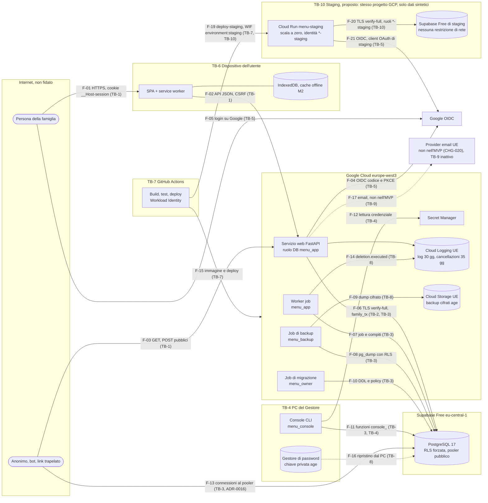

# Threat model: Menu Design

> Documento di proprietà del security-engineer. Versione 3, 2026-10-19. **Stato: approvato al gate G3 (2026-10-19, versione 2), aggiornato durante il gate G4 (versione 3).** La sezione 8 è adottata come **DPIA v1** della beta da M1 (CHG-015), in attesa della firma dell'utente.
>
> **Aggiornamento di SL-03b (2026-10-23).** Stato di THR-011, THR-012 e THR-013 dopo la slice dei limiti di frequenza; F-03 e la superficie di attacco precisano che solo l'avvio OIDC è limitato; nuovi rischi residui R-12 (finestra fissa) e R-13 (righe di SR-059 rinviate), accettati dall'utente il 2026-10-23 (CHG-021).
>
> **Novità della versione 3 (gate G4, 2026-10-19).** Riesame dopo:
> - CHG-020: login con email e password rinviato dopo M2. Nell'MVP l'app non invia email;
> - ADR-0005 rev. 5 e `docs/04-architecture.md` v6: ambiente di staging, contratto di `/healthz` (Q-T2), `If-Match` malformato (Q-T1, ADR-0008).
>
> In sintesi:
> - THR-121 e THR-122 sono **non applicabili nell'MVP** e il confine TB-9 è **inattivo**;
> - la DPIA non elenca più un provider email tra i responsabili dell'MVP;
> - lo staging è un nuovo confine di fiducia (TB-10, proposto) con le minacce THR-130 … THR-134;
> - `/healthz` e `If-Match` hanno le minacce THR-106 e THR-107.
>
> Il dettaglio è nella **sezione 16**. Non servono nuove SR.
>
> **Novità della versione 2.** Riesame dopo:
> - `docs/04-architecture.md` v4;
> - ADR-0001 rev. 3, ADR-0003 rev. 4, ADR-0004 rev. 2, ADR-0006 rev. 3, ADR-0011 rev. 3, ADR-0016 rev. 2;
> - `docs/05-data.md` v3;
> - `docs/02-requirements.md` con CHG-008 … CHG-015;
> - `docs/03-ux.md` aggiornato.
>
> Decisioni dell'utente del 2026-10-18 recepite:
> - SR-069 **respinta**: recupero semplice. THR-050 rivalutata, rischio residuo R-11 (sezione 15);
> - SR-071 ridotta alla sola scadenza di 7 giorni. THR-072 ha un rischio residuo accettato;
> - SR-068, SR-070, SR-072 … SR-076 accettate;
> - rischio Medio di THR-030 accettato;
> - sezione 8 adottata come DPIA v1.
>
> Ulteriori decisioni dell'utente del 2026-10-19 (dopo la revisione critica di G3, "facciamoci meno paranoie"):
> - recupero semplificato con l'hash dell'email, senza soglia né limite (R-11 accettato);
> - email alla console solo come SHA-256 (flusso F-18);
> - `postgres` offline, bootstrap dallo SQL editor di Supabase, password dei ruoli da Cloud Shell;
> - niente ruolo `menu_maint`;
> - RLS sulla sola `session`;
> - nessuna riconciliazione del registro delle cancellazioni;
> - rilevazione a sole finestre orarie.
>
> Il riesame e le incoerenze trovate tra i documenti sono nella **sezione 15**.
>
> Fonti: `docs/02-requirements.md` (v2 approvata a G2, più CHG-001 … CHG-007), `docs/03-ux.md` (v1 aggiornata), `docs/04-architecture.md` (v3), ADR-0001 … ADR-0016, `docs/05-data.md` (v2), `security-standard.md` di Bottega (OWASP ASVS 2, GDPR).
>
> **Stato di verifica:** il threat model è stato costruito sul design: non esiste ancora codice, quindi nessuna mitigazione è verificata da un test (colonna "Verificato da test": tutte le voci sono "da fare"). I fatti sui fornitori (Supabase, Cloud Run) che non ho potuto confermare su fonti ufficiali sono marcati **DA VERIFICARE** e raccolti nella sezione 13.
>
> Contenuto richiesto dai requisiti:
> - la valutazione dei rischi sintetica su minori e presenze in casa, precondizione di M1 (SR-065): sezione 8;
> - la verifica dei 9 controlli compensativi dell'endpoint del database esposto (ADR-0016): sezione 7;
> - le verifiche chieste dal gate G2 su SR-039, SR-066 e SR-067: THR-008, THR-009, THR-050, THR-060 … THR-064;
> - la verifica di DD-07 di `docs/03-ux.md`: THR-034.

## 0. Sintesi

**Giudizio complessivo.** Il design è solido sui punti che contano di più:
- isolamento su due livelli (filtro applicativo più RLS forzata, con FK composite e inventario in CI);
- sessioni opache con hash e cookie `__Host-`;
- inviti con `GET` innocuo, segreto nel frammento e consumo atomico;
- console senza accesso ai contenuti;
- backup cifrati con chiave offline e senza `BYPASSRLS`;
- eventi pseudonimizzati.

Restano **10 punti da sistemare**. Nessuno blocca le slice di M0, ma alcuni vanno chiusi prima di M1 o di M2.

| # | Punto | THR | Quando | Chi |
|---|---|---|---|---|
| 1 | **La riautenticazione non lega la nuova autenticazione allo stesso account.** Con il telefono sbloccato di un Amministratore, chiunque può riautenticarsi con il proprio account Google e sbloccare le operazioni critiche, se il server non confronta il `sub`. | THR-008 | Prima di M2 (ADR-0004 da precisare ora) | architect, SR-068 proposta |
| 2 | **Il recupero dell'Amministratore non è verificabile dal Gestore.** Per SR-012 il Gestore non vede le email degli account né chi sono gli Amministratori, quindi non può controllare l'email della richiesta né avvisare gli Amministratori (ASM-057 b-c). L'attesa di 72 ore è solo una regola procedurale. | THR-050 | Prima di M1 | architect, data-architect, UX, SR-069 proposta |
| 3 | **ADR-0016 sopravvaluta due controlli compensativi.** La RLS (controllo 4) non ferma chi ha rubato la credenziale di `menu_app`. La revisione mensile dei log (controllo 9) non è attuabile su Supabase Free, che conserva i log del database per 1 giorno. | THR-040, sezione 7 | Prima di M1 | utente (decisione), architect, devops, SR-075 proposta |
| 4 | **Il PC del Gestore è anche il PC di sviluppo.** Un pacchetto npm o PyPI malevolo installato lì può rubare i token `gcloud` del proprietario del progetto, cioè tutti i segreti e i backup. | THR-052, THR-090 | Prima di M0 in produzione | devops, utente, SR-074 proposta |
| 5 | **Il segreto dell'invito non ha un percorso definito attraverso il redirect OIDC.** `auth_flow` e `signup_pending` non prevedono l'invito. | THR-033 | Prima di M1 | architect, data-architect |
| 6 | **Il limite di 60 scritture al minuto è per sessione e le sessioni per account sono illimitate.** Un solo account può far crescere `change_event` di decine di MB al giorno ed esaurire i 500 MB condivisi da tutte le famiglie. | THR-013, THR-100 | M0 | architect, SR-070 proposta |
| 7 | **Le esportazioni della famiglia restano scaricabili per 24 ore da chi ha perso il ruolo o è uscito.** Inoltre il loro perimetro non esclude i dati di account degli altri membri (email, ultima visita, sessioni). | THR-060, THR-063 | M1 | architect, SR-072 proposta |
| 8 | **IP del client da `X-Forwarded-For`:** su Cloud Run va letto solo il valore aggiunto dalla piattaforma, altrimenti i limiti per IP si aggirano. | THR-012 | M0 | architect, tech-lead |
| 9 | **La cache offline dell'ex membro rimasto offline non scade mai** e contiene presenze nominative. | THR-072 | M2 | utente (decisione), SR-071 proposta |
| 10 | **DPIA.** L'elenco del Garante (provv. 467/2018, punto 6) include i "trattamenti non occasionali di dati relativi a soggetti vulnerabili" (minori). Una DPIA formale potrebbe quindi servire già da M1, e non solo prima dell'apertura al pubblico come deciso in SD-6. | sezione 8 | Prima di M1 | utente (decisione) |

**Stato dei 10 punti dopo le revisioni (v2, 2026-10-19):**

| # | Stato | Dove |
|---|---|---|
| 1 | **Risolto nel design:** SR-068 accettata, ADR-0004 rev. 2, AC-043.6 | THR-008 |
| 2 | **Semplificato per scelta dell'utente** (2026-10-19): recupero manuale con l'email (hash) del membro, avviso a tutta la famiglia, registro. Rischio residuo R-11 **Medio, accettato** | THR-050, sezione 15 |
| 3 | **Risolto nel design:** ADR-0016 rev. 2. Riconferma prima di M1 dopo V-1 | sezione 7 |
| 4 | **Risolto nel design:** console come job Cloud Run (ADR-0011 rev. 3), SR-074 accettata. Da verificare in `docs/09-release.md` | THR-052 |
| 5 | **Risolto nel design:** ADR-0004 rev. 2, `auth_flow.invite_id` | THR-033 |
| 6 | **Risolto nel design:** SR-070 accettata, ADR-0006 rev. 3 | THR-013, THR-100 |
| 7 | **Risolto nel design:** SR-072 accettata. Firma di `console_enqueue_export` da allineare | THR-060, THR-063 |
| 8 | **Risolto nel design:** ADR-0006 rev. 3. Resta V-3 in staging | THR-012 |
| 9 | **Parziale per scelta dell'utente:** solo la scadenza di 7 giorni. Rischio residuo Medio accettato | THR-072 |
| 10 | **Deciso:** sezione 8 adottata come DPIA v1 da M1 (CHG-015). Manca la firma | sezione 8 |

**DD-07 (nome della famiglia solo dopo il login):** confermata. È efficace contro gli osservatori passivi e non peggiora nulla. Non protegge da chi ha il link e fa il login, ma quella persona può comunque entrare (THR-034).

## 1. Ambito, ipotesi e scala del rischio

- **In ambito:**
  - M0, M1 e M2 dell'MVP (beta chiusa, fino a circa 50 famiglie e 250 account);
  - l'apertura al pubblico solo dove i requisiti la citano già (SR-050, DPIA).
- **Fuori ambito:** sicurezza interna di Google e Supabase oltre a quanto contrattualizzato (trattata come attore "fornitore"), app native future, login Apple.
- **Ipotesi di lavoro:**
  - H-1: il Gestore è una sola persona, che è anche lo sviluppatore e l'Amministratore della propria famiglia;
  - H-2: le famiglie tester sono invitate e conosciute, ma i loro membri (adolescenti compresi) non sono fidati tra loro oltre il ruolo;
  - H-3: i dispositivi degli utenti sono spesso condivisi in casa;
  - H-4: il link di invito viaggia su chat non controllate (WhatsApp, gruppi, backup delle chat).

**Scala.** Probabilità (P) e impatto (I): B = bassa, M = media, A = alta.

| P \ I | B | M | A |
|---|---|---|---|
| **A** | Medio | Alto | Critico |
| **M** | Basso | Medio | Alto |
| **B** | Basso | Basso | Medio |

- Il **rischio inerente** è quello senza mitigazioni.
- Il **residuo** è quello con le mitigazioni indicate, se applicate e verificate.
- Ogni minaccia con rischio inerente Alto o Critico ha una mitigazione assegnata.

## 2. Asset

| ID | Asset | Valore | Classe (`docs/05-data.md` §10) | Dove |
|---|---|---|---|---|
| A-01 | **Presenze, settimana tipo, ospiti** (quando la casa è vuota, abitudini dei minori) | Il dato più sensibile per la **sicurezza fisica** delle persone (SR-055) | Personale riservato, anche di minori | `attendance`, `typical_week*`, `meal.guests_*`, `change_event` (`before`/`after`), `export_file`, cache offline (M2) |
| A-02 | Identità e profili dei minori (nome dei profili sotto i 14 anni, account 14-17, dichiarazioni di età e di responsabilità genitoriale) | Interessati vulnerabili (GDPR cons. 38, art. 8) | Personale, minori | `person`, `account` |
| A-03 | Dati degli account (email, `sub`, nome visualizzato, ultima visita, ordinamento preferito, sessioni con IP troncato) | Identificazione, contatto, dato d'uso | Personale | `account`, `session`, `security_event` |
| A-04 | Contenuti della famiglia (piatti, note, fonti, voci libere, nome della famiglia, nomi degli "Altro pasto", gusti) | Riservatezza domestica. Note e gusti possono far dedurre salute o religione (Q-015) | Personale (contenuto) | Tabelle di famiglia |
| A-05 | Cronologia (eventi di modifica) | Integrità e responsabilità (FR-061), KPI | Personale (pseudonimo) | `change_event` |
| A-06 | **Credenziali e segreti** | Chiave dell'intero sistema | Segreto | Secret Manager: URL del database per ruolo, client secret OIDC, pepper HMAC. Gestore di password del Gestore: chiave privata `age`, password di `postgres` |
| A-07 | Token di sessione, token CSRF, segreti di inviti e codici, `code_verifier` | Accesso a un account o a una famiglia | Segreto (solo hash a riposo) | Cookie, browser (frammento dell'URL), DB come hash |
| A-08 | Backup cifrati e chiave privata `age` | Tutti i dati di tutte le famiglie | Personale riservato | Cloud Storage UE, copia offline mensile, gestore di password |
| A-09 | Registro di sicurezza e registro delle cancellazioni | Rilevazione, prova, diritto alla cancellazione dopo un ripristino | Personale (pseudonimo) | `security_event`, `deletion_log`, Cloud Logging (35 giorni) |
| A-10 | Account operativi del Gestore (Google Cloud, Supabase, GitHub, client OAuth, DNS e registrar) | Controllo totale | n/a | Fornitori |
| A-11 | Disponibilità del servizio e delle quote gratuite (500 MB di Supabase, Cloud Run) | Servizio per tutte le famiglie, costo | Interno | Piattaforma |
| A-12 | Codice e pipeline (repository, immagine, bundle della SPA) | Integrità di tutto il resto | Interno | GitHub, Artifact Registry |

## 3. Attori della minaccia

| ID | Attore | Capacità | Motivazione tipica | Punti di ingresso |
|---|---|---|---|---|
| AT-01 | Anonimo su Internet, bot | Richieste HTTP arbitrarie, header falsificati, scansioni, connessioni al pooler del database | Scansione opportunistica, credential stuffing, abuso delle risorse gratuite | TB-1, TB-3 (endpoint esposto, ADR-0016) |
| AT-02 | Bot di anteprima dei link (WhatsApp, Telegram) | `GET` automatici sui link condivisi | Nessuna (effetti collaterali) | TB-1 (pagina dell'invito) |
| AT-03 | **Chi possiede un link di invito trapelato** | Un account Google qualsiasi più il link | Curiosità, controllo, stalking | S-12, accettazione dell'invito |
| AT-04 | **Membro malintenzionato della famiglia** (qualunque ruolo, anche Amministratore) | Sessione valida, conoscenza della famiglia | Controllo, conflitti domestici, separazioni | Tutte le API della famiglia |
| AT-05 | **Ex membro** (rimosso o uscito) | Vecchie sessioni, cache offline, conoscenza delle abitudini, eventuali file esportati | Conflitto, controllo dopo una separazione | Sessione (ora non valida), dispositivo, esportazioni |
| AT-06 | **Account adolescente (14-17 anni)** | Qualunque ruolo, età solo autodichiarata, dispositivo spesso condiviso o meno protetto | Curiosità, condivisione impropria con amici. Più spesso è una **vittima**: dispositivo perso o compromesso | API della famiglia, dispositivo |
| AT-07 | Utente di un'altra famiglia | Sessione valida in un'altra famiglia | Curiosità, test di IDOR | TB-2 |
| AT-08 | Chi usa un dispositivo condiviso o prestato (familiare, amico) | Sessione aperta di 30-90 giorni | Opportunismo | TB-6 |
| AT-09 | **PC del Gestore compromesso** (malware, pacchetto malevolo, furto) | Token `gcloud` in cache, sessioni del browser, gestore di password sbloccato, repository, console | Furto di massa, ransomware | TB-4, TB-7, TB-8 |
| AT-10 | Gestore come insider | Console, dashboard Supabase (ruolo `postgres`), progetto cloud | Curiosità, errore | TB-4 (ASM-045) |
| AT-11 | **Fornitore cloud e database** (Supabase, Google) o loro personale; richieste di autorità extra-UE | Accesso all'infrastruttura, cifratura a riposo gestita dal fornitore | Abuso interno, obblighi di legge (CLOUD Act) | TB-3, TB-8 |
| AT-12 | Dipendenza compromessa (PyPI, npm, GitHub Actions, immagine base) | Esecuzione di codice in CI, sul PC o nel browser degli utenti | Furto di segreti e token, esfiltrazione | TB-7 |
| AT-13 | Social engineer verso il Gestore | Email e telefonate credibili | Prendere il controllo di una famiglia tramite il recupero (FR-064) | Contatto privacy, runbook |

## 4. Flussi di dati e confini di fiducia

### 4.1 Diagramma

I confini TB-1 … TB-9 sono quelli di `docs/04-architecture.md`. TB-9 (provider email) è **inattivo nell'MVP** (CHG-020). TB-10 (staging) è proposto in questa versione per l'architect (sezione 16). Le etichette degli archi riportano il flusso (F-nn) e il confine attraversato.

### 4.2 Flussi

| Flusso | Da → A | Dati | Confine | Controlli principali |
|---|---|---|---|---|
| F-01, F-02 | Browser → servizio web | Cookie di sessione, token CSRF, JSON con dati di famiglia | TB-1 | TLS 1.2+, HSTS, `__Host-`, CSRF con controllo di `Origin`, `extra=forbid`, `authorize`, rate limit, limiti sul corpo |
| F-03 | Anonimo → servizio web | Avvio e callback OIDC, pagina dell'invito, `/healthz` | TB-1 | Rate limit per IP **solo sull'avvio OIDC** (IPv6 per /64); il callback non ha un limite proprio (CHG-021, R-13). Nessun dato senza sessione, risposte generiche |
| F-04, F-05 | Servizio web e browser ↔ Google | `code`, `code_verifier`, token ID con `sub`, `email`, `name`, `auth_time` | TB-5 | PKCE S256, `state` e `nonce` monouso, validazione completa con joserfc |
| F-06 | Servizio web → DB | Tutto il dominio | TB-2, TB-3 | `family_tx` con `set_config(…, true)`, RLS forzata, FK composite, TLS `verify-full` |
| F-07 | Worker → DB | Congelamento, esportazioni, pulizie | TB-3 | `menu_app` con contesto di famiglia, più le funzioni di manutenzione (nessun ruolo `menu_maint`, decisione del 2026-10-19) |
| F-08, F-09 | Backup → DB → storage | Dump completo | TB-3, TB-8 | `menu_backup` senza `BYPASSRLS`, `--enable-row-security`, `age` verso chiave pubblica, bucket privato con ciclo di vita a 30 giorni |
| F-10 | Migrazione → DB | DDL, policy, funzioni | TB-3 | `menu_owner` solo nel job, revisione, test di inventario |
| F-11, F-12 | Console → DB e Secret Manager | Identificativi, esiti, segreto dei codici (M2) | TB-3, TB-4 | `menu_console` con sole funzioni dedicate, credenziale solo in memoria, MFA |
| F-13 | Internet → pooler | Tentativi di autenticazione | TB-3 | **Rischio accettato in ADR-0016** (sezione 7) |
| F-14 | Worker → Cloud Logging | Registro delle cancellazioni (solo ID) | TB-8 | Bucket di log dedicato, 35 giorni |
| F-15 | CI → cloud | Immagine, revisioni | TB-7 | Workload Identity Federation, azioni fissate a SHA |
| F-16 | PC del Gestore → DB temporaneo | Dump decifrato in streaming | TB-4, TB-8 | Nessun file in chiaro, progetto temporaneo cancellato |
| F-18 | PC del Gestore → job Cloud Run `menu-console` → DB | Argomenti del comando: identificativi, **SHA-256 delle email**, `request_ref`, hash dei codici. Esito nei log del job | TB-4, TB-3 | Nessuna credenziale del DB sul PC. Argomenti conservati nella configurazione dell'esecuzione e negli audit log (THR-053) |
| F-17 | Servizio web → provider email | Indirizzi, modelli fissi | TB-9 | **Non esiste nell'MVP** (CHG-020): nessun flusso invia email dall'app. Si attiva con FR-002 o con SR-050 (apertura al pubblico), con SR-061 |
| F-19 | GitHub Actions → risorse `*-staging` | Immagine (stesso digest della produzione), deploy, migrazioni di staging | TB-7, TB-10 | WIF `deploy-staging` legata al `subject` `repo:mrclttnz/menu-design:environment:staging`, permessi solo su `*-staging` (THR-130) |
| F-20 | `menu-staging` e job `*-staging` → Supabase di staging | Solo dati sintetici | TB-10 | Segreti `*-staging` distinti, TLS `verify-full`, stessi ruoli della produzione con password proprie (THR-132) |
| F-21 | `menu-staging` ↔ Google | Login degli account di prova | TB-5 | Client OAuth di staging con un solo redirect URI, `aud` distinto (THR-131) |

## 5. Superficie di attacco

| Punto di ingresso | Autenticazione | Note |
|---|---|---|
| `GET /`, asset, `index.html`, `sw.js`, manifest | Nessuna | Statici. `index.html` e i meta tag non contengono dati dinamici (nessun nome di famiglia, THR-034). `sw.js` servito con `no-cache`. |
| `GET /healthz` | Nessuna | Contratto di Q-T2: esegue `SELECT 1` con `menu_app`, timeout brevi, risponde solo `200 {"status":"ok"}` o `503 {"status":"unavailable"}`, senza versione, errori o tempi, con `no-store` e senza cookie. Rotta pubblica in OpenAPI (`x-authz: {scope: public}`). THR-106. |
| `POST /api/v1/auth/google/start` (con CSRF delle `POST` anonime), `GET /api/v1/auth/google/callback` | Nessuna, più il cookie `__Host-auth_flow` | **Solo l'avvio è limitato:** 30 avvii per IP in 15 minuti (IPv6 per /64, finestra fissa: R-12). Il callback e i login falliti non hanno un limite per IP (rinviati, CHG-021, R-13): il callback lavora solo con un flusso creato da un avvio limitato, monouso, e senza flusso non scrive nulla. `state`, `nonce` e PKCE. URL di ritorno solo da allow-list (THR-010). |
| Accettazione e rifiuto dell'invito, passo età e informativa (M1) | `__Host-signup` (dopo Google) oppure anonimo (rifiuto) | `POST` con CSRF (THR-007). 10 link non validi per IP in 15 minuti. |
| Risoluzione dell'invito prima del login (**da progettare**, THR-033) | Nessuna | Solo `POST`. Risposta generica. Non rivela il nome della famiglia. |
| `/api/v1/session`, `/api/v1/me/*` (compresi `plan-seen` e `preferences`) | Sessione | Solo i dati dell'account della sessione. |
| `/api/v1/family*`, `/people*`, `/invites*`, `/dishes*`, `/plan*`, `/meals/{date}/{type}/{slot}*`, `/attendance*`, `/typical-week*`, `/history*` | Sessione, più ruolo e famiglia | `authorize` e `family_tx` su ogni operazione, `x-authz` in OpenAPI. |
| `/api/v1/exports`, `/api/v1/exports/{id}/download` | Sessione, solo il richiedente | Allegato con `no-store`. Controlli di THR-060. |
| M2: codici di creazione (FR-005, FR-006) | `signup_pending` dopo Google | SR-059 (limiti per IP). |
| ~~M2: login con password, registrazione, recupero e verifica dell'email~~ | – | **Non esiste nell'MVP** (CHG-020). Torna con FR-002, insieme a THR-121 e THR-122. |
| **Staging:** `https://<url di menu-staging>` (stesse rotte della produzione) | Come la produzione | Raggiungibile da Internet, scala a zero, `max-instances=1`, solo dati sintetici, nessun allarme attivo fuori dalle esercitazioni (THR-130 … THR-134). |
| Pooler di Supabase di staging | Password dei ruoli di staging | Raggiungibile da Internet, senza restrizioni di rete (THR-132). |
| **Pooler PostgreSQL di Supabase** (porte 5432 e 6543) | Password del ruolo | **Raggiungibile da Internet** (ADR-0016). |
| API HTTPS del progetto Supabase (Auth, PostgREST, Storage) | Chiavi API del progetto | Data API disattivata. Auth e Storage non usati: vanno chiusi (sezione 7, controllo 6). |
| Console CLI (PC del Gestore) | Account Google del Gestore con MFA, credenziale da Secret Manager | Locale. |
| Dashboard di Supabase, console Google Cloud, GitHub, client OAuth, DNS e registrar | Account del Gestore con MFA | Chi li compromette controlla tutto (THR-052). |
| Job Cloud Run e Cloud Scheduler | IAM | Non invocabili pubblicamente (THR-094). |

## 6. Minacce (STRIDE)

Legenda delle colonne:
- **P, I, R.in.** = probabilità, impatto e rischio inerente;
- **Res.** = rischio residuo con le mitigazioni;
- **SR / ADR · Mx** = requisito o decisione che implementa la mitigazione, con la milestone. La slice la assegnerà il tech-lead in `docs/07-plan.md`.
- **Verificato da test:** il test previsto. Nessuno esiste ancora: tutte le voci sono "da fare".

### 6.1 Identità: OIDC, bootstrap, sessioni, CSRF, riautenticazione (TB-1, TB-5)

| ID | STRIDE | Componente | Minaccia e scenario | P | I | R.in. | Mitigazione | SR / ADR · Mx | Res. | Verificato da test |
|---|---|---|---|---|---|---|---|---|---|---|
| THR-001 | S | Callback OIDC | Token ID falsificato o manipolato (`alg=none`, altra chiave, `aud` o `iss` errati, scaduto, `nonce` ripetuto, `email_verified=false`) → impersonazione di qualunque account. | M | A | Alto | joserfc con RS256 fisso e JWKS di Google. Verifica di `iss`, `aud`, `exp`, `nonce` e `email_verified`. Token preso **solo** dalla risposta del token endpoint su TLS, mai da parametri del browser. Refresh del JWKS su `kid` sconosciuto, limitato nel tempo. | SR-001, SR-033 · ADR-0004 · M0 | Basso | Da fare: test con token manipolati (un caso per claim) |
| THR-002 | S | Avvio e callback OIDC | **Login CSRF / iniezione del codice:** l'attaccante fa completare al browser della vittima un callback con il proprio `code`. La vittima lavora nell'account dell'attaccante, e le sue presenze e note finiscono in quella famiglia. | M | M | Medio | `state` monouso (hash in `auth_flow`) legato al cookie `__Host-auth_flow` dello stesso browser. PKCE. Callback rifiutato senza cookie e riga corrispondenti. Riga cancellata al primo uso. | SR-033 · ADR-0004 · M0 | Basso | Da fare: callback con `state` di un altro flusso o senza cookie → rifiuto |
| THR-003 | S, E | Bootstrap (FR-007) | Chi controlla un account Google con l'email del bootstrap (indirizzo non Gmail riassegnato, alias, errore di battitura del Gestore) diventa Amministratore della famiglia. | B | A | Medio | `email_verified` obbligatorio. Confronto **esatto** con l'email normalizzata solo con `lower(btrim())`, senza togliere punti o suffissi `+` (normalizzare gli alias apre furti). Scadenza 7 giorni, monouso, evento di sicurezza, email cancellata al riscatto. Procedura: il Gestore emette il bootstrap solo per un indirizzo di cui la persona ha il controllo permanente e lo riscatta subito. | SR-033 · ADR-0004 · M0 | Basso | Da fare: bootstrap scaduto, email diversa per un punto o un `+`, email non verificata → nessun Amministratore |
| THR-004 | S | Account Google dell'utente | Account Google della vittima compromesso (phishing) → accesso alla famiglia con il ruolo della vittima. | M | A | Alto | Fuori dal controllo del prodotto: MFA delegata a Google (FR-059). Scadenze di 30 e 90 giorni, elenco e revoca delle sessioni (SR-038), revoca globale (SR-053), riautenticazione per le operazioni critiche (SR-039, SR-068). | SR-037, SR-038, SR-039, SR-053 · M0-M2 | Medio (accettato: dipende da Google) | Da fare: test di SR-038 |
| THR-005 | I, S | Cookie di sessione | Furto del token di sessione (XSS, malware, backup del browser) → accesso per 30-90 giorni. | M | A | Alto | Token di 256 bit da `secrets`, solo hash SHA-256 nel DB. Cookie `__Host-`, `HttpOnly`, `Secure`, `SameSite=Lax`. Mai in storage JS, IndexedDB o service worker. CSP `script-src 'self'` senza `unsafe-inline` e `unsafe-eval`. Revoca (SR-038). | SR-005, SR-037, SR-023 · ADR-0004 · M0 | Basso | Da fare: attributi del cookie, nessun token in chiaro nel DB, ricerca nel codice client di accessi allo storage |
| THR-006 | S | Sessione | Fixation: una sessione già presente nel browser resta valida dopo il login di un altro account. | B | M | Basso | Nuova sessione a ogni login. Al login, la sessione indicata dal cookie già presente viene cancellata. | SR-005 · ADR-0004 · M0 | Basso | Da fare: login con un cookie preesistente → vecchia sessione non valida |
| THR-007 | T | API che modificano dati (CSRF proprio, R-09) | CSRF da un sito terzo. Varianti: rifiuto anonimo di un invito, `POST /me/plan-seen`, logout forzato. | M | M | Medio | Token CSRF per sessione nell'header `X-CSRF-Token`, confrontato con `hmac.compare_digest`. Controllo di `Origin` o `Sec-Fetch-Site: same-origin` su **ogni** metodo non sicuro, **anche anonimo**. `Content-Type: application/json` obbligatorio sui metodi non sicuri. Nessun `GET` con effetti (logout compreso). Per i `POST` anonimi: controllo di `Origin` più token in un cookie `__Host-` (double submit). | SR-023, SR-043 · ADR-0004 · M0, M1 | Basso | Da fare: richieste senza token, con token di un'altra sessione, con `Origin` estraneo, con `text/plain` → `403` |
| THR-008 | E, S | **Riautenticazione (SR-039)** | Con il telefono sbloccato di un Amministratore, un familiare avvia "Conferma che sei tu" e si autentica con **il proprio** account Google. Se il server aggiorna `session.auth_time` senza confrontare il `sub` con quello dell'account della sessione, ottiene eliminazione della famiglia, nomina di sé come Amministratore ed esportazione. È proprio lo scenario che SR-039 vuole impedire. | M | A | Alto | **SR-068 (proposta):** la riautenticazione vale solo se il token ID ha la **stessa coppia (provider, `sub`)** dell'account della sessione. Altrimenti la riautenticazione fallisce, la sessione non cambia e si scrive un evento di sicurezza `reauth.mismatch`. Il flusso è legato alla sessione (`auth_flow.session_id`). | SR-039, SR-068 (accettata, CHG-008) · ADR-0004 rev. 2 · M2 | Basso | Da fare: riautenticazione con un altro `sub` → `auth_time` invariato, operazione ancora `reauth_required` |
| THR-009 | E | Riautenticazione | Google risponde con una sessione SSO senza chiedere la password (`prompt=login` o `max_age` non rispettati), oppure il token non contiene `auth_time`. | M | M | Medio | Il server richiede `auth_time` presente, con `auth_time ≥ auth_flow.created_at − 60 s` e `≤ now`. Altrimenti rifiuto. | SR-039, SR-068 (accettata) · ADR-0004 rev. 2 · M2 | Basso | Da fare: token senza `auth_time` o con `auth_time` vecchio → rifiuto |
| THR-010 | S, I | Redirect dopo il login | Open redirect tramite un parametro di ritorno (per esempio il "riprende dal punto" della riautenticazione) → phishing con il dominio dell'app. | M | M | Medio | Nessun URL di ritorno dal callback. Il percorso di ritorno si salva in `auth_flow` all'avvio, validato contro una allow-list di percorsi relativi della SPA. | SR-024 · ADR-0004 rev. 2 (`auth_flow.return_to`) · M0 | Basso | Da fare: `return_to` assoluto, `//host` o `javascript:` → ritorno alla home |
| THR-011 | D | `auth_flow`, `signup_pending` | Creazione massiva di stati temporanei e di chiamate verso Google. | M | B | Basso | 30 avvii per IP in 15 minuti, TTL di 10 e 30 minuti, pulizia oraria (SR-049), tetto di righe di `auth_flow` per IP. | SR-049, SR-059 · ADR-0006 · M0 | Basso | SL-03b: 31° avvio → `429` e concorrenza verificati. Chiave per IP con IPv6 ridotto al /64 e IPv4-mappato ridotto all'IPv4, verificata con test di regressione e nuova prova (SEC-SL03b-001 chiuso, 2026-10-23): il tetto di righe di `auth_flow` per IP è quindi dato dal limite degli avvii (al massimo 30 flussi per IPv4 o per /64 ogni 15 minuti). Resta aperta la pulizia di `auth_flow` e `rate_counter` in SL-10a (prima del rilascio di M0). Residui accettati: R-12 e R-13 (sezione 12) |
| THR-012 | S, R | Identità del client per i limiti e il registro | IP del client falsificabile con `X-Forwarded-For`. Se il servizio si fida di tutti i proxy (`--forwarded-allow-ips='*'`) e legge la voce più a sinistra, un bot cambia IP a ogni richiesta, aggira i limiti per IP (inviti, login, codici di creazione da M2) e scrive IP falsi nel registro. | A | M | Alto | Su Cloud Run usare **solo la voce aggiunta dal front end della piattaforma** (la più a destra), mai valori forniti dal client. Configurazione esplicita in un'unica funzione `client_ip()`. Comportamento reale di Cloud Run **DA VERIFICARE** con una richiesta con `X-Forwarded-For` falsificato. Limiti anche per identità e per sessione, non solo per IP. | SR-059 · ADR-0006 rev. 3 (`client_ip`, ultima voce) · M0 · resta V-3 | Basso | SL-03b: test d'integrazione con header falsificato verificato, `TRUSTED_PROXY_HOPS` obbligatorio e almeno 1 in staging e production, con avvio rifiutato altrimenti (SEC-SL03b-003 chiuso, 2026-10-23). Resta V-3 in staging (valore 1 o 2) |
| THR-013 | D | Sessioni | Sessioni illimitate per account: login ripetuti moltiplicano il limite per sessione (300 richieste e 60 scritture al minuto) e gonfiano la tabella `session`. | M | M | Medio | **SR-070 (proposta):** al massimo 20 sessioni attive per account (la più vecchia si revoca), limite di scritture anche per account. | SR-059, SR-070 (accettata, CHG-010) · ADR-0004 rev. 2, ADR-0006 rev. 3 · M0 | Basso | SL-03b: 21° login e login concorrenti verificati (AC-047.4), 60 scritture/min per account verificate |
| THR-014 | S, T | `signup_pending` (M1) | Riuso o furto del cookie `__Host-signup` per accettare un invito con un'identità altrui, o dopo la scadenza. | B | M | Basso | Handle di 256 bit salvato come hash, 30 minuti, monouso, legato a `sub`, CSRF, cancellato all'accettazione o al rifiuto. | SR-043, SR-049 · M1 | Basso | Da fare: riuso del cookie dopo l'accettazione → rifiuto |
| THR-015 | I | Client secret OIDC | Furto del client secret: un attaccante scambia codici intercettati o si spaccia per l'app nella schermata di consenso. | B | M | Basso | Client secret solo in Secret Manager, accessibile al solo servizio web. PKCE (un codice rubato è inutile senza il `code_verifier`). Redirect URI esatti nella configurazione del client OAuth. Rotazione in `docs/09-release.md`. | SR-001 · ADR-0004, ADR-0005 · M0 | Basso | Da fare: checklist di configurazione del client OAuth |

### 6.2 Isolamento tra famiglie e autorizzazione (TB-2)

| ID | STRIDE | Componente | Minaccia e scenario | P | I | R.in. | Mitigazione | SR / ADR · Mx | Res. | Verificato da test |
|---|---|---|---|---|---|---|---|---|---|---|
| THR-020 | I, T | Tutte le rotte con ID nell'URL | IDOR/BOLA: un account della famiglia B legge o modifica piatti, pasti, persone, inviti, sessioni o esportazioni della famiglia A. | A | A | **Critico** | Famiglia solo dalla membership della sessione. `family_tx` come unico accesso. RLS `ENABLE`+`FORCE` con `p_family`. UUID v4. `404` più evento di sicurezza. Test di inventario `cross_family` per ogni `operation_id`. | SR-008, SR-009, SR-042 · ADR-0003 · M0 | Basso | Da fare: inventario `cross_family` più test RLS di `docs/05-data.md` §6.4 |
| THR-021 | I, T | Corpi delle richieste | Riferimenti nel corpo verso oggetti di un'altra famiglia (`dish_id`, `course_id`, `person_id`, `tag_id`, profilo collegato, destinazione di sposta o copia) → nomi e fonti altrui nel proprio piano. | A | A | **Critico** | Verifica nella stessa transazione più FK composite `(family_id, id)` più RLS. Le colonne senza FK di `change_event` (`actor_person_id`, `subject_person_id`, `dish_id`) le scrive solo il server, e la mappa `refs` le risolve sotto RLS, quindi un ID estraneo diventa "persona eliminata" senza fuga di dati. | SR-041 · ADR-0003 · M0 | Basso | Da fare: un test negativo per ogni operazione che accetta riferimenti |
| THR-022 | E, T | Modelli di scrittura | Mass assignment: famiglia, ruolo, autore, versione, `status=tested` da Membro, `priority` da Membro (ASM-067), `name` su un pasto non `other`. | M | M | Medio | `extra='forbid'`, modelli di scrittura per ruolo, `403` per un campo vietato al ruolo, `422` per uno sconosciuto. `CHECK` nel DB come seconda linea. | SR-010 · ADR-0002 · M0 | Basso | Da fare: un test per campo vietato e per ruolo |
| THR-023 | E | `access.authorize` | Escalation verticale: un Membro o un Pianificatore chiama operazioni da Amministratore (inviti, ruoli, rimozioni, fuso, pasti di default). Ruolo letto da una cache vecchia. | M | A | Alto | Matrice centralizzata. `AuthzRoute` impedisce l'avvio senza dichiarazione. Membership e ruolo riletti a ogni richiesta. Test negativo per ogni cella "No" (SR-009). | SR-009 · ADR-0002, ADR-0003 · M0 | Basso | Da fare: inventario più test della matrice |
| THR-024 | E | Regole "Propri" e "Se presente" | Un Membro modifica presenze altrui, o gli ospiti di un pasto a cui non è presente, sfruttando una corsa tra verifica e scrittura. | M | M | Medio | Regola valutata nella stessa transazione della scrittura, con `effective_attendance`. Presenza propria derivata dalla `person` della sessione, mai dal corpo. | SR-009, SR-041 · ADR-0007 · M1 | Basso | Da fare: test della matrice "Se presente" |
| THR-025 | I, T | Query (ricerca `LIKE`, filtri, ordinamento preferito) | **SQL injection.** Con `menu_app` l'iniezione può chiamare `set_config` e leggere **tutte** le famiglie: la RLS non protegge da un'iniezione. | M | A | Alto | Solo query parametrizzate (SQLAlchemy Core) [MUST]. `ORDER BY` da una mappa fissa enum → colonna (`dish_sort_preference`). Escape di `%`, `_` e `\` nel pattern `LIKE`. Divieto di `text()` con stringhe formattate (regola semgrep). bandit e semgrep in CI. | SS §3 · ADR-0003 · M0 | Basso | Da fare: semgrep in CI, test con `%`, `_` e `'` nella ricerca |
| THR-026 | I | Policy RLS e migrazioni | Errori nelle policy (R-04): tabella di famiglia senza RLS, `WITH CHECK` mancante, policy `p_owner` o `p_backup` assenti, `FOR ALL` al posto di `FOR SELECT`. | B | A | Medio | Test in CI sull'inventario (`docs/05-data.md` §6.3, §6.4). Test RLS su PostgreSQL 17 reale. Revisione del security-engineer sulle migrazioni che toccano policy. | SR-042 · ADR-0003 · M0 | Basso | Da fare: test di inventario RLS e policy |
| THR-027 | I | Pooling di Supavisor | Il contesto di famiglia "resta" su una connessione riusata (un `SET` di sessione, o `set_config(…, false)`) e una richiesta di B gira con il contesto di A. | B | A | Medio | Solo `set_config(…, true)`, locale alla transazione. Nessun `SET` di sessione. Ogni accesso ai dati di famiglia dentro `family_tx`. Test: una transazione nuova senza contesto legge zero righe anche dopo una transazione con contesto sulla stessa connessione. | SR-042 · ADR-0003 · M0 | Basso | Da fare: test sul riuso della connessione |
| THR-028 | I | Tabella `account` senza RLS | Un difetto nel modulo `identity` (o una risposta che serializza troppo) espone email e nomi di **tutti** gli account, compresi gli adolescenti. | B | A | Medio | `system_tx` solo nel modulo `identity` (controllo statico). `response_model` espliciti. Test che nessuna risposta contenga email di altri account (AC-013.10). **RLS sulla sola `session`** (decisione del 2026-10-19). La RLS su `account` non è adottata: scelta proporzionata, accettata. | SR-042 · ADR-0003 · M0 | Basso-Medio (accettato) | Da fare: test sulle risposte del modulo `identity` |

### 6.3 Inviti, profili, ruoli e minori

| ID | STRIDE | Componente | Minaccia e scenario | P | I | R.in. | Mitigazione | SR / ADR · Mx | Res. | Verificato da test |
|---|---|---|---|---|---|---|---|---|---|---|
| THR-030 | E, I | Link di invito trapelato (AT-03) | Il link circola (inoltro, chat di gruppo, backup delle chat, screenshot). Chi lo usa per primo entra **come Pianificatore** e legge tutto: presenze, minori, gusti. Può anche usare come nome visualizzato quello di un familiare ("Mamma"), perché il nome viene da Google. | M | A | Alto | Ruolo massimo Pianificatore con `CHECK` nel DB (SR-044). Monouso atomico, 7 giorni, revocabile, massimo 20 in sospeso (SR-063). Ingresso visibile agli Amministratori. Avviso `invite.warn`. **SR-073 (proposta):** agli Amministratori si mostra anche l'**email verificata** di chi è entrato. Rimozione con effetto immediato (FR-012). Il destinatario legittimo trova il link già usato e lo segnala. | SR-007, SR-043, SR-044, SR-063, SR-073 (accettata, CHG-013) · M1 | **Medio, accettato esplicitamente dall'utente** (CHG-015) | Da fare: invito con ruolo `admin` rifiutato anche via API, evento visibile, test di concorrenza |
| THR-031 | D, T | Anteprima dei link (AT-02) | Il bot di anteprima apre il link e lo consuma o lo rifiuta. | A | B | Medio | `GET` senza effetti. Segreto nel frammento (non arriva al server). Accettazione e rifiuto solo con `POST` più CSRF. | SR-043 · M1 | Basso | Da fare: `GET` sulla pagina → invito ancora valido |
| THR-032 | I | Segreto dell'invito nel browser e nei log | Il segreto finisce in log del server o del proxy, nel `Referer`, nella cronologia del browser, negli errori del client o in uno screenshot dell'URL. | M | M | Medio | Segreto nel frammento `#`, `Referrer-Policy: no-referrer`. La SPA lo legge e lo **rimuove subito dall'URL** (`history.replaceState`). Mai in querystring, `localStorage` o messaggi d'errore. Redazione nei log. | SR-043, SR-021 · M1 | Basso | Da fare: dopo un'accettazione, ricerca del segreto nei log → zero occorrenze |
| THR-033 | T, I | **Invito attraverso il redirect OIDC (lacuna del design)** | Il frammento non sopravvive al giro su Google. Il design non dice dove il segreto o l'invito restano durante il login: `auth_flow.purpose` ammette solo `login` e `reauth`, e `signup_pending` non ha l'invito. Le soluzioni improvvisate sono deboli: segreto in `localStorage` (persistente ed esposto a XSS), oppure nel parametro `state` o in un URL di ritorno (finisce nei log di Google e della piattaforma). | M | M | Medio | **Mitigazione A-02 (architetto, data-architect):** prima del login la SPA invia il segreto con un `POST` anonimo (CSRF di THR-007, 10 per IP in 15 minuti). Il server lo risolve con `invite_resolve` e salva **solo `invite_id`** in `auth_flow` (nuovo `purpose='invite'`) e poi in `signup_pending.invite_id`. Il browser non conserva il segreto. Al callback il server rilegge l'invito: deve essere ancora `pending` e valido. | SR-043, SR-049 · ADR-0004 rev. 2, `docs/05-data.md` v3 (`auth_flow.invite_id`) · M1 | Basso | Da fare: flusso completo senza segreto nello storage, invito revocato durante il login → `accept.invalid` |
| THR-034 | I | **DD-07**, pagina dell'invito | Rivelazione del nome della famiglia a chi vede il link. **Valutazione:** prima del login non si rivela nulla, se la pagina è statica. Dopo il login, chiunque abbia il link e un account Google vede nome e ruolo prima di accettare: DD-07 non protegge da questa persona, che però potrebbe comunque entrare. Protegge invece da bot, osservatori dell'URL e anteprime. **DD-07 confermata.** | M | B | Basso | `index.html` e meta tag OG statici e generici. Nome della famiglia restituito solo con un `signup_pending` valido e un invito ancora valido. **Non** mostrato ad account già in una famiglia (ASM-050) né dopo il blocco per età. Nessun nome dell'invitante. | SR-043 · DD-07 · M1 | Basso | Da fare: la pagina senza login non contiene il nome. Account già in una famiglia → messaggio senza nome |
| THR-035 | T | Rifiuto e accettazione concorrenti | Chi ha il link lo "brucia" rifiutandolo (griefing), oppure due persone accettano insieme. | M | B | Basso | `UPDATE … WHERE status='pending' AND expires_at > now()`. Esito "rifiutato" visibile all'Amministratore. Indice unico su `person.account_id` (ASM-050). | SR-007, SR-043 · M1 | Basso | Da fare: AC-013.9 |
| THR-036 | E, I | Collegamento di un profilo (M2) | Un link collegato al profilo di un minore viene intercettato → lo sconosciuto eredita la storia delle presenze del minore. | B | A | Medio | Conferma di un Amministratore che vede nome **ed email** (SR-045). Prima della conferma nessuno storico. Invito precedente revocato (SR-063). Procedura di ASM-066. | SR-045, SR-063 · M2 | Basso | Da fare: AC-037.5 e AC-037.6 |
| THR-037 | R | Dichiarazioni di età e di responsabilità genitoriale | Un minore di 14 anni dichiara di averne almeno 14. Un adulto crea il profilo di un minore senza esserne responsabile. | M | M | Medio | Autodichiarazione per scelta della visione, registrata con data e autore (SR-013, SR-064). Procedura di Q-018 (rimozione e profilo). Informativa chiara. Valutato nella sezione 8. | SR-013, SR-064 · M1 | Medio (accettato, sezione 8) | Da fare: profilo rifiutato senza dichiarazione |
| THR-038 | E, D | Invariante sugli Amministratori | Corsa tra due Amministratori che si tolgono il ruolo a vicenda. Oppure un Amministratore malintenzionato rimuove tutti gli altri. | M | M | Medio | `SELECT … FOR UPDATE` sulla famiglia più trigger differito (SR-011). Gli abusi tra Amministratori sono interni alla famiglia (accettato). Il recupero (FR-064, SR-066) è possibile anche con Amministratori attivi, che vedono l'avviso a tutta la famiglia e possono reagire. Vedi THR-050 (R-11). | SR-011 · M1 | Basso | Da fare: AC-015.3 |
| THR-039 | E | Ruolo cambiato o account rimosso con richieste in volo | Un account declassato o rimosso continua a scrivere. | M | M | Medio | Membership e ruolo riletti a ogni richiesta, `403` o `404`. Cache offline svuotata (SR-046). | SR-005, SR-046 · M1 | Basso | Da fare: AC-014.3, AC-016.1 |

### 6.4 Database, ruoli e funzioni privilegiate, endpoint esposto (TB-3)

| ID | STRIDE | Componente | Minaccia e scenario | P | I | R.in. | Mitigazione | SR / ADR · Mx | Res. | Verificato da test |
|---|---|---|---|---|---|---|---|---|---|---|
| THR-040 | S, I, E | **Credenziali dei ruoli più endpoint pubblico (ADR-0016)** | Una credenziale sottratta (Secret Manager, PC del Gestore, CI, log, errore di configurazione) consente la connessione diretta da Internet. Effetto per ruolo: - `menu_app`: legge **tutte** le famiglie. `account` non ha RLS, quindi l'attaccante elenca gli ID degli account, imposta `app.account_id` per trovare le `person`, poi imposta `app.family_id`. La RLS non è un ostacolo; - `menu_backup`: lettura totale (`p_backup USING (true)`); - `menu_owner`: tutto, DDL compreso; - `menu_console`: solo funzioni. Può promuovere ad Amministratore un account che è **già** membro, accodare esportazioni (scaricabili solo dal richiedente) e revocare tutte le sessioni; - (`menu_maint` non esiste più dal 2026-10-19: le funzioni di manutenzione sono di `menu_app`.) | M | A | Alto | Controlli 1, 2, 3, 5, 6, 7, 8 di ADR-0016, rivisti nella sezione 7. **SR-075 (proposta):** "Enforce SSL" lato Supabase, network restrictions se disponibili sul piano Free, `CONNECTION LIMIT` per ruolo, password di `postgres` nel gestore di password, rilevazione sostitutiva del controllo 9. Accesso IAM per singolo segreto (un account di servizio per servizio o job). `menu_owner` solo nel job di migrazione. SR-074 per il PC. | SR-040, SR-075 (accettata) · ADR-0016 rev. 2 · M0, prima di M1 | Medio (accettato in ADR-0016 rev. 2, da riconfermare dopo V-1). Basso con le network restrictions e l'IP statico | Da fare: checklist in `docs/09-release.md`, test dei privilegi per ruolo |
| THR-041 | E, I | Pooler Supavisor e PostgreSQL esposti | Vulnerabilità remota non autenticata del pooler o di PostgreSQL. | B | A | Medio | Aggiornamenti del fornitore. Network restrictions, se disponibili (SR-075). Rivalutazione nella DPIA. | ADR-0016 · M0 | Medio (accettato, rischio residuo di ADR-0016) | n/a |
| THR-042 | S | Pooler | Forza bruta o credential stuffing sulle password dei ruoli. | M | A | Alto | Password casuali di almeno 32 caratteri (≥ 190 bit: forza bruta impraticabile). Ban automatici di Supabase (fail2ban, **DA VERIFICARE**: una fonte non ufficiale indica il ban dopo 2 tentativi errati, per 30 minuti). Password diverse per ruolo. | ADR-0016 c. 1, 5 · M0 | Basso | Da fare: verifica in `docs/09-release.md` |
| THR-043 | I, T | Client del database | Una connessione in chiaro o senza verifica del certificato (console, backup, ripristino) espone la password a un MITM. | B | A | Medio | `sslmode=verify-full` con la CA di Supabase. **All'avvio la configurazione rifiuta un URL senza `sslmode=verify-full`** (pydantic-settings). "Enforce SSL on incoming connections" attivo su Supabase (SR-075). | SR-023, SR-075 · ADR-0003, ADR-0014 · M0 | Basso | Da fare: test di configurazione con `sslmode=require` → avvio rifiutato |
| THR-044 | E | Funzioni `SECURITY DEFINER` (circa 15, proprietario `menu_owner`, con `p_owner USING (true)`; senza il ruolo `menu_maint` le funzioni di manutenzione sono eseguibili da `menu_app`) | Una funzione privilegiata diventa un bypass della RLS per: - hijacking del `search_path` (oggetti creati in `public` o in `app` da altri ruoli); - SQL dinamico o parametri non validati; - `EXECUTE` lasciato a `PUBLIC`; - `app.search_norm` che chiama `unaccent` senza qualificarne lo schema. | B | A | Medio | `SET search_path = app, pg_temp`. `REVOKE EXECUTE … FROM PUBLIC` più `ALTER DEFAULT PRIVILEGES`. `REVOKE CREATE ON SCHEMA public, app FROM PUBLIC`. Nessun SQL dinamico. Funzioni di `extensions` sempre qualificate (`extensions.unaccent`). Test in CI che elenca **tutte** le funzioni `SECURITY DEFINER` con i loro `GRANT` e le confronta con la matrice di `docs/05-data.md` §3. Le funzioni di manutenzione eseguibili da `menu_app` non hanno parametri arbitrari (agiscono solo su ciò che è già scaduto). `maint_apply_deletion` resta del solo proprietario. | SR-040, SR-042 · ADR-0003, ADR-0011 · M0 | Basso | Da fare: test d'inventario delle funzioni e dei grant |
| THR-045 | I | `invite_resolve`, `bootstrap_resolve` | Usate come oracolo da un `menu_app` compromesso (per sapere se esiste un bootstrap per un'email). | B | B | Basso | Solo hash o valori esatti, solo ID in uscita, rate limit a monte. Impatto minimo. | SR-043 · `docs/05-data.md` §6.2 · M0, M1 | Basso | Da fare: test delle funzioni |
| THR-046 | D | Quota di 500 MB di Supabase Free | Esaurimento dello spazio (crescita, abuso, esportazioni `bytea` fino a 20 MB). Il comportamento al superamento non è noto (sola lettura?): servizio fermo per **tutte** le famiglie. | M | A | Alto | Allarme al 70% (NFR-017), eventi compatti, quote (SR-060), **SR-070 (proposta)**, esportazioni ≤ 20 MB cancellate dopo 24 ore, misura nella prima slice, verifica del comportamento al superamento (ADR-0014, punto 2). | NFR-017, SR-060, SR-070 · ADR-0014 · M0 | Medio | Da fare: misura dello spazio nella prima slice |
| THR-047 | D | Supabase, Cloud Run | Pausa o indisponibilità del fornitore. I controlli falliscono chiusi → `503`. | B | M | Basso | Best effort (NFR-005). Uptime ogni 5 minuti. Backup propri. | NFR-005 · ADR-0005, ADR-0014 · M0 | Basso | n/a |
| THR-048 | T | Migrazioni | Una migrazione errata o malevola toglie una policy o un `FORCE`. | B | A | Medio | Revisione. Test d'inventario dopo `upgrade head`. `menu_owner` solo nel job. Deploy solo da `main` protetto (THR-091). | SR-042 · `docs/05-data.md` §12 · M0 | Basso | Da fare: test d'inventario in CI |

### 6.5 Console del Gestore (TB-4)

| ID | STRIDE | Componente | Minaccia e scenario | P | I | R.in. | Mitigazione | SR / ADR · Mx | Res. | Verificato da test |
|---|---|---|---|---|---|---|---|---|---|---|
| THR-050 | S, E | **Recupero dell'Amministratore, semplificato (FR-064, SR-066; decisione dell'utente del 2026-10-19)** | Il membro chiede dall'email del proprio account, e il Gestore lo aggiunge come Amministratore con `console_recover_admin(email_sha256, request_ref)`. Non c'è soglia di inattività, né controllo di un "Amministratore utilizzabile", né limite giornaliero: il comando funziona anche se la famiglia ha Amministratori attivi. Scenari: - **(a)** email con `From:` falsificato a nome di un membro; - **(b)** casella email di un membro compromessa; - **(c)** membro che chiede il ruolo senza titolo (adolescente, ex partner ancora membro); - **(d)** il nuovo Amministratore rimuove gli altri, crea inviti o chiede l'esportazione della famiglia. Impatto: controllo della famiglia. I dati del piano li vede già come membro. | M | A | Alto | Il comando agisce solo su un account **già membro** (la funzione verifica l'hash dell'email sull'account). **Avviso a tutta la famiglia** (`family_notice`, 30 giorni, con il contatto per segnalare). Evento in cronologia ed evento di sicurezza con allarme (SR-058). Sessioni dell'account promosso invalidate. Gli Amministratori attivi vedono l'avviso e possono rimuovere l'account (FR-012) o, da M2, revocargli il ruolo (FR-066). Il Gestore è il filtro umano: ogni esecuzione è manuale. **Buona pratica proporzionata nel runbook** (facoltativa, costo minimo): controllare `dkim=pass`/`dmarc=pass` negli header e, nel dubbio, rispondere all'indirizzo chiedendo una conferma. | SR-066 · ADR-0011, `docs/05-data.md` · M1 | **Medio, R-11, ACCETTATO dall'utente** (2026-10-19) | Da fare: account non membro → nessuna modifica. Avviso creato. Evento scritto per ogni esito. Nessuna email in chiaro salvata |
| THR-051 | I | Gestore come insider (AT-10) | Il Gestore usa la console o la dashboard per leggere i contenuti delle famiglie tester. | B | A | Medio | `menu_console` senza privilegi sulle tabelle, viste aggregate con soglia `<5` (SR-012, SR-040, SR-055). L'accesso diretto con `postgres` dalla dashboard di Supabase resta procedurale (ASM-045) con `console_audit_note`. | SR-012, SR-040, SR-055 · ADR-0011 · M0 | Medio (accettato, ASM-045) | Da fare: test "permesso negato" per `menu_console` |
| THR-052 | E, I, T | **PC del Gestore (AT-09)** | Il PC è anche quello di sviluppo, dove girano `pnpm install` e `uv sync`. Un pacchetto malevolo o un malware ruba: - i token `gcloud` in cache (proprietario del progetto) → **tutti** i segreti di Secret Manager (`menu_owner`, `menu_app`, `menu_backup`), Cloud Run, bucket dei backup, client OAuth; - le sessioni del browser (Supabase, GitHub) → codice malevolo in produzione tramite la pipeline; - la chiave privata `age` dal gestore di password sbloccato; - le credenziali `menu_owner` usate dal PC per `maint replay-deletions` e `db/bootstrap.sql`. L'MFA non protegge i token già in cache. | M | A | Alto | **SR-074 (proposta):** - identità operativa separata dalla quotidiana: impersonazione di un account di servizio con il solo `secretAccessor` sul segreto della console, senza token di proprietario persistenti; - installazioni e build in un container o in un utente del sistema operativo separati da quelli che hanno le credenziali operative; - script di installazione npm bloccati; - MFA resistente al phishing (passkey o chiave di sicurezza) su Google, Supabase, GitHub e registrar; - cifratura del disco; - `db/bootstrap.sql` eseguito dallo SQL editor di Supabase; `maint replay-deletions` eseguito con l'identità del job di migrazione; il PC tocca il database solo durante un ripristino (ADR-0015 rev. 4); - protezione del branch e dell'ambiente di deploy (THR-091); - allarme su ogni comando console (SR-058). | SR-040, SR-074 (accettata) · ADR-0011 rev. 3 (console come job Cloud Run: nessuna credenziale del database sul PC), ADR-0005, ADR-0015 · M0 | Medio (resta il rischio sui token `gcloud`, che possono avviare il job console e i deploy) | Da fare: checklist in `docs/09-release.md` |
| THR-053 | I | Argomenti della console, log delle esecuzioni dei job | La console gira come job Cloud Run: i suoi argomenti restano nella configurazione dell'esecuzione e negli audit log di Google Cloud (flusso F-18). Un'email in chiaro o un dato personale in `request_ref` vi resterebbe per la durata di quei log. | M | M | Medio | Le email arrivano alla console **solo come SHA-256** dell'email normalizzata, calcolato solo in Python da `menu.common.email_sha256` (ADR-0011). Il Gestore inserisce l'email a un prompt interattivo, mai sulla riga di comando, quindi non finisce nella cronologia della shell. `request_ref` con formato vincolato senza dati personali. Il segreto dei codici è generato in locale, al job arriva solo l'hash. Nota: l'hash di un'email è uno **pseudonimo, non un'anonimizzazione** (chi conosce l'email può ricalcolarlo), ma basta a tenere gli indirizzi fuori dai log. **Il devops verifica e annota in `docs/09-release.md`** cosa conservano, e per quanto, le esecuzioni di Cloud Run Jobs e gli audit log (Admin Activity e Data Access). | SR-021, SR-040, SR-066 · ADR-0011 · M0-M2 | Basso | Da fare: test del formato di `request_ref`, verifica del devops sui log |
| THR-054 | R | Registro dei comandi console | Il Gestore, o chi ha il suo PC, nega o cancella un'azione: il registro nel DB è modificabile dal proprietario. | B | M | Basso | Evento `console.*` più allarme immediato via email (SR-058): la traccia esiste anche fuori dal database. | SR-057, SR-058 · M1 | Basso | Da fare: test dell'allarme |
| THR-055 | D | `console_revoke_all_sessions` | Con la credenziale della console rubata, tutti gli utenti vengono disconnessi. | B | M | Basso | Impatto limitato (nuovo login). Allarme SR-058. | SR-053 · M1 | Basso | n/a |

### 6.6 Esportazioni, coda di lavoro e worker (R-09)

| ID | STRIDE | Componente | Minaccia e scenario | P | I | R.in. | Mitigazione | SR / ADR · Mx | Res. | Verificato da test |
|---|---|---|---|---|---|---|---|---|---|---|
| THR-060 | I | **Download dell'esportazione della famiglia (SR-067)** | Il file resta scaricabile per 24 ore anche se il richiedente, nel frattempo, è stato declassato, rimosso o è uscito (AT-05). Oppure un telefono prestato scarica lo ZIP con tutti i dati, minori compresi. | B | A | Medio | **SR-072 (proposta):** - per `scope='family'` il download richiede che il richiedente sia **ancora Amministratore** di `export_file.family_id`; - i file `family` del richiedente si cancellano quando perde il ruolo, esce o viene rimosso; - da M2 il download di un'esportazione della famiglia richiede la riautenticazione (estende SR-039). | SR-016, SR-067, SR-072 (accettata, CHG-012) · ADR-0013, `purge_family_exports` · M1 (riautenticazione M2) | Basso | Da fare: declassamento dopo la generazione → download `404` |
| THR-061 | S, I | Avvio dell'esportazione | Il Gestore accoda un'esportazione per l'email (hash) sbagliata o indicata da un impostore. | M | M | Medio | Il file è scaricabile **solo** dall'account richiedente autenticato nell'app, per 24 ore: un impostore non lo ottiene senza controllare quell'account. Il worker ricontrolla il perimetro (AC-044.4, SR-072). Email solo come hash (THR-053). | SR-067, SR-072 · ADR-0011 · M1 | Basso | Da fare: AC-044.2 … AC-044.4 |
| THR-062 | T | CSV esportati | Formula injection (un nome di piatto `=HYPERLINK(...)` aperto in un foglio di calcolo). | M | M | Medio | Neutralizzazione di `= + - @ \t \r` all'inizio della cella (SR-016), anche dopo spazi iniziali. Nomi dei file nello ZIP fissi. | SR-016 · M1 | Basso | Da fare: test con celle malevole |
| THR-063 | I | Perimetro dell'esportazione | L'esportazione della famiglia include dati a livello di account degli **altri** membri: email, ultima visita, ordinamento preferito, sessioni, IP. Oppure l'esportazione "propri dati" include righe di altre persone. | M | M | Medio | SR-072: famiglia = contenuti della famiglia più i soli nomi visualizzati delle persone. Propri dati = account, sessioni (senza IP) e righe della propria `person`. Mai email, `last_visit_at` o sessioni di altri. | SR-014, SR-072 · M1 | Basso | Da fare: test del perimetro |
| THR-064 | T, E | Coda `job` (codice proprio) | `menu_app` può inserire job: un difetto o una compromissione dell'app accoda esportazioni con un payload manipolato (`family_id` di un'altra famiglia). | B | M | Basso | Il worker **ignora** `family_id` del payload e lo ricava dalla membership attuale del richiedente. Tipi di job in allow-list (`CHECK`). Il file va solo al richiedente. `dedupe_key`. | SR-067 · ADR-0013 (da precisare) · M1 | Basso | Da fare: job con `family_id` estraneo → nessun dato di quella famiglia |
| THR-065 | D | Worker | Job velenoso, lease scaduti, due worker sovrapposti. | M | B | Basso | `SKIP LOCKED`, `locked_until`, massimo 5 tentativi, advisory lock per compito, compiti idempotenti, timeout di 240 secondi. | ADR-0013 · M1 | Basso | Da fare: test di concorrenza della coda |
| THR-066 | I | Esportazioni nei backup | Un file d'esportazione presente al momento del dump resta nel backup cifrato fino a 30 giorni. | B | M | Basso | Accettato in `docs/05-data.md` §13. Da citare nell'informativa. | SR-016, SR-028 · M1 | Basso | n/a |

### 6.7 Client, PWA e cache (TB-6)

| ID | STRIDE | Componente | Minaccia e scenario | P | I | R.in. | Mitigazione | SR / ADR · Mx | Res. | Verificato da test |
|---|---|---|---|---|---|---|---|---|---|---|
| THR-070 | T, I | SPA | **XSS memorizzato** tramite contenuti degli utenti: nomi di piatti, note, voci libere, nomi degli "Altro pasto", nota degli ospiti, portate, tag, nome della famiglia, `name` di Google come nome proposto. Con l'XSS si leggono i dati della famiglia e si agisce come la vittima (il token CSRF è leggibile via API). | M | A | Alto | Escape di React. `dangerouslySetInnerHTML` vietato (ESLint). CSP `script-src 'self'`, `object-src 'none'`, `base-uri 'none'`, `connect-src 'self'` (limita anche l'esfiltrazione). **Raccomandato:** `require-trusted-types-for 'script'`. URL delle fonti solo `http` e `https`, controllati sul server **e** nel client prima di renderli come `href`. Informativa resa senza HTML. Messaggi ICU di Lingui senza HTML. | SR-023, SR-024 · ADR-0001 · M0 | Basso | Da fare: test e2e con payload XSS in ogni campo di testo, test degli header |
| THR-071 | I | Fonti della ricetta | Link a pagine di phishing, reverse tabnabbing. | M | B | Basso | `rel="noopener noreferrer"`, solo `http` e `https`, il server non apre mai i link (nessun SSRF). | SR-024 · M0 | Basso | Da fare: test di rendering |
| THR-072 | I | **Cache offline (M2)** | La cache si svuota solo quando l'app torna online (SR-026, SR-046). Un **ex membro** che resta offline, o un telefono perso o condiviso, conserva l'ultimo piano con le **presenze nominative e le note degli ospiti** (dato riservato, A-01). | M | M | Medio | SR-026 e SR-046. Logout e cambio di account svuotano la cache. Cache per account. Nessun token in cache. **SR-071 accettata in forma ridotta (CHG-011):** i dati più vecchi di 7 giorni non si mostrano e si cancellano all'apertura (AC-041.5, ADR-0001 rev. 3). Il contenuto **resta invariato** per scelta dell'utente. Nota: la scadenza si applica solo quando l'app viene aperta. Su un dispositivo spento o non aperto i dati restano in IndexedDB finché l'app non parte, e chi estrae lo storage del browser li legge comunque. | SR-026, SR-046, SR-071 · ADR-0001 rev. 3 · M2 | **Medio** (accettato dall'utente, CHG-011: esposizione fino a 7 giorni dall'ultimo aggiornamento, e oltre se l'app non viene aperta) | Da fare: AC-041.3, AC-041.5 |
| THR-073 | T, I | Service worker | Il service worker serve dalla cache risposte API o la navigazione verso il callback OIDC (`navigateFallback`). Oppure un service worker vecchio, con un difetto, resta attivo. | M | M | Medio | Precache della sola app shell. `navigateFallbackDenylist` per `/api/`. Nessun runtime caching delle API. `sw.js` con `no-cache`. Aggiornamento con `skipWaiting` dopo il rilascio. | SR-046 · ADR-0001 (da precisare) · M2 | Basso | Da fare: test e2e del login con il service worker attivo |
| THR-074 | I, T | Header | Clickjacking, MIME sniffing, fuga del `Referer`. | M | M | Medio | `frame-ancestors 'none'`, `nosniff`, `Referrer-Policy: no-referrer` (almeno sulla pagina dell'invito, `strict-origin-when-cross-origin` altrove), HSTS. | SR-023 · M0 | Basso | Da fare: test degli header |
| THR-075 | I | Cache HTTP | Risposte autenticate salvate da cache del browser o intermedie. | B | M | Basso | `Cache-Control: no-store` sulle risposte autenticate. | SR-046 · M0 | Basso | Da fare: test degli header |
| THR-076 | S, E | Dispositivo condiviso (AT-08) | Un familiare usa la sessione di 30-90 giorni di un Amministratore: crea inviti, rimuove persone, cambia ruoli. | M | M | Medio | Logout sempre raggiungibile. Sessioni revocabili. Riautenticazione per le operazioni critiche (M2). Accettato per inviti e ruoli (SD-3 b). | SR-038, SR-039 · M1, M2 | Medio (accettato, SD-3) | n/a |

### 6.8 Backup, ripristino e cancellazioni (TB-8)

| ID | STRIDE | Componente | Minaccia e scenario | P | I | R.in. | Mitigazione | SR / ADR · Mx | Res. | Verificato da test |
|---|---|---|---|---|---|---|---|---|---|---|
| THR-080 | I | Bucket dei backup | Furto dei file di backup. | B | A | Medio | Cifratura `age` prima del caricamento, chiave privata solo offline, bucket privato UE con prevenzione dell'accesso pubblico, account del job con sola creazione. | SR-028 · ADR-0015 · M0 | Basso | Da fare: verifica del bucket in `docs/09-release.md` |
| THR-081 | I | Ruolo `menu_backup` senza `BYPASSRLS` | La credenziale di `menu_backup` equivale a una lettura totale (`p_backup USING (true)`). | B | A | Medio | Segreto accessibile solo al job di backup (IAM per segreto). `CONNECTION LIMIT` basso (SR-075). Rotazione. Vedi THR-040. | SR-075 · ADR-0015 · M0 | Basso | Da fare: test dei privilegi |
| THR-082 | D, T | Backup e chiave | Un'identità compromessa cancella o sostituisce i backup (ransomware). Oppure la chiave privata `age` va persa. | B | A | Medio | **Retention policy** del bucket (per esempio 25 giorni, non bloccata) che impedisce la cancellazione anticipata, compatibile con il ciclo di vita a 30 giorni. Due copie della chiave privata. Copia offline mensile. | NFR-006 · ADR-0015 (da precisare) · M0 | Basso | Da fare: tentativo di cancellazione anticipata → rifiutato |
| THR-083 | R, I | **Cancellazioni dopo un ripristino (SR-048)** | Dati cancellati tornano in vita dopo un ripristino, se l'evento `deletion.executed` non arriva al registro esterno, oppure se si ripristina da una copia più vecchia di 35 giorni. | B | A | Medio | Registro esterno di 35 giorni, più lungo dei backup. Copia offline ruotata entro 30 giorni. Replay prima della riapertura. Prova trimestrale con un account cancellato. Un errore di emissione del log produce un errore applicativo con allarme (NFR-007). La riconciliazione giornaliera **non è adottata** (decisione del 2026-10-19). | SR-017, SR-018, SR-048 · ADR-0015 · M1 | Basso (accettato) | Da fare: prova di ripristino trimestrale |
| THR-084 | I | Ripristino di prova | Il progetto Supabase temporaneo con dati reali resta esposto (password debole, Data API attiva) o dimenticato. | B | A | Medio | Stessa configurazione della produzione (password casuali, MFA, Data API spenta, SSL forzato). Cancellazione entro 24 ore annotata nel runbook. | SR-029, SR-075 · ADR-0015 · M1 | Basso | Da fare: checklist del runbook |
| THR-085 | D | Dump | Dump incompleto, perché manca una policy `p_backup`. | B | A | Medio | `pg_dump --enable-row-security` fallisce invece di produrre un dump parziale. Controllo in CI delle policy. | NFR-006 · ADR-0015 · M0 | Basso | Da fare: test del dump con `menu_backup` |

### 6.9 CI/CD e catena di fornitura (TB-7)

| ID | STRIDE | Componente | Minaccia e scenario | P | I | R.in. | Mitigazione | SR / ADR · Mx | Res. | Verificato da test |
|---|---|---|---|---|---|---|---|---|---|---|
| THR-090 | T, E, I | Dipendenze Python e npm | Pacchetto malevolo o compromesso (typosquatting, account del maintainer violato, worm npm che si autopropaga, script `postinstall`). Effetti: furto di segreti in CI o sul PC (THR-052), oppure codice nel bundle della SPA che esfiltra i dati delle famiglie dal browser. | M | A | Alto | **SR-076 (proposta):** - `uv.lock` e `pnpm-lock.yaml` committati con hash; - verifica del nome e dell'esistenza prima di aggiungere una dipendenza (protocollo §3.7); - **cooldown di 7 giorni** sulle nuove versioni (pnpm `minimumReleaseAge`, uv `exclude-newer` relativo); - script di installazione bloccati salvo allow-list (`onlyBuiltDependencies` di pnpm); - osv-scanner, pip-audit e `pnpm audit` in CI; - aggiornamenti automatici con revisione; - poche dipendenze; - CSP `connect-src 'self'` (limita l'esfiltrazione dal browser). | SS §11, SR-076 · ADR-0002 · M0 | Medio | Da fare: job di CI che fallisce su CVE alte o critiche |
| THR-091 | T, E | GitHub Actions e deploy | Azioni non fissate, `pull_request_target`, token con permessi ampi, segreti esposti a PR da fork, Workload Identity Federation con una condizione troppo larga (qualunque branch o repository impersona l'account di servizio di deploy). | M | A | Alto | Azioni fissate a SHA. `permissions:` minime per job (`contents: read` per default). Nessun `pull_request_target`. Condizione WIF su `repository` e `ref == refs/heads/main`, più un environment di produzione protetto. zizmor in CI. Branch protection su `main`. | SS §11, SR-076 · ADR-0005 · M0 | Basso | Da fare: zizmor in CI, revisione della configurazione WIF |
| THR-092 | T | Immagine container | Base non fissata, CVE, esecuzione come root, segreti nei layer. | M | M | Medio | `python:3.14-slim` fissata per digest, multi-stage, utente non root, file system di sola lettura, trivy image e hadolint in CI. | SS §12 · ADR-0002, ADR-0005 · M0 | Basso | Da fare: trivy in CI |
| THR-093 | I | Repository | Segreti nel codice o nella storia git (`.env`, URL del database, client secret). | M | A | Alto | `.env*` in `.gitignore`, solo `.env.example`, gitleaks in pre-commit e in CI su tutta la storia. | SS §6 · M0 | Basso | Da fare: gitleaks in CI |
| THR-094 | T, E, I | Configurazione cloud | Errori di configurazione: - bucket pubblico; - job Cloud Run invocabili da chiunque; - Secret Manager con accesso a livello di progetto; - account di servizio predefinito con ruolo Editor; - log con dati fuori dall'UE. | M | A | Alto | Un account di servizio dedicato per servizio e per job, `secretAccessor` sul singolo segreto, nessun invoker pubblico per i job, prevenzione dell'accesso pubblico al bucket, sink dei log in europe-west3. trivy config sull'eventuale IaC. Checklist in `docs/09-release.md`. | SR-027, SR-040, SR-051 · ADR-0005 · M0 | Basso | Da fare: checklist di configurazione |

### 6.10 Disponibilità e abusi

| ID | STRIDE | Componente | Minaccia e scenario | P | I | R.in. | Mitigazione | SR / ADR · Mx | Res. | Verificato da test |
|---|---|---|---|---|---|---|---|---|---|---|
| THR-100 | D | Scritture tracciate | Un account malintenzionato o compromesso apre N sessioni, ciascuna con 60 scritture al minuto: ogni sessione produce circa 86.000 eventi al giorno (circa 30 MB). I 500 MB condivisi si esauriscono in pochi giorni. | B | A | Medio | **SR-070 (proposta):** - 60 scritture al minuto **per account** (tutte le sessioni insieme); - un tetto giornaliero di scritture tracciate per famiglia (proposta: 5.000); - massimo 20 sessioni per account. Più allarme al 70% (NFR-017) e metrica giornaliera dello spazio per famiglia (`maint_db_size`). | SR-059, SR-060, SR-070 (accettata: 60/min per account, 5.000/giorno per famiglia, 20 sessioni) · ADR-0006 rev. 3 · M0 | Basso | Da fare: test dei limiti per account e per famiglia (AC-049.5, AC-047.4) |
| THR-101 | D | Costi | Denial of wallet su Cloud Run e sui job. | M | M | Medio | `max-instances=2`, budget con avvisi a 1 € e 5 €, timeout dei job, degrado documentato (SR-062). | SR-062 · ADR-0005 · M0 | Basso | Da fare: verifica del budget in `docs/09-release.md` |
| THR-102 | D | API | Corpi enormi, JSON profondo, intervalli lunghi, pagine grandi. | M | M | Medio | 64 KB, profondità 10, 62 giorni, massimo 100 elementi per pagina (SR-060). | SR-060 · M0 | Basso | Da fare: AC di SR-060 |
| THR-103 | D | Limiti di frequenza in PostgreSQL | Il rate limiter fallisce chiuso: un database lento produce `503` ovunque, e i contatori moltiplicano le scritture. | B | M | Basso | Transazione breve e separata, pulizia oraria. Accettato. | SR-059 · ADR-0006 · M0 | Basso | n/a |
| THR-104 | D | Lock sulla famiglia | Operazioni che tengono a lungo `family FOR UPDATE` bloccano la famiglia. | B | M | Basso | `lock_timeout` di 3 secondi, `statement_timeout` di 5 secondi, congelamento in SQL basato su insiemi. | ADR-0007 · M1 | Basso | Da fare: test di carico |
| THR-105 | T | "Oggi" e passato | Il client manipola la data per alterare il "passato" o il congelamento. | B | M | Basso | "Oggi" calcolato nel database, nessuna data del client definisce il passato (ADR-0009). | ADR-0009 · M0 | Basso | Da fare: test con orologio simulato |
| THR-106 | D, I | **`GET /healthz` pubblico (Q-T2)** | Endpoint anonimo che apre una transazione su `menu_app`. Un flood di richieste occupa le connessioni del pool e i 2 s di attesa della connessione, e rallenta le richieste vere. Il corpo potrebbe rivelare versione o errori del database. | M | B | Basso | Contratto di Q-T2: corpo solo `status`, `no-store`, nessun cookie, timeout brevi. **Raccomandazioni economiche:** usare il pool esistente (mai una connessione nuova per richiesta) e tenere in memoria l'esito per circa 5 s, così N richieste al secondo producono al massimo un `SELECT 1` ogni 5 s per istanza. `max-instances` limita il costo (THR-101). Niente rate limit in PostgreSQL su questa rotta: il controllo deve misurare il database, non dipendere dai contatori. | NFR-005, SR-060 · `docs/04-architecture.md` (`platform.http`) · M0 | Basso | Da fare: il corpo di `200` e `503` contiene solo `status`; con il database fermo → `503` entro il timeout |
| THR-107 | D, T | **`If-Match` malformato (Q-T1, ADR-0008)** | Un valore fuori formato fa scrivere senza controllo di versione oppure produce un `500`. Caso concreto: la regex ammette fino a 19 cifre (`[1-9][0-9]{0,18}`), ma `9999999999999999999` supera il massimo di `bigint` (9223372036854775807), quindi il confronto in PostgreSQL fallisce con un errore di overflow e la risposta è `500` invece di `422`. Un valore ripetuto nel corpo dell'errore o nei log potrebbe anche riflettere input non fidato. | M | B | Basso | Regex ancorata e limitata (nessun ReDoS), `*` rifiutato, header assente → `428`, qualsiasi altro valore → `422 invalid_value` senza scrittura né evento (ADR-0008). **Aggiunta:** dopo la regex convertire in `int` e rifiutare con lo stesso `422` i valori oltre 2^63−1, oppure limitare la regex a 18 cifre. Il valore ricevuto non compare nel corpo dell'errore né nei log. | ADR-0008, ADR-0010 · M0 | Basso | Da fare: `abc`, `W/"3"`, `*`, header vuoto, `"9999999999999999999"` → `422 invalid_value`, nessun evento, nessun `500` |

### 6.11 Log, registri e privacy dei nuovi dati (ultima visita, ordinamento preferito)

| ID | STRIDE | Componente | Minaccia e scenario | P | I | R.in. | Mitigazione | SR / ADR · Mx | Res. | Verificato da test |
|---|---|---|---|---|---|---|---|---|---|---|
| THR-110 | I | Log applicativi e della piattaforma | Segreti (cookie, CSRF, segreti degli inviti, `code_verifier`) o dati riservati (presenze, nomi, note) nei log o negli errori. **Nota:** i log delle richieste di Cloud Run contengono l'URL con la querystring, quindi `code` e `state` del callback OIDC sono registrati dalla piattaforma. Il rischio è accettabile: il codice è monouso e inutile senza `code_verifier`. | M | M | Medio | Redazione in structlog, nessun corpo nei log, errori generici RFC 9457, IP troncati nei log applicativi, nessun segreto in querystring tranne il `code` OIDC. | SR-021, SR-051, SR-055 · ADR-0005 · M0 | Basso | Da fare: test di SR-051 (eccezione con cookie e corpo noti) |
| THR-111 | R, T | Registro di sicurezza | Un'app compromessa non scrive eventi o ne inserisce di falsi. Tentativi di modifica. | B | M | Basso | Solo `INSERT`, trigger contro `UPDATE`, lettura solo dalla console, replica come log strutturato per gli allarmi (fuori dal DB). | SR-057 · M0 | Basso | Da fare: `UPDATE` e `DELETE` con `menu_app` → negati |
| THR-112 | I | **Ultima visita (`account.last_visit_at`, FR-062b)** | Usata come strumento di sorveglianza: un genitore Amministratore vede quando il figlio apre l'app, oppure il dato compare nell'API delle persone, nell'esportazione della famiglia o nelle statistiche del Gestore. | M | B | Basso | Solo `/api/v1/me` e la risposta dell'apertura del piano (valore precedente, solo per sé). Mai nelle risposte su altre persone. Escluso dall'esportazione della famiglia (SR-072) e dalle statistiche (SR-014). Nessuno storico, aggiornamento al massimo una volta al minuto. L'indicatore di FR-046 rivela solo chi ha modificato, non quando l'altro ha guardato. | SR-014, SR-072 · `docs/05-data.md` · M1 | Basso | Da fare: test negativo che nessuna risposta su altre persone contenga `last_visit_at` |
| THR-113 | I, T | Ordinamento preferito (M2) | Dato innocuo. Unico rischio: `ORDER BY` costruito dall'input (vedi THR-025). | B | B | Basso | Enum con `CHECK`, mappa fissa enum → indice. | SR-010 · M2 | Basso | Da fare: valore fuori enum → `422` |
| THR-114 | I | Statistiche del Gestore | Con poche famiglie un conteggio identifica una famiglia. | B | M | Basso | Viste senza parametro di famiglia, soglia `<5`, nessuna lettura di presenze o gusti (SR-055). | SR-055 · M1 | Basso | Da fare: test della vista |
| THR-115 | I | Cronologia con tombstone | Chi conosceva l'ex membro ricostruisce le sue abitudini passate dalle righe "ex membro". | M | B | Basso | Pseudonimizzazione (SR-047). Accettato: lo storico dei pasti passati è un requisito (FR-063). | SR-047 · M1 | Basso | Da fare: test di SR-047 |
| THR-116 | I | Note libere | Dati sanitari o religiosi (allergie, diete) nelle note, nei gusti o nelle voci libere (Q-015). | M | M | Medio | Avviso nell'interfaccia (SR-032), nessun campo di categoria particolare. Valutato nella sezione 8. | SR-032 · M0 | Medio (accettato, sezione 8) | n/a |
| THR-117 | R | Cronologia | Una modifica del piano viene negata, oppure l'evento viene alterato. | B | M | Basso | Evento nella stessa transazione, autore dalla sessione, trigger d'immutabilità, nessuna rotta di modifica (SR-022). | SR-022, SR-047 · ADR-0012 · M0 | Basso | Da fare: test di inventario `tracks` |

### 6.12 Fornitori, email e password (email e password non nell'MVP, CHG-020)

| ID | STRIDE | Componente | Minaccia e scenario | P | I | R.in. | Mitigazione | SR / ADR · Mx | Res. | Verificato da test |
|---|---|---|---|---|---|---|---|---|---|---|
| THR-120 | I | Fornitori (AT-11) | Accesso del personale di Supabase o di Google ai dati in chiaro nel database (cifratura a riposo con chiavi del fornitore), o richieste di autorità extra-UE (società madri statunitensi). | B | A | Medio | DPA e garanzie di trasferimento (SR-027, SR-052), regione UE, backup cifrati con chiave propria, minimizzazione, nessun campo di categoria particolare. Cifratura di campo esclusa (`docs/05-data.md` §10), da rivedere nella DPIA. | SR-027, SR-028, SR-052 · ADR-0014 · prima di M1 | Medio (accettato, sezione 8) | n/a |
| THR-121 | S, D | Provider email (TB-9) | Spoofing del dominio, phishing con il mittente dell'app, email bombing, esaurimento della quota. | M | M | Medio | SR-061: modelli fissi senza testo altrui, tetto giornaliero, SPF, DKIM, DMARC almeno `quarantine`. | SR-061 · ADR del provider email · primo flusso email | Basso | **NON APPLICABILE nell'MVP (CHG-020):** l'app non invia email in M0-M2. Si riattiva con FR-002 (backlog dopo M2) o con l'avviso di inattività di SR-050 (apertura al pubblico), e allora serve l'ADR del provider prima del flusso. Non riguarda gli allarmi di SR-058, che arrivano al Gestore dai canali di notifica di Cloud Monitoring (Google Cloud, già responsabile) e non contengono dati delle famiglie |
| THR-122 | S | Login con password | Credential stuffing, enumerazione, pre-hijacking tra Google e password. | M | A | Alto | SR-002, SR-034, SR-035, SR-036, SR-059: Argon2id, k-anonimato, hash fittizio, ritardo progressivo, nessuna unione automatica. | SR-002, SR-034 … SR-036 · ADR-0004 · backlog dopo M2 | Basso | **NON APPLICABILE finché FR-002 non viene ripreso (CHG-020, Q-031).** Nell'MVP non esistono password né rotte per crearle. Alla ripresa la minaccia torna Alta e le SR indicate tornano priorità M, con i test di SR-036 |

### 6.13 Ambiente di staging (TB-10 proposto, ADR-0005 rev. 5, decisione dell'utente del 2026-10-19)

Lo staging è nello stesso progetto Google Cloud della produzione, con un secondo progetto Supabase Free e solo dati sintetici. Il valore da proteggere **non** sono i dati dello staging, ma la separazione dalla produzione: segreti, identità di deploy, client OAuth e database.

| ID | STRIDE | Componente | Minaccia e scenario | P | I | R.in. | Mitigazione | SR / ADR · Mx | Res. | Verificato da test |
|---|---|---|---|---|---|---|---|---|---|---|
| THR-130 | E, I | **Identità e segreti nello stesso progetto GCP** | Un account di servizio di staging riceve per errore `secretAccessor` a livello di progetto, oppure l'identità `deploy-staging` può aggiornare il servizio `menu` o i job di produzione. Un difetto o un codice malevolo che gira in staging, dove gli allarmi sono spenti, legge così i segreti di produzione (URL del database con `menu_app`, client secret, pepper) o pubblica in produzione senza l'approvazione dell'utente. | B | A | Medio | ADR-0005 rev. 5: - account di servizio `*-staging` con `secretAccessor` sul **singolo** segreto, mai a livello di progetto; - `deploy-staging` con permessi solo sulle risorse `*-staging`, e `deploy-prod` solo su quelle di produzione; - ogni identità WIF è legata al `subject` del proprio environment (`repo:mrclttnz/menu-design:environment:staging` oppure `…:production`); - l'environment `production` richiede l'approvazione dell'utente ed è limitato a `main`. **Precisazioni per il devops:** - dato che il `subject` include l'environment e non il ref, la condizione del provider deve verificare anche il claim `ref == refs/heads/main`, e i due environment GitHub devono ammettere solo `main` come branch di deploy; - (buona pratica economica) nella condizione usare anche `repository_owner_id` e `repository_id`, che non cambiano se il repository viene rinominato o ricreato; - verificare con `gcloud projects get-iam-policy` e `gcloud secrets get-iam-policy` che nessuna identità `*-staging` compaia sui segreti o servizi di produzione. | SR-040, SR-074, SR-076 · ADR-0005 rev. 5 · M0 | Basso | Da fare: checklist IAM in `docs/09-release.md`. Prova negativa: un job di staging che legge un segreto di produzione riceve `PERMISSION_DENIED` |
| THR-131 | S, I | **Client OAuth di staging** | (a) Il client di produzione ammette un redirect URI di staging o un URI troppo largo: un `code` di produzione può finire a un'app meno controllata. (b) Un token ID emesso per lo staging viene presentato alla produzione. (c) La schermata di consenso è condivisa con la produzione nello stesso progetto, quindi lo staging appare a un utente reale con lo stesso nome dell'app, e una persona reale potrebbe accedervi e lasciarvi email e `sub` veri. | B | M | Basso | Due client separati. Lo staging ha **un solo** redirect URI esatto (`https://<url di menu-staging>/api/v1/auth/google/callback`), e il client di produzione non ammette URI di staging. La produzione verifica `aud` uguale al **proprio** client ID (THR-001), quindi un token di staging viene rifiutato. Nello staging si entra solo con un bootstrap o un invito, che il Gestore emette solo per account Google di prova dedicati. Se un account reale finisce in staging per errore, lo si cancella. | SR-001, SR-033 · ADR-0004, ADR-0005 rev. 5 · M0 | Basso | Da fare: checklist dei due client OAuth. Token con `aud` del client di staging verso la produzione → rifiuto (un caso del test di THR-001) |
| THR-132 | I, S | **Supabase di staging senza restrizioni di rete** | Il pooler di staging è raggiungibile da Internet come quello di produzione (ADR-0016), ma senza allarmi attivi e con pause e ricreazioni frequenti. Rischi reali: (a) le stesse password dei ruoli in staging e in produzione, così una credenziale di staging rubata apre la produzione; (b) dati reali copiati o inseriti in staging. | B | M | Basso | **Confermo il parere dell'architect:** con soli dati sintetici l'assenza di restrizioni di rete è accettabile, perché una fuga dallo staging non tocca dati personali. La conclusione però dipende da due condizioni, da rendere esplicite nel runbook: - password dei ruoli generate **separatamente** per ogni progetto (`role-secret.sh` eseguito per ambiente), e pepper e client secret diversi: nessun valore condiviso con la produzione; - nessuna copia, estratto o ripristino di dati di produzione in staging (ADR-0005 rev. 5). La prova di ripristino usa il progetto temporaneo, non lo staging. Stesse impostazioni di base della produzione: "Enforce SSL", Data API spenta, Auth e Storage chiusi, MFA dell'account Supabase. | SR-029, SR-075 · ADR-0005 rev. 5, ADR-0016 · M0 | Basso | Da fare: checklist "segreti di staging distinti" in `docs/09-release.md` |
| THR-133 | T, E | **Dati sintetici caricati in produzione** | Il comando `seed` gira contro il database di produzione per un errore di configurazione. I dataset sintetici potrebbero creare account, bootstrap, inviti o sessioni con valori **noti** a chi legge il repository: diventerebbero una porta di accesso alla produzione, oltre a inquinare i dati reali. | B | A | Medio | Difesa su tre livelli (ADR-0005 rev. 5): - in produzione non esiste un job di seed; - le identità di staging non leggono i segreti né raggiungono il database di produzione (THR-130); - il comando rifiuta `APP_ENV=production`. **Precisazioni per il tech-lead (costo minimo):** - il controllo sia un'allow-list, non un divieto: `seed` parte solo se `APP_ENV` è `dev` o `staging`, quindi un valore errato o mancante blocca; - i dataset non contengono token di sessione, segreti di invito o di codice in chiaro riutilizzabili, né email di persone reali (solo domini riservati come `example.org` o account di prova). | SR-040 · ADR-0005 rev. 5, `platform.config` · M0 | Basso | Da fare: `seed` con `APP_ENV=production`, vuoto o sconosciuto → uscita con errore senza scritture (test unitario) |
| THR-134 | I, D | **Configurazione dello staging diversa dalla produzione** | Lo staging gira con impostazioni più deboli (debug, errori dettagliati, header o CSP rilassati, documentazione OpenAPI esposta solo lì): le prove (ZAP, Lighthouse, smoke) misurano un sistema diverso, e un difetto della produzione sfugge. In più, lo staging pubblico consuma la quota gratuita condivisa con la produzione (denial of wallet, test di carico). | M | B | Basso | Stessa immagine per digest in staging e in produzione (ADR-0005 rev. 5). `APP_ENV` **non disattiva** nessun controllo di sicurezza: cambia solo il permesso di `seed` e le etichette. `max-instances=1`, scala a zero, budget unico con avvisi (THR-101), test di carico in una finestra concordata. | SR-023, SR-062 · ADR-0005 rev. 5 · M0 | Basso | Da fare: lo stesso test degli header di sicurezza in CI e come smoke su staging |

## 7. Verifica dei 9 controlli compensativi di ADR-0016

ADR-0016 accetta l'endpoint del database raggiungibile da Internet (rischio THR-040, THR-041, THR-042). Ho verificato ogni controllo rispetto alle minacce che dovrebbe coprire.

| # | Controllo (ADR-0016) | Minacce | Valutazione | Lacuna e azione | Chi |
|---|---|---|---|---|---|
| 1 | Password casuali di almeno 32 caratteri, diverse per ruolo, solo nel gestore di segreti | THR-042, THR-040 | **Efficace** contro la forza bruta. **Parziale** contro il furto. | Mancano nell'elenco la password di `postgres` (dashboard e ripristino) e quella del progetto temporaneo di ripristino: password casuali nel gestore di password. Le password di `db/bootstrap.sql` non devono passare dalla shell del PC (cronologia): eseguire lo script come job cloud con i segreti montati (A-14). | devops |
| 2 | TLS `verify-full` con la CA di Supabase | THR-043 | **Efficace** per i nostri client. | Aggiungere "Enforce SSL on incoming connections" su Supabase (vale anche per il pooler secondo la documentazione Supabase) e il rifiuto all'avvio di un URL senza `sslmode=verify-full`. | devops, tech-lead |
| 3 | Minimo privilegio | THR-040, THR-044 | (Valutazione v1, aggiornata in 7.1.) **Efficace** per `menu_console` e `menu_maint`, il cui furto ha un impatto limitato. **Non riduce** l'impatto per `menu_app` e `menu_backup`, che leggono tutto. | `CONNECTION LIMIT` e `statement_timeout` per ruolo (per esempio `menu_console` 2, `menu_backup` 2, `menu_maint` 2). Segreti accessibili per singolo account di servizio. | data-architect, devops |
| 4 | RLS e FK composite come seconda linea | THR-040 | **Non efficace contro il furto delle credenziali.** Chi si connette come `menu_app` imposta da sé `app.family_id` e `app.account_id` con `set_config` e trova gli ID, perché `account` non ha RLS. La frase "servono il contesto di famiglia e query valide" va corretta. Resta **efficace contro i difetti dell'applicazione** (THR-020), che è il suo scopo vero. | Riformulare il controllo in ADR-0016. La raccomandazione A-10 (RLS su `account` e `session`) aumenta un poco il costo per l'attaccante ma non chiude il punto. | architect |
| 5 | Ban automatici di Supabase | THR-042 | **DA VERIFICARE.** Una fonte non ufficiale indica il ban dopo 2 password errate, per 30 minuti. | Verifica alla creazione del progetto (ADR-0014, punto 6). Nota: una password errata nel deploy fa bannare l'IP di uscita del servizio, quindi la procedura di rotazione deve essere a due passi. | devops |
| 6 | Data API disattivata, chiavi non distribuite | Superficie HTTPS del progetto | **Efficace** per PostgREST. | Chiudere anche il resto: registrazioni di Supabase Auth disattivate, nessun bucket Storage, verifica con una richiesta REST che fallisce (ADR-0014, punto 5). Le network restrictions non coprono le API HTTPS. | devops |
| 7 | MFA su tutti gli account della piattaforma | THR-052, A-10 | **Efficace** contro il furto della password. **Non protegge** dai token già in cache sul PC. | MFA resistente al phishing (passkey o chiave di sicurezza) e SR-074. | utente, devops |
| 8 | Rotazione delle password dei ruoli | THR-040 | **Efficace.** | Aggiungere i trigger di rotazione: sospetto, cambio o perdita del PC, uscita di un collaboratore, alert di gitleaks. Procedura a due passi senza fermo. | devops |
| 9 | Revisione mensile dei log di connessione del database (valutazione v1, aggiornata in 7.1: ora **parziale**) | Rilevazione di THR-040, THR-042 | **Non attuabile su Supabase Free:** i log di API e database si conservano **1 giorno**, e i log drain non sono disponibili sul piano Free (pagina dei prezzi di Supabase). Una revisione mensile non vede nulla. | Sostituire con una delle opzioni di SR-075: - (a) **consigliata come base:** funzione `maint_role_activity()` eseguita dal worker ogni 10 minuti. Scrive nei log (30 giorni) il numero di connessioni per ruolo e per indirizzo client da `pg_stat_activity`, con allarme se `menu_owner`, `menu_backup` o `menu_console` risultano connessi fuori dalle finestre previste. Fattibilità dei privilegi **DA VERIFICARE** (`pg_read_all_stats`); - (b) estrazione giornaliera automatica dei log tramite la Management API di Supabase verso Cloud Logging (il token di accesso è un segreto potente); - (c) Supabase Pro (log di 7 giorni). | devops, utente |

**Controlli aggiuntivi proposti (SR-075):**
- network restrictions di Supabase. La documentazione ufficiale dice che si applicano a connessioni dirette e pooler, ma **non chiarisce se il piano Free le include (DA VERIFICARE)**. Hanno senso solo con un IP di uscita statico per Cloud Run (opzione (b) di ADR-0016) e con l'IP del PC del Gestore;
- `CONNECTION LIMIT` per ruolo;
- password di `postgres` gestita;
- "Enforce SSL";
- Supabase Auth chiuso.

**Conclusione sulla sezione 7.** Per M0 (solo la famiglia del Gestore) l'accettazione resta ragionevole. Prima di M1, quando entrano dati di altre famiglie con minori, ADR-0016 va **aggiornato** (decisione dell'utente D-2 nel report):
- correggere i controlli 4 e 9;
- aggiungere i controlli di SR-075;
- **rivalutare l'opzione (b)** (IP di uscita statico più network restrictions), se le restrizioni sono disponibili sul piano Free.

Il rischio residuo resta **Medio**: la classe MEDIUM è accettabile tramite ADR, e la regola §12 dello standard non è [MUST]. La revisione dell'accettazione va legata alla DPIA (sezione 8).

### 7.1 Riesame di ADR-0016 revisione 2 (2026-10-19)

ADR-0016 rev. 2 recepisce tutte le azioni della sezione 7:
- controllo 4 riformulato correttamente;
- controllo 9 sostituito dalla rilevazione automatica;
- nuovo controllo 10 (hardening di SR-075 da M0);
- piano per M1 con network restrictions e IP statico, se disponibili;
- console come job Cloud Run, quindi nessuna credenziale del database sul PC e nessun IP del PC da autorizzare.

**Giudizio: controlli 1-10 adeguati per M0**, con le semplificazioni decise dall'utente il 2026-10-19:

| Controllo | Effetto delle decisioni del 2026-10-19 | Valutazione |
|---|---|---|
| 1, password | `postgres` conservata offline. Bootstrap dallo SQL editor di Supabase. Password dei ruoli generate in Cloud Shell e scritte direttamente in Secret Manager: non passano dal PC | **Efficace**. Lo SQL editor gira come `postgres` (superutente), quindi la sua protezione è l'MFA dell'account Supabase (controllo 7) |
| 3, minimo privilegio | Niente ruolo `menu_maint`: il worker usa `menu_app`, che esegue anche le funzioni di manutenzione | **Invariato** nel rischio. `menu_app` legge già tutto in caso di furto (controllo 4). Le funzioni di manutenzione agiscono solo su dati scaduti |
| 4, RLS | RLS sulla sola `session`, non su `account` | Come prima: protegge dai difetti dell'applicazione, non dal furto della credenziale |
| 9, rilevazione | `maint_role_activity()` controlla solo le **finestre orarie** di `menu_owner`, `menu_backup` e `menu_console` | **Parziale.** Rileva l'uso fuori orario dei ruoli usati di rado. **Non rileva** l'uso illecito della credenziale di `menu_app`, che è sempre connesso ed è la più preziosa: per quella la difesa è solo preventiva (segreti, controlli 1-3, network restrictions dopo V-1). È un compromesso accettabile per la beta |

Altre osservazioni:
- **Esito di V-1 decisivo:**
  - con network restrictions e IP statico, THR-040 e THR-041 scendono a **Basso**;
  - senza, restano **Medio** e vanno riconfermati nella DPIA (sezione 8.5, condizione 3).
- **Accessi amministrativi fuori dalle restrizioni:** la dashboard HTTPS di Supabase (SQL editor come `postgres`) non è coperta dalle restrizioni di rete. Resta protetta solo dall'MFA resistente al phishing (controllo 7) ed è il residuo di THR-051 (ASM-045).

## 8. Valutazione dei rischi su minori e presenze in casa (SR-065, precondizione di M1)

Questa sezione è la "valutazione dei rischi sintetica" chiesta da SR-065 (SD-6). È strutturata secondo i contenuti minimi dell'art. 35(7) GDPR, così l'utente, come titolare, può decidere se adottarla come DPIA della beta chiusa (vedi 8.6).

### 8.1 Descrizione del trattamento

- **Finalità:** pianificare i pasti della famiglia, calcolare chi è presente e i coperti, ricordare cosa si è cucinato. In più, solo per la famiglia del Gestore, KPI di autovalutazione.
- **Titolare:** il Gestore (persona fisica che offre il servizio).
- **Responsabili:** Google Cloud (esecuzione, log, backup, Secret Manager, allarmi al Gestore) e Supabase (database), entrambi in regioni UE. **Nell'MVP non c'è un provider email** (CHG-020): l'app non invia email. Un provider email UE con DPA si aggiunge solo con FR-002 o con SR-050 (apertura al pubblico), e in quel momento si aggiornano questa DPIA, il registro dei trattamenti e l'informativa.
- **Staging (ADR-0005 rev. 5):** il secondo progetto Supabase Free e il servizio `menu-staging` trattano **solo dati sintetici** e gli account Google di prova del Gestore. Non contengono dati delle famiglie, quindi non cambiano questa valutazione. Restano gli stessi fornitori, con gli stessi DPA.
- **Titolare autonomo per l'accesso:** Google Identity.
- **Scala:** fino a circa 50 famiglie e 250 account nell'anno uno, beta chiusa su invito.
- **Ciclo di vita:**
  - raccolta dall'interfaccia (nessuna fonte esterna, salvo `sub`, email e nome da Google);
  - conservazione per la vita della famiglia o dell'account (SR-019, `docs/05-data.md` §9), con le eccezioni di 24 ore, 30 giorni e 12 mesi;
  - cancellazione immediata nel database, dai backup entro 30 giorni, riapplicata dopo un ripristino (SR-048).

### 8.2 Interessati e categorie di dati

| Interessati | Dati | Note |
|---|---|---|
| Adulti con account | Email, `sub`, nome, dichiarazioni, presenze, settimana tipo, gusti, contenuti, ultima visita, visite settimanali, sessioni (IP troncato) | |
| **Adolescenti 14-17 con account** | Come gli adulti. L'età è solo dichiarata ("≥14" e data) | Vulnerabili. Consenso proprio ammesso dai 14 anni (art. 2-quinquies del Codice privacy) |
| **Minori sotto i 14 anni (profili)** | Nome visualizzato, presenze, settimana tipo, gusti. Nessun accesso | Vulnerabili. Dati inseriti da un adulto con dichiarazione di responsabilità genitoriale (SR-064) |
| Ospiti (terzi) | Solo un numero e una nota libera, che può nominarli | Non informati direttamente: nota breve e facoltativa (SR-032) |

**Dato più sensibile:** la combinazione **presenze, settimana tipo e ospiti** (A-01). Rivela in modo sistematico quando la casa è vuota e le abitudini dei minori (orari, giorni fuori casa). Non è una categoria particolare dell'art. 9, ma ha natura "altamente personale" e conseguenze sulla **sicurezza fisica**. I gusti e le note possono far dedurre salute o religione (Q-015).

### 8.3 Necessità e proporzionalità

- **Base giuridica proposta** (la fissa l'utente nel registro, SR-052):
  - art. 6(1)(b) per il servizio;
  - art. 6(1)(f) per sicurezza e log;
  - art. 6(1)(c) per le prove delle dichiarazioni;
  - per i profili dei minori, il trattamento è richiesto da chi esercita la responsabilità genitoriale (SR-064).
- **Minimizzazione:** nessuna data di nascita, foto, cognome obbligatorio, geolocalizzazione o analitica di terzi (SR-014, SR-031). Visita settimanale sì/no. Ultima visita come unico valore sovrascritto. IP solo nel registro di sicurezza, troncato dopo 90 giorni.
- **Accesso ai dati:**
  - solo la famiglia, secondo i ruoli;
  - il Gestore non legge i contenuti (SR-012, SR-040), salvo l'accesso diretto per incidenti, registrato (ASM-045);
  - statistiche solo aggregate (SR-055).
- **Conservazione:** limitata (SR-019, SR-050 dall'apertura al pubblico). Presenze future, gusti e settimana tipo si cancellano all'uscita di una persona (FR-012).
- **Diritti:**
  - accesso e portabilità tramite il Gestore (FR-065), poi in self-service;
  - rettifica del nome (FR-067);
  - cancellazione (FR-016, FR-017);
  - per i profili, i diritti si esercitano tramite l'Amministratore (SR-054);
  - informativa breve adatta ai 14-17 anni (SR-030).
- **Fornitori:** regioni UE, DPA prima di M1 (SR-052). Le società madri sono statunitensi: servono le garanzie di trasferimento nel DPA (SR-027).

### 8.4 Rischi per i diritti e le libertà degli interessati

| ID | Rischio (evento → conseguenza per le persone) | Fonti di minaccia (THR) | Probabilità | Gravità | Misure | Residuo |
|---|---|---|---|---|---|---|
| RDP-01 | **Esposizione delle presenze a estranei** (accesso da altra famiglia, fuga di massa dal database, backup rubato) → furto in casa vuota, adescamento di minori di cui si conoscono gli orari | THR-020, 021, 025, 028, 040, 052, 080, 090 | Bassa | Massima | Isolamento su due livelli con test obbligatori. Backup cifrati con chiave offline. Credenziali per ruolo. SR-074, SR-075, SR-076 | **Medio**, guidato da THR-040 (endpoint esposto) e THR-052 (PC del Gestore) |
| RDP-02 | **Ingresso non voluto nella famiglia o nel ruolo di Amministratore** (link trapelato, recupero chiesto con un'email falsificata o compromessa) → un estraneo o un ex partner vede le abitudini dei minori, e con il recupero può rimuovere gli altri | THR-030, 036, 050 | Media | Alta | Ruolo massimo Pianificatore, monouso, 7 giorni, ingressi visibili agli Amministratori con email verificata (SR-073), conferma del collegamento (SR-045). Recupero solo per un account già membro, eseguito a mano dal Gestore, avviso a tutta la famiglia, evento di sicurezza e allarme | **Medio** (link trapelato: accettato, CHG-015). **Medio** (recupero: R-11, accettato il 2026-10-19) |
| RDP-03 | **Controllo dopo l'uscita** (ex membro, separazione) tramite cache offline, esportazioni, sessioni | THR-060, 072, 039 | Media | Alta | Membership riletta a ogni richiesta, svuotamento della cache al primo accesso online (SR-046), scadenza di 7 giorni della cache (SR-071 ridotta), SR-072 sulle esportazioni | Basso per sessioni ed esportazioni. **Medio per la cache offline** (accettato, CHG-011): fino a 7 giorni di presenze nominative e note degli ospiti su un dispositivo perso o di un ex membro rimasto offline |
| RDP-04 | **Sorveglianza all'interno della famiglia** (genitore che controlla quando l'adolescente apre l'app, gusti e presenze visibili a tutti) | THR-112 | Media | Bassa | Ultima visita non visibile ad altri. Gusti e presenze visibili alla famiglia per scelta (ASM-030, ASM-044), spiegato nell'informativa | Basso |
| RDP-05 | **Minore sotto i 14 anni con account** (falsa dichiarazione) → trattamento senza base valida (art. 8) | THR-037 | Media | Media | Autodichiarazione registrata, informativa chiara, procedura Q-018, rimozione | **Medio** (accettato dalla visione: nessuna verifica dell'età) |
| RDP-06 | **Dati di categoria particolare nelle note** (allergie, religione) senza garanzie dell'art. 9 | THR-116 | Media | Media | Avviso (SR-032), campi liberi limitati, nessun uso automatico | **Medio** (accettato, Q-015) |
| RDP-07 | **Diritto alla cancellazione non rispettato** (ripristino che fa risorgere i dati, copie offline) | THR-083, 066 | Bassa | Media | SR-048, riconciliazione (A-15), rotazione a 30 giorni, prova trimestrale | Basso |
| RDP-08 | **Accesso del fornitore o di autorità extra-UE** | THR-120 | Bassa | Alta | DPA, regione UE, backup cifrati con chiave propria | **Medio** (accettato, da rivedere nella DPIA prima dell'apertura) |
| RDP-09 | **Perdita di disponibilità o di integrità del piano** (spazio esaurito, ransomware, errore) → disagio, nessun danno grave | THR-046, 082, 100 | Media | Bassa | Backup giornaliero, allarmi, SR-070 | Basso |

### 8.5 Conclusione

Per la beta chiusa il rischio residuo è **accettabile** solo a queste condizioni, tutte **prima di M1**:
1. informativa breve (SR-030) che spieghi chiaramente:
   - presenze e visibilità in famiglia;
   - ultima visita;
   - ospiti;
   - email visibile agli Amministratori (SR-073);
   - avviso di recupero tramite il supporto;
   - cache offline fino a 7 giorni sul dispositivo;
   - il ruolo di Google;
2. registro dei trattamenti e DPA firmati (SR-052);
3. ADR-0016 rev. 2 con i controlli 1-10 attivi. Esito di V-1 registrato:
   - con network restrictions e IP statico, il rischio di THR-040 e THR-041 scende a Basso;
   - senza, resta Medio ed è **accettato in questa DPIA** con firma;
4. recupero dell'Amministratore secondo SR-066 nella forma semplificata: avviso a tutta la famiglia, evento di sicurezza per ogni esito, email solo come hash, procedura nel runbook;
5. SR-072 (esportazioni) incluso nelle slice di M1;
6. SR-074 applicato e verificato in `docs/09-release.md` prima di trattare dati di altre famiglie;
7. test di isolamento e d'inventario (THR-020, THR-021, THR-026, THR-044) verdi in CI.

**Rischi residui accettati dall'utente** (da riportare nella firma):

| Rischio | THR / RDP | Livello | Accettazione |
|---|---|---|---|
| Link di invito come segreto al portatore | THR-030, RDP-02 | Medio | CHG-015 |
| Recupero semplificato dell'Amministratore (R-11) | THR-050, RDP-02 | Medio | Decisione dell'utente del 2026-10-19 (SR-069 respinta, nessuna soglia né limite) |
| Cache offline con presenze nominative per 7 giorni | THR-072, RDP-03 | Medio | CHG-011 |
| Endpoint del database esposto, fino all'esito di V-1 | THR-040, THR-041, RDP-01 | Medio | ADR-0016 rev. 2 |
| Falsa dichiarazione di età, note con dati di salute, fornitori extra-UE | RDP-05, RDP-06, RDP-08 | Medio | Questa DPIA |

### 8.6 Adozione come DPIA v1 (CHG-015)

L'elenco del Garante delle tipologie di trattamento soggette a valutazione d'impatto (provv. n. 467 dell'11 ottobre 2018) include al punto 6 i "trattamenti non occasionali di dati relativi a soggetti vulnerabili". Per questo l'utente ha deciso (CHG-015, SR-065) di adottare questa sezione come **DPIA v1 della beta, a partire da M1**, con una revisione professionale prima dell'apertura al pubblico. Il testo vigente dell'elenco va comunque verificato sul sito del Garante (V-6).

| Campo | Valore |
|---|---|
| Versione | DPIA v1 (sezione 8 del threat model v2, 2026-10-19). Aggiornata nel threat model v3 (2026-10-19): nessun provider email nell'MVP (CHG-020), staging con soli dati sintetici. I rischi e le misure non cambiano |
| Titolare | Il Gestore, persona fisica (da completare con nome e contatto privacy) |
| Data di adozione e firma | **Da compilare dall'utente prima di M1** |
| Parere del DPO o di un consulente | Non nominato. Revisione professionale prevista prima dell'apertura al pubblico |
| Prossima revisione | Prima dell'apertura al pubblico, oppure a uno degli eventi elencati sotto, oppure dopo l'esito di V-1 |

**Eventi che riaprono questa valutazione:**
- l'apertura al pubblico;
- la condivisione pubblica (ASM-010);
- notifiche push o email con contenuti, e comunque il primo invio di email dall'app (FR-002 o SR-050, CHG-020), che aggiunge un responsabile;
- dati reali in staging (vietato da ADR-0005 rev. 5);
- app native;
- un cambio di fornitore o di regione;
- un incidente;
- l'aggiunta di dati (età, foto, posizione);
- l'ingresso di più di 50 famiglie.

## 9. Requisiti di sicurezza proposti

**Esito (2026-10-18):** SR-068, SR-070, SR-072 … SR-076 accettate e integrate in `docs/02-requirements.md` (CHG-008 … CHG-014). SR-069 respinta. SR-071 accettata in forma ridotta. Il testo sotto è la proposta originale, conservata per traccia. La colonna "Ambito" indica se la proposta cambia lo scope del prodotto.

| ID | Requisito proposto | Motivazione (THR) | Mx | Ambito |
|---|---|---|---|---|
| SR-068 | **Riautenticazione legata alla stessa identità.** - La riautenticazione è valida solo se il nuovo token ID ha la stessa coppia (provider, `sub`) dell'account della sessione, e un `auth_time` presente e non precedente all'avvio del flusso (tolleranza di 60 s). - In caso contrario `session.auth_time` non cambia e si registra l'evento `reauth.mismatch`. - Per email e password si verifica la password dello stesso account (non nell'MVP: segue FR-002, CHG-020). | THR-008, THR-009 | M2 | Nessun cambio di scope: precisa SR-039 |
| SR-069 | ~~Recupero dell'Amministratore in due fasi~~. **Respinta dall'utente** (CHG-009). Sostituita dal recupero semplice di SR-066 riscritta. | THR-050 | n/a | Rischio residuo R-11 accettato |
| SR-070 | **Limiti di scrittura per account e per famiglia, sessioni per account.** - Al massimo 60 scritture al minuto per account (somma delle sessioni). - Al massimo 5.000 scritture tracciate al giorno per famiglia (valore da confermare), con `429` e allarme. - Al massimo 20 sessioni attive per account: al login oltre il limite si revoca la sessione meno recente. | THR-013, THR-046, THR-100 | M0 | Piccolo: estende SR-059 e SR-060 con nuovi valori |
| SR-071 | **Accettata in forma ridotta** (CHG-011): solo la scadenza di 7 giorni. Il contenuto (presenze nominative e note degli ospiti) resta in cache. | THR-072, RDP-03 | M2 | Rischio residuo Medio accettato |
| SR-072 | **Perimetro e ciclo di vita delle esportazioni.** - Il download di un'esportazione `family` richiede che il richiedente sia ancora Amministratore di quella famiglia. - I file `family` di un account si cancellano quando perde il ruolo, esce o viene rimosso. - Da M2 il download di un'esportazione della famiglia richiede la riautenticazione. - L'esportazione della famiglia contiene i contenuti della famiglia e i nomi visualizzati, **non** email, ultima visita, ordinamento preferito, sessioni o IP degli altri account. - L'esportazione dei propri dati contiene i dati del proprio account e le righe della propria persona. | THR-060, THR-063, THR-112 | M1 (riautenticazione M2) | Piccolo: precisa SR-016, SR-067 e SR-039 |
| SR-073 | **Identità verificabile di chi entra con un invito.** Nell'elenco delle persone e nell'evento di ingresso, gli Amministratori vedono il nome visualizzato **e l'email verificata** dell'account entrato con un invito. | THR-030 | M1 | **Cambia lo scope** (UX di S-10, privacy: l'email dei membri diventa visibile agli Amministratori). Decisione D-5 |
| SR-074 | **Separazione e igiene degli accessi operativi del Gestore.** - MFA resistente al phishing (passkey o chiave di sicurezza) su Google Cloud, Supabase, GitHub, registrar e DNS. - Le credenziali operative non restano in cache nell'ambiente dove si installano dipendenze o si esegue codice di terzi (container o utente del sistema operativo separati). - La console usa un'identità con il solo accesso al proprio segreto. - Cifratura del disco. - `maint replay-deletions` e `db/bootstrap.sql` si eseguono come job cloud. - Verifica annotata in `docs/09-release.md`. | THR-052, THR-090 | M0 | Nessuno sul prodotto (procedura e devops) |
| SR-075 | **Hardening di Supabase e rilevazione degli accessi al database** (aggiorna ADR-0016). - "Enforce SSL" attivo. - Network restrictions attive se disponibili. - `CONNECTION LIMIT` per ruolo. - Password di `postgres` casuale e gestita. - Registrazioni di Supabase Auth disattivate e nessun bucket Storage. - Rilevazione automatica delle connessioni anomale per ruolo, con allarme, al posto della revisione mensile dei log. | THR-040 … THR-043, sezione 7 | M0 (base), prima di M1 (completo) | Nessuno sul prodotto. Possibile costo con l'opzione (b) o (c) (D-2) |
| SR-076 | **Catena di fornitura.** - Cooldown di 7 giorni sulle nuove versioni delle dipendenze. - Script d'installazione npm bloccati salvo allow-list. - Immagini base fissate per digest. - Scansioni obbligatorie della sezione 11, bloccanti in CI. - Workload Identity Federation limitata a repository e branch `main`. | THR-090 … THR-093 | M0 | Nessuno |

## 10. Mitigazioni che toccano il design (per gli altri ruoli)

### 10.1 Per l'architect

| ID | Azione | THR | ADR |
|---|---|---|---|
| A-01 | Precisare in ADR-0004 il legame della riautenticazione allo stesso `sub` e la verifica della freschezza di `auth_time` (SR-068). | 008, 009 | ADR-0004 |
| A-02 | Definire il percorso dell'invito attraverso OIDC: risoluzione prima del login con `POST`, solo `invite_id` lato server in `auth_flow` (`purpose='invite'`) e in `signup_pending`, segreto mai conservato nel browser. | 033 | ADR-0004 |
| A-03 | URL di ritorno salvato in `auth_flow` all'avvio e validato contro una allow-list di percorsi relativi. | 010 | ADR-0004 |
| A-04 | Regola unica per l'IP del client su Cloud Run (voce aggiunta dalla piattaforma), con test in staging. | 012 | ADR-0006 |
| A-05 | CSRF per i `POST` anonimi (controllo di `Origin` più cookie `__Host-` double submit) e `Content-Type: application/json` obbligatorio sui metodi non sicuri. | 007 | ADR-0004 |
| A-06 | Limiti per account e per famiglia e massimo di sessioni (SR-070). | 013, 100 | ADR-0006 |
| A-07 | ~~Recupero in due fasi~~: superata, SR-069 respinta. Al suo posto il recupero semplificato deciso il 2026-10-19 (THR-050, R-11 accettato, sezione 15). | 050 | ADR-0011 |
| A-08 | `request_ref` con formato vincolato e verifica dell'email del richiedente nelle funzioni di recupero ed esportazione. | 053, 061 | ADR-0011 |
| A-09 | Controlli sul download delle esportazioni, cancellazione dei file alla perdita del ruolo, perimetro di SR-072. | 060, 063 | ADR-0013 |
| A-10 | (Raccomandata) RLS su `account` (sé stessi, oppure persone della famiglia del contesto) e su `session` (sé stessi), con funzioni di risoluzione strette per `token_hash` e `(provider, sub)`. | 028, 040 | ADR-0003 |
| A-11 | Aggiornare ADR-0016: controlli 4 e 9 riformulati, controlli di SR-075, rivalutazione dell'opzione (b). | 040 | ADR-0016 |
| A-12 | Service worker con `navigateFallbackDenylist` per `/api/` e nessun runtime caching delle API. CSP con `require-trusted-types-for 'script'`, `object-src 'none'`, `base-uri 'none'`. | 070, 073 | ADR-0001 |
| A-13 | Validazione all'avvio degli URL del database (`sslmode=verify-full` obbligatorio). | 043 | ADR-0003 |
| A-14 | `maint replay-deletions` e `db/bootstrap.sql` come job Cloud Run con i segreti montati, non dal PC. | 052 | ADR-0015 |
| A-15 | Riconciliazione giornaliera di `deletion_log` con il registro esterno. | 083 | ADR-0015 |
| A-16 | Retention policy del bucket dei backup, compatibile con il ciclo di vita a 30 giorni. | 082 | ADR-0015 |
| A-17 | Il worker ricava la famiglia dalla membership attuale del richiedente e ignora quella del payload. | 064 | ADR-0013 |
| A-18 | Condizione WIF su repository e `refs/heads/main`, environment di produzione protetto. | 091 | ADR-0005 |
| A-19 | Scadenza e contenuto della cache offline, se SR-071 è accettata. | 072 | ADR-0001 |

### 10.2 Per il data-architect (`docs/05-data.md`)

- `auth_flow`:
  - `purpose` in (`login`, `reauth`, `invite`);
  - `invite_id uuid NULL`;
  - `return_to varchar(200) NULL` con `CHECK` sul formato relativo.
- `signup_pending.invite_id`.
- Recupero dell'Amministratore: funzione unica `console_recover_admin(email_sha256, request_ref)` con avviso `family_notice` e evento di sicurezza (decisione del 2026-10-19; la proposta in due fasi con `admin_recovery_request` è superata).
- `ALTER ROLE … CONNECTION LIMIT` per `menu_console` e `menu_backup` (`menu_maint` eliminato il 2026-10-19).
- `REVOKE CREATE ON SCHEMA public, app FROM PUBLIC`.
- Funzioni di `extensions` qualificate.
- Test d'inventario delle funzioni `SECURITY DEFINER` e dei loro grant.
- Cancellazione degli `export_file` con `scope='family'` alla perdita del ruolo o all'uscita del richiedente (nella procedura di §7.3 e nel cambio di ruolo).
- (Se A-10) policy su `account` e `session` e due funzioni di risoluzione.
- `maint_role_activity()` per la rilevazione di SR-075, se fattibile.

### 10.3 Per il devops (`docs/09-release.md`)

- Checklist di SR-074 e SR-075.
- Verifiche **DA VERIFICARE** della sezione 13.
- Retention policy del bucket.
- Account di servizio per servizio e per job, con `secretAccessor` sul singolo segreto.
- WIF limitata.
- Pipeline della sezione 11.
- Prova del ripristino con il progetto temporaneo protetto.
- Rotazione a due passi.
- Procedura di recupero semplice nel runbook, con la verifica di `dkim=pass` e `dmarc=pass` e la risposta con un codice all'indirizzo del richiedente (THR-050).

### 10.4 Per l'ux-designer

- ~~Codice di supporto e opposizione~~: superati (SR-069 respinta). Al loro posto il banner `notice.adminRecovered` per tutta la famiglia, già in `docs/03-ux.md`. Serve un modo per il richiedente di indicare la famiglia (F-06, sezione 15).
- Email verificata accanto al nome di chi è entrato (SR-073).
- Messaggio offline per i dati scaduti (SR-071, AC-041.5).
- La pagina dell'invito non mostra il nome della famiglia ad account già in una famiglia (THR-034).

### 10.5 Per il tester e il tech-lead

Test di sicurezza da pianificare, oltre a quelli già previsti dai requisiti:
- token manipolati (THR-001);
- riautenticazione con un `sub` diverso (THR-008);
- `X-Forwarded-For` falsificato (THR-012);
- CSRF anonimo (THR-007);
- invito attraverso OIDC senza storage (THR-033);
- riuso della connessione senza contesto (THR-027);
- inventario delle funzioni `SECURITY DEFINER` e dei grant (THR-044);
- download dopo il declassamento (THR-060);
- perimetro delle esportazioni (THR-063);
- nessun `last_visit_at` di altri nelle risposte (THR-112);
- limiti per account e per famiglia (THR-100);
- XSS in tutti i campi di testo (THR-070);
- service worker e callback OIDC (THR-073);
- funzioni di recupero (THR-050).

## 11. Controlli obbligatori della pipeline

Tutti bloccanti sulla pull request verso `main` e sul deploy, salvo dove indicato.

- **Segreti:** `gitleaks detect` su tutta la storia in CI, più un hook pre-commit locale.
- **SAST:**
  - `semgrep` con `p/python`, `p/owasp-top-ten`, `p/typescript`, `p/react`, più regole proprie:
    - divieto di `text()` con f-string o `format`;
    - divieto di `set_config(…, false)` e di `SET` di sessione;
    - divieto di sessioni SQLAlchemy fuori da `tenancy`;
    - divieto di `dangerouslySetInnerHTML` e di `localStorage` con token;
  - `bandit` sul backend;
  - `eslint-plugin-security` più la regola su `dangerouslySetInnerHTML`.
- **Dipendenze:** `pip-audit` (o `uv` con osv-scanner) e `pnpm audit --audit-level high`, più `osv-scanner` sui lockfile. Bloccanti su CVE alte o critiche senza correzione accettata. Cooldown di 7 giorni (SR-076).
- **Container e IaC:**
  - `trivy image` sulle immagini del servizio e del backup (bloccante su critiche e alte con correzione disponibile);
  - `hadolint` sui Dockerfile;
  - `trivy config` sull'eventuale IaC;
  - base fissata per digest.
- **Workflow:** `zizmor` sui workflow di GitHub Actions. Azioni fissate a SHA. `permissions` minime. Nessun `pull_request_target`.
- **Test di sicurezza in CI:**
  - inventario `cross_family` e `tracks`;
  - test RLS e privilegi su PostgreSQL 17 (`docs/05-data.md` §6.4);
  - inventario delle funzioni `SECURITY DEFINER` e dei grant;
  - test degli header di sicurezza;
  - test di SR-033.
- **Contratto:** controllo di `openapi.json` con `x-authz` su ogni operazione.
- **DAST:** OWASP ZAP baseline contro `menu-staging` (solo ambienti del progetto, mai la produzione con dati reali) prima del rilascio di M1 e nell'audit (fase G6). Primo passo: riattivare il progetto Supabase di staging, se è in pausa.
- **Staging come gate:** lo smoke su `menu-staging`, compreso il test degli header (THR-134), deve passare prima dell'approvazione dell'environment `production`.
- **Email:** nessun controllo DNS (SPF, DKIM, DMARC) nell'MVP: torna con il primo flusso email (THR-121).
- **Strumenti assenti** su questa macchina il 2026-10-18 (verificato con `command -v`): gitleaks, semgrep, trivy, osv-scanner, pip-audit, bandit, zizmor, hadolint (oltre a uv e pnpm). Installazione:
  - `go install github.com/gitleaks/gitleaks/v8@latest`;
  - `pipx install semgrep`;
  - `pipx install pip-audit`;
  - `pipx install bandit`;
  - `pipx install zizmor`;
  - `go install github.com/google/osv-scanner/v2/cmd/osv-scanner@latest`;
  - trivy e hadolint dai pacchetti o binari ufficiali.

## 12. Rischi residui e accettazioni

| Rischio residuo | THR | Livello | Stato |
|---|---|---|---|
| Endpoint del database esposto (credenziali, vulnerabilità del pooler) | 040, 041 | Medio (Basso con V-1 positivo e IP statico) | Accettato in ADR-0016 rev. 2. **Riconferma prima di M1** dopo V-1, nella DPIA |
| Link di invito come segreto al portatore | 030 | Medio | **Accettato esplicitamente** dall'utente (CHG-015) |
| **R-11: recupero semplificato dell'Amministratore** | 050 | Medio | **Accettato** dall'utente (2026-10-19): nessuna soglia di inattività né limite giornaliero |
| **Cache offline con presenze nominative e note degli ospiti, fino a 7 giorni** | 072 | Medio | **Accettato** (CHG-011) |
| Account Google compromesso | 004 | Medio | Fuori controllo, mitigato dalle sessioni revocabili e da SR-068 |
| PC del Gestore (token `gcloud` che avviano la console e i deploy) | 052 | Medio | Ridotto da ADR-0011 rev. 3 e SR-074. Da verificare in `docs/09-release.md` |
| Catena di fornitura | 090 | Medio | SR-076 accettata |
| Spazio di 500 MB | 046 | Medio | Monitorato (NFR-017), SR-070 |
| Falsa dichiarazione di età, note con dati di salute, fornitori extra-UE | 037, 116, 120 | Medio | Accettati nella DPIA (sezione 8.5) |
| Gestore come insider con accesso diretto (dashboard Supabase fuori dalle restrizioni di rete) | 051 | Medio | Accettato (ASM-045) |
| Dispositivo condiviso nelle operazioni non critiche | 076 | Medio | Accettato (SD-3) |
| **R-12: finestra fissa dei limiti di frequenza.** A cavallo di due finestre passa fino a 2 volte il limite (per esempio 60 avvii del login per IP in pochi secondi, 120 scritture per account in circa un minuto). La media su periodi lunghi resta entro il limite. Nessun limite attuale protegge un segreto a bassa entropia | 011, 013, 100 | Basso | **Accettato** dall'utente il 2026-10-23 (D1, CHG-021, ADR-0006 rev. 6). Da rivedere se un limite dovrà proteggere un OTP o un codice breve |
| **R-13: righe di SR-059 rinviate** ("Callback OIDC 30 per IP in 15 minuti" e "Login fallito 20 per IP in 15 minuti"). Nell'MVP solo Google il lavoro costoso del callback richiede un flusso creato da un avvio limitato, ogni flusso si usa una volta, e un callback senza flusso non scrive nulla. Resta il traffico anonimo non contato del callback (una query indicizzata per richiesta), coperto da `max-instances` e dagli allarmi di spesa | 011 | Basso | **Accettato** dall'utente il 2026-10-23 (D2, CHG-021, ADR-0006 rev. 6). Da rivedere con SL-12 o con il ritorno di email e password (FR-002) |

**Verifica (v2, aggiornata in v3).** Le 19 minacce con rischio inerente Alto o Critico hanno tutte una mitigazione assegnata nel design. Con CHG-020 THR-122 non si applica all'MVP, quindi **nell'MVP le minacce Alte o Critiche sono 18**. Le nuove minacce della versione 3 (THR-106, THR-107, THR-130 … THR-134) sono al massimo Medie:

| Minacce | Mitigazione |
|---|---|
| THR-001, 004, 005 | ADR-0004 |
| THR-008 | SR-068, ADR-0004 rev. 2 |
| THR-012 | ADR-0006 rev. 3 |
| THR-020, 021 | ADR-0003 |
| THR-023 | SR-009 |
| THR-025 | Parametrizzazione e semgrep |
| THR-030 | SR-044, SR-063, SR-073 |
| THR-040 | ADR-0016 rev. 2, SR-075 |
| THR-042 | Controlli 1 e 5 |
| THR-046 | SR-070, NFR-017 |
| THR-050 | SR-066, avviso a tutta la famiglia, registro (residuo accettato) |
| THR-052 | ADR-0011 rev. 3, SR-074 |
| THR-070 | CSP con Trusted Types, ADR-0001 rev. 3 |
| THR-090, 091 | SR-076 |
| THR-093 | gitleaks |
| THR-094 | ADR-0005, SR-074 |
| ~~THR-122~~ | SR-036. **Non applicabile nell'MVP** (CHG-020): torna nel conteggio quando si riprende FR-002 |

Nessuna resta Alta o Critica dopo le mitigazioni, a condizione che le mitigazioni siano implementate e verificate dai test indicati. THR-050 è Medio per accettazione esplicita dell'utente (R-11), non per riduzione tecnica.

## 13. Punti DA VERIFICARE

| # | Punto | Dove si verifica | Chi |
|---|---|---|---|
| V-1 | Network restrictions di Supabase disponibili sul piano Free | Dashboard del progetto | devops |
| V-2 | Ban automatici (fail2ban): soglia, durata, applicazione al pooler | Documentazione ufficiale, prova sul progetto | devops |
| V-3 | Comportamento di `X-Forwarded-For` su Cloud Run (quale voce aggiunge la piattaforma) | Richiesta con header falsificato in staging | tech-lead |
| V-4 | Leggibilità di `pg_stat_activity` per tutti i ruoli da una funzione di `menu_owner` su Supabase (opzione (a) del controllo 9) | Prova sul progetto | data-architect |
| V-5 | Comportamento al superamento di 500 MB (ADR-0014, punto 2) | Documentazione e supporto Supabase | devops |
| V-6 | Testo vigente del punto 6 dell'elenco del Garante (provv. 467/2018) | Sito del Garante | utente |
| V-7 | Supporto della durata relativa in `exclude-newer` della versione di uv adottata (aggiunto in uv 0.9.17) e di `minimumReleaseAge` in pnpm (in minuti) | Documentazione degli strumenti | tech-lead |
| V-8 | (Da ADR-0005 rev. 5) I progetti Supabase Free in pausa non contano nel limite di 2 progetti attivi, e per quanto restano riattivabili. Nessun impatto sulla sicurezza, solo sulla prova di ripristino | Documentazione e prova | devops |
| V-9 | Claim del token OIDC di GitHub per un job con `environment`: formato del `subject` e presenza di `ref`, `repository_id` e `repository_owner_id` da usare nella condizione WIF (THR-130) | Documentazione di GitHub e Google, prova al primo deploy | devops |

## 14. Tracciabilità SR → THR

| SR | THR |
|---|---|
| SR-001, SR-033 | 001, 002, 003, 015 |
| SR-005, SR-037 | 005, 006, 039 |
| SR-007, SR-043, SR-044, SR-063 | 030 … 035 |
| SR-008, SR-009, SR-041, SR-042 | 020 … 027, 044, 048 |
| SR-010 | 022, 113 |
| SR-011 | 038 |
| SR-012, SR-040, SR-055 | 051, 052, 114 |
| SR-013, SR-064 | 037 |
| SR-014, SR-019 | 112, 063 |
| SR-016, SR-067 | 060 … 066 |
| SR-017, SR-018, SR-048 | 083 |
| SR-021, SR-051 | 110, 053 |
| SR-022, SR-047, SR-057 | 111, 115, 117 |
| SR-023, SR-024 | 007, 070, 071, 074 |
| SR-026, SR-046 | 072, 073, 075 |
| SR-027, SR-028, SR-052 | 080, 120 |
| SR-039 | 008, 009, 076 |
| SR-045 | 036 |
| SR-053 | 004, 055 |
| SR-058 | 054 |
| SR-059, SR-060 | 011, 012, 013, 100, 102 |
| SR-061 | 121 (non applicabile nell'MVP, CHG-020) |
| SR-062 | 101 |
| SR-066 | 050 |
| SR-002, SR-034 … SR-036 | 122 (non applicabile finché FR-002 non viene ripreso, CHG-020) |
| SR-040, SR-074, SR-076 (staging, ADR-0005 rev. 5) | 130, 133 |
| SR-001, SR-033 (staging) | 131 |
| SR-029, SR-075 (staging) | 132 |
| SR-023, SR-062 (staging) | 134 |
| NFR-005, SR-060 | 106 |
| ADR-0008, ADR-0010 | 107 |
| SR-065 | sezione 8 |
| Proposte SR-068 … SR-076 | sezione 9 |
| ADR-0016 | 040, 041, 042, sezione 7 |

Fonti esterne consultate il 2026-10-18 (fatti sui fornitori):
- documentazione Supabase sulle network restrictions;
- pagina dei prezzi di Supabase (conservazione dei log di 1 giorno sul piano Free);
- documentazione Supabase sull'SSL enforcement;
- elenco del Garante (provv. 467/2018) come riportato da Filodiritto;
- impostazioni di pnpm (`minimumReleaseAge`);
- note di rilascio di uv 0.9.17 (`exclude-newer` relativo).

## 15. Riesame dopo le revisioni del design (v2, 2026-10-19)

Indicazione dell'utente: il prodotto non gestisce dati critici, quindi le misure devono restare **proporzionate**. Questa sezione registra cosa è stato recepito, cosa è stato semplificato per scelta e con quale rischio residuo, e le poche incoerenze ancora da correggere.

### 15.1 Stato delle azioni della sezione 10

| Azione | Stato |
|---|---|
| A-01 riautenticazione legata al `sub` | Recepita: ADR-0004 rev. 2, SR-068, AC-043.6 |
| A-02 invito attraverso OIDC | Recepita: ADR-0004 rev. 2, `auth_flow.invite_id`, `signup_pending.invite_id` |
| A-03 URL di ritorno | Recepita: `auth_flow.return_to` con `CHECK` e allow-list |
| A-04 IP del client | Recepita: ADR-0006 rev. 3. Resta V-3 in staging |
| A-05 CSRF per le `POST` anonime | Recepita: double submit `__Host-csrf` |
| A-06 limiti di SR-070 | Recepita: 60 scritture al minuto per account, 5.000 al giorno per famiglia, 20 sessioni |
| A-07, A-08 recupero e `request_ref` | **Semplificate per scelta dell'utente:** recupero con l'hash dell'email, nessuna soglia né limite, avviso a tutta la famiglia, registro. R-11 accettato (THR-050) |
| A-09 esportazioni | Recepita: SR-072 |
| A-10 RLS su `account` e `session` | **Ridotta:** RLS sulla sola `session`. Residuo di THR-028 accettato |
| A-11 ADR-0016 | Recepita: ADR-0016 rev. 2, con le semplificazioni della sezione 7.1 |
| A-12 service worker e CSP | Recepita: ADR-0001 rev. 3 |
| A-13 `sslmode=verify-full` all'avvio | Recepita: ADR-0003 rev. 4 |
| A-14 job cloud | Recepita ed estesa: console come job Cloud Run. Bootstrap dallo SQL editor di Supabase, password dei ruoli da Cloud Shell |
| A-15 riconciliazione del registro delle cancellazioni | **Non adottata** (scelta proporzionata). Residuo Basso di THR-083 accettato |
| A-16 retention dei backup | Da verificare in ADR-0015 e in `docs/09-release.md` |
| A-17 famiglia ricavata dalla membership nel worker | Da verificare in ADR-0013 |
| A-18 WIF limitata | Recepita (SR-076) |
| A-19 scadenza offline | Recepita in forma ridotta: SR-071, residuo Medio accettato (THR-072) |

### 15.2 Rischi residui accettati dall'utente con le semplificazioni

| ID | Rischio | THR | Livello | Decisione |
|---|---|---|---|---|
| R-11 | Recupero dell'Amministratore con la sola email di un membro, senza soglia né limite | 050 | Medio | Accettato, 2026-10-19 |
| — | Cache offline con presenze nominative e note degli ospiti, fino a 7 giorni | 072 | Medio | Accettato, CHG-011 |
| — | Link di invito come segreto al portatore | 030 | Medio | Accettato, CHG-015 |
| — | `account` senza RLS | 028 | Basso-Medio | Accettato, 2026-10-19 |
| — | Nessuna riconciliazione del registro delle cancellazioni | 083 | Basso | Accettato, 2026-10-19 |
| — | Rilevazione limitata alle finestre orarie (nessuna su `menu_app`) | 040, sezione 7.1 | Medio fino a V-1 | Accettato con ADR-0016 rev. 2 |
| R-12 | Finestra fissa dei limiti di frequenza: fino a 2 volte il limite a cavallo di due finestre | 011, 013, 100 | Basso | Accettato, 2026-10-23 (D1, CHG-021) |
| R-13 | Callback OIDC e login falliti senza limite per IP (righe di SR-059 rinviate) | 011 | Basso | Accettato, 2026-10-23 (D2, CHG-021) |

### 15.3 Incoerenze ancora da correggere (basse, prima della slice di M1 che le implementa)

| ID | Problema | Correzione | Chi |
|---|---|---|---|
| I-01 | Ogni esecuzione del recupero, anche fallita, deve produrre l'evento di sicurezza (SR-066). `docs/05-data.md` v3 lo scrive solo in caso di promozione. | Evento con esito per ogni chiamata, senza email: solo `request_ref`, famiglia se trovata, esito. | data-architect |
| I-02 | Nomi diversi tra i documenti per la funzione di recupero, gli esiti, l'evento, il `kind` dell'avviso e la chiave i18n (`notice.adminRecovered` o `notice.adminRestored`), più due formati di `request_ref`. | Un nome solo per ciascuno: `console_recover_admin(email_sha256, request_ref)`, il formato più stretto di ADR-0011 per `request_ref`. | architect, data-architect, ux-designer |
| I-03 | Normalizzazione e hash dell'email: un'unica implementazione, `menu.common.email_sha256` in Python (ADR-0011), usata dalla console e dal servizio. L'email si inserisce a un prompt interattivo, mai sulla riga di comando. | Un test che confronta l'hash calcolato dalla console con quello degli account salvati, compresi maiuscole e spazi. | tech-lead |
| I-04 | `console_enqueue_export`: firma con email (hash) in ADR-0011, con `p_requester_account_id` in `docs/05-data.md` v3. | Allineare all'hash dell'email. | data-architect |
| I-05 | Conservazione degli argomenti dei job e degli audit log di Cloud Run (THR-053). | Verifica del devops, annotata in `docs/09-release.md`. | devops |
| I-06 | Finestra giornaliera del limite per famiglia: fuso della famiglia (ADR-0006) o UTC (`docs/05-data.md`). Nessun impatto sulla sicurezza. | Allineare. | architect, data-architect |

### 15.4 Pareri richiesti in precedenza, superati dalle decisioni

- **Limite di 5 recuperi al giorno e soglia di 14 o 30 giorni:** superati. L'utente ha tolto soglia e limite (2026-10-19). Il controllo resta umano, perché ogni esecuzione è manuale e allarmata, e il residuo è R-11, Medio, accettato.
- **A-10:** il parere era favorevole a RLS su `account` e `session`. L'utente ha adottato la sola `session`: è una scelta ragionevole per la scala del progetto, con il residuo di THR-028 accettato.

### 15.5 Esito della verifica

- Le 19 minacce con rischio inerente Alto o Critico hanno tutte una mitigazione assegnata (sezione 12). Nell'MVP sono 18, perché THR-122 è sospesa con CHG-020 (sezione 16).
- Nessuna minaccia ha un rischio residuo superiore a Medio.
- I residui Medi derivano da accettazioni esplicite dell'utente (sezioni 8.5 e 15.2), non da lacune del design.

## 16. Riesame del gate G4 (v3, 2026-10-19): CHG-020 e staging

Indicazione dell'utente invariata: misure **proporzionate**. Questa revisione non propone nuove SR. Le poche precisazioni sono a costo minimo e riguardano devops e tech-lead.

### 16.1 CHG-020: niente email e password nell'MVP

| Elemento | Prima | Ora |
|---|---|---|
| THR-122 (login con password) | Alto, mitigato da SR-002, SR-034 … SR-036 in M2 | **Non applicabile** finché FR-002 non viene ripreso (Q-031). Alla ripresa torna Alta, con le stesse SR in priorità M |
| THR-121 (provider email) | Medio, SR-061 in M2 | **Non applicabile** finché non si realizza FR-002 o l'avviso di SR-050 (apertura al pubblico). Prima di quel flusso servono l'ADR del provider e SPF, DKIM e DMARC |
| TB-9 e F-17 | Attivi da M2 | **Inattivi nell'MVP.** Restano nel diagramma come confine futuro. Gli allarmi di SR-058 al Gestore non passano da TB-9: usano i canali di notifica di Cloud Monitoring (Google Cloud) e non contengono dati delle famiglie |
| DPIA §8.1 | "Da M2 un provider email UE" | Nessun provider email nell'MVP. Il primo invio di email dall'app riapre la DPIA (§8.6) |
| Superficie di attacco (§5) | Rotte di password e verifica in M2 | Rimosse dall'MVP. I codici di creazione (FR-005, FR-006) restano in M2 |
| Mappatura delle minacce Alte (§12) | 19 | 18 nell'MVP |

**Effetto sulla sicurezza:** positivo. Sparisce la superficie più esposta agli abusi automatici (credential stuffing, enumerazione, pre-hijacking, email bombing). L'unico metodo d'accesso è Google, e restano attive SR-003, SR-004, SR-039, SR-059 e SR-068.

**Incoerenze negli altri documenti (da correggere, non le modifico io):**
- `docs/04-architecture.md` v6: nelle note del deployment "In M2 si aggiunge un provider email UE (ADR da scrivere prima di M2)", e nella tabella dei confini TB-9 è ancora "Provider email (M2)". Vanno allineati a CHG-020 (architect);
- `docs/04-architecture.md`, tabella dei confini: aggiungere TB-10 staging (architect).

### 16.2 Staging (ADR-0005 rev. 5, decisione dell'utente del 2026-10-19)

Esito sui punti chiesti:

| Punto | Esito |
|---|---|
| Staging come nuova zona di fiducia nello stesso progetto GCP, con identità di deploy e di runtime separate | **Adeguato** per questa scala. Il progetto unico è accettabile perché IAM e segreti sono per risorsa. Precisazioni in THR-130: nessun `secretAccessor` a livello di progetto e verifica IAM documentata. Il progetto GCP separato si rivaluta prima dell'apertura al pubblico, come già scritto nell'ADR |
| WIF legata al `subject` dell'environment GitHub | **Adeguata.** Con il `subject` di environment il ref non compare nel `subject`: la condizione deve verificare anche `ref == refs/heads/main`, e i due environment devono ammettere solo `main`. Buona pratica: `repository_id` e `repository_owner_id` (THR-130, V-9) |
| Client OAuth di staging con un solo redirect URI | **Adeguato.** La produzione rifiuta i token di staging grazie al controllo di `aud` (THR-001, THR-131). In staging solo account Google di prova |
| Solo dati sintetici e controllo di `APP_ENV` sul seed | **Adeguato.** Precisazioni: un'allow-list (`dev`, `staging`) al posto del divieto di `production`, e dataset senza segreti riutilizzabili né email reali (THR-133) |
| Supabase di staging senza restrizioni di rete | **Confermo il parere dell'architect: accettabile**, a due condizioni: segreti e password dei ruoli diversi da quelli di produzione, e nessun dato di produzione in staging (THR-132). Se una delle due cadesse, il rischio diventerebbe quello di THR-040 |
| `/healthz` pubblico, risposta con il solo stato | **Adeguato** (THR-106). Raccomandazione economica: esito tenuto in memoria per circa 5 s e pool esistente |
| Nuovo percorso `422` per un `If-Match` malformato | **Adeguato**, con una correzione bassa: valori di 19 cifre oltre il massimo di `bigint` producono un `500`. Controllo dell'intervallo dopo la regex, oppure regex a 18 cifre (THR-107) |

**Rischio residuo dello staging:** Basso. Nessun residuo da far accettare all'utente.

### 16.3 Azioni (tutte piccole)

| ID | Azione | THR | Chi |
|---|---|---|---|
| A-20 | Aggiungere TB-10 (staging) alla tabella dei confini e allineare TB-9 e le note del deployment a CHG-020 | 121, 130 | architect |
| A-21 | Checklist in `docs/09-release.md`: IAM per segreto delle identità `*-staging` con prova negativa, condizione WIF con `ref` (più `repository_id` e `repository_owner_id`), environment limitati a `main`, segreti e password dei ruoli di staging generati a parte, due client OAuth con redirect URI esatti, V-8 e V-9 | 130, 131, 132 | devops |
| A-22 | `seed` con allow-list di `APP_ENV` e test. Dataset senza segreti riutilizzabili né email reali | 133 | tech-lead, tester |
| A-23 | `If-Match`: controllo dell'intervallo di `bigint` e caso di test a 19 cifre | 107 | tech-lead, tester |
| A-24 | `/healthz`: esito in memoria per circa 5 s, pool esistente, test del corpo | 106 | tech-lead |
| A-25 | Test degli header di sicurezza anche come smoke su staging. `APP_ENV` non disattiva controlli | 134 | tech-lead, devops |

