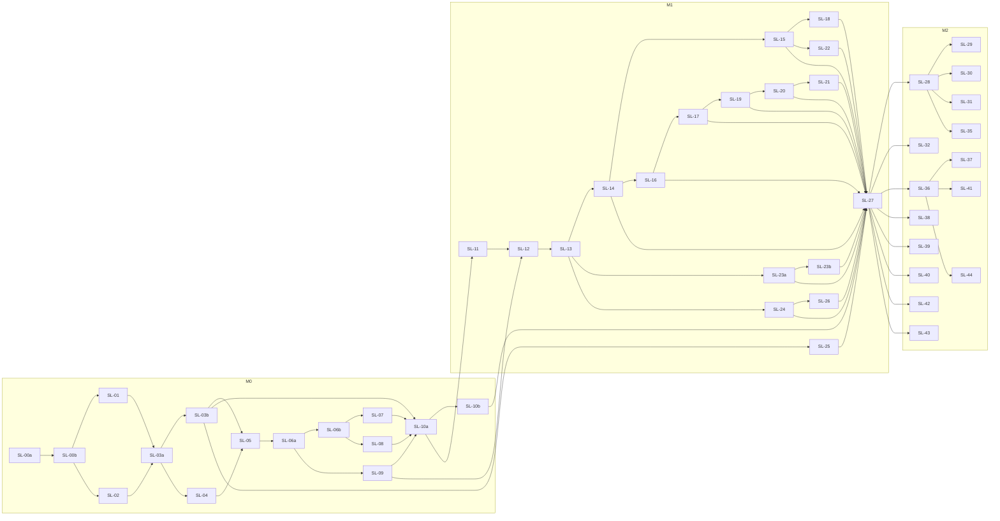

# Piano di sviluppo: Menu Design

> Documento di proprietà del tech-lead. **Versione 3, 2026-10-20. Stato: PROPOSTA** (in attesa del gate G4).
>
> Fonti: `docs/01-vision.md` (rev. 6), `docs/02-requirements.md` (v2 con CHG-001 … CHG-019 e il CHG-020 su email e password, vedi sotto), `docs/03-ux.md`, `docs/04-architecture.md` (v6), ADR-0001 … ADR-0016 (ADR-0005 rev. 5), `docs/05-data.md` (v5), `docs/06-threat-model.md` (v3), `docs/08-test-strategy.md` (v2), `references/security-standard.md` e `references/python-standard.md` di Bottega.
>
> **Novità della versione 2** (revisione critica di G4 e decisioni dell'utente del 2026-10-19):
> - **Slice divise** (OBJ-01): SL-00 → SL-00a e SL-00b; SL-03 → SL-03a e SL-03b; SL-23 → SL-23a e SL-23b. SL-12 e SL-14 alleggerite (S-17 completa in SL-16, S-13 in SL-15). Nessuna slice è L.
> - **Dipendenze** (OBJ-02): SL-10 (ora SL-10a) dipende anche da SL-08 e SL-09, SL-12 da SL-09. Nuova regola di DoD: ogni modulo che possiede dati di famiglia registra un `ExportContributor` nella slice che crea la tabella, verificato da un test d'inventario.
> - **Tempo nel database** (OBJ-04, D-T1 = b + c): `app.now_utc()` al posto di `now()`, sostituibile solo dai test tramite `menu_owner`. Il controllo "nessun `now()` nudo" copre funzioni, default delle colonne, policy e viste. §5.5 riscritta.
> - **Contratto** (OBJ-07): `If-Match` malformato o `*` → `422 invalid_value`, mancante → `428`; `/healthz` nell'inventario delle rotte pubbliche; il passo contract-first di una slice è **BLOCCATO** se un punto di §11.3 dovuto prima di quella slice è ancora aperto; `already_in_family` con un solo significato.
> - **Test** (OBJ-08, OBJ-09): cartelle e target `make` della strategia di test (I-T6); AC-001.1 diviso tra SL-03a (redirect e sessione) e SL-06 (ora SL-06a, end-to-end).
> - **Tracciabilità** (OBJ-10): SR-027 e NFR-016 anche su SL-10 (ora SL-10b) (test di `deploy.yml`).
> - **Esecuzioni a livelli** (OBJ-06): `make ci` per slice, `make full` per milestone e prima del rilascio, `make nightly` almeno ogni 5 slice e a ogni milestone finché non gira la CI remota.
> - **D-1:** repository GitHub privato `https://github.com/mrclttnz/menu-design`. Politica: commit locali, **ogni push richiede il consenso esplicito dell'utente**; prima del primo push gitleaks su tutta la storia. Budget dei minuti di GitHub Actions (piano Free, 2.000 min/mese) e notturno solo nei giorni con commit (§6.3).
> - **D-2:** tutte le famiglie tester hanno Google: email e password escono da M2. SL-33 e SL-34 passano al backlog dopo M2 con SL-90 e SL-91; SL-32 dipende solo da SL-27; P-14 esce da M2. Il product-analyst registra un **CHG-020** nei requisiti.
> - **Staging:** secondo progetto Supabase Free e servizio Cloud Run `menu-staging` che scala a zero, solo dati sintetici, mai copiati in produzione (ADR-0005 rev. 5). Aggiunto a SL-10b e alle precondizioni (P-16); DAST, carico, Lighthouse e smoke puntano allo staging.
>
> **Ritocchi finali della v3 prima di G4 (2026-10-20):** OBJ-16 (`make full` solo locale: verifiche sullo staging e checklist 18.3 solo in `make prerelease`, così la chiusura di M1 non attende passi dell'utente); OBJ-17 (regola di blocco anche per le slice senza API); chiuse I-P3, I-P13 e le tre voci aperte di §11.3 (`already_in_family` come esito di autenticazione, `params.units[]` con `reason`, `course_in_use`).
>
> **Novità della versione 3 (2026-10-20)** (secondo giro della revisione critica, accettato dall'orchestratore, e `docs/05-data.md` v5):
> - **OBJ-11:** SL-10 → SL-10a (worker, conservazione, immagine del backup, dataset con guardia, misura dello spazio) e SL-10b (staging, `deploy.yml`, `nightly.yml`, test di WIF ed environment, checklist IAM). SL-11 dipende solo da SL-10a; SL-10b chiude il rilascio di M0 e procede in parallelo con M1.
> - **OBJ-12:** SL-27 dipende da tutte le altre slice di M1 (SL-14 … SL-26) e da SL-10b: significa "M1 chiusa".
> - **OBJ-13:** `scripts/ci.sh` compone `ci` solo dai livelli già attivati, da un elenco esplicito esteso dalle slice (§6.1); un test confronta l'elenco con le slice DONE.
> - **OBJ-14:** nessuna riattivazione automatica di Supabase in `deploy.yml` (opzione a, coerente con ADR-0005): pre-controllo che fallisce con "staging in pausa: eseguire il runbook"; nessun token della Management API in CI. Budget ricalcolato: staging **su richiesta** (`workflow_dispatch`) e prima di ogni rilascio (§6.3).
> - **OBJ-15:** colonna Stato in §11.2 e §11.3; regola di blocco estesa agli antenati in §8.1 e a §11.2; chiuse I-P1, I-P2, I-P5 … I-P9, I-P12.
> - **Livelli:** contenuti di `make ci`, `make nightly`, `make full` e `make prerelease` allineati a `docs/08-test-strategy.md` §18.1 (concorrenza ×3 e profilo `ci-small` in `make ci`, verifiche sullo staging in `prerelease`); il corpo di `app.now_utc()` è l'unica eccezione al divieto di `now()`.
> - **SL-06** (la M più grande) divisa in SL-06a e SL-06b.
> - **05-data v5:** nomi `maint_*` delle funzioni di manutenzione (`purge_family_exports` resta senza prefisso); `rate_block` e le modifiche ad `account` del login a password rinviate al backlog (CHG-020); versione attesa legata come `bigint` (§4.1); dataset caricati dai test tramite `menu.seeding.datasets`, comando `seed` separato.
>
> **Aggiornamenti integrati nella v2 (2026-10-20):** ADR-0005 rev. 5 e architettura v6 (staging nello stesso progetto GCP, flusso staging automatico → produzione protetta con lo stesso digest, `APP_ENV` obbligatorio, riattivazione di Supabase in pausa); contratto di `/healthz` e regola di `If-Match`; CHG-020 registrato; chiavi UX `validation.invalid_value`, `validation.unknown_field`, `validation.dish_archived` (con `.noRestore`) e `dish_not_planned` aggiunte da UX e architect; azioni A-22 … A-25 e condizione WIF su `ref` del threat model v3.
>
> Convenzioni di dimensione: **S** = meno di mezza giornata di lavoro di un agente; **M** = da mezza giornata a circa un giorno e mezzo. Nessuna slice è L.
>
> Le domande aperte dei requisiti si pianificano con il loro default: Q-014 (nessuna traduzione dei contenuti), Q-015 (solo avviso), Q-016 (KPI dall'esportazione della famiglia del Gestore), Q-018 (l'Amministratore rimuove l'account), Q-020 (profili gestiti da Amministratore e Pianificatore).

## 0. Sintesi

- **48 slice nell'MVP:** 15 per M0, 18 per M1, 15 per M2. Più 4 slice di backlog dopo M2, non pianificate: SL-33 e SL-34 (email e password, CHG-020), SL-90 (esportazione self-service) e SL-91 (inattività), entrambe dell'apertura al pubblico.
- **Ordine:** fondamenta e isolamento prima (SL-00a … SL-03b), poi il valore di M0 (archivio e piano), poi in M1 prima inviti e presenze (rischio di sicurezza e di correttezza più alti), poi il resto. In M2 la riautenticazione apre le operazioni critiche, mentre i codici di creazione (SL-32) possono procedere in parallelo.
- **Contratti prima del codice:** ogni slice che espone API parte da un passo *contract-first* (modelli Pydantic e rotte vuote che producono `openapi.json`), dal quale il frontend genera il client. Il passo è bloccato se è aperta una voce di §11.2 o §11.3 il cui "Prima di" è la slice o un suo antenato in §8.1.
- **Il DDL di `docs/05-data.md` non è verificato.** SL-00b esegue `db/bootstrap.sql` e la migrazione `0001` (con `app.now_utc()`) su PostgreSQL 17 con i test di ruoli, privilegi e tempo. SL-02 è la prima verifica della RLS su tabelle reali. Ogni slice estende gli inventari.
- **Precondizioni dell'utente** (§8.3): bloccano i rilasci, non la costruzione delle slice. Fa eccezione P-0 (strumenti locali), necessaria per l'evidenza già in SL-00a.

| ID | Obiettivo | US | SR principali | Dim. | Mx | Dipende da |
|---|---|---|---|---|---|---|
| SL-00a | Repository, scheletro backend, CI con lint, test e scansioni bloccanti | – | SR-009, 021, 023, 046, 060, 076 | M | M0 | – |
| SL-00b | Database locale, `bootstrap.sql`, migrazione `0001` e `now_utc`, `tenancy`, inventari DB, container | – | SR-029, 042, 075 | M | M0 | SL-00a |
| SL-01 | Guscio web end-to-end, i18n, client generato | – | SR-023, 031, 046, 076 | S | M0 | SL-00b |
| SL-02 | Famiglia iniziale da console, registro di sicurezza, prima RLS | US-002 | SR-012, 020, 040, 042, 057 | M | M0 | SL-00b |
| SL-03a | Accesso Google, sessioni, CSRF, logout | US-001, US-002 | SR-001, 004, 005, 014, 023, 033, 037, 049 | M | M0 | SL-01, SL-02 |
| SL-03b | Limiti di frequenza, massimo di sessioni, schermata "Altro" | US-001 (AC.9), US-047 (AC.4) | SR-003, 059, 070 | S | M0 | SL-03a |
| SL-04 | Archivio piatti: creare, modificare, consultare, cercare | US-004, US-006 | SR-008, 009, 010, 024, 032, 041, 060 | M | M0 | SL-03a |
| SL-05 | Eventi di modifica e stato del piatto | US-005, US-049 | SR-022, 047, 057, 070 | S | M0 | SL-04, SL-03b |
| SL-06a | Piano della settimana: vista, intervalli, pasti del giorno | US-008, US-001 (AC.1 e2e) | SR-008, 060 | M | M0 | SL-05 |
| SL-06b | Assegnare i piatti ai pasti | US-008, US-049 (AC.1) | SR-041, 060 | M | M0 | SL-06a |
| SL-07 | Voci libere, pasti speciali, cucinato N giorni fa, correzioni | US-009, US-010, US-011 | SR-024, 041 | M | M0 | SL-06b |
| SL-08 | Archiviare, ripristinare, eliminare piatti | US-007 | SR-010 | S | M0 | SL-06b |
| SL-09 | Impostazioni della famiglia, fuso, congelamento dei pasti | US-003 | SR-009, 010 | M | M0 | SL-06a |
| SL-10a | Worker, conservazione, backup, dataset sintetici, misura dello spazio | – | SR-019, 028, 029, 051 | M | M0 | SL-03b, SL-07, SL-08, SL-09 |
| SL-10b | Staging, deploy e rilascio M0 (in parallelo con M1) | – | SR-027, 062, 076 | S | M0 | SL-10a |
| SL-11 | Link di invito: creare, elencare, revocare | US-012 | SR-007, 020, 044, 063 | S | M1 | SL-10a |
| SL-12 | Accettare o rifiutare un invito (età, informativa) | US-013, US-046 | SR-004, 007, 013, 043, 049, 056 | M | M1 | SL-11, SL-09 |
| SL-13 | Persone, ruoli, almeno un Amministratore, uscita | US-014, US-015, US-016 | SR-005, 011, 047, 048, 073 | M | M1 | SL-12 |
| SL-14 | Settimana tipo e passato congelato delle presenze (API) | US-020, US-048 | SR-015, 055 | M | M1 | SL-13 |
| SL-15 | Assenze, ospiti, coperti e schermata della settimana tipo | US-020, US-021, US-022, US-023 | SR-009, 032, 041, 055 | M | M1 | SL-14 |
| SL-16 | Profili, nome visualizzato, informativa completa e nuova presa visione | US-017, US-045, US-046 | SR-014, 030, 054, 056, 064 | S | M1 | SL-14 |
| SL-17 | Gusti e proposte dei Membri | US-018, US-019 | SR-009, 010 | M | M1 | SL-16 |
| SL-18 | Consultazione del Membro, visite, "modificato da" | US-024, US-028 (AC.2, .7) | SR-014 | S | M1 | SL-15 |
| SL-19 | Conflitti di modifica su tutte le unità | US-027 | – | S | M1 | SL-17 |
| SL-20 | Spostare e scambiare | US-025 | SR-041 | M | M1 | SL-19 |
| SL-21 | Copiare giorni e settimane | US-026 | SR-041 | M | M1 | SL-20 |
| SL-22 | Cronologia | US-028 | SR-022, 047 | M | M1 | SL-15 |
| SL-23a | Esportazioni: coda, job ed esecuzione del perimetro | US-044 | SR-016, 059, 067, 072 | M | M1 | SL-13 |
| SL-23b | Esportazioni: download, "I miei dati", cancellazione alla perdita del ruolo | US-044 | SR-016, 072 | S | M1 | SL-23a |
| SL-24 | Recupero dell'Amministratore, avvisi, revoca globale | US-042 | SR-012, 053, 066 | S | M1 | SL-13 |
| SL-25 | Le mie sessioni | US-047 | SR-038 | S | M1 | SL-03b |
| SL-26 | Allarmi di sicurezza, attività dei ruoli, statistiche | – | SR-055, 058, 075 | S | M1 | SL-24 |
| SL-27 | Conservazione M1, riapplicazione delle cancellazioni (M1 chiusa) | – | SR-019, 048 | M | M1 | SL-10b, SL-14 … SL-26 |
| SL-28 | Riautenticazione legata alla stessa identità | US-043 (AC.6), US-044 (AC.8) | SR-039, 068 | M | M2 | SL-27 |
| SL-29 | Nominare e revocare Amministratori | US-043 | SR-011, 039, 044, 072 | S | M2 | SL-28 |
| SL-30 | Eliminare il proprio account | US-039 | SR-017, 039, 047 | M | M2 | SL-28 |
| SL-31 | Eliminare la famiglia con ripensamento | US-038 | SR-018, 039 | M | M2 | SL-28 |
| SL-32 | Codici di creazione e nuova famiglia | US-036 | SR-007, 043, 059, 063 | M | M2 | SL-27 |
| SL-35 | Collegare un profilo a un account | US-037 | SR-013, 045, 063 | M | M2 | SL-28 |
| SL-36 | Tag, filtro per tempo, "non cucinato da più tempo" | US-032, US-019 (AC.5) | SR-010, 060 | M | M2 | SL-27 |
| SL-37 | Priorità e ordinamento preferito | US-050, US-051 | SR-010, 014 | S | M2 | SL-36 |
| SL-38 | Proposta di promozione a "collaudato" | US-030 | SR-009 | S | M2 | SL-27 |
| SL-39 | Avviso "non piace" | US-031 | – | S | M2 | SL-27 |
| SL-40 | Più "Altro pasto" con nome | US-052 | SR-060 | S | M2 | SL-27 |
| SL-41 | Portate personalizzate | US-033 | SR-010 | S | M2 | SL-36 |
| SL-42 | Avviso di piatti simili | US-034 | – | S | M2 | SL-27 |
| SL-43 | Consultazione offline (PWA) | US-041 | SR-026, 046, 071 | M | M2 | SL-27 |
| SL-44 | Import CSV (Could) | US-035 | SR-025, 059 | M | M2 | SL-36 |
| SL-33 | *Backlog dopo M2:* email e password, registrazione e verifica | US-029 (AC.1-.3, .7, .8) | SR-002, 006, 034, 035, 061 | M | dopo M2 | SL-32 |
| SL-34 | *Backlog dopo M2:* email e password, accesso e recupero | US-029 (AC.4-.6) | SR-002, 004, 036, 059 | M | dopo M2 | SL-33 |
| SL-90 | *Backlog, apertura:* esportazione self-service | US-040 | SR-016, 039 | – | apertura | SL-28 |
| SL-91 | *Backlog, apertura:* cancellazione per inattività | – | SR-050 | – | apertura | SL-33 |

## 1. Struttura del repository

Monorepo, come richiesto da ADR-0001 e ADR-0002. Un'unica immagine container contiene backend e SPA compilata.

```
/
├── backend/
│   ├── pyproject.toml              # uv: dipendenze, gruppi dev e perf, ruff, mypy, pytest, cooldown
│   ├── uv.lock                     # committato
│   ├── alembic.ini
│   ├── migrations/
│   │   ├── env.py                  # verifica ruolo menu_owner, lock_timeout, statement_timeout
│   │   └── versions/               # 0001_…, 0002_…  (rev-id a 4 cifre, una sola testa)
│   ├── config/
│   │   └── reserved_course_names.it.json   # nomi riservati delle portate base (Q-030, M2)
│   ├── scripts/
│   │   ├── export_openapi.py       # scrive ../openapi.json
│   │   └── seed.py                 # punto d'ingresso del comando `seed` con la guardia ad allow-list (A-22)
│   ├── src/menu/
│   │   ├── __main__.py             # serve | worker --once | console <cmd> | maint <cmd>
│   │   ├── common/                 # ErrorCode, AppError, RequestContext, email_sha256, enum, registro ExportContributor
│   │   ├── platform/               # config, logging, http (middleware, problem+json, client_ip), routing (AuthzRoute)
│   │   ├── tenancy/                # engine, family_tx, system_tx, wrapper delle funzioni SQL pubblicate
│   │   ├── audit/                  # security_event, catalogo degli eventi
│   │   ├── ratelimit/              # regole, contatori, 429
│   │   ├── history/                # record_change, codec v1, lettura decodificata, weekly_visit
│   │   ├── jobs/                   # coda, worker, registro dei compiti periodici
│   │   ├── access/                 # matrice ruoli × operazioni, regole Propri / Se presente / ripensamento / reauth
│   │   ├── identity/               # account, sessioni, OIDC, CSRF, auth_flow, signup_pending, creation_code
│   │   ├── family/                 # famiglia, persone, ruoli, inviti, avvisi, onboarding (login → membership)
│   │   ├── catalog/                # portate, piatti, fonti, gusti, (M2) tag, priorità, import
│   │   ├── planning/               # pasti, voci, sposta/scambia/copia, ospiti (memorizzazione)
│   │   ├── attendance/             # settimana tipo, presenze, regola "se presente", coperti
│   │   ├── privacy/                # esportazioni, registro delle cancellazioni, eliminazioni (M2)
│   │   ├── views/                  # modelli di lettura composti: sessione, piano, cronologia con refs
│   │   ├── seeding/                # libreria dei dataset sintetici (minimal, isolation, lighthouse, load), usata dai test e da `seed`
│   │   ├── console/                # comandi del job menu-console (solo funzioni console_*)
│   │   ├── console_client/         # script locale: prompt email, hash, request_ref, gcloud
│   │   └── app/                    # composition root: create_app, router, collegamento dei protocolli
│   └── tests/                      # struttura della strategia di test (docs/08-test-strategy.md §2)
│       ├── conftest.py             # fixture DB per worker, inventari (cross_family, tracks), marker
│       ├── support/                # helper owner (menu_owner), mondo di prova, fake_oidc, orologio (now_utc)
│       ├── tools/                  # strumenti degli inventari (rotte, RLS, funzioni, ErrorCode, export)
│       ├── unit/
│       ├── architecture/           # strati, import, sessioni SQLAlchemy solo in tenancy, nessun now() nudo
│       ├── db/                     # RLS, privilegi, funzioni SECURITY DEFINER, vincoli, migrazioni a scala
│       ├── integration/            # API su PostgreSQL 17 reale, AC
│       ├── contract/               # openapi.json, x-authz, solo modifiche additive, ErrorCode
│       ├── security/               # SR-033, header, CSRF, rate limit, canarini nei log
│       ├── property/               # Hypothesis: passato congelato, codec, search_norm
│       ├── concurrency/            # quote, ultimo Amministratore, invito monouso, If-Match in parallelo
│       ├── perf/                   # Locust (gruppo perf), solo prima del rilascio
│       └── smoke/                  # pytest -m smoke contro un URL (staging, produzione dopo il deploy)
├── web/
│   ├── package.json, pnpm-lock.yaml, .npmrc   # minimumReleaseAge, onlyBuiltDependencies
│   ├── vite.config.ts, tsconfig.json, eslint.config.js, lingui.config.ts
│   ├── content/it/privacy-v1.md    # informativa (bozza `draft` fino a Q-017)
│   ├── src/
│   │   ├── app/                    # shell, rotte, provider (compone le feature)
│   │   ├── api/                    # schema generato (openapi-typescript), client, mappa ErrorCode → chiavi
│   │   ├── session/                # GET /session, CSRF, notices, authOutcome, gestione 401
│   │   ├── i18n/                   # Lingui, formattazione Intl nel fuso della famiglia
│   │   ├── locales/it/messages.po
│   │   ├── components/             # design system: EmptyState, ErrorState, Skeleton, Toast, Dialog…
│   │   ├── lib/                    # pasto-id, date locali, coda delle scritture per unità
│   │   └── features/               # plan, meal, picker, dishes, settings, people, invites, signup,
│   │                               # attendance, history, profile, exports, notices, privacy, (M2) offline
│   └── tests/
│       ├── e2e/                    # Playwright + axe, stub OIDC di test (mai su staging)
│       └── lighthouse/             # configurazione Lighthouse CI
├── openapi.json                    # contratto committato, confrontato in CI
├── db/bootstrap.sql                # ruoli, CONNECTION LIMIT, estensioni, schema app, revoche (fuori da Alembic)
├── scripts/
│   ├── ci.sh                       # passi della CI, eseguibili in locale (richiamati dal Makefile)
│   ├── role-secret.sh              # Cloud Shell: password ruoli → Secret Manager, stampa verificatore SCRAM
│   └── console.sh                  # wrapper di menu.console_client
├── .semgrep/                       # regole proprie (threat model §11, now() nudo nelle migrazioni)
├── .github/workflows/
│   ├── ci.yml                      # push su main e PR: controlli bloccanti
│   ├── nightly.yml                 # solo se ci sono commit su main nelle ultime 24 ore (§6.3)
│   └── deploy.yml                  # da SL-10b: build, trivy, staging (migrate, deploy, smoke), produzione con approvazione
├── Dockerfile                      # multi-stage: web build → venv uv → python:3.14-slim per digest, non root
├── Dockerfile.backup               # pg_dump 17 + age (SL-10a)
├── compose.yaml                    # PostgreSQL 17 locale e stub OIDC per gli e2e (immagini per digest)
├── .pre-commit-config.yaml         # gitleaks protect, ruff
├── .gitleaks.toml
├── .env.example                    # solo segnaposto
├── Makefile                        # target in §6.1
└── docs/
```

Note:
- `.venv/` dentro `backend/` (uv) e `node_modules/` vanno in `.gitignore` insieme a `.env*` (già presente). Mai pacchetti nel Python di sistema (python-standard §1).
- Il branch di lavoro diventa `main` in SL-00a (oggi il repository è su `master`, senza commit): ADR-0005 limita la Workload Identity Federation a `refs/heads/main`. Il remoto `origin` punta a `https://github.com/mrclttnz/menu-design`; **nessun push senza il consenso esplicito dell'utente** (§5.7).
- `tests/support/` è l'unico posto dove si apre una connessione `menu_owner` fuori dalle migrazioni. Il codice in `src/` non importa mai da `tests/` (test d'architettura).

## 2. Moduli e dipendenze ammesse

### 2.1 Backend: strati

Un modulo può importare solo moduli di uno strato **inferiore**. Un modulo non legge né scrive le tabelle di un altro: ne chiama i servizi (§3). Le dipendenze verso l'alto si risolvono con **protocolli** definiti nello strato inferiore e implementati in quello superiore, collegati solo nella composition root `menu.app`.

`tests/architecture/test_layers.py` (analisi `ast`, nessuna dipendenza in più) verifica:
- la tabella sotto, senza cicli;
- che le sessioni SQLAlchemy si creino solo in `tenancy` (ADR-0003);
- che `src/` non importi `tests/` e che solo `tests/support/` usi le credenziali `menu_owner`;
- che il dominio Python non chiami `datetime.now()` o `time.time()` per istanti persistiti (`DTZ` di ruff come rete in più).

| Strato | Modulo | Responsabilità | Tabelle possedute | Può dipendere da |
|---|---|---|---|---|
| 0 | `common` | `ErrorCode`, `AppError`, `RequestContext`, `email_sha256`, enum di dominio, protocollo e registro `ExportContributor` | – | libreria standard, Pydantic |
| 1 | `platform` | config fail-closed, logging con redazione, middleware HTTP, problem+json, `client_ip`, `AuthzRoute` | – | `common` |
| 2 | `tenancy` | engine, `family_tx`, `system_tx`, wrapper delle funzioni SQL pubblicate (§2.3) | `alembic_version` | 0-1 |
| 3 | `audit` | `security_log()`, catalogo degli eventi, replica come log strutturato | `security_event` | 0-2 |
| 3 | `history` | `record_change()`, codec v1, lettura decodificata, visite settimanali | `change_event`, `weekly_visit` | 0-2 |
| 3 | `jobs` | coda `job`, `worker --once`, registro dei compiti periodici | `job`, `periodic_task_run` | 0-2 |
| 4 | `ratelimit` | regole di SR-059 e SR-070, upsert unico, `429` | `rate_counter` (`rate_block` rinviata con CHG-020) | 0-3 (`audit`) |
| 4 | `access` | `authorize(ctx, operation, facts)`, regole Propri, Se presente, ripensamento, reauth; evento per ogni negazione | – | 0-3 (`audit`) |
| 5 | `identity` | account, sessioni, OIDC, CSRF, `auth_flow`, `signup_pending`, directory degli account, `creation_code` | `account`, `session`, `auth_flow`, `signup_pending`, `creation_code`; dopo M2 `password_credential`, `account_token` | 0-4 |
| 6 | `family` | famiglia, impostazioni, persone e ruoli, invariante Amministratori, profili, inviti, avvisi, onboarding (implementa `identity.LoginResolver`), contesto di membership | `family`, `family_default_meal`, `family_bootstrap`, `person`, `invite`, `family_notice`, `family_notice_dismissal` | 0-5 |
| 7 | `catalog` | portate, piatti, fonti, gusti, (M2) tag, priorità, somiglianza, import | `course`, `dish`, `dish_course`, `dish_source`, `dish_like`, `tag`, `dish_tag` | 0-6 |
| 8 | `planning` | pasti (data, tipo, slot), voci, ospiti (memorizzazione e versione), sposta/scambia/copia | `meal`, `meal_item` | 0-7 |
| 9 | `attendance` | settimana tipo, presenze esplicite, regola "se presente", coperti, scrittura degli ospiti tramite `planning` | `typical_week`, `typical_week_absence`, `attendance` | 0-8 |
| 10 | `privacy` | esportazioni (legge il registro `ExportContributor`), registro delle cancellazioni, eliminazioni di account e famiglia | `export_file`, `deletion_log` | 0-9 |
| 11 | `views` | letture composte: `GET /session`, `GET /plan`, `GET /history` con `refs` | – | 0-10 |
| 11 | `seeding` | libreria `menu.seeding.datasets`: dataset sintetici senza segreti riutilizzabili né email reali; nessuna guardia qui, la guardia è nel comando `seed` (punto d'ingresso separato, strato 12) | – | 0-10 |
| 11 | `console` | comandi del job `menu-console` (solo funzioni `console_*`) | – | 0-3 |
| 11 | `console_client` | script locale del Gestore | – | `common` (solo `email_sha256`), libreria standard |
| 12 | `app` | `create_app`, inclusione dei router, collegamento dei protocolli e dei contributori, compiti periodici, comandi CLI | – | tutti |

Ogni modulo di dominio (strati 5-10) ha la stessa forma interna: `api.py` (router con `AuthzRoute`), `schemas.py`, `service.py`, `repo.py` (query SQLAlchemy Core, sempre dentro `family_tx` o `system_tx`), `tables.py`, ed `export.py` se possiede dati di famiglia.

### 2.2 Protocolli per le dipendenze verso l'alto

| Protocollo | Definito in | Implementato da | Uso |
|---|---|---|---|
| `LoginResolver.resolve(tx, google_identity, flow) → LoginOutcome` | `identity` | `family.onboarding` | Al callback OIDC: account esistente, bootstrap, invito, `not_member`, `already_in_family` |
| `PersonLifecycleListener.on_person_leaving(tx, person)` | `family` | `attendance` (settimana tipo, presenze future), `catalog` (gusti), `privacy` (file `family`, `deletion_log`) | Uscita, rimozione, eliminazione di un profilo (`docs/05-data.md` §7.3) |
| `RoleChangeListener.on_admin_role_lost(tx, person)` | `family` | `privacy` (`purge_family_exports`) | SR-072 |
| `MealLifecycleListener.on_meal_readded(tx, key)` | `planning` | `attendance` | Pasto tolto e rimesso: cancella le eccezioni dei giorni non congelati (ADR-0009) |
| `ExportContributor` (`tables`, `export_family(tx)`, `export_self(tx, account_id, person_id)`) | `common` (protocollo e registro) | `family`, `catalog`, `planning`, `attendance`, `history`, `identity` | Perimetro di SR-072; raccolto da `privacy` |
| `PeriodicTask` (nome, frequenza, funzione idempotente) | `jobs` | moduli che hanno pulizie | Registro del worker (ADR-0013) |

**Regola `ExportContributor` (DoD, OBJ-02).** Ogni modulo che possiede una tabella di famiglia registra, **nella slice che crea la tabella**, un `ExportContributor` che dichiara le proprie tabelle e ne produce le righe nei due perimetri (`family` e `self`) secondo `docs/05-data.md` §9.3. Il test d'inventario `tests/tools/export_inventory` fallisce se una tabella con `family_id` (o `family`) non è dichiarata da esattamente un contributore, oppure se un contributore restituisce colonne escluse dal perimetro (email, `last_visit_at`, `dish_sort_preference`, `auth_subject`, IP, sessioni di altri). Il registro e il test nascono in SL-02; SL-23a aggiunge solo la coda, il job e l'impacchettamento.

### 2.3 Contratti SQL pubblicati

Alcune regole stanno, per scelta degli ADR, in funzioni SQL che più moduli devono usare. Sono l'**unica** eccezione alla regola "un modulo non legge le tabelle di un altro", in elenco chiuso:

| Oggetto SQL | Proprietario (migrazione) | Usato da | Slice |
|---|---|---|---|
| `app.now_utc()` | `tenancy` | **tutto** il codice SQL al posto di `now()` (§5.5) | SL-00b |
| `app.current_family_id()`, `app.current_account_id()`, `app.search_norm(text)` | `tenancy` | tutti | SL-00b |
| `app.family_today()` | `family` | tutti i moduli di famiglia | SL-02 |
| `app.effective_meals(from, to)` | `planning` | `attendance`, `views` | SL-06a |
| `app.v_dish_last_cooked` (vista `security_invoker`) | `planning` | `catalog`, `views` | SL-07 |
| `app.ensure_frozen()` | `planning` (parte pasti), esteso da `attendance` (parte presenze) | `family`, `attendance` | SL-09, SL-14 |
| `app.effective_attendance(from, to)` | `attendance` | `views`, `privacy` | SL-14 |

### 2.4 Frontend: strati

| Strato | Cartella | Può importare da |
|---|---|---|
| 0 | `src/api` (generato + client + mappa errori) | nessun'altra cartella dell'app |
| 0 | `src/i18n`, `src/lib` | `src/api` (solo tipi) |
| 1 | `src/components`, `src/session` | strato 0 |
| 2 | `src/features/<x>` | strati 0-1. **Mai un'altra feature.** |
| 3 | `src/app` | tutto: compone le feature nelle rotte |

Il vincolo è imposto con la regola ESLint di base `no-restricted-imports`. Rotte della SPA come in `docs/03-ux.md` §3. `pastoId` ↔ (`mealType`, `slot`) è convertito solo da `src/lib/pasto-id.ts` (ADR-0009).

## 3. Contratti tra moduli (backend)

Firme indicative in Python. `Tx` è la connessione transazionale di `tenancy`. Le eccezioni di dominio sono sempre `AppError(code: ErrorCode, params: dict)`.

```python
# common
@dataclass(frozen=True)
class RequestContext:
    correlation_id: UUID
    account_id: UUID | None
    session_id: UUID | None
    auth_time: datetime | None
    family_id: UUID | None
    person_id: UUID | None
    role: Literal["admin", "planner", "member"] | None
    family_status: Literal["active", "pending_deletion"] | None
def email_sha256(email: str) -> bytes        # sha256(email.strip().lower().encode()) (ADR-0011)
class ExportContributor(Protocol):
    tables: frozenset[str]
    def export_family(self, tx: Tx) -> dict[str, list[dict]]: ...
    def export_self(self, tx: Tx, account_id: UUID, person_id: UUID | None) -> dict[str, list[dict]]: ...

# tenancy
def family_tx(ctx: RequestContext) -> ContextManager[Tx]   # set_config(app.family_id/app.account_id/app.role, true)
def system_tx() -> ContextManager[Tx]                      # solo identity, ratelimit, jobs, audit, privacy (05-data §6.3)
def family_today(tx: Tx) -> date                           # app.family_today()
def ensure_frozen(tx: Tx) -> None                          # app.ensure_frozen()

# audit
def security_log(event: SecurityEvent, tx: Tx | None = None) -> None   # INSERT + log strutturato "security_event"

# history
def record_change(tx: Tx, ctx: RequestContext, *, unit: UnitType, op: Op,
                  key: EventKey, before: dict | None, after: dict | None) -> None

# ratelimit
def hit(rules: Sequence[RuleHit]) -> None    # un solo INSERT … ON CONFLICT, solleva rate_limited

# access
def authorize(ctx: RequestContext, operation: str, facts: ResourceFacts | None = None) -> None
#   solleva forbidden, reauth_required, family_pending_deletion; scrive access.denied

# identity
def resolve_session(token: bytes) -> SessionInfo | None
def account_labels(tx: Tx, account_ids: Iterable[UUID]) -> dict[UUID, AccountLabel]
class LoginResolver(Protocol): ...

# family
def context_for(session: SessionInfo) -> RequestContext            # membership riletta a ogni richiesta (SR-005)
def person_labels(tx: Tx, person_ids: Iterable[UUID]) -> dict[UUID, PersonLabel]   # tombstone compresi
def get_active_person(tx: Tx, person_id: UUID) -> Person            # not_found se di altra famiglia o non attiva
def default_meal_types(tx: Tx) -> set[MealType]

# catalog
def ensure_assignable(tx: Tx, dish_id: UUID, course_id: UUID) -> None   # not_found, course_not_allowed, dish_archived
def mark_planned(tx: Tx, dish_ids: Iterable[UUID]) -> None
def dish_labels(tx: Tx, dish_ids: Iterable[UUID]) -> dict[UUID, DishLabel]

# planning
def get_meal(tx: Tx, key: MealKey) -> MealState
def set_guests(tx: Tx, ctx: RequestContext, key: MealKey, count: int, note: str | None, expected_version: int) -> MealState

# attendance
def effective(tx: Tx, date_from: date, date_to: date) -> list[AttendanceCell]
def is_present(tx: Tx, key: MealKey, person_id: UUID) -> bool
```

`RequestContext` è costruito da una dipendenza FastAPI in `menu.app`: `identity.resolve_session` più `family.context_for`. Il ruolo non viene mai dal client.

## 4. Contratti API

### 4.1 Convenzioni comuni (valgono per tutti gli endpoint)

- **Base e formato:** `/api/v1`, JSON UTF-8, chiavi `camelCase`, date locali `YYYY-MM-DD`, istanti RFC 3339 in UTC (`…Z`), identificativi UUID v4.
- **Contratto:** ogni endpoint è scritto in OpenAPI 3.1 **nella slice che lo introduce**, generato da FastAPI e committato in `openapi.json`. Le modifiche successive sono solo additive; una modifica incompatibile richiede `/api/v2` o un ADR.
- **Autorizzazione dichiarata:** ogni operazione ha `operationId` uguale al nome dell'operazione di `access` (per esempio `meal.content.write`) e l'estensione `x-authz`:
  ```json
  {"scope": "public|anonymous|signup|account|family", "roles": ["admin","planner","member"],
   "rules": ["self", "if_present", "member_own_to_try"], "pendingDeletion": "allowed|blocked",
   "reauth": false, "tracks": ["meal_content"]}
  ```
  - `public`: nessuna sessione. `anonymous`: senza sessione, con CSRF double submit (`__Host-csrf`). `signup`: cookie `__Host-signup` valido. `account`: sessione valida, famiglia facoltativa. `family`: sessione e persona attiva.
  - **Inventario delle rotte pubbliche (elenco chiuso):** `GET /healthz` (fuori da `/api/v1`, dichiarata con `AuthzRoute` e `scope: public` come le altre), `GET /api/v1/session`, `GET /api/v1/auth/google/callback`. Il test d'inventario fallisce se un'altra rotta è `public`.
- **Scritture:** metodi non sicuri solo con `Content-Type: application/json` (altrimenti `415`), header `X-CSRF-Token` e controllo di `Origin` o `Sec-Fetch-Site` (altrimenti `403 csrf_failed`).
- **Concorrenza (ADR-0008):** le unità versionate espongono `version` nel corpo ed `ETag: "<n>"` sulle risorse singole. Le scritture richiedono `If-Match: "<n>"`, con `n` intero ≥ 0 (`0` per un'unità mai scritta):
  - `If-Match` **assente** → `428 precondition_required`;
  - `If-Match` valido solo se corrisponde a `^"(0|[1-9][0-9]{0,17})"$` (al massimo 18 cifre, sempre nell'intervallo di `bigint`: threat model v3, A-23, THR-107); **qualunque altro valore**, compresi `*`, `W/"3"`, numeri negativi, più valori o 19 cifre, → `422 validation` con `errors: [{field: "If-Match", code: "invalid_value"}]`, mai `500` (ADR-0008);
  - le colonne di versione sono `integer`, ma la versione attesa si lega sempre come **`bigint`** nel confronto (`… AND version = $atteso::bigint`): un valore valido oltre 2^31-1 non coincide mai con una versione esistente e produce `412` (non è mai `500`, `docs/05-data.md` v5, test del tester);
  - versione superata → `412 conflict` con `params.current`, `params.modifiedBy`, `params.modifiedAt`;
  - le operazioni su più unità usano `expectedVersions` nel corpo e un `412` con `params.units[]`, dove ogni elemento ha `key`, `reason` (`version_changed` = versione superata; `choice_required` = destinazione non vuota senza `mode`, il client chiede la scelta), `current`, `modifiedBy`, `modifiedAt` (ADR-0008).
- **Paginazione:** cursore opaco, `?cursor=&limit=` con `limit ≤ 100`; risposta `{items, nextCursor}`.
- **Errori:** RFC 9457 `application/problem+json` con `code` (enum `ErrorCode` di ADR-0010, unica fonte), `params`, ed `errors[]` per `validation`. `title` e `detail` mai mostrati.
- **Errori comuni (EC)**, non ripetuti nelle tabelle:
  - tutti: `413 payload_too_large`, `415 unsupported_media_type`, `422 validation`, `429 rate_limited`, `500 internal`;
  - scope `account` e `family`: `401 unauthenticated`, `403 csrf_failed` sulle scritture;
  - scope `family`: `404 not_found` per risorse inesistenti **o di un'altra famiglia** (con evento `access.cross_family`), `403 forbidden` per permesso mancante;
  - scritture di famiglia da M2: `409 family_pending_deletion` dove `pendingDeletion: blocked`;
  - unità versionate: `412 conflict`, `428 precondition_required`, `422` per `If-Match` non valido.
- **Codici di validazione** (`errors[].code`, insieme chiuso, allineato a `docs/03-ux.md` §5.4): `required`, `string_too_long` {max}, `limit_reached` {max}, `url_invalid`, `course_required`, `guests_range`, `priority_range` (M2), `date_invalid`, `range_order`, `duplicate_course` (M2), `invalid_value`, `unknown_field`, `dish_archived`. Il gestore di `RequestValidationError` traduce gli errori Pydantic in questi codici.
- **`already_in_family`: un solo significato** (ADR-0010, anche tra gli esiti di autenticazione): "l'account autenticato appartiene già a una famiglia" (ASM-050). Arriva per due canali con lo stesso significato: come errore HTTP `409` su `POST /signup/accept` e `POST /families`, e come esito di autenticazione `authOutcome.code` quando il callback di un invito trova un account che è già membro. In quel caso il callback crea la normale sessione dell'account, che atterra nella **propria** famiglia; l'invito **resta non consumato** e il nome della famiglia dell'invito non viene rivelato (THR-034).
- **Header di risposta:** `Cache-Control: no-store` su ogni risposta autenticata, header di sicurezza (SR-023) su tutte.

### 4.2 DTO principali

Notazione sintetica in stile TypeScript. `?` = facoltativo.

```ts
Problem        = { type, title, status, code: ErrorCode, params?: object, errors?: {field, code, params?}[] }
SessionView    = { authenticated: false, notices: [] }
               | { authenticated: true, csrfToken: string, account: {id, displayName},
                   family: {id, name, timezone, today: Date, status, deletionDueAt?} | null,
                   person: {id, role} | null, privacyReviewRequired: boolean,          // SL-16
                   notices: Notice[], authOutcome?: {code, params?} }                     // authOutcome una sola volta
Notice         = { id, kind: "admin_recovered", subjectPersonId, createdAt }
FamilyView     = { id, name, timezone, today, defaultMeals: MealType[], status, deletionDueAt? }
Course         = { id, baseCode: "starter"|"first"|"second"|"side"|"one_dish"|"dessert"|"drink"|"other" | null, name: string | null }
Source         = { kind: "link"|"book"|"magazine"|"other", reference: string, page?: string, note?: string }
DishSummary    = { id, name, status: "to_try"|"tested", courseIds: UUID[], prepTime?: "under_30"|"30_60"|"over_60",
                   archived: boolean, everPlanned: boolean, lastCookedOn?: Date, daysSinceCooked?: number,
                   priority?: number /*M2*/, tagIds?: UUID[] /*M2*/, promotionProposed?: boolean /*M2*/ }
DishDetail     = DishSummary & { notes?: string, sources: Source[], createdBy: UUID, version: number,
                   likes?: {personId, value: "like"|"neutral"|"dislike"|null, version}[] /*M1*/ }
DishWrite      = { name, courseIds: UUID[1..], notes?, prepTime?, sources: Source[0..10], status? /*solo create*/,
                   priority? /*M2, solo A/P*/, tagIds? /*M2*/ }
MealKey        = { date: Date, mealType: MealType, slot: 0..4 }
MealItem       = { id, kind: "dish"|"free_text", position: 0..9, dishId?, courseId?, freeText?, notCooked: boolean }
MealView       = MealKey & { name: string | null, present: boolean, special: "away"|"restaurant"|"skipped" | null,
                   contentVersion: number, items: MealItem[], contentModifiedBy?: UUID, contentModifiedAt?: Instant,
                   past: boolean,
                   guests?: {count: 0..50, note?: string, version, modifiedBy?, modifiedAt?},       // M1
                   attendance?: {personId, present: boolean, source: "rule"|"exception"|"frozen"|"correction", version}[],  // M1
                   covers?: number | null,                                                          // M1, null per pasti speciali
                   dislikeWarnings?: {dishId, personIds: UUID[]}[] }                                // M2
PlanView       = { from, to, today, timezone, days: {date, meals: MealView[]}[],
                   refs: { dishes: {[id]: {name, status, archived}}, courses: {[id]: Course},
                           people?: {[id]: PersonRef} } }                                           // people da M1
PersonRef      = { label: string | null, kind: "account"|"profile", status: "active"|"former",
                   formerReason?: "left"|"removed"|"profile_deleted"|"account_deleted"|"link_merged" }
Person         = { id, kind, displayName, role?: Role, joinedOn, email?: string /*solo per Amministratori, SR-073*/ }
TypicalWeek    = { personId, version, absences: {isoDow: 1..7, mealType: "breakfast"|"lunch"|"snack"|"dinner"}[] }
Invite         = { id, role: "member"|"planner", status: "pending"|"accepted"|"declined"|"revoked"|"expired",
                   createdAt, expiresAt, acceptedPersonId?, linkedPersonId? /*M2*/ }
HistoryEvent   = { id, occurredAt, actor: {kind: "person"|"platform_operator"|"system", personId?, role?},
                   unitType, op, key: {date?, mealType?, slot?, subjectPersonId?, dishId?}, before?, after? }
HistoryPage    = { items: HistoryEvent[], refs: {people, dishes, courses}, nextCursor? }
ExportFile     = { id, scope: "self"|"family", createdAt, expiresAt, sizeBytes }
```

### 4.3 Endpoint

Legenda dei permessi: **A** Amministratore, **P** Pianificatore, **M** Membro; *Propri* = solo sé stessi; *Se presente* = presente al pasto; **R** = riautenticazione (M2); **T(unità)** = traccia un evento di modifica. "EC" = errori comuni (§4.1).

#### Piattaforma, sessione e identità

| Metodo | Percorso | Slice | Permessi | Richiesta | Risposta | Errori specifici |
|---|---|---|---|---|---|---|
| GET | `/healthz` (fuori da `/api/v1`), `operationId platform.health.read` | SL-00a (controllo DB da SL-00b) | public (`x-authz` `scope: public`) | – | `200 {"status":"ok"}`, `Cache-Control: no-store`; esito del `SELECT 1` tenuto in memoria per circa 5 s, con il pool esistente (A-24, THR-106) | `503 {"status":"unavailable"}`, `no-store` |
| GET | `/api/v1/session` | SL-03a | public | cookie | `200 SessionView`; imposta `__Host-csrf` se assente; consuma `authOutcome` | – |
| POST | `/api/v1/auth/google/start` | SL-03a (limite in SL-03b, `reauth` da SL-28) | anonymous (`login`), account (`reauth`) | `{purpose: "login"|"reauth", returnTo?}` | `200 {redirectUrl}` + `__Host-auth_flow` | `429` (30/IP/15 min, SL-03b), `401` per `reauth` senza sessione |
| GET | `/api/v1/auth/google/callback` | SL-03a | public | `code`, `state`, cookie `__Host-auth_flow` | sempre `302` verso `returnTo` (allow-list) o `/piano`; esito in `auth_flow` | nessuno nell'URL; esiti `auth_cancelled`, `auth_failed`, `not_member`, `invite_invalid`, `already_in_family`, `reauth_wrong_account` via `authOutcome` |
| POST | `/api/v1/auth/logout` | SL-03a | account | `{}` | `204`, cookie cancellato | EC |
| GET | `/api/v1/me` | SL-16 | account, *Propri* | – | `200 {id, displayName, email, privacy: {version, ackAt}, ageDeclaredAt}` | EC |
| PATCH | `/api/v1/me` | SL-16 | account, *Propri* | `{displayName}` | `200` come `GET /me` | EC |
| POST | `/api/v1/me/privacy-ack` | SL-16 | account | `{version}` | `204` | `422 validation` (`invalid_value`) se non è la versione corrente |
| POST | `/api/v1/me/plan-seen` | SL-18 | family | `{}` | `200 {previousVisitAt: Instant | null}`; aggiorna ultima visita (≤ 1/min) e visita settimanale | EC |
| GET | `/api/v1/me/sessions` | SL-25 | account, *Propri* | – | `200 {items: {id, deviceLabel, lastUsedOn: Date, createdAt, current}[]}` | EC |
| DELETE | `/api/v1/me/sessions/{sessionId}` | SL-25 | account, *Propri* | – | `204` (la sessione corrente equivale al logout, ASM-074) | `404` per sessioni di altri |
| POST | `/api/v1/me/sessions/revoke-others` | SL-25 | account | `{}` | `200 {revoked: n}` | EC |
| POST | `/api/v1/notices/{noticeId}/dismiss` | SL-24 | family | `{}` | `204`, idempotente | EC |

#### Famiglia e impostazioni

| Metodo | Percorso | Slice | Permessi | Richiesta | Risposta | Errori specifici |
|---|---|---|---|---|---|---|
| GET | `/api/v1/family` | SL-09 | family: A, P, M | – | `200 FamilyView` | EC |
| PATCH | `/api/v1/family` | SL-09 | family: **A** | `{name?, timezone?}` (IANA, validato su `pg_timezone_names`) | `200 FamilyView` | `403` per P e M, `422` (`invalid_value`) per fuso sconosciuto |
| PUT | `/api/v1/family/default-meals` | SL-09 | family: A, P | `{mealTypes: MealType[]}` (anche vuoto, ASM-049) | `200 FamilyView` | `403` per M |

#### Archivio piatti

| Metodo | Percorso | Slice | Permessi | Richiesta | Risposta | Errori specifici |
|---|---|---|---|---|---|---|
| GET | `/api/v1/courses` | SL-04 | family: A, P, M | – | `200 {items: Course[]}` | EC |
| GET | `/api/v1/dishes` | SL-04 (`lastCookedOn` da SL-07; filtri M2 da SL-36/37) | family: A, P, M | `?q=&courseId=&status=&archived=false|true&cursor=&limit=` (M2: `tagId`, `prepTime`, `sort=name|priority|least_recently_cooked`) | `200 {items: DishSummary[], nextCursor}`; M0-M1 ordinato per nome senza accenti | EC |
| POST | `/api/v1/dishes` | SL-04 (M da SL-17) | family: A, P; M con `status` assente o `to_try` | `DishWrite` | `201 DishDetail` + `ETag` | `403` (M con `tested` o `priority`), `404` (portata di altra famiglia), `409 quota_exceeded {quota: dishes}` |
| GET | `/api/v1/dishes/{dishId}` | SL-04 | family: A, P, M | – | `200 DishDetail` + `ETag` | EC |
| PUT | `/api/v1/dishes/{dishId}` | SL-04 (regole M da SL-17) | family: A, P; M `member_own_to_try` | `DishWrite` senza `status`, `If-Match` | `200 DishDetail` | `403`, `404`, `412`, `428` |
| POST | `/api/v1/dishes/{dishId}/status` | SL-05 | family: A, P; **T(dish)** | `{status}`, `If-Match` | `200 DishDetail` | `403` per M |
| POST | `/api/v1/dishes/{dishId}/archive` | SL-08 | family: A, P; **T(dish)** | `{}`, `If-Match` | `200 DishDetail` | `409 dish_not_planned` (ADR-0010) |
| POST | `/api/v1/dishes/{dishId}/restore` | SL-08 | family: A, P; **T(dish)** | `{}`, `If-Match` | `200 DishDetail` | `403` per M |
| DELETE | `/api/v1/dishes/{dishId}` | SL-08 (M da SL-17) | family: A, P; M `member_own_to_try` | `If-Match` | `204` | `409 dish_already_planned` (anche in corsa, AC-007.6) |
| PUT | `/api/v1/dishes/{dishId}/likes/{personId}` | SL-17 | family: A, P (tutti); M *Propri* | `{value: "like"|"neutral"|"dislike"|null}`, `If-Match` (`0` se sconosciuto) | `200 {personId, value, version}` | `403` (M su altri), `404` |

#### Piano e pasti

| Metodo | Percorso | Slice | Permessi | Richiesta | Risposta | Errori specifici |
|---|---|---|---|---|---|---|
| GET | `/api/v1/plan` | SL-06a (presenze da SL-15) | family: A, P, M | `?from=&to=` (default: settimana corrente) | `200 PlanView` | `422 range_too_large {maxDays: 62}`, `422 validation` (`range_order`, `date_invalid`) |
| GET | `/api/v1/meals/{date}/{mealType}/{slot}` | SL-06a | family: A, P, M | – | `200 MealView` + `ETag` (versione del contenuto) | `404` (slot non valido per il tipo) |
| PUT | `/api/v1/meals/{date}/{mealType}/{slot}/content` | SL-06b (voci libere e speciali da SL-07) | family: A, P; **T(meal_content)** | `{items: MealItem[0..10] (senza id per le nuove), special: … | null, name?: string /*solo other, SL-40*/}`, `If-Match` | `200 MealView` | `403` per M, `404` (piatto o portata di altra famiglia), `422 course_not_allowed`, `422 validation` (`limit_reached`, `dish_archived`, `string_too_long`) |
| PUT | `/api/v1/meals/{date}/{mealType}/{slot}/presence` | SL-06a | family: A, P; **T(meal_content)** | `{present: boolean}`, `If-Match` | `200 MealView` (rimettere un pasto lo svuota e ne azzera ospiti ed eccezioni non congelate) | `403` per M |
| POST | `/api/v1/meals/{date}/{mealType}/{slot}/items/{itemId}/save-as-dish` | SL-07 | family: A, P; **T(meal_content)** | `DishWrite`, `If-Match` del pasto | `201 {dish: DishDetail, meal: MealView}` atomico | `409 quota_exceeded {dishes}`, `412`, `404` |
| PUT | `/api/v1/meals/{date}/{mealType}/{slot}/guests` | SL-15 | family: A, P; M *Se presente*; **T(meal_guests)** | `{count: 0..50, note?: string ≤ 200}`, `If-Match` (versione ospiti) | `200 MealView` | `403` (M assente), `422` (`guests_range`) |
| PUT | `/api/v1/meals/{date}/{mealType}/{slot}/attendance/{personId}` | SL-15 | family: A, P (tutti); M *Propri*; **T(attendance)** | `{present: boolean | null}` (`null` = torna alla regola), `If-Match` (`0` se nessuna riga) | `200 {personId, present, effectivePresent, source, version, covers}` | `403` (M su altri), `404`, `422 person_before_join {joinedOn}` |
| POST | `/api/v1/days/{date}/other-meals` | SL-40 | family: A, P; **T(meal_content)** | `{name?: string 1..40}` | `201 MealView` (slot scelto dal server, riuso del primo `removed`) | `409 quota_exceeded {quota: other_meals_per_day, limit: 5}` |
| POST | `/api/v1/plan/move` | SL-20 | family: A, P; **T(meal_content)** | `{source: MealKey & {itemId?}, target: MealKey, mode?: "replace"|"merge", expectedVersions: {[key]: n}}` | `200 {meals: MealView[]}` | `412 conflict {units}`: `reason: version_changed` per versioni superate, `reason: choice_required` per destinazione non vuota senza `mode` (il client chiede "sostituisci, unisci o annulla") |
| POST | `/api/v1/plan/swap` | SL-20 | family: A, P; **T(meal_content)** | `{a: MealKey & {itemId?}, b: MealKey & {itemId?}, expectedVersions}` | `200 {meals: MealView[]}` | `412 {units}` con `reason: version_changed` |
| POST | `/api/v1/plan/copy` | SL-21 | family: A, P; **T(meal_content)** | `{sourceFrom, sourceTo, targetFrom, mode?: "replace"|"append", dryRun?: boolean, expectedVersions?}` | `dryRun`: `200 {nonEmptyTargets: n, expectedVersions}`; altrimenti `200 {meals: MealView[], skippedArchived: {key, dishId}[]}` | `422 range_too_large`, `412 {units}` con `reason` `version_changed` o `choice_required` (destinazione non vuota senza `mode`) |
| GET | `/api/v1/history` | SL-22 | family: A, P, M | `?date=&mealType=&slot=&cursor=&limit=` | `200 HistoryPage` | EC (nessuna operazione di modifica esiste) |

Note sul pasto:
- La chiave è sempre completa: `/meals/{date}/{mealType}/{slot}` con `slot = 0` per i tipi standard (ADR-0009). Un percorso senza slot non esiste.
- `name` è accettato solo per `other` e solo da SL-40: prima il server lo rifiuta con `422 unknown_field`.
- Rimettere un pasto tolto segue ADR-0009: contenuto e ospiti azzerati, eccezioni dei giorni non congelati cancellate tramite `MealLifecycleListener`.

#### Presenze e settimana tipo

| Metodo | Percorso | Slice | Permessi | Richiesta | Risposta | Errori specifici |
|---|---|---|---|---|---|---|
| GET | `/api/v1/typical-week/{personId}` | SL-14 | family: A, P, M | – | `200 TypicalWeek` (versione `0` se non compilata) | `404` |
| PUT | `/api/v1/typical-week/{personId}` | SL-14 | family: A, P (tutti, profili compresi); M *Propri*; **T(typical_week)** | `{absences}`, `If-Match` | `200 TypicalWeek` | `403` (M su altri), `422` (`invalid_value` per `other`) |

#### Persone, profili e inviti

| Metodo | Percorso | Slice | Permessi | Richiesta | Risposta | Errori specifici |
|---|---|---|---|---|---|---|
| GET | `/api/v1/people` | SL-13 | family: A, P, M | – | `200 {items: Person[]}`; `email` solo per richiedente A e solo per persone entrate con invito (SR-073) | EC |
| PATCH | `/api/v1/people/{personId}/role` | SL-13 | family: **A** | `{role: "member"|"planner"}` | `200 Person` | `403` (P, M; destinatario Amministratore non ultimo: serve SL-29), `409 last_admin`, `422 invalid_value` per `admin` |
| POST | `/api/v1/people/{personId}/remove` | SL-13 | family: **A** (persone con account) | `{}` | `204` | `409 last_admin`, `403` |
| POST | `/api/v1/me/leave` | SL-13 | family | `{}` | `204` (sessione resta valida, famiglia `null`) | `409 last_admin` |
| POST | `/api/v1/profiles` | SL-16 | family: A, P | `{displayName: 1..60, guardianDeclaration: true}` | `201 Person` | `409 quota_exceeded {people}`, `422` (`required` sulla dichiarazione) |
| PATCH | `/api/v1/profiles/{personId}` | SL-16 | family: A, P | `{displayName}` | `200 Person` | `403` per M |
| DELETE | `/api/v1/profiles/{personId}` | SL-16 | family: A, P | – | `204` | `403` per M |
| GET | `/api/v1/invites` | SL-11 | family: **A** | – | `200 {items: Invite[]}` | `403` |
| POST | `/api/v1/invites` | SL-11 (`linkedPersonId` da SL-35) | family: **A** | `{role: "member"|"planner", linkedPersonId?}` | `201 Invite & {url}` (`url` con `#segreto`, restituito una sola volta) | `409 quota_exceeded {pending_invites | daily_invites}`, `422 invalid_value` per `admin` |
| POST | `/api/v1/invites/{inviteId}/revoke` | SL-11 | family: **A** | `{}` | `204` | `404` |
| POST | `/api/v1/invites/resolve` | SL-12 | anonymous | `{secret}` | `200 {redirectUrl}`: crea `auth_flow` con `purpose='invite'` e solo `invite_id` | `404 invite_invalid` (risposta unica), `429` (10/IP/15 min) |
| GET | `/api/v1/signup` | SL-12 | signup | – | `200 {familyName, role, privacy: {version, summary}}` (DD-07: solo dopo il login) | `404 invite_invalid` |
| POST | `/api/v1/signup/accept` | SL-12 | signup | `{ageDeclaration: "at_least_14"|"under_14", privacyVersion}` | `201` + `__Host-session`; invito consumato | `422 age_declaration_blocked` (invito valido, nessun dato), `404 invite_invalid`, `409 already_in_family`, `422 validation` (informativa non confermata) |
| POST | `/api/v1/signup/decline` | SL-12 | signup | `{}` | `204`, invito `declined` | `404 invite_invalid` |

#### Esportazioni

| Metodo | Percorso | Slice | Permessi | Richiesta | Risposta | Errori specifici |
|---|---|---|---|---|---|---|
| GET | `/api/v1/exports` | SL-23b | account, *Propri* | – | `200 {items: ExportFile[]}` | EC |
| GET | `/api/v1/exports/{exportId}/download` | SL-23b (R per `family` da SL-28) | account, *Propri*; `family` solo se ancora A | – | `200 application/zip`, `Content-Disposition: attachment`, `no-store`; evento `export.downloaded` | `404` (non richiedente, scaduto, non più Amministratore), `403 reauth_required` (M2) |

#### Endpoint di M2 (contratto sintetico, dettagliato in OpenAPI nella slice)

| Metodo | Percorso | Slice | Permessi | Richiesta → Risposta | Errori specifici |
|---|---|---|---|---|---|
| POST | `/api/v1/people/{personId}/admin` | SL-29 | A, **R** | `{}` → `200 Person` | `403 reauth_required` |
| DELETE | `/api/v1/people/{personId}/admin` | SL-29 | A, **R** | → `200 Person` (diventa Pianificatore, ASM-062) | `409 last_admin` |
| DELETE | `/api/v1/me` | SL-30 | account, **R**, `pendingDeletion: allowed` | `{confirm: true}` → `204` | `409 last_admin`, `403 reauth_required` |
| POST | `/api/v1/family/deletion` | SL-31 | A, **R** | `{familyName}` → `200 FamilyView` (`pending_deletion`) | `422 validation` (nome non coincide), `403 reauth_required` |
| DELETE | `/api/v1/family/deletion` | SL-31 | A, **R**, `pendingDeletion: allowed` | → `200 FamilyView` | `403 reauth_required` |
| POST | `/api/v1/families` | SL-32 | signup (dopo login Google) | `{code, familyName, ageDeclaration, privacyVersion}` → `201` + sessione | `404 code_invalid`, `409 already_in_family`, `422 age_declaration_blocked`, `429` |
| POST | `/api/v1/people/{personId}/link/confirm` / `reject` | SL-35 | A | `{}` → `200 Person` | `404`, `403` |
| GET/POST/PATCH/DELETE | `/api/v1/tags`, `/api/v1/tags/{tagId}` | SL-36 | lettura A, P, M; scrittura A, P | `{name: 1..30}` → `Tag` | `409 quota_exceeded {tags}`, `403` |
| PUT | `/api/v1/me/preferences` | SL-37 | account, *Propri* | `{dishSort: "name"|"priority"|"least_recently_cooked"}` → `200` | `422 validation` |
| POST | `/api/v1/dishes/{dishId}/promotion/dismiss` | SL-38 | A, P | `{}` → `204` | `403` per M |
| POST/PATCH/DELETE | `/api/v1/courses`, `/api/v1/courses/{courseId}` | SL-41 | A, P | `{name: 1..40}` → `Course` | `422 duplicate_course`, `409 course_in_use {usageCount}` (ADR-0010), `409 quota_exceeded {courses}`, `403` su portate base |
| GET | `/api/v1/dishes/similar?name=` | SL-42 | A, P, M | → `{items: DishSummary[≤5]}` | EC |
| POST | `/api/v1/dishes/import/preview` | SL-44 | A, P | CSV UTF-8 ≤ 1 MB (`text/csv`, unica eccezione al JSON) → `{validRows, errors: {row, code}[], duplicates, previewToken}` | `413`, `422` (`csv.*`), `429` (5/famiglia/ora) |
| POST | `/api/v1/dishes/import/commit` | SL-44 | A, P | `{previewToken, importDuplicates: boolean}` → `{created, skipped, excludedByQuota}` | `409 quota_exceeded {dishes}` parziale |

Gli endpoint di email e password (`/api/v1/auth/password/*`) sono **post-M2** (CHG-020): rinviati con SL-33 e SL-34 nel backlog, non fanno parte del contratto dell'MVP.

### 4.4 Contratto della console (CLI)

Il contratto dei comandi del Gestore è ADR-0011 (tabella "Comandi"). Il piano lo distribuisce così:

| Comando (script locale) | Funzione SQL | Slice |
|---|---|---|
| `family bootstrap --name` (email al prompt) | `console_bootstrap_family` | SL-02 |
| `security-log --since` | `console_security_events` | SL-02 |
| `audit note --ref` | `console_audit_note` | SL-02 |
| `export enqueue --scope self|family --request-ref` (email al prompt), `export status <job>` | `console_enqueue_export`, `console_export_status` | SL-23a |
| `admin recover --request-ref` (email al prompt) | `console_recover_admin` | SL-24 |
| `sessions revoke-all --reason` | `console_revoke_all_sessions` | SL-24 |
| `stats` | vista `console_stats_global` | SL-26 |
| `maint replay-deletions --input` (job `menu-migrate`) | `maint_apply_deletion` | SL-27 |
| `codes issue|list|revoke` | `console_issue_code`, `console_list_codes`, `console_revoke_code` | SL-32 |

Regole comuni, verificate da test in ogni slice che aggiunge un comando: email solo al prompt (`getpass`), argomenti del job solo hash esadecimali minuscoli, ID e `request_ref` validato con `^[A-Z]{2,5}-[0-9]{8}-[0-9]{1,3}$`; output solo ID ed esiti; un evento di sicurezza per ogni esito.

## 5. Convenzioni

### 5.1 Nomi
- **Python:** pacchetti e moduli `snake_case`, classi `PascalCase`, costanti `UPPER_CASE`.
- **Database:** come `docs/05-data.md` (inglese, singolare, `snake_case`, enum come `text` con `CHECK` nominato, `naming_convention` di §12).
- **API:** percorsi al plurale in `kebab-case`, JSON `camelCase`, `operationId` = operazione di `access` nel formato `<area>.<risorsa>.<azione>`.
- **Eventi di sicurezza:** `area.azione` in minuscolo (per esempio `auth.login`, `invite.created`, `access.cross_family`, `rate_limit.exceeded`).
- **TypeScript:** componenti `PascalCase.tsx`, altri file `kebab-case.ts`, hook `useXxx`. Chiavi i18n semantiche di `docs/03-ux.md` §7.3.
- **Test:** `test_<comportamento>`; marker `db`, `sec`, `concurrency`, `smoke`, `slow`, `cross_family("<operationId>")`, `tracks("<operationId>")`. Ogni test di un criterio cita l'AC (`AC-008.7`) ed entra nella mappa `tests/ac_map.yaml` del tester.

### 5.2 Errori
- Il dominio solleva solo `AppError(ErrorCode, params)`; `platform.http` lo traduce in problem+json con lo stato di ADR-0010. Nessuna stringa per l'utente nel backend.
- Eccezioni impreviste → `500 internal`, log con `correlation_id` e stack trace solo nel log del server. Debug disattivato in produzione (verificato all'avvio).
- Fail closed: un errore in un controllo di sicurezza (sessione, CSRF, rate limit, authz) nega l'accesso.
- Frontend: `code` → chiave `error.<code>` o `validation.<code>` (mappa unica in `src/api/errors.ts`), `params` interpolati con ICU; codice sconosciuto → `error.generic`. Test di copertura: ogni valore di `ErrorCode` e dei codici di validazione ha una chiave nel catalogo `it`.

### 5.3 Log
- structlog in JSON su stdout, con `severity`, `timestamp`, `correlation_id`, `event`. Nessun corpo di richiesta, nessun header `Cookie` o `Authorization`, nessuna querystring tranne il percorso.
- Processore di redazione con allow-list dei campi ammessi; chiavi vietate eliminate (`cookie`, `authorization`, `token`, `secret`, `password`, `code_verifier`, `csrf`, `email`, `display_name`, `name`, `note`, `free_text`, `guests_note`, `before`, `after`). Ritorni a capo nei valori neutralizzati (SR-021).
- Mai nei log presenze, settimana tipo, ospiti (SR-055) né email (SR-021).
- Eventi di sicurezza: `audit.security_log` scrive la riga in `security_event` **e** un log strutturato `security_event` con gli stessi campi (senza IP completo), base delle metriche di allarme (SR-058).

### 5.4 Lint, formattazione e type-check

| Ambito | Strumento | Configurazione |
|---|---|---|
| Python lint | ruff 0.17 | regole `E, F, W, I, B, UP, S, SIM, RUF, N, PT, DTZ, T20`; nessun `print`; `S` attivo anche nei test salvo `S101` |
| Python format | `ruff format` | lunghezza 100 |
| Python tipi | mypy 2.4 `--strict` | plugin Pydantic |
| Python SAST | bandit 1.9 | tutto `src/` |
| TS lint | ESLint (flat config) con `typescript-eslint` strict, `react-hooks`, `eslint-plugin-lingui` (`no-unlocalized-strings`, `require-explicit-id`), `eslint-plugin-security`, `no-restricted-imports` (strati), `no-restricted-syntax` contro `dangerouslySetInnerHTML`, `localStorage` e `sessionStorage` | errori bloccanti |
| TS format | Prettier | default, `printWidth: 100` |
| TS tipi | `tsc --noEmit` con `strict`, `noUncheckedIndexedAccess` | |
| i18n | `lingui extract` senza differenze, `lingui compile --strict` | bloccanti (NFR-011) |

Le dipendenze nuove (Prettier, `typescript-eslint`, `eslint-plugin-react-hooks`, `eslint-plugin-security`, Vitest, Testing Library, MSW, Playwright, `@axe-core/playwright`, `@lhci/cli`, Locust, Schemathesis) vanno verificate sul registro all'installazione (protocollo §3.7) e riportate nel report della slice che le introduce.

### 5.5 Test

La strategia di dettaglio è del tester (`docs/08-test-strategy.md`). Il piano fissa i vincoli che ogni slice rispetta.

- **Regole di slice:**
  - test scritti prima dell'implementazione e visti fallire (DoD);
  - ogni AC ha almeno un test automatico che lo cita;
  - ogni rotta nuova ha la dichiarazione `authz`, un test `cross_family` e un test negativo per ogni cella "No" della matrice che la riguarda (SR-009);
  - ogni rotta con `tracks` ha un test `tracks` (evento in caso di successo, nessun evento in caso di fallimento, AC-049.4);
  - ogni tabella nuova entra negli inventari RLS e privilegi (`docs/05-data.md` §6.3, §6.4), nel registro `ExportContributor` (§2.2) e, se di famiglia, nel mondo di prova; ogni funzione `SECURITY DEFINER` nell'inventario chiuso (§3.3);
  - ogni vista nuova ha i test end-to-end degli stati vuoto, caricamento ed errore (NFR-013) e un controllo axe senza violazioni serie o critiche (NFR-008).
- **Database di test:** PostgreSQL 17 reale (container), `db/bootstrap.sql` e `alembic upgrade head` su un database template, un database per worker. I test dell'app si collegano come `menu_app`; le fixture privilegiate passano dall'helper `tests/support/owner` (`menu_owner`), mai dal codice dell'app.
- **Tempo (D-T1 = b + c, OBJ-04):**
  - **una sola sorgente di "adesso" nel database: `app.now_utc()`**, creata in `0001` (SL-00b) come funzione `STABLE` che in produzione restituisce `now()`;
  - nessun `now()`, `current_timestamp`, `current_date`, `localtimestamp` o `transaction_timestamp()` "nudo" negli oggetti dello schema `app`: corpi delle funzioni (`pg_proc`), **default delle colonne** (`pg_attrdef`), **policy** (`pg_policy`), **viste** (`pg_views`) e vincoli (`pg_constraint`). **L'unica eccezione ammessa è il corpo di `app.now_utc()` stessa**, che restituisce `now()`. Il controllo è un test di catalogo in `tests/architecture` eseguito dopo `upgrade head`, più una regola semgrep sulle migrazioni;
  - `app.family_today()`, le scadenze delle sessioni, `ensure_frozen()`, le finestre dei limiti e le policy di pulizia usano `app.now_utc()`;
  - **solo i test** spostano l'orologio, sostituendo `app.now_utc()` con `CREATE OR REPLACE FUNCTION` tramite l'helper `owner` nel database del proprio worker, e lo ripristinano a fine test. Nessun parametro, variabile d'ambiente o ramo di codice di test esiste in produzione; `menu_app` non può ridefinire la funzione (nessun `CREATE` sullo schema `app`);
  - per le scadenze di singole righe (sessione di 91 giorni, invito scaduto, contatore vecchio) i test **spostano i dati** con l'helper `owner` (opzione c);
  - Python: nessun istante persistito calcolato con l'orologio del processo (`DTZ`); gli istanti vengono dal database;
  - frontend: `page.clock` di Playwright per il cambio di giorno e la scadenza offline di 7 giorni.
- **Login nei test:** provider OIDC finto (`tests/support/fake_oidc.py`), in-process nei test pytest e come processo separato negli e2e. La configurazione rifiuta un emittente diverso da `https://accounts.google.com` quando `APP_ENV=production` o `APP_ENV=staging` (ASM-073). Sullo staging gli smoke usano account Google di prova.
- **Livelli di esecuzione (OBJ-06):**

  | Comando | Contenuto (allineato a `docs/08-test-strategy.md` §18.1, di proprietà del tester) | Quando è obbligatorio |
  |---|---|---|
  | `make ci` | solo i **livelli già attivati** (§6.1): lint, format, mypy, bandit; unit, architettura, db, integrazione, sicurezza, contratto; e2e **della slice** e regressione dei flussi principali (Chromium 360 px e desktop) con axe; **concorrenza ×3**; proprietà con profilo **`ci-small`** (20 esempi); migrazioni: **solo la nuova revisione** (`upgrade → downgrade -1 → upgrade`) più `downgrade base` ↔ `upgrade head`; inventari; copertura e soglie; `openapi.json` senza differenze; frontend; scansioni installate. Obiettivo ≤ 15 minuti | **alla fine di ogni slice** (evidenza della DoD) |
  | `make nightly` | Lighthouse (mediana di 5) sul dataset `lighthouse` **locale** (tendenza, non blocca), matrice completa dei browser, proprietà `nightly` (500), concorrenza ×200, Schemathesis, scansioni con database aggiornati, inventari globali (eventi mai prodotti, funzioni SQL mai eseguite) | **almeno ogni 5 slice e a ogni milestone** finché la CI remota non gira; poi `nightly.yml` nei giorni con commit |
  | `make full` | **tutto**: scala completa delle migrazioni (ogni revisione), proprietà `ci` (50) e `nightly` (500), concorrenza ×200, matrice completa dei browser, Schemathesis, inventari globali, confronto statistico dei tempi (SR-004), scansioni complete, soglie di copertura complete. **Solo locale**: nessuna verifica sullo staging | **alla chiusura di ogni milestone e prima di ogni rilascio** (non dipende da passi dell'utente) |
  | `make prerelease URL=<staging>` | smoke (con header), Lighthouse ufficiale, carico NFR-002, ZAP baseline **contro lo staging**, mai contro la produzione; checklist di 08-test-strategy §18.3; **unico livello** con verifiche sullo staging, quindi dipende dalle precondizioni di §8.3 | prima del **rilascio** di ogni milestone e nell'audit G6, non per chiuderla (OBJ-16) |

### 5.6 Dipendenze e catena di fornitura (SR-076)
- Versioni fissate e lockfile committati (`uv.lock`, `pnpm-lock.yaml`).
- Cooldown di 7 giorni: `[tool.uv] exclude-newer` relativo (V-7; altrimenti data assoluta aggiornata a mano) e `minimumReleaseAge=10080` in `.npmrc`.
- Script d'installazione npm bloccati, con `onlyBuiltDependencies` limitato ai pacchetti che ne hanno bisogno (per esempio `esbuild`).
- Immagini base fissate per digest (`python:3.14-slim@sha256:…`, `postgres:17@sha256:…`, `node:24-slim@sha256:…`).
- Ogni dipendenza nuova: verifica di esistenza, nome esatto, manutenzione, licenza e CVE, nel report della slice.

### 5.7 Branch, commit e push
- Branch principale `main`. Commit automatico **locale** alla fine di ogni slice (impostazione di `docs/STATUS.md`).
- **Push:** remoto `origin` = `https://github.com/mrclttnz/menu-design` (privato). **Ogni push richiede il consenso esplicito dell'utente**, finché l'utente non cambia la regola. Prima del **primo** push: `gitleaks detect` su tutta la storia, con esito pulito riportato nel report; poi branch protection su `main`.
- Conventional Commits: `type(scope): descrizione`, con `type` in `feat, fix, refactor, test, docs, build, ci, chore, perf, security` e `scope` = modulo. Trailer `Refs: SL-NN, US-NNN`.
- Mai codice che non compila o test rossi su `main`.

### 5.8 Migrazioni
- Regole di `docs/05-data.md` §12: Alembic con `upgrade` e `downgrade`, una sola testa, RLS, policy, grant e funzioni nella stessa migrazione della tabella.
- Tempo: `app.now_utc()` in ogni default, policy, vista e funzione (§5.5). Il DDL di `docs/05-data.md` che usa `now()` si traduce così al momento della migrazione (§11.2, I-P9).
- Migrazioni: in `make ci` solo la nuova revisione (`upgrade` → `downgrade -1` → `upgrade`) più `downgrade base` ↔ `upgrade head`; in `make full` la scala completa su ogni revisione; sempre seguiti dagli inventari.
- Espansione e contrazione: ogni migrazione compatibile con il codice precedente (lo staging lo verifica prima della produzione).

## 6. Pipeline CI, staging e budget

### 6.1 Target del `Makefile`

Il `Makefile` è l'unico punto di verità: i workflow di GitHub Actions richiamano gli stessi target.

**Livelli attivati (OBJ-13).** `scripts/ci.sh` costruisce `make ci` da un elenco esplicito (`CI_TIERS`), che ogni slice estende quando introduce un livello:

| Slice | Livelli aggiunti a `CI_TIERS` |
|---|---|
| SL-00a | `lint`, `unit` (con architettura), `contract`, `scan` (gitleaks, semgrep, pip-audit, osv-scanner, zizmor) |
| SL-00b | `db` (con `integration`, `security`, `property` `ci-small`, `concurrency` ×3 e migrazioni), `container` (hadolint, trivy image e config) |
| SL-01 | `web` (eslint, prettier, tsc, vitest, lingui, client generato, build, budget; pnpm audit), `e2e` (Playwright + axe) |

Un target segnaposto (per esempio `make perf` prima che esista) fallisce con un messaggio esplicito **solo se viene chiamato direttamente**; non è mai incluso in `make ci` finché la sua slice non lo attiva. Il test `tests/tools/test_ci_tiers.py` confronta `CI_TIERS` con la tabella delle slice in `docs/STATUS.md`: ogni livello di una slice DONE deve essere attivo, e nessun livello può essere attivo prima della sua slice.

| Target | Contenuto |
|---|---|
| `dev` | PostgreSQL locale, migrazioni, server con ricarica, Vite |
| `lint` | ruff, ruff format, mypy, bandit, eslint, prettier, tsc, lingui |
| `test` | `test-unit` + `test-db` + `test-int` + `test-sec` + `test-prop` (profilo `ci`) + `test-conc` + `test-contract` |
| `test-unit`, `test-db`, `test-int`, `test-sec`, `test-prop`, `test-conc`, `test-contract` | i singoli livelli di 08-test-strategy §2 (`test-unit` comprende `tests/architecture`) |
| `e2e` | build dell'immagine, compose con PostgreSQL e stub OIDC, Playwright + axe |
| `lighthouse` | Lighthouse CI mediana di 5 (`URL=` per lo staging, altrimenti container locale) |
| `perf` | Locust contro `URL=` (solo staging o locale) |
| `smoke` | `pytest -m smoke` contro `URL=` |
| `dast` | ZAP baseline contro `URL=` (staging) |
| `scan` | gitleaks, semgrep, pip-audit, osv-scanner, pnpm audit, hadolint, trivy image e config, zizmor |
| `ci` | **solo i livelli attivati** nell'elenco esplicito di `scripts/ci.sh` (vedi sotto) |
| `nightly`, `full`, `prerelease` | §5.5 |
| `openapi`, `seed` | rigenera il contratto; carica un dataset (guardia ad allow-list: parte solo con `APP_ENV` `dev` o `staging`; valore assente, sconosciuto o `production` → uscita con errore senza scritture, A-22) |

### 6.2 Job della CI

| Job | Passi | Bloccante | Slice |
|---|---|---|---|
| `secrets` | `gitleaks detect` su tutta la storia (`fetch-depth: 0`), più hook pre-commit | sì | SL-00a |
| `backend` | `uv sync --frozen`; ruff; format; mypy; bandit; `test-unit` (con architettura) e `test-contract`; da SL-00b anche `test-db`, `test-int`, `test-sec`, `test-prop` (`ci-small`), `test-conc` (×3) su servizio `postgres:17` e migrazioni (nuova revisione più base ↔ head); `openapi.json` senza differenze | sì | SL-00a (DB da SL-00b) |
| `sast` | `semgrep` con `p/python`, `p/owasp-top-ten`, `p/typescript`, `p/react` e `.semgrep/` (divieto di `text()` con f-string o `format`, di `set_config(…, false)` e `SET` di sessione, di sessioni SQLAlchemy fuori da `tenancy`, di `now()` nudo nelle migrazioni, di `dangerouslySetInnerHTML`, di token in storage) | sì | SL-00a (regole TS attive da SL-01) |
| `deps` | `pip-audit` (con `uv export`), `osv-scanner` su `uv.lock` (e `pnpm-lock.yaml` da SL-01), `pnpm audit --audit-level high` (da SL-01) | sì, su CVE alte o critiche senza accettazione | SL-00a |
| `workflows` | `zizmor`; azioni fissate a SHA; `permissions: contents: read` per default; nessun `pull_request_target` | sì | SL-00a |
| `container` | `hadolint`; `docker build`; `trivy image` (HIGH e CRITICAL con correzione); `trivy config` su Dockerfile, `compose.yaml` e workflow | sì | SL-00b |
| `web` | `pnpm install --frozen-lockfile`; eslint; prettier; tsc; vitest; lingui; client generato senza differenze; `vite build`; budget del bundle ≤ 150 KB gzip | sì | SL-01 |
| `e2e` | immagine, PostgreSQL e stub OIDC, Playwright Chromium (360 px e desktop) + axe | sì | SL-01 |
| `nightly` | §6.3 | allarme, non blocca (CHG-018) | Lighthouse da SL-06a, dataset da SL-10a, workflow da SL-10b |
| `deploy` | §6.4 | sì (approvazione manuale per la produzione) | SL-10b |

SL-01 ha solo il budget del bundle; Lighthouse parte con la prima vista principale (SL-06a), come accettato da 08-test-strategy I-T2.

### 6.3 Budget dei minuti di GitHub Actions (piano Free, 2.000 min/mese)

Il repository è privato: i minuti contano. Il budget vale da quando l'utente acconsente ai push.

Due scenari ricalcolati (OBJ-14). `nightly.yml` non fa più il deploy sullo staging: Lighthouse notturno gira sul container locale del runner (08-test-strategy §18.1).

| Voce | Stima per esecuzione | (A) staging a ogni push su `main` | (B) staging su richiesta e prima dei rilasci |
|---|---|---|---|
| `ci.yml` per push su `main` (job in parallelo, minuti sommati: backend ~8, web ~4, e2e ~6, container ~3, sast ~2, deps ~1, secrets e workflows ~1) | ~25 min | ≤ 40 → ~1.000 | ≤ 40 → ~1.000 |
| `deploy.yml`, parte staging (build, trivy, pre-controllo, migrazione, deploy, smoke) | ~10 min | ≤ 40 → ~400 | ≤ 8 → ~80 |
| `deploy.yml`, parte produzione (stesso digest) | ~6 min | ≤ 5 → ~30 | ≤ 5 → ~30 |
| `nightly.yml`, solo nei giorni con commit (uscita in ~1 minuto altrimenti) | ~25 min | ≤ 15 → ~375 | ≤ 15 → ~375 |
| **Totale / margine su 2.000** | | **~1.805 / ~195 (10%)** | **~1.485 / ~515 (26%)** |

**Scelta: (B).** Il margine di (A) è troppo stretto per un mese con più push del previsto. Il deploy sullo staging parte con `workflow_dispatch` (su richiesta) e obbligatoriamente prima di ogni rilascio (`make prerelease`); la produzione richiede sempre un deploy dello staging riuscito con lo stesso digest. Si torna ad (A) solo se il consumo reale resta sotto i 1.200 minuti per due mesi (decisione del devops, annotata in `docs/09-release.md`).

Regole per restare nel budget:
- solo runner Linux; `concurrency` con `cancel-in-progress` sullo stesso ref;
- filtri sui percorsi: i commit che toccano solo `docs/` eseguono solo `secrets` e un controllo leggero;
- nessuna PR da fork (repository privato); il lavoro a slice si spinge a gruppi, quando l'utente acconsente, non a ogni commit;
- limite di spesa di GitHub a 0 €: al superamento della quota i job si fermano invece di addebitare (coerente con SR-062);
- `make nightly` e `make full` restano eseguibili in locale senza consumare minuti.

### 6.4 Staging e deploy (SL-10b, ADR-0005 rev. 5, architettura v6 "Ambienti e deploy")

- **Staging nello stesso progetto GCP:** servizio Cloud Run `menu-staging` (europe-west3, scala a zero, `max-instances=1`), job `menu-migrate-staging`, `menu-console-staging`, `menu-seed-staging`, `menu-worker-staging` (avviati a mano, nessuno Scheduler né backup), **secondo progetto Supabase Free** a Francoforte con ruoli e password generati separatamente (`role-secret.sh` per ambiente), segreti e account di servizio `*-staging` con `secretAccessor` sul singolo segreto, **client OAuth di staging** con un solo redirect URI. Pepper, client secret e password mai condivisi con la produzione (THR-130, THR-132).
- **Solo dati sintetici:** `seed` con i dataset `lighthouse` e `load` e account Google di prova; il comando parte solo con `APP_ENV` in allow-list (`dev`, `staging`) e i dataset non contengono segreti riutilizzabili né email reali (A-22, THR-133). Nessuna copia di dati tra staging e produzione; in produzione non esiste un job di seed.
- **`APP_ENV` obbligatorio** in `platform.config` (`dev`, `test`, `staging`, `production`; avvio rifiutato se assente). Cambia solo il permesso di `seed`, lo stub OIDC (solo `dev`/`test`) e le etichette: **non disattiva alcun controllo di sicurezza** (A-25, THR-134).
- **Flusso (`deploy.yml`):** push su `main` (solo con il consenso dell'utente) → CI verde; poi, **su richiesta (`workflow_dispatch`) e prima di ogni rilascio** (§6.3, scelta B): build dell'immagine e `trivy image` → push nel registro UE → environment GitHub `staging`, WIF `deploy-staging`: **pre-controllo di connessione** al database di staging con timeout breve, che fallisce con il messaggio "staging in pausa: eseguire il runbook" (la riattivazione è **manuale dalla dashboard** di Supabase, ADR-0005; nessun token della Management API in CI, OBJ-14), `menu-migrate-staging`, deploy di `menu-staging`, `make smoke` sullo staging con il **test degli header di sicurezza** (A-25) → environment `production`, **protetto con approvazione dell'utente**, WIF `deploy-prod`: `menu-migrate` e deploy dello **stesso digest** → smoke in produzione (solo `/healthz` e header).
- **WIF e environment:** ogni identità è legata al `subject` del proprio environment (`repo:mrclttnz/menu-design:environment:staging|production`) **e** la condizione del provider verifica anche `ref == refs/heads/main` (più `repository_id` e `repository_owner_id`, V-9); entrambi gli environment GitHub ammettono solo `main` come branch di deploy (THR-130).
- **Test di `deploy.yml`** (`tests/tools`, in `make ci`): regioni UE per Cloud Run, registro, bucket di log e storage (SR-027, NFR-016); condizioni WIF con `ref`; nessun segreto in chiaro; stesso digest tra staging e produzione; `max-instances` = 2 in produzione e 1 in staging (SR-062).
- **Misure sullo staging:** DAST (ZAP), carico NFR-002 (valore ufficiale, D-T2 = b; regressioni in locale), Lighthouse ufficiale (pre-rilascio) e smoke. Prima di ogni uso lo staging va riattivato a mano dalla dashboard di Supabase se è in pausa (runbook).
- **Prova di ripristino:** usa un progetto temporaneo; dato il limite di 2 progetti Free attivi, lo staging si mette in pausa durante la prova (V-8) e non riceve mai dati reali.

## 7. Slice

Ogni slice rispetta la Definition of Done del protocollo §5, con in più:
- **Contract-first:** le slice con API iniziano con modelli Pydantic, rotte vuote e `openapi.json`, dopo i quali backend e frontend procedono in parallelo. **Il passo contract-first è BLOCCATO** (e la slice resta `TODO`) finché è **aperta** (colonna Stato) una voce di §11.2 o §11.3 il cui "Prima di" è questa slice o uno dei suoi antenati nel grafo di §8.1. **Per le slice senza API** (per esempio SL-00b, SL-10a, SL-10b, SL-27) non c'è passo contract-first: è la slice stessa a restare `TODO` finché una voce pertinente è aperta (OBJ-17).
- **Evidenza:** output fresco di `make ci`; `make nightly` alla quinta slice dall'ultima esecuzione e a fine milestone; `make full` a fine milestone (§5.5).
- **`ExportContributor`** registrato per ogni tabella di famiglia creata (§2.2).

Le stime di moduli e file sono indicative.

### 7.1 Milestone M0: la carta può essere abbandonata

#### SL-00a · Repository, scheletro backend e CI con scansioni bloccanti · M
- **Obiettivo:** il repository ha la struttura del piano, un'app FastAPI minima e una CI locale e remota con lint, tipi, test e scansioni bloccanti.
- **US / AC:** nessuna storia. NFR-014, NFR-015.
- **SR:** SR-009 (`AuthzRoute` e inventario, compresa la rotta pubblica `/healthz`), SR-021 (redazione dei log), SR-023 (header di sicurezza), SR-046 (`no-store`), SR-060 (64 KB, profondità 10), SR-076 (scansioni bloccanti, cooldown, azioni fissate a SHA).
- **THR:** THR-025 (semgrep), THR-090, THR-091, THR-093, THR-102, THR-107, THR-110.
- **Contenuto:**
  - struttura della sezione 1, branch `main`, remoto `origin` configurato **senza push**, `.gitignore` esteso, `.env.example`, `Makefile` con tutti i target di §6.1 (quelli senza contenuto ancora falliscono con un messaggio esplicito "disponibile da SL-xx", non passano a vuoto);
  - `menu.common` (`ErrorCode` completo di ADR-0010, `AppError`, `email_sha256`), `menu.platform` (config pydantic-settings fail-closed; logging con redazione; middleware di header, limite del corpo, profondità JSON, `Content-Type`, ID di correlazione, `no-store`; problem+json con traduzione degli errori Pydantic nei codici di validazione; `client_ip` con `TRUSTED_PROXY_HOPS`; `AuthzRoute`; `APP_ENV` obbligatorio), `menu.app`, `GET /healthz` (`platform.health.read`, senza DB);
  - test: `ErrorCode` uguale alla tabella di ADR-0010; un'app con una rotta senza `authz` non parte; inventario delle rotte pubbliche; header; 65 KB → `413`; JSON profondo → `422`; `text/plain` → `415`; `If-Match` mancante → `428`; `*`, `W/"3"`, negativo, non intero e **19 cifre** → `422 invalid_value`, mai `500` (A-23, su una rotta di prova); avvio rifiutato senza `APP_ENV`; corpo e `no-store` di `/healthz`; redazione con canarini; test d'architettura sugli strati;
  - CI: `scripts/ci.sh`, `.github/workflows/ci.yml` con i job `secrets`, `backend` (senza DB), `sast`, `deps`, `workflows`; `.pre-commit-config.yaml`; regole `.semgrep/`.
- **Moduli e file:** circa 30 file.
- **Dipende da:** nessuna. **Precondizione:** P-0 (strumenti locali).
- **Agenti:** devops, backend-developer.
- **Rischi:** `exclude-newer` relativo di uv da verificare (V-7). Eccezione stretta al cooldown solo per certifi (GHSA-6q48-6c7w-9gw2, CVSS 9.1, 2026-10-20) con `exclude-newer-package` in `backend/pyproject.toml`: da rimuovere entro ~2026-10-27.

#### SL-00b · Database locale, `bootstrap.sql`, migrazione `0001`, `tenancy` e container · M
- **Obiettivo:** PostgreSQL 17 locale con i quattro ruoli, la prima migrazione verificata con `app.now_utc()`, l'accesso ai dati solo da `tenancy` e l'immagine container scansionata.
- **US / AC:** nessuna storia.
- **SR:** SR-029 (solo dati sintetici, guardia del seed), SR-042 (`tenancy` unico accesso), SR-075 base (`CONNECTION LIMIT`, revoche, rifiuto di URL senza `sslmode=verify-full`).
- **THR:** THR-026, THR-027, THR-043, THR-044 (base), THR-048, THR-092, THR-106, THR-133.
- **Contenuto:**
  - `compose.yaml` (PostgreSQL 17 per digest); `db/bootstrap.sql` compatibile con l'editor SQL di Supabase e con un PostgreSQL locale (revoche verso `anon` e `authenticated` solo se i ruoli esistono, nessun comando `psql`, nessuna password);
  - Alembic con `env.py` (verifica di `menu_owner`), migrazione `0001`: `app.now_utc()`, funzioni di contesto, `search_norm` con `extensions.unaccent`, controllo dei prerequisiti;
  - `menu.tenancy` (`family_tx`, `system_tx`, `set_config(…, true)`); `/healthz` con `SELECT 1` sul pool esistente ed esito in memoria per circa 5 s, `503 {"status":"unavailable"}` se il DB non risponde (A-24, THR-106); guardia ad allow-list di `seed` con test (A-22);
  - `tests/support/owner`, fixture di database template e un database per worker;
  - test db: esattamente quattro ruoli di login, nessuno con `BYPASSRLS`; `rolconnlimit` come `docs/05-data.md` §3.1; nessun `CREATE` su `app` e `public` per ruoli diversi da `menu_owner`; inventario `SECURITY DEFINER` (vuoto); test RLS generico per ogni tabella con `family_id` (vuoto); **nessun `now()` nudo** in funzioni, default, policy, viste e vincoli; sostituzione di `app.now_utc()` da parte dell'helper e impossibilità per `menu_app`; riuso della connessione senza contesto (THR-027); avvio rifiutato con `sslmode=require`; migrazioni a scala;
  - `Dockerfile` multi-stage (solo backend), utente non root; job `container`; job `backend` con il servizio PostgreSQL.
- **Moduli e file:** circa 25 file.
- **Dipende da:** SL-00a.
- **Agenti:** backend-developer, data (revisione di `bootstrap.sql` e `0001`), devops (container).
- **Rischi:** le differenze tra PostgreSQL locale e Supabase si verificano solo sul progetto reale (P-4, ADR-0014 punti 1-6).

#### SL-01 · Guscio web end-to-end · S
- **Obiettivo:** la SPA localizzata è servita dallo stesso container, chiama l'API tramite il client generato e passa i controlli i18n, accessibilità e budget.
- **US / AC:** nessuna storia (prepara S-01, S-08). NFR-011, NFR-009, NFR-001 (solo budget), NFR-008 (axe).
- **SR:** SR-023 (CSP con Trusted Types), SR-031 (nessuno script di terze parti, `connect-src 'self'`), SR-046 (`sw.js` e `index.html` `no-cache`, asset `immutable`), SR-076 (`.npmrc`).
- **THR:** THR-070 (base), THR-074, THR-075, THR-090.
- **Contenuto:** progetto `web/` (Vite, React 19, React Router, TanStack Query, React Aria Components, Lingui), strati di §2.4, catalogo `it` con le chiavi d'errore, mappa `ErrorCode` → chiavi con test di copertura, componenti base, formattazione `Intl`, `pasto-id.ts`, pagina S-01 statica; FastAPI serve i file statici; job `web` ed `e2e`; Playwright con axe; budget.
- **Moduli e file:** circa 30 file.
- **Dipende da:** SL-00b.
- **Agenti:** frontend-developer, devops.
- **Rischi:** CSP con Trusted Types e React Router; budget di 150 KB.

#### SL-02 · Famiglia iniziale da console, registro di sicurezza, prima verifica della RLS · M
- **Obiettivo:** il Gestore crea la propria famiglia con un comando che riceve l'email solo come hash, e il registro di sicurezza è operativo e immutabile.
- **US / AC:** US-002 (AC-002.1 parte console, AC-002.2, AC-002.3; riscatto e AC-002.4 in SL-03a).
- **SR:** SR-012, SR-020 (catalogo degli eventi), SR-033 (bootstrap a 7 giorni, lato dati), SR-040 (ruolo `menu_console`), SR-042 (prima RLS reale), SR-057.
- **THR:** THR-003 (dati), THR-020, THR-026, THR-044, THR-051, THR-053, THR-111.
- **Migrazioni:** `family`, `family_default_meal`, `person`, `family_bootstrap`, `course` (portate base), trigger, `app.family_today()` (con `now_utc`); `security_event` con trigger d'immutabilità; `console_bootstrap_family`, `console_security_events`, `console_audit_note`.
- **Contenuto:** moduli `audit`, `console`, `console_client`; registro `ExportContributor` in `common`, contributori di `family` e `catalog` (`course`) e test d'inventario degli export (§2.2).
- **Test:** RLS su tutte le tabelle nuove; `menu_console` → permesso negato sulle tabelle; `menu_app` → permesso negato su `SELECT`, `UPDATE`, `DELETE` di `security_event`; inventario `SECURITY DEFINER`; `ON DELETE NO ACTION` con cascata dalla famiglia (punto aperto di `docs/05-data.md` §4); nessuna email in chiaro in argomenti, output e righe; `email_sha256` uguale tra script e servizio (I-03); `family_today()` con orologio spostato attorno alla mezzanotte; inventario degli export.
- **Moduli e file:** circa 25 file.
- **Dipende da:** SL-00b.
- **Agenti:** backend-developer, data, security-engineer.
- **Rischi:** prima esecuzione reale del DDL: le correzioni vanno anche in `docs/05-data.md` (data-architect).

#### SL-03a · Accesso Google, sessioni, CSRF e logout · M
- **Obiettivo:** il Gestore accede con Google, il primo login riscatta il bootstrap, la sessione dura 30 o 90 giorni e un login senza famiglia non lascia dati.
- **US / AC:** US-001 (AC-001.1 per redirect e sessione, l'end-to-end fino al piano si completa in SL-06a; AC-001.2-.8), US-002 (AC-002.1 riscatto, AC-002.4).
- **SR:** SR-001, SR-004, SR-005, SR-014 (campi dell'account), SR-023 (CSRF anonimo e di sessione), SR-033, SR-037, SR-049.
- **THR:** THR-001, 002, 005, 006, 007, 010, 015, 028.
- **Migrazioni:** `account` (con `email_sha256`), FK `person.account_id`, `session` con RLS per account, `auth_flow` (`login`/`reauth`); `session_resolve`, `bootstrap_resolve`.
- **API:** `GET /session`, `POST /auth/google/start`, `GET /auth/google/callback`, `POST /auth/logout`.
- **Contenuto:** `identity` (Authlib + joserfc, PKCE S256, `state` e `nonce` monouso, JWKS con refresh su `kid` sconosciuto, token di sessione da `secrets` salvati come hash, cookie `__Host-session` e `__Host-csrf`, esito del callback letto una volta); `family.onboarding` (account esistente, bootstrap, `not_member`); `family.context_for`; contributore di `identity` (perimetro `self`); frontend S-01 con "Continua con Google", messaggi degli esiti, provider di sessione, gestione di `401`.
- **Test:** un test per ogni claim manipolata (SR-033); `state` di altro flusso o cookie mancante; `returnTo` non ammessi → `/piano`; attributi del cookie; nessun token in chiaro; sessione di 91 giorni e di 31 giorni di inattività rifiutate; logout invalida sul server; fixation; login senza famiglia → nessuna riga in `account`; stesso `sub` con email cambiata; CSRF negativi; emittente non Google rifiutato in `production` e `staging`.
- **Moduli e file:** circa 25 file.
- **Dipende da:** SL-01, SL-02.
- **Agenti:** backend-developer, frontend-developer, security-engineer (revisione obbligatoria, R-09).
- **Rischi:** codice proprio per sessioni e CSRF (R-09); la verifica manuale con Google reale richiede P-3.

#### SL-03b · Limiti di frequenza, massimo di sessioni, schermata "Altro" · S
- **Obiettivo:** gli abusi ricevono `429` con contatori condivisi e persistenti, un account non supera 20 sessioni e la persona collegata vede chi è ed esce da "Altro".
- **US / AC:** US-001 (AC-001.9), US-047 (AC-047.4).
- **SR:** SR-003 (login), SR-059 (avvio OIDC 30/IP/15 min; API autenticata 300/min per sessione, di cui 60 scritture), SR-070 (massimo 20 sessioni).
- **THR:** THR-011, THR-012, THR-013 (sessioni), THR-103.
- **Migrazioni:** `rate_counter` (`rate_block`, ritardo progressivo del login a password, è rinviata con CHG-020).
- **Contenuto:** modulo `ratelimit` (regole dichiarative, chiavi HMAC con pepper, un solo upsert per richiesta, `429` + `Retry-After`, evento `rate_limit.exceeded`, fail closed con `503`); middleware del limite generale; revoca della sessione meno recente oltre la 20ª (evento `session.evicted`); S-08 minimo (nome, ruolo, "Esci").
- **Test:** 31° avvio → `429`; 301ª richiesta e 61ª scrittura per sessione → `429`; contatori dopo un riavvio; concorrenza sui contatori; `X-Forwarded-For` falsificato → IP dell'ultima voce; 21° login.
- **Moduli e file:** circa 12 file.
- **Dipende da:** SL-03a.
- **Agenti:** backend-developer, frontend-developer (S-08).
- **Rischi:** tra SL-03b e SL-05 il limite di 60 scritture è solo per sessione (I-T5): nessun dato di altre famiglie esiste ancora.

#### SL-04 · Archivio piatti: creare, modificare, consultare, cercare · M
- **Obiettivo:** il Pianificatore salva piatti con portate, stato, note, tempo e fonti, e li ritrova per nome, portata e stato.
- **US / AC:** US-004 (AC-004.1-.7), US-006 (AC-006.1-.5; AC-006.4 con piatti archiviati da fixture, end-to-end in SL-08).
- **SR:** SR-008, SR-009 (prima matrice reale in `access`), SR-010, SR-024, SR-032, SR-041, SR-060 (quota 2.000 piatti, paginazione).
- **THR:** THR-020, 021, 022, 023, 025, 070, 071.
- **Migrazioni:** `dish` (senza `priority` e `promotion_dismissed_on`), `dish_course`, `dish_source`, indici.
- **API:** `GET /courses`, `GET /dishes`, `POST /dishes`, `GET /dishes/{id}`, `PUT /dishes/{id}`.
- **Contenuto:** `access` dichiarativo (una riga per operazione, anche futura); contributore di `catalog`; S-05, S-06 (senza gusti), S-07.
- **Test:** AC; matrice A/P/M con membri da fixture; `cross_family`; quota concorrente; XSS in nome e note (e2e); ricerca con `%`, `_`, `'` e senza accenti.
- **Moduli e file:** circa 30 file.
- **Dipende da:** SL-03a.
- **Agenti:** backend-developer, frontend-developer.

#### SL-05 · Eventi di modifica e stato del piatto · S
- **Obiettivo:** ogni modifica tracciata registra un evento compatto nella stessa transazione, a partire dal cambio di stato del piatto, con i limiti per account e per famiglia.
- **US / AC:** US-005 (AC-005.1-.4), US-049 (AC-049.2-.5; AC-049.1 in SL-06b).
- **SR:** SR-022, SR-047, SR-057, SR-070 (60 scritture/min per account, 5.000 tracciate/giorno per famiglia nel fuso della famiglia, allarme).
- **THR:** THR-013 (account), THR-046, THR-100, THR-117.
- **Migrazioni:** `change_event` con trigger d'immutabilità e RLS `p_family_select`/`p_family_insert`.
- **API:** `POST /dishes/{id}/status`.
- **Contenuto:** `history` (codec v1, modelli per `unit_type`/`op`/`v`), `tracks` in `authz` e inventario; regole `write_account` e `tracked_family`; contributore di `history`.
- **Test:** inventario `tracks`; nessun evento su `412` o `403`; nessun nome o email negli eventi; `menu_app` senza `UPDATE`/`DELETE`; 61ª scrittura per account e 5.001ª per famiglia → `429`; proprietà del codec.
- **Moduli e file:** circa 15 file.
- **Dipende da:** SL-04, SL-03b.
- **Agenti:** backend-developer, frontend-developer.
- **Rischi:** il formato v1 diventa permanente (AC-028.5): revisione del data-architect prima della chiusura.

#### SL-06a · Piano della settimana: vista, intervalli, pasti del giorno · M
- **Obiettivo:** dopo il login si vede la settimana nel fuso della famiglia, con i pasti di default, e chi pianifica aggiunge o toglie un pasto in un giorno.
- **US / AC:** US-008 (AC-008.1, .3, .4, .5, .7 in lettura), US-001 (AC-001.1 end-to-end: login → piano della settimana corrente), AC-052.7 (test di schema: due "Altro pasto" nello stesso giorno).
- **SR:** SR-008, SR-060 (62 giorni).
- **THR:** THR-020, THR-105.
- **Migrazioni:** `meal`, `meal_item`, `ix_meal_item_dish`, `app.effective_meals()`.
- **API:** `GET /plan`, `GET /meals/{date}/{mealType}/{slot}`, `PUT …/presence`.
- **Contenuto:** `planning` (lettura e presenza del pasto), `views` (piano); contributore di `planning`; S-02 (settimana, navigazione, oggi evidenziato), D-05 (intervallo), S-03 in sola lettura con "aggiungi o togli il pasto"; Lighthouse nel notturno da questa slice (prima vista principale).
- **Test:** settimana da lunedì nel fuso con `now_utc` spostato; 63 giorni → `422 range_too_large`; pasto di altra famiglia → `404` ed evento; pasto rimesso riusa la riga (versioni crescenti); evento `meal_content` per presenza; stato vuoto del piano.
- **Moduli e file:** circa 20 file.
- **Dipende da:** SL-05.
- **Agenti:** backend-developer, frontend-developer, data (revisione di `effective_meals`).
- **Rischi:** prestazioni di `GET /plan` con 62 giorni (NFR-002).
- **Nota (critic, round 2):** SL-06 v2 era vicina a L ed è divisa in SL-06a e SL-06b.

#### SL-06b · Assegnare i piatti ai pasti · M
- **Obiettivo:** chi pianifica assegna uno o più piatti a ogni pasto in al massimo 3 interazioni, con il selettore che resta aperto.
- **US / AC:** US-008 (AC-008.2, .6, .8, .9 e .7 per la scrittura), US-049 (AC-049.1).
- **SR:** SR-041 (piatto e portata della famiglia, nella stessa transazione), SR-060 (10 voci).
- **THR:** THR-021.
- **API:** `PUT …/content` (solo piatti).
- **Contenuto:** `catalog.ensure_assignable` e `mark_planned` (`ever_planned` monotono); S-03 con voci, riordino "sposta su/giù"; S-04 (selettore ordinato per nome, filtro "da provare", scelta della portata); coda delle scritture per unità nel client (DD-01); su `412` ricarica con avviso generico (finestra completa in SL-19).
- **Test:** piatto di altra famiglia → `404` ed evento; `course_not_allowed`; 11ª voce; conteggio delle interazioni (NFR-012a); un evento per ogni assegnazione; nessun evento su `412`.
- **Moduli e file:** circa 20 file.
- **Dipende da:** SL-06a.
- **Agenti:** backend-developer, frontend-developer.

#### SL-07 · Voci libere, pasti speciali, "cucinato N giorni fa", correzioni del passato · M
- **Obiettivo:** il piano è completo anche senza piatti dell'archivio, il selettore mostra da quanto non si cucina un piatto e i pasti passati si correggono.
- **US / AC:** US-009 (AC-009.1-.6), US-010 (AC-010.1-.6), US-011 (AC-011.1-.5; AC-011.6 in SL-15).
- **SR:** SR-024, SR-041.
- **THR:** THR-070, THR-105.
- **Migrazioni:** vista `app.v_dish_last_cooked` (`security_invoker`, con `now_utc` tramite `family_today()`).
- **API:** `PUT …/content` esteso, `POST …/items/{itemId}/save-as-dish`; `GET /dishes` con `lastCookedOn` e `daysSinceCooked`.
- **Test:** pasti di oggi e futuri non contano; speciali non contano; "non cucinato" riporta alla data precedente; salvataggio della voce atomico; ordinamento per nome senza accenti (AC-010.6).
- **Moduli e file:** circa 20 file.
- **Dipende da:** SL-06b.
- **Agenti:** backend-developer, frontend-developer.

#### SL-08 · Archiviare, ripristinare ed eliminare piatti · S
- **Obiettivo:** il Pianificatore toglie dalle scelte i piatti che non vuole più proporre senza perdere lo storico.
- **US / AC:** US-007 (AC-007.1-.7), AC-006.4 end-to-end.
- **SR:** SR-010.
- **THR:** THR-022.
- **API:** `POST /dishes/{id}/archive`, `POST /dishes/{id}/restore`, `DELETE /dishes/{id}`.
- **Test:** pianificato e poi tolto → solo archiviazione (AC-007.7); corsa assegnazione/eliminazione → `409` (AC-007.6); archiviato non assegnabile ma visibile.
- **Dipende da:** SL-06b.
- **Agenti:** backend-developer, frontend-developer.

#### SL-09 · Impostazioni della famiglia, fuso orario e congelamento dei pasti · M
- **Obiettivo:** Amministratore e Pianificatore scelgono i pasti di default; l'Amministratore cambia nome e fuso; il passato non cambia.
- **US / AC:** US-003 (AC-003.1-.6).
- **SR:** SR-009, SR-010.
- **THR:** THR-023, THR-105.
- **Migrazioni:** `app.ensure_frozen()` (parte pasti), `app.maint_families_needing_freeze()`.
- **API:** `GET /family`, `PATCH /family`, `PUT /family/default-meals`.
- **Contenuto:** `family.settings` con `ensure_frozen` prima di ogni cambio di pasti di default e di fuso; S-09; stato vuoto senza pasti di default.
- **Test:** proprietà di ADR-0007 sulla parte pasti, con `now_utc` spostato; mezzanotte, cambi d'ora, cambio di fuso; matrice.
- **Dipende da:** SL-06a.
- **Agenti:** backend-developer, frontend-developer, data.

#### SL-10a · Worker, conservazione, backup, dataset sintetici e misura dello spazio · M
- **Obiettivo:** le pulizie e gli allarmi di M0 girano da soli, l'immagine del backup cifrato esiste, i dataset sintetici si caricano solo dove è permesso e lo spazio reale è misurato.
- **US / AC:** nessuna storia nuova; rende operative US-001 e US-049. NFR-006, NFR-017, NFR-001 (dataset).
- **SR:** SR-019 (sessioni, flussi, contatori, registro a 12 mesi), SR-028 (backup `age`), SR-029 (dataset sintetici), SR-051 (IP a 90 giorni).
- **THR:** THR-046, 047, 080, 082, 085, 133.
- **Migrazioni:** `periodic_task_run`; `maint_security_log_retention()`, `maint_db_size()`.
- **Contenuto:** `jobs` (`worker --once --max-seconds 240`, compiti idempotenti con advisory lock); compiti di M0; allarme dello spazio al 70%; **libreria `menu.seeding.datasets`** (`minimal`, `isolation`, `lighthouse`, `load`), usata dalle fixture dei test direttamente sul database di test, e **comando `seed` come punto d'ingresso separato** con la guardia ad allow-list (`APP_ENV` `dev` o `staging`, host del database e `SEED_TARGET` in allow-list, A-22); dataset senza segreti riutilizzabili né email reali; misura dello spazio sul dataset `load` (valori in `docs/05-data.md` §14 a cura del data-architect); `Dockerfile.backup` (pg_dump 17 + age) e script del backup.
- **Test:** idempotenza; due worker sovrapposti; pulizie; dump con `menu_backup` completo (THR-085); `seed` con `APP_ENV` `production`, `test`, vuoto o sconosciuto → uscita con errore **senza connettersi**; nessun file sotto `tests/` importa il modulo del comando `seed`.
- **Moduli e file:** circa 18 file.
- **Dipende da:** SL-03b, SL-07, SL-08, SL-09.
- **Agenti:** backend-developer, tester, data, devops (immagine del backup).
- **Rischi:** la misura dello spazio non comprende le presenze: si ripete in SL-27 (I-P3).

#### SL-10b · Staging, pipeline di deploy e rilascio M0 · S
- **Obiettivo:** la stessa immagine passa dallo staging alla produzione con approvazione, con identità, environment e IAM verificati; chiude il rilascio di M0.
- **US / AC:** nessuna storia. NFR-005, NFR-007, NFR-016.
- **SR:** SR-027 e NFR-016 (regioni UE verificate dal test di `deploy.yml`), SR-062 (`max-instances`, degrado documentato), SR-076 (WIF limitata).
- **THR:** THR-094, 101, 130, 131, 132, 134.
- **Contenuto:** job `*-staging`; `deploy.yml` (§6.4) con gli environment `staging` (WIF `deploy-staging`) e `production` (protetto, WIF `deploy-prod`, stesso digest), condizioni WIF con `ref == refs/heads/main` ed environment limitati a `main`; **pre-controllo** che fallisce con il messaggio "staging in pausa: eseguire il runbook" se il database di staging non risponde (nessun token della Management API di Supabase in CI, OBJ-14); smoke con il test degli header sullo staging (A-25); `nightly.yml` con l'uscita anticipata nei giorni senza commit; checklist IAM (nessuna identità `*-staging` sui segreti di produzione).
- **Test:** test di `deploy.yml` in `tests/tools` (regioni UE, condizioni WIF con `ref`, environment solo `main`, stesso digest, `max-instances` 2 e 1, nessun segreto in chiaro, nessun token di Supabase); header di sicurezza in CI e come smoke sullo staging; prova negativa della checklist: un job di staging che legge un segreto di produzione riceve `PERMISSION_DENIED`.
- **Moduli e file:** circa 8 file (workflow, test, runbook in `docs/09-release.md` a cura del devops).
- **Dipende da:** SL-10a. **Può procedere in parallelo con le slice di M1.**
- **Agenti:** devops, backend-developer (test).
- **Precondizioni del primo deploy (non della costruzione):** P-1 (primo push autorizzato dall'utente, dopo gitleaks su tutta la storia), P-2, P-3 (client OAuth di produzione **e di staging**), P-4, P-7, P-16 (secondo progetto Supabase e `menu-staging`). Fino ad allora il deploy resta `UNVERIFIED` e `deploy.yml` è verificato solo dal suo test.

### 7.2 Milestone M1: tutta la famiglia consulta il piano e segna le assenze

#### SL-11 · Link di invito: creare, elencare, revocare · S
- **Obiettivo:** l'Amministratore genera un link monouso valido 7 giorni con ruolo Membro o Pianificatore, lo condivide e lo revoca.
- **US / AC:** US-012 (AC-012.1-.7).
- **SR:** SR-007, SR-020, SR-044, SR-063.
- **THR:** THR-030, THR-032, THR-035.
- **Migrazioni:** `invite`.
- **API:** `GET /invites`, `POST /invites`, `POST /invites/{id}/revoke`.
- **Contenuto:** contributore (inviti nel perimetro `family`); S-11, inviti in sospeso in S-10.
- **Test:** quota concorrente; segreto assente da log ed eventi; `admin` → `422`; P e M → `403`.
- **Dipende da:** SL-10a. **Agenti:** backend-developer, frontend-developer.

#### SL-12 · Accettare o rifiutare un invito (età e informativa) · M
- **Obiettivo:** chi riceve il link entra con Google dopo aver dichiarato di avere almeno 14 anni e preso visione dell'informativa breve, oppure rifiuta; l'anteprima delle chat non consuma l'invito.
- **US / AC:** US-013 (AC-013.1-.9; AC-013.10 lato ingresso, l'elenco in SL-13), US-046 (AC-046.1, .2, .4).
- **SR:** SR-004, SR-007, SR-013, SR-043, SR-049, SR-056, SR-059 (10 link non validi/IP/15 min).
- **THR:** THR-014, 031, 032, 033, 034, 035, 037.
- **Migrazioni:** `auth_flow.invite_id` e `purpose='invite'`, `signup_pending`, `invite_resolve`.
- **API:** `POST /invites/resolve`, `GET /signup`, `POST /signup/accept`, `POST /signup/decline`; esiti `invite_invalid` e `already_in_family`.
- **Contenuto:** onboarding con invito; accettazione atomica in `family_tx` (invito, account, persona, `ensure_frozen` prima dell'ingresso); S-12 con la **sintesi** dell'informativa da `content/it/privacy-v1.md` (la pagina S-17 completa e il blocco della bozza arrivano in SL-16).
- **Test:** `GET` della pagina → invito valido; accettazioni concorrenti; invito revocato durante il login; età < 14 → nessun dato e invito valido; informativa non confermata; account già membro → esito `already_in_family`, sessione nella **propria** famiglia, invito **non consumato** e nome della famiglia dell'invito non rivelato; segreto mai in storage, URL, log.
- **Dipende da:** SL-11, SL-09 (`ensure_frozen`).
- **Agenti:** backend-developer, frontend-developer, security-engineer.

#### SL-13 · Persone, ruoli, almeno un Amministratore, uscita e rimozione · M
- **Obiettivo:** l'Amministratore vede chi è entrato (con email verificata), assegna i ruoli Membro e Pianificatore, rimuove persone; ognuno può uscire; resta sempre almeno un Amministratore.
- **US / AC:** US-014 (AC-014.1-.5), US-015 (AC-015.1-.3; AC-015.1 con due Amministratori da fixture o dal recupero di SL-24), US-016 (AC-016.1, .3, .4, .5; AC-016.2 per cronologia e tombstone, completato da SL-14 e SL-17), US-013 (AC-013.10).
- **SR:** SR-005, SR-011, SR-020, SR-047, SR-048 (`deletion_log` ed evento `deletion.executed`), SR-073.
- **THR:** THR-038, 039, 115.
- **Migrazioni:** `deletion_log`.
- **API:** `GET /people`, `PATCH /people/{id}/role`, `POST /people/{id}/remove`, `POST /me/leave`.
- **Contenuto:** `PersonLifecycleListener` e `RoleChangeListener`; pseudonimizzazione di `docs/05-data.md` §7.3; S-10 (persone, ruoli, rimozione, ultimo Amministratore spiegato senza le vie di M2); svuotamento della cache client a `404` di membership.
- **Test:** concorrenza tra due Amministratori; declassato con richiesta in volo → `403`; email assente per P e M; nessun nome rimasto nelle tabelle dopo la rimozione (parziale fino a SL-30).
- **Dipende da:** SL-12. **Agenti:** backend-developer, frontend-developer.
- **Nota (OBJ-01):** ricontrollata, resta M: S-10 è una lista con tre azioni e il lavoro più delicato (invariante e pseudonimizzazione) è in SQL già specificato.

#### SL-14 · Settimana tipo e passato congelato delle presenze (API) · M
- **Obiettivo:** ogni persona può avere una settimana tipo e il passato conserva le presenze che aveva, verificato da test di proprietà.
- **US / AC:** US-020 (AC-020.1-.3, .5-.7 via API), US-048 (AC-048.1-.4), US-016 (AC-016.2: settimana tipo ed eccezioni future cancellate, presenze passate come "ex membro").
- **SR:** SR-015, SR-055.
- **THR:** THR-024, THR-104.
- **Migrazioni:** `typical_week`, `typical_week_absence`, `attendance`, `app.effective_attendance()`, `app.ensure_frozen()` esteso, compito notturno di congelamento.
- **API:** `GET` e `PUT /typical-week/{personId}`.
- **Contenuto:** `attendance` (senza UI: la schermata S-13 è in SL-15); iscrizione a `PersonLifecycleListener`; contributore di `attendance`.
- **Test:** macchina a stati Hypothesis di ADR-0007 (modifiche, ingressi, uscite, avanzamenti di `now_utc`: il passato non cambia salvo correzioni); mezzanotte, cambi d'ora, cambio di fuso; ASM-058.
- **Dipende da:** SL-13. **Agenti:** backend-developer, data, tester.
- **Rischi:** R-07; la regola vive solo in SQL.

#### SL-15 · Assenze, ospiti, coperti e schermata della settimana tipo · M
- **Obiettivo:** ognuno segna o corregge le proprie assenze anche sul passato e imposta la propria settimana tipo, chi è presente aggiunge ospiti, e ogni pasto mostra coperti, presenti e assenti.
- **US / AC:** US-020 (S-13 e AC-020.4, .5 end-to-end), US-021 (AC-021.1-.3, .5-.8), US-022 (AC-022.1-.3, .5), US-023 (AC-023.1-.4), US-011 (AC-011.6).
- **SR:** SR-009, SR-032 (nota degli ospiti), SR-041, SR-055.
- **THR:** THR-024.
- **API:** `PUT …/attendance/{personId}`, `PUT …/guests`; `GET /plan` e `GET /meals/…` con `attendance`, `guests`, `covers`, `refs.people`.
- **Contenuto:** `planning.set_guests`; iscrizione a `MealLifecycleListener`; S-13; sezioni "Chi c'è" e "Ospiti" in S-03; coperti in S-02; pasti speciali senza coperti.
- **Test:** M assente → `403` sugli ospiti; `person_before_join`; coperti con profili, assenti, ospiti; AC-021.3 sui dati di `change_event`.
- **Dipende da:** SL-14. **Agenti:** backend-developer, frontend-developer.

#### SL-16 · Profili senza account, nome visualizzato, informativa completa e nuova presa visione · S
- **Obiettivo:** chi pianifica aggiunge i bambini come profili con la dichiarazione di responsabilità genitoriale; ogni account cambia il proprio nome; l'informativa completa è consultabile e un suo cambio si ripresenta al login.
- **US / AC:** US-017 (AC-017.1-.6), US-045 (AC-045.1-.4), US-046 (AC-046.3), ASM-064.
- **SR:** SR-014, SR-030 (pagina S-17, blocco della build di rilascio se la bozza è `draft`), SR-054, SR-056, SR-064.
- **THR:** THR-037.
- **API:** `POST`, `PATCH`, `DELETE /profiles…`, `GET` e `PATCH /me`, `POST /me/privacy-ack`; `privacyReviewRequired` in `GET /session`.
- **Test:** profilo senza dichiarazione rifiutato; nome non sovrascritto dal login; AC-017.6; "persona eliminata"; build di rilascio rifiutata con informativa `draft`.
- **Dipende da:** SL-14. **Agenti:** backend-developer, frontend-developer.

#### SL-17 · Gusti e proposte "da provare" dei Membri · M
- **US / AC:** US-018 (AC-018.1-.5), US-019 (AC-019.1-.4), riconferma di AC-005.4, AC-007.5, AC-008.8, AC-009.6, AC-011.4 con Membri reali; US-016 (AC-016.2: gusti cancellati).
- **SR:** SR-009, SR-010.
- **THR:** THR-022, THR-023.
- **Migrazioni:** `dish_like` (nel contributore di `catalog`).
- **API:** `PUT /dishes/{id}/likes/{personId}`; regole `member_own_to_try`.
- **Contenuto:** gusti in S-06, stato bloccato per il Membro in S-07, comandi nascosti per ruolo; iscrizione di `catalog` a `PersonLifecycleListener`.
- **Dipende da:** SL-16. **Agenti:** backend-developer, frontend-developer.

#### SL-18 · Consultazione del Membro, visite e indicatore "modificato da" · S
- **US / AC:** US-024 (AC-024.1-.7), US-028 (AC-028.2, .7).
- **SR:** SR-014. **THR:** THR-112.
- **Migrazioni:** `weekly_visit` (contributore di `history`), `account.last_visit_at` (perimetro `self`).
- **API:** `POST /me/plan-seen`.
- **Test:** una visita settimanale; aggiornamento al massimo ogni minuto; nessuna risposta con `lastVisitAt` di altri; nessun indicatore per le proprie modifiche; 360 px.
- **Dipende da:** SL-15. **Agenti:** backend-developer, frontend-developer.

#### SL-19 · Conflitti di modifica su tutte le unità · S
- **US / AC:** US-027 (AC-027.1-.7).
- **Contenuto:** D-01 per contenuto, presenza, ospiti, scheda del piatto, settimana tipo e gusto; "sovrascrivi" con la versione ricevuta; test con richieste parallele per ogni unità e tra unità diverse.
- **Dipende da:** SL-17. **Agenti:** frontend-developer, backend-developer (test).

#### SL-20 · Spostare e scambiare piatti e pasti · M
- **US / AC:** US-025 (AC-025.1-.5). **SR:** SR-041. **THR:** THR-021.
- **API:** `POST /plan/move`, `POST /plan/swap`.
- **Contenuto:** `expectedVersions`, ordine dei lock per chiave, D-04; `412` con `params.units[]` e `reason` (`version_changed`, `choice_required`).
- **Test:** tutto o niente; `412` con le unità e il `reason` corretto in entrambi i casi; nessun deadlock con operazioni incrociate.
- **Dipende da:** SL-19. **Agenti:** backend-developer, frontend-developer.

#### SL-21 · Copiare giorni e settimane · M
- **US / AC:** US-026 (AC-026.1-.5); NFR-012b (test di usabilità nel rilascio M1). **SR:** SR-041.
- **API:** `POST /plan/copy` con `dryRun`; `412` con `params.units[]` e `reason` (`version_changed`, `choice_required` se la destinazione non è vuota e manca `mode`).
- **Dipende da:** SL-20. **Agenti:** backend-developer, frontend-developer.

#### SL-22 · Cronologia · M
- **US / AC:** US-028 (AC-028.1, .3-.6), AC-011.3 (cronologia), AC-021.5.
- **SR:** SR-022, SR-047. **THR:** THR-115, THR-117.
- **API:** `GET /history`.
- **Contenuto:** decodifica di tutte le versioni del codec, `views.history` con `refs`, S-14, chiavi `history.<unitType>.<op>` con test di copertura.
- **Dipende da:** SL-15 (in parallelo con SL-16 … SL-21). **Agenti:** backend-developer, frontend-developer.

#### SL-23a · Esportazioni: coda, job ed esecuzione del perimetro · M
- **Obiettivo:** su richiesta, il Gestore accoda un'esportazione e il worker genera il file con il perimetro di SR-072.
- **US / AC:** US-044 (AC-044.1 generazione, AC-044.4, AC-044.5, AC-044.7).
- **SR:** SR-016 (neutralizzazione delle formule, 24 ore), SR-059 (3 per account e 3 per famiglia al giorno), SR-067, SR-072 (perimetro).
- **THR:** THR-061, 062, 063, 064, 065, 066.
- **Migrazioni:** `job`, `export_file` con RLS per richiedente, `console_enqueue_export`, `console_export_status`.
- **Contenuto:** coda dei job nel worker; `privacy` che raccoglie il registro `ExportContributor` (già popolato dalle slice precedenti) e produce lo ZIP con JSON e CSV; comandi `export enqueue` e `export status`.
- **Test:** payload con `family_id` estraneo ignorato; non Amministratore con `family` → `not_admin`; perimetro (nessuna email, ultima visita o sessione di altri); celle `=`, `+`, `-`, `@`, tab e ritorno a capo; esito unico `not_eligible`; due worker sovrapposti.
- **Dipende da:** SL-13. **Agenti:** backend-developer, data.

#### SL-23b · Esportazioni: download, "I miei dati", cancellazione alla perdita del ruolo · S
- **Obiettivo:** solo il richiedente scarica il proprio file per 24 ore, e i file della famiglia spariscono se perde il ruolo o esce.
- **US / AC:** US-044 (AC-044.1 consegna, AC-044.2, AC-044.3, AC-044.6; AC-044.8 in SL-28).
- **SR:** SR-016, SR-072 (download solo se ancora Amministratore, cancellazione).
- **THR:** THR-060.
- **Migrazioni:** `purge_family_exports`.
- **API:** `GET /exports`, `GET /exports/{id}/download`.
- **Contenuto:** iscrizione a `RoleChangeListener` e `PersonLifecycleListener`; S-16.
- **Test:** altro account → `404`; declassamento dopo la generazione → file cancellato e `404`; scaduto → `404`; evento `export.downloaded`.
- **Dipende da:** SL-23a. **Agenti:** backend-developer, frontend-developer.

#### SL-24 · Recupero dell'Amministratore, avvisi alla famiglia, revoca globale · S
- **US / AC:** US-042 (AC-042.1, .2, .4-.8).
- **SR:** SR-012, SR-020, SR-053 (comando), SR-066.
- **THR:** THR-050 (R-11 accettato), 053, 054, 055.
- **Migrazioni:** `family_notice`, `family_notice_dismissal` (contributore di `family`), `console_recover_admin`, `console_revoke_all_sessions`, `maint_purge_family_notices`.
- **API:** `notices[]`, `POST /notices/{id}/dismiss`; comandi `admin recover`, `sessions revoke-all`.
- **Test:** quattro esiti con evento; `not_eligible` identico; argomento email sulla riga di comando rifiutato; nessuna email o hash salvati; sessioni del promosso invalidate.
- **Dipende da:** SL-13. **Agenti:** backend-developer, frontend-developer, security-engineer.

#### SL-25 · Le mie sessioni · S
- **US / AC:** US-047 (AC-047.1-.3). **SR:** SR-038. **THR:** THR-004, THR-076.
- **API:** `GET /me/sessions`, `DELETE /me/sessions/{id}`, `POST /me/sessions/revoke-others`.
- **Dipende da:** SL-03b (in parallelo con le altre slice di M1). **Agenti:** backend-developer, frontend-developer.

#### SL-26 · Allarmi di sicurezza, attività dei ruoli, statistiche aggregate · S
- **SR:** SR-055 (vista `console_stats_global`, soglia `<5`), SR-058 (eventi strutturati per le soglie; metriche e notifiche del devops), SR-075 (finestre orarie su `pg_stat_activity`, subordinato a V-4).
- **THR:** THR-040 (rilevazione parziale), 054, 114.
- **Dipende da:** SL-24. **Agenti:** backend-developer, devops.

#### SL-27 · Conservazione M1, riapplicazione delle cancellazioni, nuova misura dello spazio · M
- **SR:** SR-019, SR-048 (`maint replay-deletions` con l'identità di `menu-migrate`, fusione con il registro esterno, idempotenza).
- **THR:** THR-083, THR-084.
- **Migrazioni:** `maint_apply_deletion`, `maint_purge_deletion_log`.
- **Contenuto:** compiti periodici di M1; comando `maint replay-deletions`; nuova misura dello spazio con presenze; supporto al runbook di ripristino.
- **Dipende da:** SL-10b e **tutte le altre slice di M1** (SL-14 … SL-26, quindi anche SL-11 … SL-13): significa "M1 chiusa". **Agenti:** backend-developer, devops, data.

### 7.3 Milestone M2: MVP completo per le famiglie tester

Tutte le famiglie tester hanno Google (D-2): l'accesso resta solo Google in M2.

#### SL-28 · Riautenticazione legata alla stessa identità · M
- **US / AC:** AC-043.6 (per tutte le operazioni di SR-039), AC-044.8, meccanismo di AC-038.6 e AC-039.4.
- **SR:** SR-039, SR-068. **THR:** THR-008, THR-009, THR-076.
- **Contenuto:** `purpose='reauth'` con `prompt=login` e `max_age=0`, legame a `auth_flow.session_id`, controllo di `sub` e `auth_time` (tolleranza 60 s), `reauth.mismatch`, `reauth_wrong_account` con email mascherata; `reauth: true` → `403 reauth_required` oltre 10 minuti; download `family` con riautenticazione; D-03.
- **Dipende da:** SL-27. **Agenti:** backend-developer, frontend-developer, security-engineer.

#### SL-29 · Nominare e revocare Amministratori · S
- **US / AC:** US-043 (AC-043.1-.5), AC-015.2 (messaggio di M2). **SR:** SR-011, SR-039, SR-044, SR-072. **THR:** THR-038.
- **Dipende da:** SL-28. **Agenti:** backend-developer, frontend-developer.

#### SL-30 · Eliminare il proprio account · M
- **US / AC:** US-039 (AC-039.1-.4). **SR:** SR-017, SR-039, SR-047 (zero righe con nome o email), SR-048. **THR:** THR-083, THR-115.
- **Dipende da:** SL-28. **Agenti:** backend-developer, frontend-developer.

#### SL-31 · Eliminare la famiglia con periodo di ripensamento · M
- **US / AC:** US-038 (AC-038.1-.7). **SR:** SR-018, SR-020, SR-039. **THR:** THR-083.
- **Migrazioni:** `maint_purge_due_families`, compito orario.
- **Contenuto:** `pendingDeletion` applicato a tutte le rotte con test d'inventario; B-02.
- **Dipende da:** SL-28. **Agenti:** backend-developer, frontend-developer.

#### SL-32 · Codici di creazione e nuova famiglia · M
- **US / AC:** US-036 (AC-036.1-.8), FR-068 nella creazione, US-046 (creazione con codice).
- **SR:** SR-007, SR-020, SR-043, SR-059 (5 codici errati/account, 10/IP), SR-063 (20 codici attivi). **THR:** THR-031, THR-035.
- **Migrazioni:** `creation_code`, `console_issue_code`, `console_list_codes`, `console_revoke_code`.
- **API:** `POST /families` (dopo login Google); comandi `codes`; S-18.
- **Dipende da:** **solo SL-27**: può procedere in parallelo con SL-28 … SL-31. **Agenti:** backend-developer, frontend-developer.

#### SL-35 · Collegare un profilo a un account · M
- **US / AC:** US-037 (AC-037.1-.8). **SR:** SR-013, SR-045, SR-063. **THR:** THR-036.
- **Contenuto:** procedura di ASM-066, `ensure_frozen` alla conferma.
- **Dipende da:** SL-28. **Agenti:** backend-developer, frontend-developer, data.

#### SL-36 · Tag, filtro per tempo di preparazione, ordinamento "non cucinato da più tempo" · M
- **US / AC:** US-032 (AC-032.1-.6), US-019 (AC-019.5). **SR:** SR-010, SR-060.
- **Migrazioni:** `tag`, `dish_tag` (contributore di `catalog`).
- **Dipende da:** SL-27. **Agenti:** backend-developer, frontend-developer.

#### SL-37 · Priorità e ordinamento preferito · S
- **US / AC:** US-050 (AC-050.1-.5), US-051 (AC-051.1-.6); AC-010.6 superato in M2. **SR:** SR-010, SR-014. **THR:** THR-113.
- **Migrazioni:** `dish.priority` con indice, `account.dish_sort_preference`.
- **Dipende da:** SL-36. **Agenti:** backend-developer, frontend-developer.

#### SL-38 · Proposta di promozione a "collaudato" · S
- **US / AC:** US-030 (AC-030.1-.4). **SR:** SR-009. **Migrazioni:** `dish.promotion_dismissed_on`.
- **Dipende da:** SL-27. **Agenti:** backend-developer, frontend-developer.

#### SL-39 · Avviso "non piace" · S
- **US / AC:** US-031 (AC-031.1-.5), AC-022.4.
- **Dipende da:** SL-27. **Agenti:** backend-developer, frontend-developer.

#### SL-40 · Più "Altro pasto" con nome · S
- **US / AC:** US-052 (AC-052.1-.6, .8), AC-020.8. **SR:** SR-060.
- **Dipende da:** SL-27. **Agenti:** backend-developer, frontend-developer.

#### SL-41 · Portate personalizzate · S
- **US / AC:** US-033 (AC-033.1-.5). **SR:** SR-010.
- **Dipende da:** SL-36. Usa `409 course_in_use {usageCount}` (ADR-0010). **Agenti:** backend-developer, frontend-developer.

#### SL-42 · Avviso di piatti simili · S
- **US / AC:** US-034 (AC-034.1-.3).
- **Dipende da:** SL-27. **Agenti:** backend-developer, frontend-developer.

#### SL-43 · Consultazione offline (PWA) · M
- **US / AC:** US-041 (AC-041.1-.5); NFR-010. **SR:** SR-026, SR-046, SR-071. **THR:** THR-072 (residuo accettato), THR-073.
- **Dipende da:** SL-27. **Agenti:** frontend-developer.

#### SL-44 · Import CSV (Could) · M
- **US / AC:** US-035 (AC-035.1-.7); NFR-003. **SR:** SR-025, SR-059, SR-060.
- **Dipende da:** SL-36. **Agenti:** backend-developer, frontend-developer.

### 7.4 Backlog dopo M2 (non pianificato)

| ID | Obiettivo | Copre | Nota |
|---|---|---|---|
| SL-33 | Email e password: registrazione dentro un invito o un codice e verifica dell'email | US-029 (AC-029.1-.3, .7, .8), AC-013.1 (metodo password), SR-002, SR-006, SR-034, SR-035, SR-061 | **Rinviata da D-2** (CHG-020). Precondizione P-14 (ADR e DPA del provider email, SPF, DKIM, DMARC). |
| SL-34 | Email e password: accesso, recupero e ritardo progressivo | US-029 (AC-029.4-.6), SR-002, SR-004, SR-036, SR-059 | Rinviata da D-2. Dipende da SL-33. Porta con sé `rate_block` e le modifiche ad `account` di `docs/05-data.md` §4.3 (`status`, unicità parziale su `lower(email)`, `auth_provider='password'`), rinviate con CHG-020. |
| SL-90 | Esportazione self-service di account e famiglia | US-040, FR-018, FR-019 | Apertura al pubblico (ASM-011). Riusa `privacy` e SL-28. |
| SL-91 | Cancellazione per inattività di 24 mesi con avviso | SR-050 | Apertura al pubblico. Richiede l'invio di email (SL-33). |
| – | Cambio dell'email di un account con password | Q-021 | Da decidere prima dell'apertura. |

## 8. Ordine di esecuzione, milestone e passi di rilascio

### 8.1 Grafo delle dipendenze



### 8.2 Ordine e motivazione

| Fase | Slice in ordine | Motivo |
|---|---|---|
| M0, fondamenta | SL-00a, SL-00b, SL-01 ∥ SL-02, SL-03a, SL-03b | Rischio massimo prima: isolamento verificato su tabelle reali, sessioni e CSRF propri (R-09), console senza contenuti. Tutto dipende da autenticazione e `access`. |
| M0, valore | SL-04 (∥ SL-03b), SL-05, SL-06a, SL-06b ∥ SL-09, poi SL-07 ∥ SL-08, SL-10a | Archivio e piano sono il valore di M0. Gli eventi precedono il piano (FR-061 da M0). SL-10a chiude la costruzione di M0. |
| M0, rilascio | SL-10b (in parallelo con l'inizio di M1) | Staging, deploy e rilascio di M0; dipende dalle precondizioni P-1 … P-7 e P-16. |
| M1, ingresso e persone | SL-11, SL-12, SL-13 | Rischio di sicurezza più alto di M1 (THR-030, minori, SR-073). |
| M1, presenze | SL-14, SL-15, SL-16 | Rischio di correttezza più alto (R-07) e valore centrale di M1. |
| M1, completamento | SL-17, SL-18, SL-19, SL-20, SL-21, SL-22 (∥ dopo SL-15), SL-23a, SL-23b, SL-24, SL-25 (∥ dopo SL-03b), SL-26, poi SL-27 (M1 chiusa: dopo tutte le altre e SL-10b) | Esportazioni e recupero sono condizioni della DPIA per M1 (§8.5 condizioni 4-5 del threat model). |
| M2, diritti | SL-28, poi SL-29 ∥ SL-30 ∥ SL-31 ∥ SL-35; **SL-32 in parallelo dall'inizio di M2** | La riautenticazione sblocca le operazioni critiche; i codici servono subito alle famiglie tester. |
| M2, archivio e comodità | SL-36, SL-38, SL-39 (Must), poi SL-37, SL-40, SL-41, SL-42, SL-43 (Should), infine SL-44 (Could) | Priorità MoSCoW. |

Le slice marcate ∥ si assegnano a un secondo flusso solo se i file non si sovrappongono; le migrazioni di slice parallele si serializzano al commit (una sola testa).

### 8.3 Precondizioni a carico dell'utente e passi di rilascio

Bloccano il rilascio della milestone indicata, non la costruzione delle slice (salvo P-0). Il devops le tiene in `docs/09-release.md`; il tester le verifica nella checklist di pre-rilascio (08-test-strategy §18.3).

| ID | Azione | Chi | Blocca |
|---|---|---|---|
| P-0 | Installare in WSL: Docker (Desktop con integrazione WSL o Engine), uv, pnpm (`corepack enable`), pipx, gitleaks, semgrep, trivy, osv-scanner, pip-audit, bandit, zizmor, hadolint. Verificato il 2026-10-19: mancano tutti tranne Python 3.14.4 e Node 24.18. | utente | **SL-00a** (evidenza locale) |
| P-1 | Repository GitHub privato: **creato** (`mrclttnz/menu-design`). Restano: **primo push autorizzato dall'utente** (dopo gitleaks su tutta la storia, evidenza nel report), branch protection su `main`, environment `staging` e `production` limitati a `main` (`production` con approvazione dell'utente), limite di spesa di Actions a 0 € | utente | rilascio M0 (CI remota e deploy, SL-10b) |
| P-2 | Progetto Google Cloud con fatturazione, budget con avvisi a 1 € e 5 € (SR-062) | utente | **rilascio M0** (Cloud Run lo richiede già in M0; I-P4) |
| P-3 | Client OAuth Google separati per produzione, **staging** (un solo redirect URI di `menu-staging`) e sviluppo su `localhost`; account Google di prova dedicati per gli smoke dello staging | utente | verifica manuale di SL-03a; primo deploy di SL-10b |
| P-4 | Progetto Supabase Free di produzione a Francoforte, `db/bootstrap.sql` dall'editor SQL, password dei ruoli con `scripts/role-secret.sh`, Data API disattivata, "Enforce SSL", verifiche ADR-0014 punti 1-6, V-2, V-4, V-5 | utente e devops | rilascio M0 |
| P-5 | SR-074: MFA resistente al phishing su Google Cloud, Supabase, GitHub, registrar e DNS; credenziali operative separate dall'ambiente di sviluppo; disco cifrato; verifica annotata | utente e devops | rilascio M0 in produzione, al più tardi M1 |
| P-6 | V-3 (`X-Forwarded-For` sullo staging), conservazione delle esecuzioni dei job e degli audit log (I-05), V-7 | devops | rilascio M0 |
| P-7 | Uptime check su `/healthz` di produzione, allarmi email su 5xx ed eccezioni (NFR-005, NFR-007), bucket di log UE 30 giorni (SR-051), primo backup riuscito (NFR-006) | devops | rilascio M0 |
| **P-16** | **Staging (ADR-0005 rev. 5):** secondo progetto Supabase Free a Francoforte (stessa configurazione di P-4, password dei ruoli generate separatamente), servizio `menu-staging` e job `*-staging` nello stesso progetto GCP, segreti e account di servizio `*-staging`, identità WIF `deploy-staging` e `deploy-prod` (V-9); solo dati sintetici; riattivare il progetto Supabase se è in pausa prima di ogni uso; V-8 (pausa dello staging durante la prova di ripristino) | utente e devops | primo deploy di SL-10b, rilascio M0 |
| P-8 | **Informativa breve** scritta dall'utente (Q-017, SR-030), che citi ultima visita, email visibile agli Amministratori, recupero tramite il supporto, cache offline, ruolo di Google, contatto privacy; sostituisce la bozza | utente | **rilascio M1** |
| P-9 | **DPIA v1** firmata (threat model §8.6, SR-065), con l'esito di V-1 | utente | **rilascio M1** |
| P-10 | Registro dei trattamenti e DPA di Google Cloud e Supabase accettati (SR-052, SR-027) | utente | **rilascio M1** |
| P-11 | V-1: restrizioni di rete di Supabase sul piano Free → IP di uscita statico (circa 5 €/mese) oppure rischio residuo riconfermato nella DPIA (ADR-0016, SR-075); V-6 | devops e utente | **rilascio M1** |
| P-12 | Procedura di violazione dei dati in `docs/09-release.md` (SR-053); sullo staging ZAP baseline (anche per l'audit G6) e test di carico NFR-002; verifiche manuali di accessibilità di US-008, US-021, US-024; test di usabilità NFR-012b | devops, tester, utente | rilascio M1 |
| P-13 | Prima prova di ripristino trimestrale con un account cancellato (NFR-006, SR-048) | devops e utente | entro 3 mesi dal rilascio M0, poi ogni trimestre |
| P-15 | Simulazione della procedura di violazione (SR-053: "provata prima di M2") | utente e devops | rilascio M2 |
| P-14 | ADR del provider email UE, DPA, SPF, DKIM, DMARC (SR-061), aggiornamento dell'informativa e riesame della DPIA | architect, utente, devops | **solo il backlog SL-33** (non più M2, D-2) |

## 9. Sequenza delle migrazioni

I numeri di revisione si assegnano in sequenza all'implementazione (una sola testa). L'ordine è vincolante. Tutti i default, le policy, le viste e le funzioni usano `app.now_utc()`.

| Ordine | Contenuto | Slice | Mx |
|---|---|---|---|
| 1 | `0001`: `app.now_utc()`, funzioni di contesto, `search_norm`, controllo dei prerequisiti | SL-00b | M0 |
| 2 | `family`, `family_default_meal`, `person`, `family_bootstrap`, `course`, trigger, `family_today()` | SL-02 | M0 |
| 3 | `security_event` e trigger d'immutabilità | SL-02 | M0 |
| 4 | funzioni console di M0 | SL-02 | M0 |
| 5 | `account`, FK `person.account_id`, `session` (RLS per account), `auth_flow`, `session_resolve`, `bootstrap_resolve` | SL-03a | M0 |
| 6 | `rate_counter` | SL-03b | M0 |
| 7 | `dish`, `dish_course`, `dish_source` | SL-04 | M0 |
| 8 | `change_event` | SL-05 | M0 |
| 9 | `meal`, `meal_item`, `effective_meals()` | SL-06a | M0 |
| 10 | `v_dish_last_cooked` | SL-07 | M0 |
| 11 | `ensure_frozen()` (pasti), `maint_families_needing_freeze()` | SL-09 | M0 |
| 12 | `periodic_task_run`, `maint_security_log_retention()`, `maint_db_size()` | SL-10a | M0 |
| 13 | `invite` | SL-11 | M1 |
| 14 | `auth_flow.invite_id`, `signup_pending`, `invite_resolve` | SL-12 | M1 |
| 15 | `deletion_log` | SL-13 | M1 |
| 16 | `typical_week*`, `attendance`, `effective_attendance()`, `ensure_frozen()` v2 | SL-14 | M1 |
| 17 | `dish_like` | SL-17 | M1 |
| 18 | `weekly_visit`, `account.last_visit_at` | SL-18 | M1 |
| 19 | `job`, `export_file`, `console_enqueue_export`, `console_export_status` | SL-23a | M1 |
| 20 | `purge_family_exports` | SL-23b | M1 |
| 21 | `family_notice*`, `console_recover_admin`, `console_revoke_all_sessions`, `maint_purge_family_notices` | SL-24 | M1 |
| 22 | `console_stats_global` | SL-26 | M1 |
| 23 | `maint_apply_deletion`, `maint_purge_deletion_log` | SL-27 | M1 |
| 24 … | M2: `maint_purge_due_families` (SL-31), `creation_code` e funzioni (SL-32), `tag`, `dish_tag` (SL-36), `dish.priority`, `account.dish_sort_preference` (SL-37), `dish.promotion_dismissed_on` (SL-38) | M2 | M2 |
| backlog | `password_credential`, `account_token`, `rate_block`, modifiche ad `account` di `docs/05-data.md` §4.3 (`status`, unicità parziale su `lower(email)`, `auth_provider='password'`) (SL-33, SL-34, CHG-020) | dopo M2 | – |

`meal.meal_slot`, `meal.name`, `meal_item.meal_slot` e `change_event.meal_slot` nascono in M0 (ordini 8 e 9), come richiesto da FR-072 e AC-052.7.

## 10. Matrice di tracciabilità

### 10.1 User story → slice

Tutte le storie Must, Should e Could di M0-M2 sono coperte da slice pianificate. US-029 passa al backlog dopo M2 per D-2 (CHG-020); US-040 è dell'apertura al pubblico.

| US | Priorità · Mx | Slice | Note sugli AC |
|---|---|---|---|
| US-001 | M · M0 | SL-03a, SL-03b (.9), SL-06a (.1 end-to-end) | AC-001.1: redirect e sessione in SL-03a, piano in SL-06a |
| US-002 | M · M0 | SL-02, SL-03a | console in SL-02, riscatto e scadenza in SL-03a |
| US-003 | M · M0 | SL-09 | |
| US-004 | M · M0 | SL-04 | |
| US-005 | M · M0 | SL-05 (AC-005.4 riconfermato in SL-17) | |
| US-006 | M · M0 | SL-04, SL-08 (.4) | |
| US-007 | M · M0 | SL-08 | |
| US-008 | M · M0 | SL-06a (.1, .3, .4, .5, .7 lettura), SL-06b (.2, .6, .7 scrittura, .8, .9; .8 riconfermato in SL-17) | |
| US-009 | M · M0 | SL-07 | |
| US-010 | M · M0 | SL-07 (.6 superato in SL-37) | |
| US-011 | M · M0 / M1 | SL-07 (.1-.5), SL-15 (.6), SL-22 (.3 cronologia) | |
| US-012 | M · M1 | SL-11 | |
| US-013 | M · M1 | SL-12, SL-13 (.10); metodo password nel backlog SL-33 | |
| US-014 | M · M1 | SL-13 | |
| US-015 | M · M1 | SL-13, SL-29 (messaggio di M2) | |
| US-016 | M · M1 | SL-13, SL-14 e SL-17 (.2 per presenze e gusti) | |
| US-017 | M · M1 | SL-16 | |
| US-018 | M · M1 | SL-17 | |
| US-019 | M · M1 | SL-17, SL-36 (.5) | |
| US-020 | M · M1 | SL-14 (API), SL-15 (S-13, .4, .5), SL-40 (.8) | |
| US-021 | M · M1 | SL-15, SL-22 (.5 cronologia) | |
| US-022 | M · M1 | SL-15, SL-39 (.4) | |
| US-023 | M · M1 | SL-15 | |
| US-024 | M · M1 | SL-18 | |
| US-025 | M · M1 | SL-20 | |
| US-026 | M · M1 | SL-21 | |
| US-027 | M · M1 | SL-19 | |
| US-028 | M · M1 | SL-22 (.1, .3-.6), SL-18 (.2, .7) | |
| US-029 | M · **rinviata dopo M2** (D-2, CHG-020) | SL-33, SL-34 (backlog) | |
| US-030 | M · M2 | SL-38 | |
| US-031 | M · M2 | SL-39 | |
| US-032 | M · M2 | SL-36 | |
| US-033 | S · M2 | SL-41 | |
| US-034 | S · M2 | SL-42 | |
| US-035 | C · M2 | SL-44 | |
| US-036 | M · M2 | SL-32 | |
| US-037 | M · M2 | SL-35 | |
| US-038 | M · M2 | SL-31 | |
| US-039 | M · M2 | SL-30 | |
| US-040 | M (Apertura) | SL-90 (backlog) | fuori dall'MVP |
| US-041 | S · M2 | SL-43 | |
| US-042 | M · M1 | SL-24 | |
| US-043 | M · M2 | SL-29, SL-28 (.6) | |
| US-044 | M · M1 | SL-23a (.1 generazione, .4, .5, .7), SL-23b (.1 consegna, .2, .3, .6), SL-28 (.8) | |
| US-045 | M · M1 | SL-16 | |
| US-046 | M · M1 | SL-12 (.1, .2, .4), SL-16 (.3), SL-32 (creazione con codice) | |
| US-047 | S · M1 | SL-25, SL-03b (.4 da M0) | |
| US-048 | M · M1 | SL-14 | |
| US-049 | M · M0 | SL-05, SL-06b (.1) | |
| US-050 | S · M2 | SL-37 | |
| US-051 | S · M2 | SL-37 | |
| US-052 | S · M2 | SL-40, SL-06a (.7 test di schema) | |

### 10.2 SR → slice

"Processo" indica i requisiti verificati anche o soprattutto con passi operativi (§8.3) o documenti di altri ruoli.

| SR | Slice | Passo di processo |
|---|---|---|
| SR-001 | SL-03a | |
| SR-002 | SL-33, SL-34 (backlog dopo M2, D-2), segue FR-002 (CHG-020) | |
| SR-003 | SL-03b, SL-12, SL-23a, SL-32, SL-44 | |
| SR-004 | SL-03a, SL-12, SL-32 (SL-34 nel backlog) | |
| SR-005 | SL-03a, SL-13 (la parte "cambio password" segue FR-002: backlog SL-34, CHG-020) | |
| SR-006 | SL-33 (backlog), segue FR-002 (CHG-020) | |
| SR-007 | SL-11, SL-12, SL-32 | |
| SR-008 | SL-02 (RLS), SL-04, SL-06a e ogni slice con rotte di famiglia | |
| SR-009 | SL-00a (inventario), SL-04 (matrice), ogni slice | |
| SR-010 | SL-04, SL-17, SL-37, SL-41 | |
| SR-011 | SL-13, SL-29 | |
| SR-012 | SL-02, SL-24 | |
| SR-013 | SL-12, SL-35 | |
| SR-014 | SL-03a, SL-16, SL-18, SL-37 | |
| SR-015 | SL-00a (regola di DoD), SL-14 | **processo:** classificazione in `docs/05-data.md` aggiornata in ogni slice con colonne nuove |
| SR-016 | SL-23a, SL-23b | |
| SR-017 | SL-30 | |
| SR-018 | SL-31 | |
| SR-019 | SL-10a, SL-27 | |
| SR-020 | SL-02 (catalogo), ogni slice aggiunge i propri eventi | |
| SR-021 | SL-00a, SL-11, SL-12 | |
| SR-022 | SL-05, SL-22 | |
| SR-023 | SL-00a, SL-01, SL-03a | **processo:** TLS e HSTS della piattaforma (P-7) |
| SR-024 | SL-04, SL-07 | |
| SR-025 | SL-44 | |
| SR-026 | SL-43 | |
| SR-027 | SL-00a (configurazione), **SL-10b (test di `deploy.yml`: regioni UE)** | **processo:** DPA (P-10), rilascio M1 |
| SR-028 | SL-10a | **processo:** cifratura a riposo del provider (P-4) |
| SR-029 | SL-00b (guardia), SL-10a (libreria dei dataset e comando `seed`), SL-10b (staging sintetico) | |
| SR-030 | SL-12 (sintesi), SL-16 (pagina completa e blocco della bozza) | **processo:** testo dell'informativa (P-8, Q-017) |
| SR-031 | SL-01 | |
| SR-032 | SL-04, SL-15 | |
| SR-033 | SL-02, SL-03a | |
| SR-034 | SL-33 (backlog), segue FR-002 (CHG-020) | |
| SR-035 | SL-33 (backlog), segue FR-002 (CHG-020) | |
| SR-036 | SL-34 (backlog), segue FR-002 (CHG-020) | |
| SR-037 | SL-03a | |
| SR-038 | SL-25 | |
| SR-039 | SL-28, SL-29, SL-30, SL-31 | |
| SR-040 | SL-02 | **processo:** MFA e credenziali della console (P-5) |
| SR-041 | SL-04, SL-06b, SL-07, SL-15, SL-20, SL-21 | |
| SR-042 | SL-00b, SL-02 | |
| SR-043 | SL-12, SL-32 | |
| SR-044 | SL-11, SL-29 | |
| SR-045 | SL-35 | |
| SR-046 | SL-00a, SL-01, SL-13, SL-43 | |
| SR-047 | SL-05, SL-13, SL-22, SL-30 | |
| SR-048 | SL-13 (registro), SL-27 (replay) | **processo:** prova di ripristino trimestrale (P-13) |
| SR-049 | SL-03a, SL-12 | |
| SR-050 | SL-91 (backlog, apertura) | fuori dall'MVP |
| SR-051 | SL-00a, SL-10a | **processo:** bucket di log 30 giorni (P-7) |
| SR-052 | – | **processo:** registro dei trattamenti e DPA (P-10), rilascio M1 |
| SR-053 | SL-24 (comando) | **processo:** procedura (P-12) e simulazione prima di M2 (P-15) |
| SR-054 | SL-16 | **processo:** contatto privacy nell'informativa (P-8) |
| SR-055 | SL-14, SL-15, SL-26 | |
| SR-056 | SL-12, SL-16 | |
| SR-057 | SL-02, SL-05 | |
| SR-058 | SL-26 | **processo:** metriche e notifiche (devops) |
| SR-059 | SL-03b, SL-05, SL-12, SL-23a, SL-32, SL-44 (le righe login fallito, registrazione, recupero password e reinvio della verifica seguono FR-002: backlog SL-33, SL-34, CHG-020) | |
| SR-060 | SL-00a, SL-04, SL-06a, SL-06b, SL-13, SL-36, SL-40, SL-44 | |
| SR-061 | SL-33 (backlog): si applica solo dal primo flusso email (CHG-020) | **processo:** P-14 (solo con SL-33) |
| SR-062 | SL-10b | **processo:** budget e avvisi (P-2), limite di spesa di Actions (P-1) |
| SR-063 | SL-11, SL-32, SL-35 | |
| SR-064 | SL-16 | |
| SR-065 | – | **processo:** DPIA v1 firmata prima di M1 (P-9) |
| SR-066 | SL-24 | |
| SR-067 | SL-23a | |
| SR-068 | SL-28 | |
| SR-069 | – | **respinta** (CHG-009) |
| SR-070 | SL-03b (20 sessioni), SL-05 (per account e per famiglia) | |
| SR-071 | SL-43 | |
| SR-072 | SL-23a (perimetro), SL-23b (download e cancellazione), SL-28 (riautenticazione), SL-29 | |
| SR-073 | SL-13 | |
| SR-074 | – | **processo:** checklist (P-5) |
| SR-075 | SL-00b (`bootstrap.sql`, `verify-full`), SL-26 (finestre orarie) | **processo:** P-4, P-16 (M0), P-11 (V-1 prima di M1) |
| SR-076 | SL-00a, SL-01, SL-10b (WIF e environment) | **processo:** WIF limitata ed environment protetto (P-1) |

### 10.3 NFR → slice

| NFR | Slice | Passo di processo |
|---|---|---|
| NFR-001 | SL-01 (budget), SL-06a (Lighthouse notturno), SL-10a (dataset) | ufficiale sullo staging prima di ogni rilascio |
| NFR-002 | SL-06a, SL-15 (query) | carico sullo staging (P-12) |
| NFR-003 | SL-44 | |
| NFR-004 | SL-04, SL-13 (quote) | |
| NFR-005, NFR-007 | SL-00a/SL-00b (`/healthz`), SL-10b | P-7 |
| NFR-006 | SL-10a, SL-27 | P-13 |
| NFR-008 | ogni slice con UI (axe) | verifiche manuali (P-12) |
| NFR-009 | SL-01, SL-18 | |
| NFR-010 | SL-43 | |
| NFR-011 | SL-01, ogni slice | |
| NFR-012 | SL-06b (a), SL-21 (b) | test di usabilità (P-12) |
| NFR-013 | ogni slice con viste | |
| NFR-014 | SL-00a | |
| NFR-015 | SL-00a, ogni slice | |
| NFR-016 | SL-00a, **SL-10b (test di `deploy.yml`)** | P-4, P-7, P-16 |
| NFR-017 | SL-05, SL-10a, SL-27 | |

### 10.4 Minacce con rischio inerente Alto o Critico → slice

| THR | Slice |
|---|---|
| THR-001, THR-005 | SL-03a |
| THR-004 | SL-03a, SL-25, SL-28 |
| THR-008 | SL-28 |
| THR-012 | SL-03b (più V-3) |
| THR-020, THR-021 | SL-02, SL-04, SL-06a, SL-06b e ogni slice di famiglia |
| THR-023 | SL-04, SL-17 |
| THR-025 | SL-00a (semgrep), SL-04 |
| THR-030 | SL-11, SL-13 |
| THR-040, THR-042 | SL-00b, SL-26 (più P-4, P-11) |
| THR-046 | SL-05, SL-10a |
| THR-050 | SL-24 |
| THR-052 | SL-02 (console come job) più P-5 |
| THR-070 | SL-01, SL-04, SL-07 |
| THR-090, THR-091, THR-093 | SL-00a |
| THR-094 | SL-10b (più P-4, P-16) |
| THR-122 | non applicabile nell'MVP (CHG-020); torna con SL-34 |

Minacce aggiunte dal threat model v3 (rischio residuo Basso): THR-106 (`/healthz`) → SL-00b; THR-107 (`If-Match`) → SL-00a; THR-130 (identità di staging nello stesso progetto), THR-131 (client OAuth di staging), THR-132 (Supabase di staging senza restrizioni), THR-133 (seed in produzione, anche SL-00b), THR-134 (configurazione dello staging diversa) → SL-10b e P-16. THR-121 (provider email) non è applicabile nell'MVP (CHG-020).

## 11. Ipotesi, domande e incoerenze

### 11.1 Ipotesi del piano

| ID | Ipotesi | Impatto se falsa |
|---|---|---|
| ASM-072 | Finché l'utente non acconsente ai push, la CI si esegue in locale con `make ci` (stessi passi di GitHub Actions); l'evidenza delle slice è quella locale. | Nessuno sulle slice; il deploy di M0 richiede il primo push. |
| ASM-073 | Il login nei test automatici usa un provider OIDC finto; la configurazione rifiuta emittenti diversi da Google con `APP_ENV=production` o `staging`. | Senza stub, i test di SL-03a non sono ripetibili. |
| ASM-074 | Revocare la propria sessione corrente da `DELETE /me/sessions/{id}` equivale al logout. | Serve un codice d'errore dedicato. |
| ASM-075 | `POST /invites/resolve` crea direttamente il flusso OIDC (`purpose='invite'`) e restituisce `redirectUrl` (ADR-0004 rev. 2 punto 2.2); `POST /auth/google/start` non accetta `purpose='invite'`. | Cambia solo il contratto tra SPA e server. |
| ASM-076 | Il budget di §6.3, scelta B (≤ 40 esecuzioni di CI, ≤ 15 notturni, ≤ 8 deploy sullo staging e ≤ 5 in produzione al mese), basta con push raggruppati su consenso. | Ridurre il notturno o spostare job pesanti in locale. |

### 11.2 Incoerenze trovate nei documenti di altri ruoli

Le voci **aperte** con "Prima di" uguale a una slice o a un suo antenato in §8.1 bloccano il passo contract-first di quella slice (§7).

| ID | Documento | Problema | Proposta / esito | Proprietario | Prima di | Stato |
|---|---|---|---|---|---|---|
| I-P1 | `docs/05-data.md` §7.1 | `effective_meals` faceva sparire i pasti futuri con piatti quando il tipo usciva dai default (AC-003.2). | Corretto in 05-data v5. | data-architect | SL-09 | **Chiusa** (05-data v5) |
| I-P2 | `docs/05-data.md` §4.2 | Citava un inesistente ADR-0017. | Corretto in 05-data v5. | data-architect | SL-05 | **Chiusa** (05-data v5) |
| I-P3 | `docs/02-requirements.md` NFR-017 | Misura dello spazio "nella prima slice", ma le tabelle che crescono arrivano in SL-05, SL-06a e SL-14. | Il piano misura in SL-10a e di nuovo in SL-27. Confermare l'interpretazione nel requisito. | product-analyst | SL-10a | **Chiusa** (product-analyst: misura in SL-10a e in SL-27, esiti in `docs/05-data.md`) |
| I-P4 | `docs/STATUS.md` | Fatturazione Google Cloud indicata "prima di M1". | Spostata tra le precondizioni del rilascio M0 (P-2). | orchestrator | rilascio M0 | **Chiusa** (STATUS aggiornato) |
| I-P5 | ADR-0003 vs `docs/05-data.md` | Nomi delle funzioni di manutenzione diversi. | 05-data v5 adotta i nomi `maint_*` di ADR-0003; il piano li usa. Le differenze di insieme residue sono segnalate dal data-architect all'architect. | data-architect, architect | SL-10a | **Chiusa** (05-data v5) |
| I-P6 | `docs/05-data.md` §12 vs §3.1 | Password dei ruoli in `bootstrap.sql`. | Corretto in 05-data v5 (ruoli senza password, verificatore SCRAM). | data-architect | SL-00b | **Chiusa** (05-data v5) |
| I-P7 | `docs/05-data.md` §4.2 vs ADR-0009 | Percorso del pasto senza slot. | Corretto in 05-data v5: slot sempre nel percorso. | data-architect | SL-06a | **Chiusa** (05-data v5) |
| I-P8 | `docs/05-data.md` §1 e stati dei documenti | Rimando errato e stati "PROPOSTA (in attesa del gate G3)". | Corretto in 05-data v5. | data-architect, ux-designer, security-engineer | – | **Chiusa** (05-data v5; verificare 03-ux e 06-threat-model) |
| I-P9 | `docs/05-data.md` e ADR-0009 | `now()` nudo nel DDL, in contrasto con D-T1. | 05-data v5 usa `app.now_utc()` ovunque, default compresi. | data-architect, architect | SL-00b | **Chiusa** (05-data v5) |
| I-P10 | ADR-0015 e staging | Limite di 2 progetti Supabase Free durante la prova di ripristino. | Staging in pausa durante la prova (V-8). | devops | P-13 | **Chiusa** (architettura v6) |
| I-P11 | `docs/02-requirements.md` | Email e password fuori da M2. | CHG-020. | product-analyst | G4 | **Chiusa** |
| I-P12 | ADR-0008 vs threat model v3 | Regex di `If-Match` con 19 o 18 cifre. | L'architect ha allineato ADR-0008 a `{0,17}` (18 cifre). | architect | SL-00a | **Chiusa** (ADR-0008) |
| I-P13 | ADR-0005 rev. 5 / architettura v6 "Ambienti e deploy" | Il flusso descrive lo staging **automatico** a ogni push su `main`; il piano sceglie lo staging su richiesta e prima di ogni rilascio per il budget dei minuti (§6.3, OBJ-14). | Allineare la descrizione del flusso (nessun impatto di sicurezza: la produzione richiede sempre uno staging riuscito con lo stesso digest). | architect | SL-10b | **Chiusa** (ADR-0005 e architettura: staging su richiesta e prima di ogni rilascio) |

### 11.3 Contratti da completare prima della slice indicata

Stessa regola di blocco di §11.2.

| Richiesta | Motivo | Proprietario | Prima di | Stato |
|---|---|---|---|---|
| `already_in_family` anche tra gli **esiti di autenticazione** di ADR-0010 | Significato unico di §4.1: errore `409` su accettazione e creazione (già in ADR-0010) ed esito `authOutcome` del callback di un invito per un account già membro, senza rivelare il nome della famiglia (AC-013.4, THR-034); testo unico `accept.alreadyInFamily` | architect (ADR-0010), ux-designer | SL-12 | **Chiusa** (ADR-0010: l'account atterra nella propria famiglia, invito non consumato) |
| `params.units[]` nel `412 conflict` delle operazioni su più unità | ADR-0008 lo chiede, la tabella di ADR-0010 no | architect | SL-20 | **Chiusa** (ADR-0008: `key`, `reason`, `current`, `modifiedBy`, `modifiedAt`) |
| Nuovo `ErrorCode` `course_in_use` (409, `usageCount`) | AC-033.3 | architect, ux-designer | SL-41 | **Chiusa** (ADR-0010) |
| Codici per email e password, ADR del provider email | **Post-M2** (CHG-020): rinviati con SL-33 | architect | SL-33 (backlog dopo M2) | Rinviata |
| Chiavi UX `validation.invalid_value`, `validation.unknown_field`, `validation.dish_archived` (con `.noRestore`), `dish_not_planned` | Codici del server senza chiave di catalogo | ux-designer, architect | SL-01, SL-08 | **Chiusa** (03-ux §7, ADR-0010) |
| `If-Match` malformato o `*` → `422 invalid_value`, mancante → `428`, al massimo 18 cifre | Q-T1, OBJ-07, A-23 | architect | SL-00a | **Chiusa** (ADR-0008) |

### 11.4 Decisioni

| ID | Stato |
|---|---|
| D-1 | **Decisa** (utente, 2026-10-19): repository privato `mrclttnz/menu-design`; commit locali; ogni push con consenso esplicito; gitleaks su tutta la storia prima del primo push; budget Actions e notturno nei soli giorni con commit (§6.3, §5.7). |
| D-2 | **Decisa** (utente, 2026-10-19): email e password fuori da M2 (SL-33, SL-34 nel backlog), SL-32 in parallelo con SL-28 … SL-31, P-14 fuori da M2. registrato come CHG-020. |
| D-T1 | **Decisa** (orchestratore su parere del critic): opzione b + c, `app.now_utc()` (§5.5). |
| D-T2 | Adottata la raccomandazione del tester: NFR-002 ufficiale sullo staging, regressioni in locale. |
| Staging | **Decisa** (utente, 2026-10-19): §6.4, P-16; ADR-0005 rev. 5. |

Nessuna nuova decisione richiesta all'utente.
